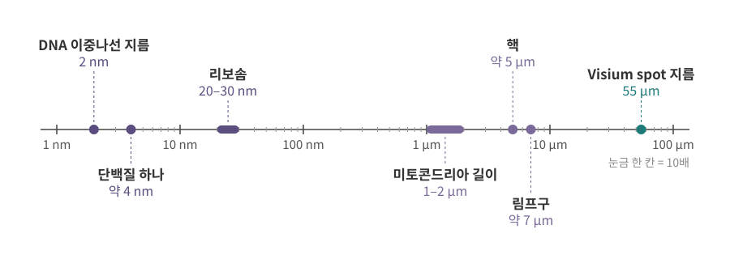
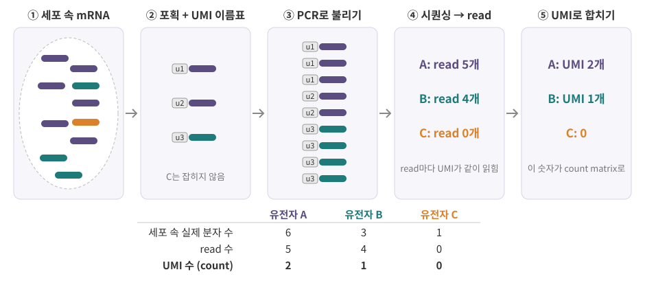
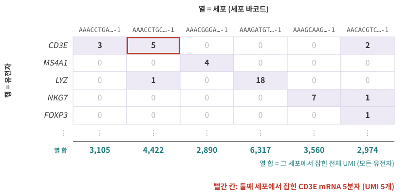

::: {.callout-note collapse="true"}
## 참고 자료
- Essential Cell Biology 1장 — 구조 참고
- Cell Biology by the Numbers (Milo & Phillips) — 크기와 개수를 어림하는 방식
- 본문의 숫자는 옆의 배지가 출처. 출처마다 범위가 다르므로 **자릿수**로 읽기
- 그림은 직접 그린 모식도
:::

# 1. 숫자 행렬 뒤에는 세포가 있다

## 1) 분석을 시작하면 받는 것

- single-cell RNA-seq(scRNA-seq) 분석의 출발점은 **행렬 하나**
  - 행 = 유전자, 열 = 세포
  - 칸 = 0 이상의 정수, 대부분 0
- CS·통계의 눈으로 보면 "희소한 정수 행렬" — 틀린 말은 아님
- 그런데 분석 중에 내리는 판단은 대부분 **행렬 밖의 지식**이 필요함

## 2) 생물학을 모르면 막히는 질문

| 데이터에서 만나는 질문 | 답이 있는 곳 |
|---|---|
| 미토콘드리아 유전자(`MT-`로 시작) 비율이 높은 세포는 왜 버리나? | [1장](01_cell_system.qmd) |
| 서열은 왜 5'→3'으로 쓰고, 반대 가닥은 어떻게 읽나? | [2장](02_biomolecules.qmd) |
| 같은 유전자의 좌표가 파일마다 1씩 다른 이유는? | [3장](03_genome_chromatin.qmd) |
| VCF의 `0/1`은 무엇인가? | [4장](04_replication_mutation_inheritance.qmd) |
| ATAC peak는 무엇을 뜻하나? | [5장](05_transcription.qmd) |
| read가 왜 유전자의 3' 끝에 몰려 있나? | [6장](06_rna_processing.qmd) |
| mRNA가 많으면 단백질도 많나? | [7장](07_translation_protein.qmd) |
| pathway 분석 결과는 어떻게 읽나? | [8장](08_cell_signaling.qmd) |
| 세포주기 효과는 빼야 하나? | [9장](09_cell_cycle_death_cancer.qmd) |
| 클러스터 하나 = cell type 하나인가? | [10장](10_cell_identity.qmd) |
| spatial 데이터의 spot 하나에는 세포가 몇 개인가? | [11장](11_tissue_interaction.qmd) |
| FASTQ 파일은 어떻게 만들어졌나? | [12장](12_data_generation.qmd) |

- 이 장은 그 전에 필요한 두 가지 감각을 잡음
  1. 세포와 분자는 **얼마나 작고 얼마나 많은가** (2–3절)
  2. 시퀀싱은 **무엇을 세는가** (4절, 장 끝 데이터 상자)

::: {.callout-tip collapse="true"}
## 이 책을 읽는 법: 데이터에서 거꾸로
- 교과서는 대개 분자 → 세포 → 조직 순서로 쌓아 올림
- 이 책은 반대로 **데이터 파일에서 출발**해, 그 숫자를 이해하는 데 필요한 생물학만 고름
- 장마다 "데이터에서는 이렇게 보여요" 상자 — 생물학 개념이 파일과 분석 단계에서 보이는 모습
:::

# 2. 세포는 얼마나 작은가

## 1) 크기의 사다리

{fig-alt="1 nm부터 100 µm까지 로그 눈금 위의 DNA 지름, 단백질, 리보솜, 미토콘드리아, 핵, 림프구, Visium spot"}

| 대상 | 크기 | 무엇인가 | 출처 |
|---|---|---|---|
| DNA 이중나선 | 지름 약 2 nm | 유전 정보를 담은 분자 → [2장](02_biomolecules.qmd) | [BioNumbers](https://bionumbers.hms.harvard.edu/bionumber.aspx?id=105243){.src} |
| 단백질 하나 | 지름 약 4 nm | 세포 안에서 일하는 분자 → [2장](02_biomolecules.qmd), [7장](07_translation_protein.qmd) | [BioNumbers](https://bionumbers.hms.harvard.edu/bionumber.aspx?id=101827){.src} |
| 리보솜 | 20–30 nm | mRNA를 읽어 단백질을 만드는 기계 → [7장](07_translation_protein.qmd) | [NIGMS](https://nigms.nih.gov/biobeat/2021/03/take-a-tour-of-your-cells-organelles){.src} |
| 미토콘드리아 | 길이 1–2 µm | 에너지를 만드는 소기관, 자기 DNA가 있음 → [1장](01_cell_system.qmd) | [NIGMS](https://nigms.nih.gov/biobeat/2021/03/take-a-tour-of-your-cells-organelles){.src} |
| 핵 | 지름 약 5 µm | 유전체 DNA가 들어 있는 방 → [1장](01_cell_system.qmd), [3장](03_genome_chromatin.qmd) | [NIGMS](https://nigms.nih.gov/biobeat/2021/03/take-a-tour-of-your-cells-organelles){.src} |
| 림프구 | 지름 약 7 µm | 혈액 속 면역세포, 작은 세포에 속함 → [10장](10_cell_identity.qmd) | [BioNumbers](https://bionumbers.hms.harvard.edu/bionumber.aspx?id=111788){.src} |
| Visium spot | 지름 55 µm, 중심 간격 100 µm | 공간 전사체 실험에서 mRNA를 잡는 원형 구역 → [11장](11_tissue_interaction.qmd) | [OSTA](https://bioconductor.org/books/release/OSTA/pages/seq-introduction.html){.src} |

- 단위: 1 µm = 1,000 nm
- 림프구 하나는 단백질 하나보다 **길이로 약 2,000배** 큼 (7 µm ÷ 4 nm)
- 부피로는 그 세제곱 → **수십억 배**

## 2) 부피로 보면

- 포유류 세포의 특징적인 부피: 약 3,000 µm³ [Cell Biology by the Numbers](https://book.bionumbers.org/how-many-mrnas-are-in-a-cell/){.src} → 지름 약 18 µm인 공
- 림프구(지름 7 µm)는 약 180 µm³ → 같은 "세포"라도 부피가 **17배쯤** 차이
- 세포 종류마다 크기가 다르면 담긴 mRNA 총량도 다를 수 있음
  - → 세포마다 잡힌 총 UMI가 다른 것이 **전부 기술적 차이는 아님** (장 끝 데이터 상자)

::: {.callout-warning collapse="true"}
## 처음엔 여기서 헷갈려요: 세포는 텅 빈 주머니가 아니다
- 교과서 그림의 세포는 소기관 몇 개가 물에 떠 있는 모습
- 실제로는 분자로 빽빽함: 단백질만 µm³당 200만–400만 개 [Milo 2013](https://pmc.ncbi.nlm.nih.gov/articles/PMC3910158/){.src}
- 세포 그림은 **무엇이 어디에 있는지** 보여 주는 지도일 뿐, 밀도는 그리지 못함
:::

# 3. 세포 하나에 분자는 몇 개인가

## 1) 대략의 숫자

| 무엇 | 세포 하나에 대략 | 출처 |
|---|---|---|
| 유전체 DNA | 약 31억 bp × 2벌 (부모에게서 한 벌씩) | [Ensembl](https://www.ensembl.org/Homo_sapiens/Info/Annotation){.src} |
| 유전자 | 단백질을 만드는 유전자 약 2만 개, 전체 약 7.9만 개 | [GENCODE](https://www.gencodegenes.org/human/stats.html){.src} |
| 한 세포가 발현하는 유전자 | 많아야 약 1만 개 | [BioNumbers](https://bionumbers.hms.harvard.edu/bionumber.aspx?id=111221){.src} |
| 전체 RNA | 10–30 pg (빠르게 자라는 배양 세포) | [Qiagen](https://www.qiagen.com/cm/knowledge-and-support/knowledge-hub/bench-guide/rna/introduction/rna-numbers-size-molecular-weight-distribution-yield-and-conversions){.src} |
| 그중 rRNA | 약 80% | [BioNumbers](https://bionumbers.hms.harvard.edu/bionumber.aspx?id=107234){.src} |
| 그중 mRNA | 1–5% | [Qiagen](https://www.qiagen.com/cm/knowledge-and-support/knowledge-hub/bench-guide/rna/introduction/rna-numbers-size-molecular-weight-distribution-yield-and-conversions){.src} |
| mRNA 분자 | 10⁵–10⁶ 개 (부피 3,000 µm³ 기준) | [Cell Biology by the Numbers](https://book.bionumbers.org/how-many-mrnas-are-in-a-cell/){.src} |
| 단백질 분자 | µm³당 200만–400만 개 → 세포 하나에 약 10¹⁰ 개 | [Milo 2013](https://pmc.ncbi.nlm.nih.gov/articles/PMC3910158/){.src} |

- bp (base pair, 염기쌍) = DNA 글자 한 쌍 → [2장](02_biomolecules.qmd)
- 실측 예: 사람 림프모구 세포주 GM12878은 세포 하나에 mRNA 평균 약 8만 개, 세포마다 5만 미만에서 30만 가까이 [BioNumbers](https://bionumbers.hms.harvard.edu/bionumber.aspx?id=111775){.src}
- RNA의 대부분은 rRNA(리보솜의 재료) → mRNA만 골라 잡는 방법이 필요한 이유 ([6장](06_rna_processing.qmd), [12장](12_data_generation.qmd))

## 2) 유전자 하나에는 몇 개?

- mRNA 10⁵–10⁶ 개를, 발현 중인 유전자 많아야 1만 개가 나눠 가짐
- 단순 평균: 유전자 하나당 **10–100개**
- 실제로는 고르지 않음: 소수 유전자가 많이 가져가는 치우친 분포 → **대부분의 유전자는 평균보다 적음**
- 단백질은 자릿수가 다름: mRNA 하나당 평균 수천 개 (단백질/mRNA 비 평균 약 2,800) [Schwanhäusser 2011, 2013 정정](https://doi.org/10.1038/nature10098){.src} → [7장](07_translation_protein.qmd)

::: {.callout-important}
## 세포 속 mRNA는 "작은 정수"의 세계
- 특정 유전자의 mRNA는 세포 하나에 **수 개에서 수십 개**인 경우가 흔함
- 그래서 세포 수준의 발현은 연속적인 양이 아니라 **세는 수(count)**로 다룸
- 작은 수를 세면 우연한 흔들림이 큼 → 포아송·음이항 분포가 등장하는 이유 ([1. Basic Statistics 3장](https://kkonoo.github.io/1_Basic_Statistics/chapters/03_distributions.html))
:::

# 4. 시퀀싱은 무엇을 세는가

## 1) 분자에서 숫자까지

{fig-alt="세포 속 mRNA가 포획, PCR 증폭, 시퀀싱, UMI 합치기를 거쳐 count가 되는 다섯 단계"}

| 단계 | 일어나는 일 | 자세히 |
|---|---|---|
| ① 세포 속 mRNA | 유전자마다 다른 수의 mRNA가 있음 | [5–7장](05_transcription.qmd) |
| ② 포획 + 이름표 | 일부 분자만 잡혀 DNA로 복사됨(cDNA). 이때 분자마다 **UMI**, 세포마다 **세포 바코드**를 붙임 | [12장](12_data_generation.qmd) |
| ③ PCR | 복사본을 불림. 분자마다 불어나는 정도가 다름 | [12장](12_data_generation.qmd) |
| ④ 시퀀싱 | 복사본을 읽어 **read**를 만듦 (FASTQ 파일) | [12장](12_data_generation.qmd) |
| ⑤ 정렬과 합치기 | read가 어느 유전자에서 왔는지 정하고, 같은 세포·같은 유전자·같은 UMI인 read를 **분자 하나**로 셈 | [3장](03_genome_chromatin.qmd) |

::: {.callout-important}
## UMI (unique molecular identifier)
- 포획 단계에서 분자 하나하나에 붙이는 **무작위 짧은 서열** = 분자 이름표
- PCR 복사본은 원본과 같은 UMI를 가짐 → 같은 UMI의 read를 하나로 합치면 **복사 전 분자 수**를 셀 수 있음
- scRNA-seq count matrix의 한 칸 = 그 세포에서 그 유전자의 **서로 다른 UMI 개수**
:::

## 2) 다 잡히지 않는다

- 세포 속 mRNA: 10⁵–10⁶ 개 [Cell Biology by the Numbers](https://book.bionumbers.org/how-many-mrnas-are-in-a-cell/){.src}
- scRNA-seq에서 세포 하나당 잡히는 UMI는 데이터셋마다 다름
  - 예: 한 비교 연구의 10x 3' v3 데이터에서 세포당 중앙값 28,006개 [BMC Genomics 2020](https://bmcgenomics.biomedcentral.com/articles/10.1186/s12864-020-07358-4){.src}
- 나눠 보면 이 예에서도 세포 속 mRNA의 **약 3–28%만** 잡힘 — 정확한 비율은 방법과 세포마다 다름

::: {.callout-tip collapse="true"}
## 비유: 여론조사
- 세포 속 mRNA 전체 = 모집단, 잡힌 UMI = 표본
- 표본에 한 명도 안 잡힌 정당이 있어도, 그 정당 지지자가 없다는 뜻은 아님
- count matrix의 0도 마찬가지 → 장 끝 데이터 상자의 시뮬레이션
:::

::: {.callout-warning collapse="true"}
## 처음엔 여기서 헷갈려요
| 헷갈리는 짝 | 차이 |
|---|---|
| read 수 vs UMI 수 | read는 PCR 복사본까지 셈, UMI는 복사 전 분자를 셈 → scRNA-seq count matrix에는 UMI |
| 0 vs 발현 안 함 | 0 = **잡히지 않음**. 세포 속에 몇 개 있어도 0이 나올 수 있음 |
| 세포 수 vs 표본 수 | 같은 사람에게서 나온 세포 1만 개는 독립 표본 1만 개가 아님 ([1. Basic Statistics 0장](https://kkonoo.github.io/1_Basic_Statistics/chapters/00_why_statistics.html)) |
:::

## 3) 같은 모양, 다른 단위

- 시퀀싱 데이터는 대부분 "무엇 × 무엇" 행렬로 정리됨
- 그런데 칸이 세는 것은 데이터마다 다름

| 데이터 | 행 | 열 | 한 칸 | 자세히 |
|---|---|---|---|---|
| bulk RNA-seq | 유전자 | 시료 (많은 세포의 혼합) | 그 유전자에 배정된 read(또는 fragment) 수 | [6장](06_rna_processing.qmd), [12장](12_data_generation.qmd) |
| scRNA-seq | 유전자 | 세포 | UMI 수 | 이 장 |
| spatial (Visium) | 유전자 | spot (세포 여러 개, 조직마다 다름) | UMI 수 | [11장](11_tissue_interaction.qmd) |
| scATAC-seq | peak (열린 염색질 구간) | 세포 | 그 구간에 떨어진 fragment 수 | [5장](05_transcription.qmd) |
| variant (VCF) | 변이 위치 | 사람 | count가 아니라 genotype (`0/0`, `0/1`, `1/1`) | [4장](04_replication_mutation_inheritance.qmd) |

- 새 데이터를 받으면 **"이 칸은 무엇을 센 숫자인가"**부터 확인

::: {.callout-caution .data-box icon=false}
## 데이터에서는 이렇게 보여요: count matrix 한 칸 = 한 세포에서 잡힌 한 유전자의 UMI 수

{fig-alt="유전자 5개와 세포 6개의 count matrix. 대부분의 칸이 0이고, 둘째 세포의 CD3E 칸 5가 강조됨"}

**파일로는**

- 10x Genomics의 처리 프로그램 Cell Ranger가 만드는 `filtered_feature_bc_matrix/` 폴더 [10x Genomics](https://www.10xgenomics.com/support/software/cell-ranger/latest/analysis/outputs/cr-outputs-mex-matrices){.src}

| 파일 | 내용 | 행렬에서 |
|---|---|---|
| `features.tsv.gz` | 유전자 ID(Ensembl), 유전자 이름, feature 종류 | 행 이름 |
| `barcodes.tsv.gz` | 세포 바코드 | 열 이름 |
| `matrix.mtx.gz` | 0이 아닌 칸만 (행 번호, 열 번호, 값) | 값 |

- 대부분이 0이라 0이 아닌 칸만 저장 (희소 행렬)
- 열 합 = 그 세포의 **총 UMI** (Seurat `nCount_RNA`, scanpy `total_counts`)
- 열에서 0이 아닌 칸 수 = 그 세포에서 **검출된 유전자 수** (Seurat `nFeature_RNA`, scanpy `n_genes_by_counts`)

**0은 "없음"이 아니다 — 작은 시뮬레이션**

- 가상의 세포 하나: 유전자 A·B·C·D의 mRNA가 1500, 40, 10, 3개
- 분자마다 5% 확률로 잡힌다고 가정 (실제 비율은 방법마다 다름)

```{r}
#| label: capture-once
set.seed(2026)
in_cell <- c(A = 1500, B = 40, C = 10, D = 3)    # 세포 속 mRNA 수 (가상)
umi <- rbinom(4, size = in_cell, prob = 0.05)   # 분자마다 5% 확률로 포획
names(umi) <- names(in_cell)
umi
```

- 같은 세포를 다섯 번 잴 수 있다면 (실제로는 불가능 — 세포는 한 번 터뜨리면 끝)

```{r}
#| label: capture-five
five <- replicate(5, rbinom(4, size = in_cell, prob = 0.05))
rownames(five) <- names(in_cell)
five
```

- A는 69–88 → 많이 발현된 유전자는 count가 안정적
- C는 다섯 번 중 네 번 0, D는 세포 속에 3개 있어도 다섯 번 모두 0 (0이 나올 확률 0.95³ ≈ 0.86)
- 그래서 낮게 발현되는 유전자는 세포 하나가 아니라 **세포 여러 개를 모아서** 봄 (클러스터 평균, pseudobulk)
:::

# 5. 정리

- 림프구 하나는 단백질 하나보다 길이로 약 2,000배 크고, 그 안은 분자로 빽빽함
- 포유류 세포 하나에 mRNA는 10⁵–10⁶ 개 — 유전자 하나로 보면 수 개에서 수십 개가 흔함
- 시퀀싱은 세포 속 분자를 **일부만** 잡아서 셈. read는 PCR 복사본까지, UMI는 복사 전 분자를 셈
- count matrix 한 칸 = 한 세포에서 잡힌 한 유전자의 UMI 수. 0은 "잡히지 않음"
- 데이터마다 행렬 칸이 세는 것이 다름 → 먼저 무엇을 센 숫자인지 확인

# 연습문제

1. 세포 하나에 mRNA가 20만 개 있고, scRNA-seq에서 그 세포의 UMI가 4,000개 잡혔다. 분자마다 독립적으로 같은 확률로 잡힌다고 가정하자. (a) 몇 %가 잡혔나? (b) 이 세포에 mRNA가 50개 있는 유전자는 평균 몇 개의 UMI로 잡힐까? (c) 5개 있는 유전자가 0으로 나올 확률은?
2. 어떤 세포에서 유전자 X의 read는 120개, 서로 다른 UMI는 15개였다. count matrix에는 어느 숫자가 들어가나? read가 UMI보다 많은 이유는?
3. Visium spot(지름 55 µm)과 림프구(지름 7 µm)를 원으로 보고 면적만 비교하면, spot 하나를 림프구 몇 개가 덮을 수 있나? 이것이 spot의 count를 "세포 하나의 발현"으로 읽으면 안 되는 이유와 어떻게 이어지나?
4. 동료가 "이 세포에서 *FOXP3*가 0이니 이 세포는 *FOXP3*를 발현하지 않는다"고 말했다. 장 끝 데이터 상자의 시뮬레이션을 근거로 한두 문장으로 반박하라. 판단하려면 무엇을 더 보면 좋을까?
