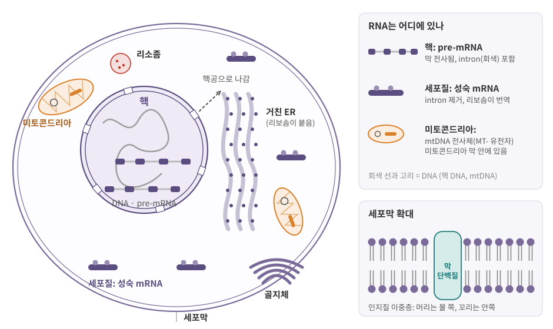
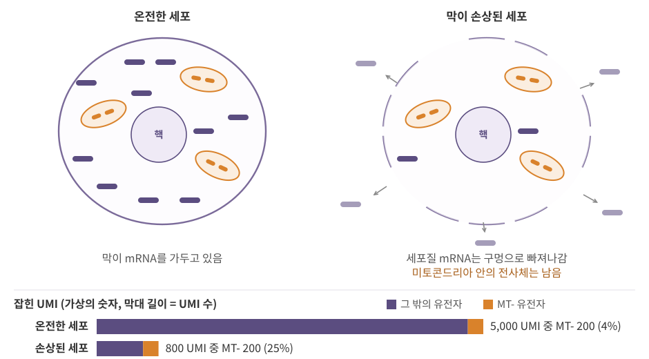
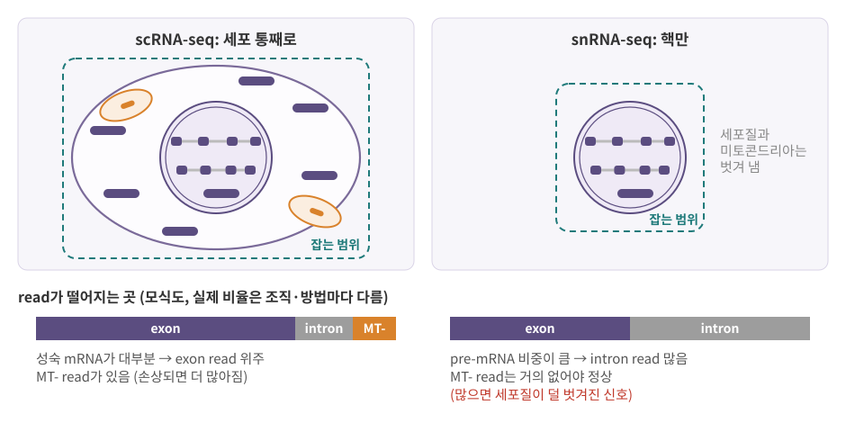

::: {.callout-note collapse="true"}
## 참고 자료
- Essential Cell Biology 1, 11, 15장 — 구조 참고
- OpenStax Biology 2e 4장 Cell Structure, 5장 Structure and Function of Plasma Membranes — 구조 참고
- 본문의 숫자는 옆의 배지가 출처
- 그림은 직접 그린 모식도
:::

# 1. 세포는 막으로 나뉜 방들

## 1) 원핵세포와 진핵세포

- 모든 세포는 **막으로 둘러싸인 주머니** — 안에 DNA, RNA, 단백질이 있음
- 안을 다시 막으로 나눴는지에 따라 두 종류

| | 원핵세포 (prokaryote) | 진핵세포 (eukaryote) |
|---|---|---|
| 예 | 세균, 고세균 | 동물·식물·균류 세포 — 사람, 마우스 |
| 핵 | 없음 — DNA가 세포질에 그대로 | 있음 — DNA가 핵막 안에 |
| 막으로 싸인 소기관 | 없음 | 미토콘드리아, ER, 골지체, 리소좀 등 |
| 크기 | 대개 수 µm 이하 | 림프구 지름 약 7 µm [BioNumbers](https://bionumbers.hms.harvard.edu/bionumber.aspx?id=111788){.src}, 포유류 세포 부피 약 3,000 µm³ [Cell Biology by the Numbers](https://book.bionumbers.org/how-many-mrnas-are-in-a-cell/){.src} |
| 전사와 번역 | 같은 공간에서 | 전사는 핵, 번역은 세포질 → 사이에 RNA 가공 ([6장](06_rna_processing.qmd)) |

- 이 책의 데이터는 대부분 사람·마우스의 진핵세포
- 마지막 줄이 핵심: 진핵세포에서는 **RNA가 만들어지는 곳과 쓰이는 곳이 다름** → 4절

## 2) 구획이 왜 중요한가

- 구획 (compartment) = 막으로 둘러싸인 공간
- 구획마다 다른 분자, 다른 화학 환경을 유지함 (예: 리소좀 안은 산성)
- 막은 큰 분자를 가둠 → 막이 **온전한지**, 어느 구획을 **골라 잡았는지**가 시퀀싱 결과를 바꿈 (5절)

::: {.callout-tip}
## 비유: 세포 = 공장
- 핵 = 설계도 보관실. 원본(DNA)은 밖으로 나가지 않고 **복사본(mRNA)만** 나감
- 리보솜 = 조립 라인, ER과 골지체 = 포장·배송 부서
- 미토콘드리아 = 발전소. 자기 설계도(mtDNA)를 **따로 조금** 가지고 있음
- 세포막 = 출입을 통제하는 벽
:::

# 2. 소기관 투어

{fig-alt="세포막 안에 핵, 핵공, 거친 ER, 골지체, 미토콘드리아, 리소좀이 있고 핵에는 intron을 포함한 pre-mRNA, 세포질에는 성숙 mRNA, 미토콘드리아에는 mtDNA 전사체가 표시된 모식도"}

| 소기관 | 하는 일 | 데이터와의 연결 |
|---|---|---|
| 핵 (nucleus) | 유전체 DNA 보관, 전사, RNA 가공 | snRNA-seq, ATAC-seq → [3장](03_genome_chromatin.qmd), [5장](05_transcription.qmd) |
| 미토콘드리아 (mitochondrion) | ATP(세포의 에너지 화폐) 생산, 자체 DNA | `MT-` 유전자, QC 지표 → 5절 |
| 리보솜 (ribosome) | mRNA를 읽어 단백질 합성. 막이 없는 분자 기계 | [7장](07_translation_protein.qmd) |
| 소포체 (endoplasmic reticulum, ER) | 거친 ER: 막·분비 단백질 합성 / 매끈한 ER: 지질 합성 | 표면 단백질, 분비 단백질 → [7장](07_translation_protein.qmd) |
| 골지체 (Golgi apparatus) | 단백질에 당사슬 등을 붙이고 목적지별로 분류 | [7장](07_translation_protein.qmd) |
| 리소좀 (lysosome) | 산성 + 분해 효소로 낡은 것·삼킨 것 분해 | — |
| 세포골격 (cytoskeleton) | 모양 유지, 이동, 세포분열 때 염색체 분리 | [9장](09_cell_cycle_death_cancer.qmd) |

## 1) 핵: 유전체의 방

- 지름 약 5 µm [NIGMS](https://nigms.nih.gov/biobeat/2021/03/take-a-tour-of-your-cells-organelles){.src}
- 핵막 (nuclear envelope): 막이 **두 겹**. 바깥 막은 ER과 이어짐
- 핵공 (nuclear pore): 핵막을 관통하는 통로
  - 나가는 것: 가공이 끝난 mRNA
  - 들어오는 것: 전사인자 같은 단백질 (단백질은 세포질의 리보솜에서 만들어지므로)
- 핵 안에서 일어나는 일: DNA가 단백질에 감겨 염색질로 ([3장](03_genome_chromatin.qmd)), 전사 ([5장](05_transcription.qmd)), intron 제거 ([6장](06_rna_processing.qmd))

## 2) 미토콘드리아: 자기 DNA를 가진 발전소

- 길이 1–2 µm [NIGMS](https://nigms.nih.gov/biobeat/2021/03/take-a-tour-of-your-cells-organelles){.src}, 세포 하나에 여러 개
- 막 두 겹, 안쪽 막이 주름져 있음 — 여기서 ATP를 만듦
- 자체 DNA = 미토콘드리아 DNA (mtDNA)

| | 핵 유전체 | 미토콘드리아 유전체 (사람) |
|---|---|---|
| 크기 | 약 31억 bp [Ensembl](https://www.ensembl.org/Homo_sapiens/Info/Annotation){.src} | 16,569 bp, 원형 [BioNumbers](https://bionumbers.hms.harvard.edu/bionumber.aspx?id=105470){.src} |
| 유전자 | 단백질 암호화 약 2만 개 ([0장](00_why_biology.qmd)) | 37개 = 단백질 13 + tRNA 22 + rRNA 2 [Anderson 1981](https://pubmed.ncbi.nlm.nih.gov/7219534/){.src} |
| 유전자 이름 (사람) | *ACTB*, *CD3E* 등 | `MT-`로 시작: *MT-CO1*, *MT-ND1*, *MT-ATP6* 등 |
| 전사되는 곳 | 핵 | 미토콘드리아 안 → RNA도 미토콘드리아 막 안에 있음 |

- mtDNA의 단백질 13개는 모두 ATP를 만드는 장치(호흡 사슬 복합체와 ATP 합성효소)의 부품
- 미토콘드리아에서 일하는 단백질은 그보다 훨씬 많음: 약 1,500개 유전자 [Ilicic 2016](https://doi.org/10.1186/s13059-016-0888-1){.src} → 대부분 **핵 유전체**에 있음
- 미토콘드리아는 어머니에게서만 물려받음 → [4장](04_replication_mutation_inheritance.qmd)

## 3) ER과 골지체: 막·분비 단백질의 길

- 거친 ER (rough ER): 표면에 리보솜이 붙어 있음
  - 막 단백질, 분비 단백질은 만들어지면서 ER 막 안으로 들어감
- 매끈한 ER (smooth ER): 리보솜 없음, 지질 합성 등
- 골지체: ER에서 온 단백질에 당사슬 등을 붙이고 (수식, modification) 목적지별로 분류
- 경로: **거친 ER → 골지체 → 세포막 또는 세포 밖** ([7장](07_translation_protein.qmd))
- 예: 항체를 대량으로 분비하는 형질세포 (plasma cell)는 거친 ER이 넓게 발달
- 데이터 연결: CITE-seq·유세포 분석(flow cytometry)이 재는 표면 단백질(CD4, CD8 등)이 모두 이 경로로 세포막에 도착 ([7장](07_translation_protein.qmd), [12장](12_data_generation.qmd))

## 4) 리소좀과 세포골격 (짧게)

- 리소좀: 안이 산성이고 분해 효소가 있음 → 낡은 소기관, 세포가 삼킨 것을 분해
- 세포골격: 액틴 섬유, 미세소관, 중간섬유의 세 가지 섬유. 세포 모양, 이동, 염색체 분리 ([9장](09_cell_cycle_death_cancer.qmd))

::: {.callout-warning}
## 처음엔 여기서 헷갈려요
| 헷갈리는 짝 | 차이 |
|---|---|
| 미토콘드리아 단백질 vs `MT-` 유전자 | `MT-`는 **mtDNA에 있는 유전자**만 가리킴 (단백질은 13개). 미토콘드리아에서 일하는 단백질 대부분은 핵 유전자라 `MT-`가 붙지 않음 |
| 리보솜 vs 리소좀 | 리보솜 = 단백질 합성, 막 없음 / 리소좀 = 분해, 막으로 싸인 소기관 |
| 핵 vs 핵막 vs 염색질 | 핵 = 방, 핵막 = 방의 벽(두 겹), 염색질 = 방 안의 DNA + 단백질 |
| 세포막 vs 핵막 | 세포막 = 한 겹(인지질 이중층 하나), 핵막 = 이중층이 두 겹 |
:::

# 3. 세포막: 안과 밖의 경계

## 1) 인지질 이중층

- 인지질 (phospholipid): 물을 좋아하는 **머리** + 물을 싫어하는 **꼬리 두 개** ([2장](02_biomolecules.qmd))
- 물속에서 꼬리끼리 마주 보며 저절로 두 겹을 이룸 = 인지질 이중층 (lipid bilayer)
- 막 가운데는 기름 같은 층 → 물에 녹는 큰 분자, 전하를 띤 분자는 그냥 지나가지 못함
- 핵막, 미토콘드리아 막, ER·골지체 막도 모두 같은 원리의 막

## 2) 선택적 투과와 막단백질

| 무엇 | 그냥 지나가나 | 어떻게 |
|---|---|---|
| O₂, CO₂ 같은 작은 비극성 분자 | 지나감 | 확산 |
| 이온 (Na⁺, K⁺ 등) | 못 지나감 | 통로·펌프 단백질 |
| 포도당, 아미노산 | 못 지나감 | 운반 단백질 |
| mRNA, 단백질 같은 큰 분자 | 못 지나감 | 막이 온전하면 **안에 갇혀 있음** |

- 막단백질 (membrane protein): 이중층에 박혀 있는 단백질
  - 수송: 이온·영양분 통과
  - 신호 수용: 바깥 신호를 받아 안으로 전달 ([8장](08_cell_signaling.qmd))
  - 표지: 세포 종류를 구분하는 표면 단백질 (CD 분자 등, [10장](10_cell_identity.qmd))
- 세포 생존율 검사에 쓰는 염색약(예: trypan blue)은 막이 손상된 세포에만 들어감 → 실험 전에 죽은 세포 비율을 확인 ([12장](12_data_generation.qmd))

::: {.callout-important}
## 막이 온전하다 = 분자가 갇혀 있다
- 온전한 세포막은 mRNA 같은 큰 분자를 세포 안에 가둠
- 막에 구멍이 나면 세포질의 mRNA가 빠져나감
- 미토콘드리아 안의 RNA는 미토콘드리아 막에 한 번 더 싸여 있음 → 5절 데이터 상자의 원리
:::

# 4. 구획과 RNA의 위치

## 1) RNA는 세포 안 어디에 있나

| 구획 | 있는 RNA | 상태 |
|---|---|---|
| 핵 | pre-mRNA (막 전사된 RNA, **intron 포함**), 핵에 머무는 일부 RNA | 만들어지는 중·가공 중 |
| 세포질 | 성숙 mRNA (intron 제거), rRNA(리보솜의 재료), tRNA | 번역에 쓰이는 중 |
| 미토콘드리아 | mtDNA에서 전사된 RNA (`MT-` 유전자) | 미토콘드리아 막 안에 |

- 흐름: 핵에서 전사 ([5장](05_transcription.qmd)) → intron 제거 등 가공 ([6장](06_rna_processing.qmd)) → 핵공으로 세포질 → 번역 ([7장](07_translation_protein.qmd))
- intron (인트론) = 유전자 안에 있지만 성숙 mRNA에서는 잘려 나가는 구간 ([6장](06_rna_processing.qmd))
- 핵 안에 있는 mRNA는 세포 전체 mRNA의 일부: 대뇌 신경세포에서 종류에 따라 약 20%에서 50% 이상 [Bakken 2018](https://journals.plos.org/plosone/article?id=10.1371%2Fjournal.pone.0209648){.src}

## 2) 무엇을 잡느냐에 따라 보이는 것이 다름

| 실험 | 잡는 것 | read가 주로 떨어지는 곳 |
|---|---|---|
| scRNA-seq (single-cell) | 세포 통째 → 세포질 mRNA가 대부분 | exon |
| snRNA-seq (single-nucleus) | 핵만 → pre-mRNA 비중이 큼 | exon + **intron** |

- read를 레퍼런스에 정렬하면 exon에 떨어졌는지 intron에 떨어졌는지 알 수 있음 ([3장](03_genome_chromatin.qmd))
- 같은 조직이라도 무엇을 잡았는지에 따라 count matrix의 성격이 달라짐 → 5절 데이터 상자 2

# 5. 데이터에서는 이렇게 보여요

::: {.callout-caution .data-box icon=false}
## 데이터에서는 이렇게 보여요: mitochondrial read 비율은 막이 온전했는지 보는 간접 지표

{fig-alt="온전한 세포와 막에 구멍이 난 세포. 손상된 세포에서 세포질 mRNA는 빠져나가고 미토콘드리아는 남음. 아래 막대에서 MT- 비율이 4%에서 25%로 오름"}

**왜 올라가나**

- 막이 손상되면 세포질 RNA는 빠져나가지만 미토콘드리아에 싸인 RNA는 남음 [Ilicic 2016](https://doi.org/10.1186/s13059-016-0888-1){.src}
- 구멍은 mRNA 분자가 빠져나갈 만큼은 크지만 미토콘드리아가 빠져나갈 만큼은 크지 않음 → mtDNA 전사체가 **상대적으로** 많아짐 [OSCA](https://bioconductor.org/books/3.13/OSCA.basic/quality-control.html){.src}
- 그래서 저품질 세포는 흔히 **MT- 비율 높음 + 총 UMI·검출 유전자 수 낮음**이 함께 나타남

**계산**

| | Seurat [튜토리얼](https://satijalab.org/seurat/pbmc3k_tutorial.html){.src} | scanpy [API 문서](https://scanpy.readthedocs.io/en/stable/api/scanpy.pp.calculate_qc_metrics.html){.src} |
|---|---|---|
| 함수 | `PercentageFeatureSet()` | `sc.pp.calculate_qc_metrics()` |
| 미토콘드리아 유전자 지정 | `pattern = "^MT-"` | `qc_vars=["mt"]` — 미리 `MT-`로 시작하는 유전자를 `var["mt"]`에 표시 |
| 결과 컬럼 | `percent.mt` (메타데이터) | `pct_counts_mt` (`adata.obs`) |

- 둘 다 0–100 사이의 **퍼센트**
- 사람은 대문자 `MT-`, 마우스는 소문자 `mt-` (예: *mt-Co1*) → [부록 B](A2_nomenclature.qmd)
- 패턴은 대소문자를 구분 → 마우스 데이터에 `"^MT-"`를 쓰면 모든 세포가 0%. 먼저 행 이름을 확인

계산 자체는 단순한 비율: 가상의 두 세포 (그림의 숫자)

```{r}
#| label: pct-mt
counts <- matrix(c(120, 80, 300, 250, 4250,     # cell_A: 온전한 세포
                   115, 85,  40,  35,  525),    # cell_B: 손상된 세포
                 ncol = 2,
                 dimnames = list(c("MT-CO1", "MT-ATP6", "ACTB", "B2M", "others"),
                                 c("cell_A", "cell_B")))
is_mt <- grepl("^MT-", rownames(counts))       # 이름이 MT-로 시작하는 행
total <- colSums(counts)
mt    <- colSums(counts[is_mt, ])
rbind(total, mt, pct_mt = mt / total * 100)
```

- MT- UMI는 두 세포 모두 200 — **분자가 늘어난 것이 아니라 분모(총 UMI)가 5,000에서 800으로 줄어서** 비율이 4% → 25%

**기준값은 하나가 아님**

- Seurat PBMC 튜토리얼: `percent.mt < 5`인 세포만 남김 [Seurat](https://satijalab.org/seurat/pbmc3k_tutorial.html){.src}
- 5%는 초기 연구에서 굳어진 기본값. 사람 조직은 마우스보다 MT- 비율이 높고, 사람 44개 조직 중 13개에서는 5%가 건강한 세포와 저품질 세포를 잘 가르지 못함 [Osorio & Cai 2021](https://pmc.ncbi.nlm.nih.gov/articles/PMC8599307){.src}
- 에너지를 많이 쓰는 세포는 원래 높음: 한 분석에서 심근세포 클러스터의 MT- 비율 중앙값 약 15%, 고정 10% 기준은 사람 신장·고환의 실질세포 일부를 버리게 함 [ddqc 2022](https://genomebiology.biomedcentral.com/articles/10.1186/s13059-022-02820-w){.src}
- 판단 순서
  1. 숫자 하나를 외워 쓰기 전에 **분포**를 봄 (violin plot, 총 UMI와의 산점도)
  2. MT- 비율이 높은 세포가 총 UMI·유전자 수도 낮은지 확인
  3. 높은 세포들이 한 클러스터로 모이고 뚜렷한 marker가 있으면 **생물학**일 수 있음 → 버리기 전에 확인 ([10장](10_cell_identity.qmd))
:::

::: {.callout-caution .data-box icon=false}
## 데이터에서는 이렇게 보여요: scRNA-seq은 세포 전체, snRNA-seq은 핵만 잡는다

{fig-alt="왼쪽은 세포 전체를 잡는 scRNA-seq, 오른쪽은 핵만 잡는 snRNA-seq. snRNA-seq에서는 intron read 비중이 크고 MT- read가 거의 없음"}

| | scRNA-seq | snRNA-seq |
|---|---|---|
| 잡는 것 | 세포 통째 (세포질 + 핵) | 핵만 — 세포질과 미토콘드리아는 벗겨 냄 |
| 시료 | 살아 있는 세포를 낱개로 떼어 내야 함 | 냉동 조직도 가능 [Slyper 2020](https://doi.org/10.1038/s41591-020-0844-1){.src}, 사후 뇌 조직의 신경세포 핵 [Lake 2016](https://pmc.ncbi.nlm.nih.gov/articles/PMC5038589){.src} |
| MT- read | 있음, 높으면 손상 의심 (데이터 상자 1) | **거의 없어야 정상** — 많으면 세포질이 덜 벗겨진 신호 [OSCA](https://bioconductor.org/books/3.20/OSCA.advanced/single-nuclei-rna-seq-processing.html){.src} |
| intron read | 적음 | 많음 (pre-mRNA). 한 비교 연구에서 핵과 비슷한 프로파일은 read의 절반 가까이가 intron [Bakken 2018](https://journals.plos.org/plosone/article?id=10.1371%2Fjournal.pone.0209648){.src} |
| 검출 유전자 수 | 많음 | exon read만 세면 적음, intron read까지 세면 차이가 줄어듦 [Bakken 2018](https://journals.plos.org/plosone/article?id=10.1371%2Fjournal.pone.0209648){.src} |
| 해리 영향 | 37 °C 효소 해리는 스트레스 반응 유전자를 켤 수 있음 [Denisenko 2020](https://pmc.ncbi.nlm.nih.gov/articles/PMC7265231){.src} | 37 °C 효소 해리를 거치지 않으므로 이 영향이 적은 편 |

: {tbl-colwidths="[16,40,44]"}

- 세포 구성도 다를 수 있음
  - 같은 종양에서 나눈 시료에서 두 방법은 같은 세포 종류를 찾았지만 **비율은 달랐음** [Slyper 2020](https://doi.org/10.1038/s41591-020-0844-1){.src}
  - 마우스 신장 비교에서는 핵 데이터에 T·B·NK 림프구가 덜 잡힘 [Denisenko 2020](https://pmc.ncbi.nlm.nih.gov/articles/PMC7265231){.src}

**Cell Ranger 설정**

- `--include-introns`: intron에 떨어진 read도 UMI로 셀지 정함
- Cell Ranger 7.0부터 기본값이 `true`. 5.0–6.1에서는 직접 켜야 했음 [10x Genomics](https://www.10xgenomics.com/support/software/cell-ranger/latest/miscellaneous/cr-intron-mode-rec){.src}
- 그래서 같은 FASTQ라도 **Cell Ranger 버전에 따라 count가 다를 수 있음** → 공개 데이터를 받으면 처리 버전부터 확인

**분석에서의 판단**

- snRNA-seq에 scRNA-seq의 MT- 기준(예: 5% 미만)을 그대로 쓰면 의미가 다름: 여기서 MT- read는 손상이 아니라 **오염**의 신호
- snRNA-seq 데이터와 scRNA-seq 데이터를 합칠 때: 세포 종류 비율과 intron 비중 차이를 기술적 차이로 먼저 의심
:::

# 6. 정리

- 진핵세포는 막으로 나뉜 구획의 시스템: 핵(전사), 세포질(번역), 미토콘드리아(에너지, 자체 DNA)
- 사람 mtDNA는 16,569 bp에 유전자 37개(단백질 13개) — `MT-` 유전자는 이 37개 중 일부일 뿐, 미토콘드리아 단백질 전체가 아님
- 막·분비 단백질은 거친 ER → 골지체를 거쳐 세포막이나 세포 밖으로 감
- 핵에는 intron이 남은 pre-mRNA, 세포질에는 성숙 mRNA, 미토콘드리아 안에는 mtDNA 전사체가 있음
- 막이 손상되면 세포질 mRNA가 빠져나가 MT- 비율이 오름 → QC 지표. 기준값은 조직과 종마다 다름
- snRNA-seq은 핵만 잡으므로 intron read가 많고 MT- read는 거의 없어야 정상

# 연습문제

1. 어떤 세포의 총 UMI가 3,200이고 `MT-` 유전자의 UMI 합이 416이다. (a) `percent.mt`는? (b) Seurat 튜토리얼 기준(5% 미만)이라면 남기나? (c) 이 세포가 사람 심장 조직의 심근세포 클러스터에 속한다면 판단이 어떻게 달라질 수 있나?
2. 동료가 마우스 scRNA-seq 데이터에서 `PercentageFeatureSet(obj, pattern = "^MT-")`를 돌렸더니 모든 세포가 0%였고, "미토콘드리아 오염이 전혀 없는 깨끗한 데이터"라고 했다. 무엇이 잘못됐을 가능성이 큰가?
3. *MT-ND1*과 *NDUFA1*은 둘 다 미토콘드리아 호흡 사슬 복합체 I의 단백질을 만드는 유전자다. 둘 중 어느 것이 `pct_counts_mt` 계산에 들어가나? 막이 손상된 세포에서 두 유전자의 UMI는 각각 어떻게 될 것으로 예상하나?
4. snRNA-seq 데이터에서 MT- 비율이 8%인 핵들이 한 클러스터로 모였다. scRNA-seq이라면 "에너지를 많이 쓰는 세포"일 수도 있지만, snRNA-seq에서는 먼저 무엇을 의심해야 하나? 그 이유를 구획으로 설명하라.
