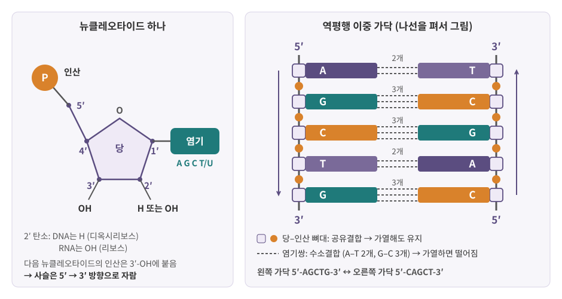
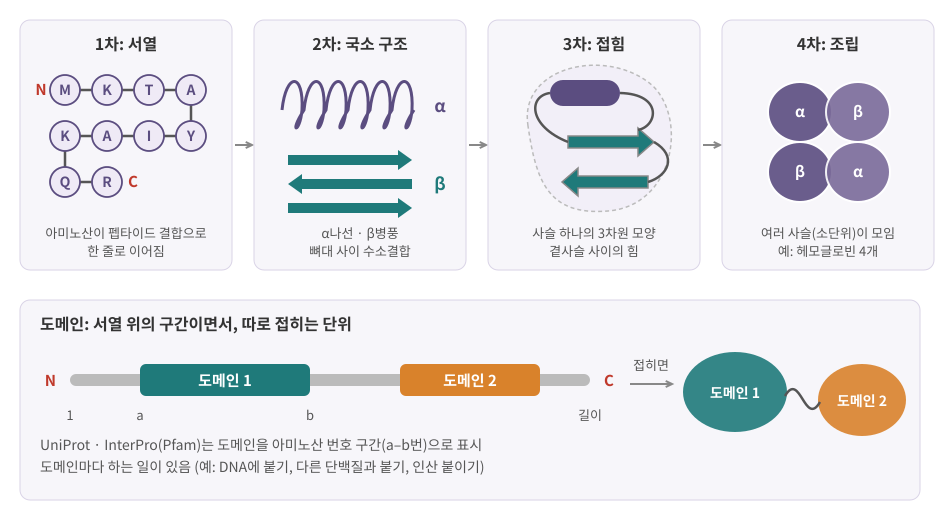
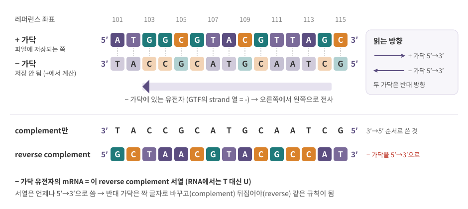

::: {.callout-note collapse="true"}
## 참고 자료
- Essential Cell Biology 2, 4장 — 구조 참고
- OpenStax Biology 2e 2장 The Chemical Foundation of Life, 3장 Biological Macromolecules — 구조 참고
- 본문의 숫자는 옆의 배지가 출처
- 그림은 직접 그린 모식도
:::

# 1. 화학은 이만큼만

## 1) 결합 두 가지

- 생체분자는 주로 탄소(C), 수소(H), 산소(O), 질소(N), 인(P), 황(S)으로 이루어짐
- 원자를 잇는 힘 중 이 책에 필요한 것은 두 가지

| | 공유결합 (covalent bond) | 수소결합 (hydrogen bond) |
|---|---|---|
| 무엇 | 원자끼리 전자를 **공유** | H가 O·N 같은 원자 사이에 다리를 놓는 **약한 끌림** |
| 세기 | 강함 | 하나는 훨씬 약함. 대신 **많이 모이면** 단단함 |
| 생기고 끊어짐 | 효소 같은 도움 없이는 잘 안 끊어짐 | 체온에서도 끊어졌다 다시 생김 |
| 예 | DNA 한 가닥의 뼈대, 단백질의 아미노산 사슬 | DNA 두 가닥 사이 염기쌍, 단백질의 접힌 모양 |

- 왜 중요한가: **DNA 두 가닥은 열로 떨어지는데, 한 가닥은 끊어지지 않음**
  - 가닥 사이 = 수소결합 → 가열하면 떨어짐 (변성, denaturation), 식히면 다시 짝을 찾음 (재결합, annealing)
  - 가닥 안 = 공유결합 → 같은 온도에서 그대로 → 서열 정보가 보존됨
- 이 원리를 쓰는 실험: PCR(가열로 떼고 식혀서 짝짓기), 프로브 hybridization ([12장](12_data_generation.qmd))

## 2) 물: 친수성과 소수성

- 세포 무게의 대부분은 물
- 물 분자는 한쪽이 약간 음전하, 반대쪽이 약간 양전하 = **극성** (polar)
- 친수성 (hydrophilic): 극성·전하를 띤 분자 → 물과 잘 어울림 (당, 이온, DNA의 인산)
- 소수성 (hydrophobic): 기름 같은 비극성 분자 → 물을 피해 **서로 모임** (소수성 효과)
- 소수성 효과가 만드는 것
  - 세포막: 인지질의 꼬리가 물을 피해 안쪽으로 모임 (5절, [1장](01_cell_system.qmd))
  - 단백질 접힘: 소수성 곁사슬이 단백질 안쪽으로 숨음 (4절)

::: {.callout-tip collapse="true"}
## 비유: 벨크로와 용접
- 공유결합 = 용접. 한 번 붙으면 웬만해서는 안 떨어짐 → 서열(정보)을 담는 사슬
- 수소결합 = 벨크로의 고리 하나. 하나는 쉽게 떨어지지만 수천 개가 붙으면 단단함 → 두 가닥의 짝, 단백질의 모양
- 그래서 **모양은 바뀌어도(변성) 서열은 그대로** — DNA에도 단백질에도 같은 이야기
:::

# 2. 단량체에서 고분자로

- 고분자 (polymer) = 작은 단위(단량체, monomer)를 공유결합으로 길게 이은 분자
- 이을 때마다 물 한 분자가 빠짐

| 단량체 | 고분자 | 잇는 결합 | 하는 일 | 자세히 |
|---|---|---|---|---|
| 뉴클레오타이드 (nucleotide) | 핵산 (DNA, RNA) | 인산다이에스터 결합 | 유전 정보 저장·전달 | 3절, [3–6장](03_genome_chromatin.qmd) |
| 아미노산 (amino acid) | 단백질 (protein) | 펩타이드 결합 | 효소, 구조, 신호, 수송 | 4절, [7장](07_translation_protein.qmd) |
| 지방산 + 글리세롤 등 | 지질 (lipid) — 사슬형 고분자는 아님 | 에스터 결합 | 막, 에너지 저장, 신호 | 5절 |
| 단당류 (monosaccharide) | 다당류 (polysaccharide) | 글리코시드 결합 | 에너지, 구조, 당사슬 | 5절 |

: {tbl-colwidths="[22,22,18,22,16]"}

- 핵산과 단백질은 **단위의 순서가 정보** → 문자열로 적을 수 있음 (장 끝 데이터 상자)
- 다당류는 가지를 치기도 함 → 문자열보다 트리에 가까움
- 지질은 길게 잇는 대신 **스스로 모여** 막을 만듦

# 3. 핵산: DNA와 RNA

{fig-alt="왼쪽은 인산, 탄소 번호 1프라임부터 5프라임이 붙은 5탄당, 염기로 된 뉴클레오타이드. 오른쪽은 왼쪽 가닥 5프라임-AGCTG-3프라임과 오른쪽 가닥이 반대 방향으로 짝지은 사다리, A-T는 점선 2개, G-C는 점선 3개"}

## 1) 뉴클레오타이드 = 당 + 인산 + 염기

- **당**: 탄소 5개짜리 당(5탄당). 탄소에 1′–5′ 번호를 붙임 (′ = 프라임, 염기 고리의 번호와 구분하려고)
- **인산**: 5′ 탄소에 붙음
- **염기**: 1′ 탄소에 붙음. A, G (퓨린, 고리 2개) / C, T, U (피리미딘, 고리 1개)
- 다음 뉴클레오타이드의 인산이 앞 뉴클레오타이드의 **3′ 탄소의 OH**에 붙으며 사슬이 이어짐
- 그래서 사슬의 두 끝이 다름
  - **5′ 끝**: 인산이 달린 끝
  - **3′ 끝**: OH가 비어 있는 끝 → 새 뉴클레오타이드는 여기에만 붙음 → 사슬은 **5′→3′으로 자람** ([4장](04_replication_mutation_inheritance.qmd), [5장](05_transcription.qmd))

## 2) DNA와 RNA

| | DNA | RNA |
|---|---|---|
| 당 | 디옥시리보스 (deoxyribose): 2′에 OH 없음 | 리보스 (ribose): 2′에 OH 있음 |
| 염기 | A, C, G, **T** | A, C, G, **U** (T 대신) |
| 가닥 | 대개 이중 가닥 | 대개 단일 가닥 (스스로 접혀 부분적으로 짝짓기도 함) |
| 안정성 | 안정 → 정보의 원본 | 덜 안정 (2′-OH가 사슬을 끊는 반응에 관여) → 쓰고 버리는 복사본 |
| 역할 | 유전체 ([3장](03_genome_chromatin.qmd)) | mRNA, rRNA, tRNA, 조절 RNA ([5–7장](05_transcription.qmd)) |

- RNA가 쉽게 분해된다는 사실은 실험의 골칫거리: RNA 시료는 빨리 처리하고, 분해 정도를 품질 지표로 확인 ([12장](12_data_generation.qmd))

## 3) 상보적 결합과 역평행

- 염기쌍 규칙 (상보성, complementarity)
  - A–T (RNA에서는 A–U): 수소결합 **2개**
  - G–C: 수소결합 **3개**
- 두 가닥은 **반대 방향** (역평행, antiparallel): 한 가닥이 위에서 아래로 5′→3′이면 짝 가닥은 아래에서 위로 5′→3′
- 한 가닥 서열을 알면 다른 가닥은 저절로 정해짐 → 서열 파일에는 **한 가닥만** 저장 (장 끝 데이터 상자)
- G–C가 많은 DNA일수록 두 가닥을 떼는 데 더 높은 온도가 필요 (수소결합이 하나 더 많은 것에 더해 염기끼리 쌓이는 힘도 기여)
- 이중나선의 지름은 약 2 nm [BioNumbers](https://bionumbers.hms.harvard.edu/bionumber.aspx?id=105243){.src}

::: {.callout-important}
## 5′→3′의 뜻
- 5′과 3′은 **당의 탄소 번호**에서 온 이름 = 사슬의 화학적 방향
- 서열은 관례상 **언제나 5′→3′으로 씀**: `ATGGC`라고 쓰면 왼쪽이 5′ 끝
- 중합효소도 5′→3′으로만 사슬을 늘림 → 전사된 RNA의 5′ 쪽이 유전자의 "앞"
:::

::: {.callout-warning collapse="true"}
## 처음엔 여기서 헷갈려요: 가닥과 방향
| 헷갈리는 짝 | 차이 |
|---|---|
| complement vs reverse complement | 글자만 짝으로 바꾸면 3′→5′ 순서로 쓴 것. 뒤집어야 5′→3′ 규칙을 지킴 → 장 끝 데이터 상자 |
| + 가닥 vs 유전자가 있는 가닥 | + 가닥은 레퍼런스가 정한 한쪽일 뿐. 유전자는 어느 가닥에도 있을 수 있음 ([3장](03_genome_chromatin.qmd)) |
| U vs T | RNA는 U를 쓰지만 전사체 서열 파일은 대개 T로 적음 (cDNA로 읽었으므로) |
| 2개 vs 3개 | 수소결합 수는 염기쌍 하나의 이야기. 가닥 전체가 떨어지는 온도는 길이·GC 비율·염 농도에 따라 다름 |
:::

# 4. 단백질: 20글자로 쓴 기계

## 1) 아미노산과 펩타이드 결합

- 아미노산의 공통 뼈대: 아미노기(–NH₂) + 카복실기(–COOH) + **곁사슬** (side chain, R)
- 곁사슬이 20종을 구분 → 크기, 전하, 물과 친한 정도가 다름
- 펩타이드 결합 (peptide bond): 앞 아미노산의 카복실기 + 다음 아미노산의 아미노기 (공유결합, 물 한 분자 빠짐)
- 방향: **N말단** (아미노기가 남은 끝) → **C말단** (카복실기가 남은 끝)
  - 리보솜은 N→C로 만들고, 서열도 N→C로 씀 → mRNA의 5′→3′과 대응 ([7장](07_translation_protein.qmd))

| 성질 | 한 글자 코드 (아미노산) |
|---|---|
| 소수성 | A (알라닌), V (발린), L (류신), I (아이소류신), M (메티오닌), F (페닐알라닌), W (트립토판) |
| 극성, 전하 없음 | S (세린), T (트레오닌), N (아스파라진), Q (글루타민), Y (타이로신), C (시스테인) |
| 양전하 (염기성) | K (라이신), R (아르지닌), H (히스티딘) |
| 음전하 (산성) | D (아스파르트산), E (글루탐산) |
| 특별한 모양 | G (글라이신, 가장 작음), P (프롤린, 사슬을 꺾음) |

: {tbl-colwidths="[25,75]"}

- 단백질 서열은 대개 M(메티오닌)으로 시작 — 번역 시작 신호와 연결 ([7장](07_translation_protein.qmd))

## 2) 구조의 네 단계

{fig-alt="1차 아미노산 서열, 2차 알파나선과 베타병풍, 3차로 접힌 사슬, 4차로 모인 네 소단위, 아래에 서열 위의 도메인 구간과 접힌 두 도메인"}

| 단계 | 무엇 | 유지하는 힘 |
|---|---|---|
| 1차 (primary) | 아미노산 **서열** | 펩타이드 결합 (공유결합) |
| 2차 (secondary) | α나선 (α-helix), β병풍 (β-sheet) 같은 국소 구조 | 뼈대 사이 수소결합 |
| 3차 (tertiary) | 사슬 하나 전체의 3차원 모양 | 곁사슬 사이: 소수성 효과, 수소결합, 이온 결합, 시스테인끼리의 이황화결합 |
| 4차 (quaternary) | 여러 사슬(소단위)의 조립 | 사슬 사이의 약한 결합 등 (예: 헤모글로빈은 사슬 4개) |

- 1차 서열이 접히는 모양을 대체로 정함
- 열이나 화학물질로 약한 결합이 끊기면 모양이 풀림 (변성) → 기능을 잃지만 **1차 서열은 그대로** (1절의 DNA와 같은 논리)

## 3) 도메인: 구조가 기능을 정한다

- 도메인 (domain): 단백질 안에서 **따로 접히는 단위**, 대개 고유한 기능을 맡음
  - 예: DNA에 붙는 도메인 (전사인자, [5장](05_transcription.qmd)), 다른 단백질에 인산을 붙이는 키나아제 도메인 ([8장](08_cell_signaling.qmd))
- 서로 다른 단백질이 같은 도메인을 공유 → 도메인으로 단백질 가족을 분류 (장 끝 데이터 상자의 Pfam/InterPro)
- 구조가 기능을 정함
  - 효소는 모양이 맞는 분자에만 작용하고, 수용체는 모양이 맞는 신호 분자만 받음
  - 아미노산 하나만 바뀌어도 기능이 달라질 수 있음: 예) β-글로빈의 글루탐산 하나가 발린으로 바뀌면 겸상적혈구 빈혈 ([4장](04_replication_mutation_inheritance.qmd))
  - 그래서 변이를 해석할 때 도메인 **안**에 있는지 **밖**에 있는지를 자주 확인함

# 5. 지질과 당

## 1) 지질: 막의 재료

- 지방산: 긴 탄화수소 꼬리 → 소수성
- 인지질 (phospholipid): 인산이 포함된 **친수성 머리** + 지방산 **소수성 꼬리 두 개** = 양친매성 (amphipathic)
- 물속에서 꼬리가 물을 피해 마주 보며 저절로 두 겹을 이룸 → 세포막과 소기관 막 ([1장](01_cell_system.qmd))
- 그 밖의 지질: 콜레스테롤(막의 유동성 조절), 스테로이드 호르몬(신호, [8장](08_cell_signaling.qmd)), 중성지방(에너지 저장)

## 2) 당: 에너지와 이름표

- 단당류: 포도당 (glucose) — 세포의 주된 에너지원, 분해 산물이 미토콘드리아에서 ATP 생산에 쓰임 ([1장](01_cell_system.qmd))
- 다당류: 글리코겐 (동물의 저장 형태), 녹말, 셀룰로오스
- 당사슬 (glycan): 단백질·지질에 붙은 짧은 당 사슬 → 세포 표면의 **이름표**
  - ER과 골지체에서 붙음 ([1장](01_cell_system.qmd), [7장](07_translation_protein.qmd))
  - 예: ABO 혈액형은 적혈구 표면 당사슬의 차이
- 핵산의 리보스·디옥시리보스도 당

::: {.callout-caution .data-box icon=false}
## 데이터에서는 이렇게 보여요: 서열은 한 가닥을 5′→3′으로 쓴 문자열

**FASTA 형식**

```
>seqA 가상의 DNA 조각
ATGGCGTACGTTAGC
>seqB 가상의 단백질 조각
MKTAYIAKQR
```

- `>`로 시작하는 줄 = 서열 이름(ID)과 설명, 그다음 줄부터 서열 (여러 줄로 나뉘기도 함)
- 한 파일에 서열이 여러 개 들어갈 수 있음
- DNA 서열은 **한 가닥만, 5′→3′**으로 저장. 레퍼런스 유전체 FASTA = 염색체마다 + 가닥 ([3장](03_genome_chromatin.qmd))
- 파일만 봐서는 DNA인지 단백질인지 표시가 없음 → A, C, G, T는 아미노산 글자(알라닌, 시스테인, 글라이신, 트레오닌)이기도 함

**IUPAC 글자: A, C, G, T 말고도 나오는 것**

| 글자 | 뜻 | 어디서 보나 |
|---|---|---|
| N | 아무 염기 (모름) | read에서 읽지 못한 자리, 레퍼런스에서 서열이 밝혀지지 않은 구간 |
| R / Y | A 또는 G (퓨린) / C 또는 T (피리미딘) | 변이가 섞인 서열, 프라이머 설계 |
| W, S, K, M, B, D, H, V | 두세 염기 중 하나 | 드묾 |

**reverse complement: 반대 가닥을 5′→3′으로**

{fig-alt="좌표 101부터 115까지 + 가닥 ATGGCGTACGTTAGC와 − 가닥, 그 아래에 complement TACCGCATGCAATCG와 reverse complement GCTAACGTACGCCAT"}

```{r}
#| label: revcomp
revcomp <- function(s) {
  comp <- chartr("ACGTN", "TGCAN", toupper(s))          # 글자마다 짝으로 (N은 N)
  paste(rev(strsplit(comp, "")[[1]]), collapse = "")    # 뒤집어서 다시 붙임
}
plus <- "ATGGCGTACGTTAGC"
chartr("ACGT", "TGCA", plus)        # complement만: 3'→5' 순서
revcomp(plus)                       # reverse complement: 5'→3'
revcomp(revcomp(plus)) == plus      # 두 번 하면 원래대로
revcomp("GAATTC")                   # 자기 자신과 같은 서열 (회문)
```

- complement만 한 `TACCGCATGCAATCG`는 − 가닥을 3′→5′ 순서로 읽은 것 → 서열 규칙(5′→3′)에 맞지 않음
- `GAATTC`처럼 reverse complement가 자기 자신인 서열 = 회문 (palindrome). 제한효소가 자르는 자리에 흔함 ([12장](12_data_generation.qmd))

**GC 함량**

```{r}
#| label: gc-content
gc_content <- function(s) {
  b <- strsplit(toupper(s), "")[[1]]
  b <- b[b != "N"]                  # 모르는 자리는 빼고 셈
  mean(b %in% c("G", "C"))
}
gc_content(plus)
gc_content("ATGNNNNGC")
```

- `plus`는 15글자 중 G·C가 8개 → 0.533
- N을 분모에 넣으면 `ATGNNNNGC`는 3/9 = 0.333, 빼면 3/5 = 0.6 → N이 많은 구간에서는 계산 규칙을 확인

**가닥 표기: + 와 −**

| 파일 | 가닥 열 | 값 | 자세히 |
|---|---|---|---|
| GTF/GFF | 7번째 열 | `+`, `-` (모르면 `.`) | [3장](03_genome_chromatin.qmd) |
| BED | 6번째 열 | `+`, `-`, `.` | [3장](03_genome_chromatin.qmd) |

- strand가 `-`인 유전자: 레퍼런스에서 그 좌표의 서열을 잘라 **reverse complement**해야 유전자 방향(5′→3′)의 서열
- 가닥 특이적(stranded) RNA-seq에서 read가 어느 가닥에서 왔는지도 같은 규칙으로 판단 ([12장](12_data_generation.qmd))

**단백질 서열과 도메인**

- 단백질 서열 = 한 글자 코드 문자열 (FASTA로 저장, N말단 → C말단)
- UniProt: 단백질마다 서열, 기능, 도메인 위치(아미노산 번호 구간)를 정리. 사람이 검토한 Swiss-Prot과 자동 주석 TrEMBL로 나뉨
- Pfam / InterPro: 도메인 가족 데이터베이스 (Pfam은 지금 InterPro 안에서 제공) → 단백질 서열에서 "어떤 도메인이 어디에 있나"를 찾음
- 쓰임: 변이가 단백질의 어느 도메인에 떨어졌는지, 낯선 유전자가 어떤 가족인지 볼 때 → [부록 C](A3_databases.qmd)
:::

# 6. 정리

- 공유결합은 서열을 담는 뼈대, 수소결합은 짝과 모양을 만드는 약한 힘 → 가열하면 DNA 두 가닥은 떨어져도 서열은 그대로
- 뉴클레오타이드 = 당 + 인산 + 염기. 5′·3′은 당의 탄소 번호이고, 사슬은 5′→3′으로 자람
- DNA(디옥시리보스, T, 이중 가닥)와 RNA(리보스, U, 단일 가닥). A–T는 수소결합 2개, G–C는 3개, 두 가닥은 역평행
- 단백질은 아미노산 20종의 문자열(N→C)이 접혀 1–4차 구조를 이루고, 도메인 단위로 기능함
- 인지질의 양친매성이 막을 만들고, 당사슬은 세포 표면의 이름표
- 서열 파일은 한 가닥을 5′→3′으로 저장 → − 가닥은 reverse complement로 읽음

# 연습문제

1. 5′-AAGCTTGC-3′의 reverse complement를 손으로 구한 뒤 `revcomp()`로 확인하라. 앞 6글자 `AAGCTT`는 회문인가?
2. 길이 100 bp인 이중 가닥 DNA 두 개가 있다. 하나는 GC 함량 40%, 다른 하나는 60%다. (a) 염기쌍 사이 수소결합 수의 합은 각각 몇 개인가? (b) 어느 쪽이 더 높은 온도에서 두 가닥이 떨어질까? (c) 수소결합 수만으로 그 차이를 다 설명할 수 있나?
3. 동료가 "PCR에서 DNA를 끓는점 가까이 가열하면 DNA가 조각조각 끊어지니 서열이 망가진다"고 말했다. 이 장의 결합 두 가지로 반박하라.
4. GTF에서 어떤 유전자의 strand가 `-`이다. 동료가 레퍼런스 FASTA에서 그 좌표의 서열을 그대로 잘라 "이 유전자의 mRNA 서열"이라며 시작 코돈 `ATG`를 앞에서부터 찾고 있다. 무엇이 잘못됐고 어떻게 고쳐야 하나?
