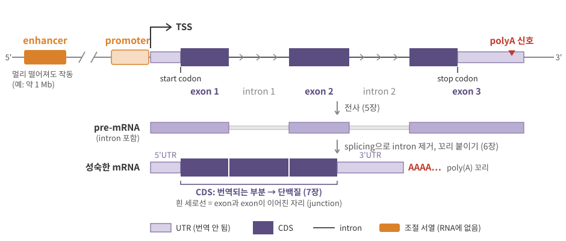
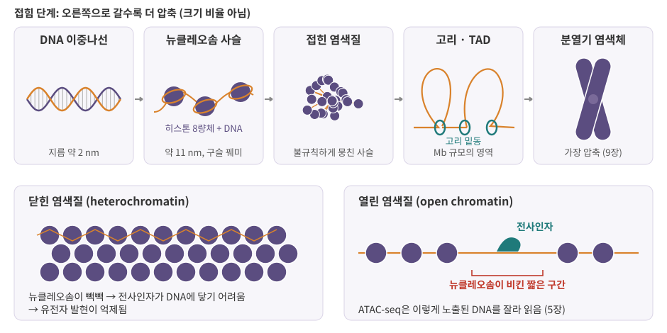
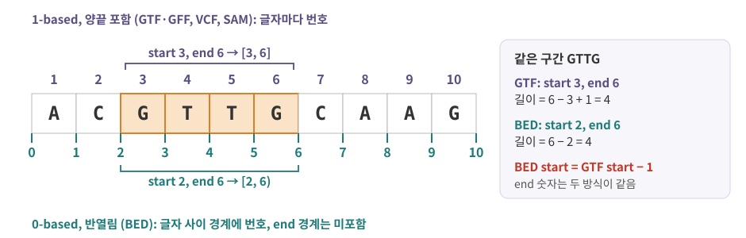

::: {.callout-note collapse="true"}
## 참고 자료
- Essential Cell Biology 5, 8장 — 구조 참고
- OpenStax Biology 2e 14장 DNA Structure and Function — 구조 참고
- 본문의 숫자는 옆의 배지가 출처
- 그림은 직접 그린 모식도. 데이터 상자의 GTF 예시는 가상의 유전자
:::

# 1. 유전체 한 벌

## 1) 핵 유전체와 미토콘드리아 유전체

- 유전체 (genome) = 한 세포가 가진 DNA 전체. 염기 글자로 쓰면 아주 긴 문자열 ([2장](02_biomolecules.qmd))
- 사람 핵 유전체: 상염색체 (autosome) 22쌍 + 성염색체 (sex chromosome) 1쌍 (XX 또는 XY) [NHGRI](https://www.genome.gov/genetics-glossary/Autosome){.src}
  - 상염색체 번호는 대략 크기 순 (1번이 가장 큼)
  - 한 벌 약 31억 bp, 부모에게서 한 벌씩 받아 세포 하나에 두 벌 ([0장](00_why_biology.qmd))
- 미토콘드리아 DNA (mtDNA): 미토콘드리아 안의 작은 고리 DNA, 16,569 bp [BioNumbers](https://bionumbers.hms.harvard.edu/bionumber.aspx?id=105470){.src}
  - 유전자 37개: 단백질 13, tRNA 22, rRNA 2 [BioNumbers](https://bionumbers.hms.harvard.edu/bionumber.aspx?id=116452){.src}
  - 미토콘드리아가 하는 일과 scRNA-seq의 `MT-` 유전자 → [1장](01_cell_system.qmd)

| | 핵 유전체 | 미토콘드리아 유전체 |
|---|---|---|
| 위치 | 핵 | 미토콘드리아 |
| 모양 | 선형 염색체, 세포 하나에 46개 | 작은 고리 |
| 크기 | 한 벌 약 31억 bp | 16,569 bp |
| 유전자 | 전체 약 7.9만 개, 그중 단백질 암호화 약 2만 개 ([0장](00_why_biology.qmd)) | 37개 |
| 파일 속 이름 | `chr1`–`chr22`, `chrX`, `chrY` (UCSC·GENCODE) 또는 `1`–`22`, `X`, `Y` (Ensembl) | `chrM` 또는 `MT` |

- 같은 염색체를 파일마다 다르게 부르는 이유 → 장 끝 데이터 상자

## 2) 단백질 정보는 1.5%뿐

- 단백질 암호화 유전자 약 2만 개의 단백질 정보는 유전체의 약 **1.5%**에 담겨 있음 [NHGRI](https://www.genome.gov/genetics-glossary/Gene){.src}
- 나머지 98% 이상
  - intron: 유전자 안에 있지만 단백질 정보는 아닌 구간 (2절)
  - 조절 서열: promoter, enhancer → [5장](05_transcription.qmd)
  - 단백질을 만들지 않는 RNA 유전자 → [6장](06_rna_processing.qmd)
  - 반복 서열, 아직 기능을 모르는 부분
- 데이터와의 연결
  - exome sequencing (WES)은 단백질 암호화 부분 위주로 골라 읽음 → 전체 유전체(WGS)보다 싸지만 조절 서열의 변이는 대부분 놓침 ([4장](04_replication_mutation_inheritance.qmd))
  - "유전자 = 단백질"이 아님. annotation에는 단백질을 만들지 않는 유전자도 많음 (`gene_type`이 `lncRNA` 등)

::: {.callout-important}
## 유전자 (gene) — 데이터에서 쓰는 뜻
- 유전체 위의 **한 구간**: RNA로 전사되는 단위
- annotation 파일에서 유전자 하나 = 위치(염색체, start, end, 가닥) + ID(`gene_id`) + 종류(`gene_type`: `protein_coding`, `lncRNA` 등)
- count matrix의 행 하나 = 보통 이 gene 하나 ([0장](00_why_biology.qmd))
:::

# 2. 유전자 하나의 구조

## 1) 부품과 이름

{fig-alt="enhancer, promoter, TSS, exon 3개와 intron 2개, 5'UTR, CDS, 3'UTR, polyA 신호가 있는 유전자와, intron을 포함한 pre-mRNA, intron이 빠지고 poly(A) 꼬리가 붙은 성숙한 mRNA"}

| 부품 | 무엇 | 데이터에서 | 자세히 |
|---|---|---|---|
| promoter | TSS 바로 앞, 전사 기계가 자리 잡는 구간 | ATAC peak가 자주 잡힘 | [5장](05_transcription.qmd) |
| TSS (transcription start site) | RNA의 첫 글자가 만들어지는 위치 | `+` 가닥 transcript의 start | [5장](05_transcription.qmd) |
| exon | 성숙한 mRNA에 남는 구간 | GTF의 `exon` 줄 | [6장](06_rna_processing.qmd) |
| intron | 전사되지만 splicing으로 잘려 나가는 구간 | 핵 RNA를 읽으면 intron read가 많아짐 | [6장](06_rna_processing.qmd) |
| 5'UTR, 3'UTR (untranslated region) | mRNA에 있지만 번역되지 않는 앞·뒤 부분 | GTF의 `UTR` 줄 | [6장](06_rna_processing.qmd), [7장](07_translation_protein.qmd) |
| CDS (coding sequence) | start codon부터 stop codon까지, 단백질로 번역되는 부분 | GTF의 `CDS` 줄 | [7장](07_translation_protein.qmd) |
| polyA 신호 | RNA의 3' 끝을 자르고 poly(A) 꼬리를 붙이라는 표시 | 3' 끝만 읽는 scRNA-seq의 read 위치 | [6장](06_rna_processing.qmd) |
| enhancer | 발현을 높이는 조절 서열, 유전자에서 멀리 있을 수 있음 | ATAC peak, GWAS 변이 해석 | [5장](05_transcription.qmd) |

## 2) 가닥과 방향

- 유전자는 DNA 두 가닥 중 어느 쪽에나 있음: `+` 가닥 또는 `−` 가닥 ([2장](02_biomolecules.qmd)의 5'→3')
- RNA는 그 유전자 가닥의 5'→3' 방향으로 만들어짐
  - `+` 가닥 유전자: TSS가 왼쪽(작은 좌표), 3' 끝이 오른쪽
  - `−` 가닥 유전자: TSS가 오른쪽(큰 좌표), 3' 끝이 왼쪽
- 그런데 GTF·BED의 start는 가닥과 상관없이 **항상 작은 좌표** → `−` 가닥 유전자의 TSS는 end 칸의 숫자
- 한 유전자에서 exon 조합이 다른 여러 transcript (isoform)가 나올 수 있음 → [6장](06_rna_processing.qmd)
  - gene 구간 = 그 유전자의 모든 transcript를 덮는 구간

## 3) enhancer는 멀리 있을 수 있다

- 예: 팔다리 발생에 필요한 유전자 *Shh*의 enhancer ZRS
  - 약 800 bp 크기로, *Shh*에서 약 1 Mb 떨어진 다른 유전자(*LMBR1*)의 intron 안에 있음 [Maas 2011](https://pmc.ncbi.nlm.nih.gov/articles/PMC3464974){.src}
  - 이 멀리 있는 조각이 팔다리 싹에서 *Shh*가 켜지는 위치를 정함. ZRS 안의 점 변이로 손가락이 더 생기는 기형(다지증)이 생김 [Lettice 2012](https://pmc.ncbi.nlm.nih.gov/articles/PMC3314984){.src}
- 데이터 분석에서의 뜻
  - ATAC peak나 GWAS 변이를 "가장 가까운 유전자"에 붙이는 것은 편하지만 틀릴 수 있음 ([4장](04_replication_mutation_inheritance.qmd), [5장](05_transcription.qmd))
  - 멀리 떨어진 enhancer와 promoter가 만나려면 DNA가 3차원으로 접혀야 함 → 3절

::: {.callout-warning collapse="true"}
## 처음엔 여기서 헷갈려요: 유전자 부품
| 헷갈리는 짝 | 차이 |
|---|---|
| exon vs CDS | exon은 UTR까지 포함, CDS는 번역되는 부분만 → 한 exon 안에 UTR과 CDS가 섞일 수 있음 |
| gene vs transcript | gene 구간은 모든 transcript를 덮는 바깥 경계. 실제 RNA 분자 하나는 transcript 하나에 해당 |
| GTF start vs TSS | `−` 가닥 유전자에서 start는 TSS가 아니라 3' 끝. TSS는 end |
| intron vs 유전자 사이 | intron은 유전자 안(전사됨), 유전자 사이 구간(intergenic)은 전사 단위 밖 |
| gene_name vs gene_id | 유전자 기호(*TP53* 등)는 바뀌거나 겹칠 수 있음 → 분석 기준은 `gene_id` ([부록 B](A2_nomenclature.qmd)) |
:::

# 3. DNA를 핵에 넣는 법: 뉴클레오솜과 염색질

## 1) 히스톤과 뉴클레오솜

- 지름 약 5 µm인 핵([0장](00_why_biology.qmd)) 안에 31억 bp × 2벌의 DNA → 감고 접어야 들어감
- 히스톤 (histone): DNA를 감는 단백질. H2A, H2B, H3, H4
- 뉴클레오솜 (nucleosome): 히스톤 8량체 (octamer, 네 종류가 2개씩) 둘레에 DNA 146 bp가 감긴 단위 [Luger 1997](https://doi.org/10.1038/38444){.src}
  - 뉴클레오솜과 뉴클레오솜 사이는 짧은 연결 DNA (linker DNA)
  - 이렇게 이어진 사슬이 "구슬 꿰미", 굵기 약 11 nm [Ou 2017](https://doi.org/10.1126/science.aag0025){.src}
- 염색질 (chromatin) = DNA + 히스톤 + 거기 붙은 여러 단백질
- 히스톤 꼬리에는 화학 표지가 붙어 염색질 상태를 바꿈 → ChIP-seq으로 측정 ([5장](05_transcription.qmd))

## 2) 접힘 단계

{fig-alt="DNA 이중나선, 뉴클레오솜 사슬, 접힌 염색질, 고리와 TAD, 분열기 염색체의 다섯 단계와, 뉴클레오솜이 빽빽한 닫힌 염색질과 뉴클레오솜이 비킨 자리에 전사인자가 붙은 열린 염색질"}

| 단계 | 크기 | 메모 |
|---|---|---|
| DNA 이중나선 | 지름 약 2 nm | [0장](00_why_biology.qmd) |
| 뉴클레오솜 사슬 | 약 11 nm | 구슬 꿰미 |
| 접힌 염색질 | 5–24 nm 굵기의 사슬이 여러 밀도로 뭉침 | 교과서의 "30 nm 섬유 → 더 굵은 섬유" 계층 모형과 달리, 사람 세포 안에서는 불규칙한 사슬로 관찰됨 [Ou 2017](https://doi.org/10.1126/science.aag0025){.src} |
| 고리 (loop) · TAD | Mb 규모 | 안쪽끼리 자주 접촉하는 영역 [Dixon 2012](https://doi.org/10.1038/nature11082){.src} → [5장](05_transcription.qmd) |
| 분열기 염색체 | 가장 압축 | 세포분열 때 → [9장](09_cell_cycle_death_cancer.qmd) |

- TAD (topologically associating domain): Hi-C(어느 두 구간이 공간에서 가까운지 세는 방법)로 찾은 Mb 규모 영역 [Dixon 2012](https://doi.org/10.1038/nature11082){.src}
  - 세포 종류가 달라도 비교적 안정, 경계에 절연 단백질 CTCF가 많음
  - enhancer와 promoter의 만남도 이런 3차원 구조 안에서 일어남 → [5장](05_transcription.qmd)

## 3) 열린 염색질과 닫힌 염색질

| | euchromatin (진정염색질) | heterochromatin (이질염색질) |
|---|---|---|
| 압축 | 느슨함 | 빽빽함 |
| 발현 | 활발한 유전자가 많음 | 억제됨 |
| 현미경에서 | 옅게 염색 | 진하게 염색 |

- 열린 염색질 (open chromatin, accessible chromatin): 뉴클레오솜이 비켜서 DNA가 드러난 짧은 구간
  - 전사인자 (transcription factor)가 DNA에 붙을 수 있음 → promoter와 일하는 enhancer가 대표적
  - ATAC-seq은 이런 구간을 잘라 읽어 peak로 보여 줌 ([5장](05_transcription.qmd))
- 우리 몸의 세포는 거의 같은 유전체를 갖지만 **어디가 열려 있는지**는 세포 종류마다 다름 → 세포 정체성 ([10장](10_cell_identity.qmd))

::: {.callout-tip collapse="true"}
## 비유: 같은 백과사전, 다른 펼친 페이지
- 유전체 = 모든 세포가 똑같이 가진 백과사전 한 질
- 닫힌 염색질 = 끈으로 묶어 꽂아 둔 권, 열린 염색질 = 책상 위에 펼쳐 둔 페이지
- 간세포와 T세포는 같은 백과사전에서 서로 다른 페이지를 펼쳐 놓고 읽음 → 발현이 다름
:::

# 4. 유전체 지도: 서열과 annotation

- 레퍼런스 유전체 (reference genome assembly): 염기 서열 자체, 좌표계를 정함. 파일은 FASTA
- annotation: 그 서열 위 어디에 유전자·exon·CDS가 있는지 적은 지도. 파일은 GTF 또는 GFF3. 배포처는 GENCODE, Ensembl, RefSeq 등
- 정렬과 정량에는 둘 다 필요
  - read가 유전체 어디에서 왔는지 → FASTA에 정렬 (결과는 SAM/BAM)
  - 그 위치가 어느 유전자인지 → GTF로 판단 → count matrix의 행 ([0장](00_why_biology.qmd))

| 파일 | 담은 것 | 좌표 | 자세히 |
|---|---|---|---|
| FASTA | 염기 서열 | 서열 순서 그대로 | [12장](12_data_generation.qmd) |
| GTF / GFF3 | 유전자 구조 | 1-based | 장 끝 데이터 상자 |
| BED | 구간 목록 (peak 등) | 0-based | 장 끝 데이터 상자, [5장](05_transcription.qmd) |
| SAM / BAM | read 정렬 결과 | SAM은 1-based (BAM 내부는 0-based) | [12장](12_data_generation.qmd) |
| VCF | 변이 | 1-based | [4장](04_replication_mutation_inheritance.qmd) |

::: {.callout-caution .data-box icon=false}
## 데이터에서는 이렇게 보여요: GTF 한 줄 = 유전체 위 구간 하나 + 그 구간의 이름표

**컬럼 9개, 탭으로 구분** [GENCODE](https://www.gencodegenes.org/pages/data_format.html){.src} [Ensembl](https://bacteria.ensembl.org/info/website/upload/gff.html){.src}

| # | 컬럼 | 뜻 | 예 |
|---|---|---|---|
| 1 | seqname | 염색체 이름 | `chr1` (GENCODE), `1` (Ensembl) |
| 2 | source | annotation을 만든 곳 | `HAVANA`, `ENSEMBL` |
| 3 | feature | 구간의 종류 | `gene`, `exon`, `CDS` |
| 4 | start | 시작 위치, 1부터 셈 | `1251` |
| 5 | end | 끝 위치, 이 글자까지 포함 | `1350` |
| 6 | score | 점수 (GENCODE는 안 씀) | `.` |
| 7 | strand | 가닥 | `+`, `-` |
| 8 | frame | CDS 줄에서만: 다음 codon이 시작되기 전까지 건너뛸 글자 수 | `0`, `1`, `2` (그 외 `.`) |
| 9 | attribute | `키 "값";` 쌍의 목록 | `gene_id "…"; transcript_id "…";` |

: {tbl-colwidths="[5,15,45,35]"}

- feature 종류 (GENCODE): `gene`, `transcript`, `exon`, `CDS`, `UTR`, `start_codon`, `stop_codon`, `Selenocysteine` [GENCODE](https://www.gencodegenes.org/pages/data_format.html){.src}
  - Ensembl GTF는 UTR을 `five_prime_utr`, `three_prime_utr`로 나눠 씀
  - 한 transcript = transcript 줄 1개 + exon마다 1줄 + CDS 조각마다 1줄 + …
- attribute에서 자주 꺼내는 키 [GENCODE](https://www.gencodegenes.org/pages/data_format.html){.src}

| 키 | 뜻 | 예 |
|---|---|---|
| `gene_id` | 유전자 ID, `.` 뒤는 버전 번호 | `ENSG…`로 시작 |
| `transcript_id` | transcript ID | `ENST…`로 시작 |
| `gene_name` | 유전자 기호 | `TP53` |
| `gene_type` | 유전자 종류 | `protein_coding`, `lncRNA` |
| `exon_number` | transcript 안에서 몇 번째 exon인가 | `2` |

- 다른 파일과 ID를 맞출 때 버전 번호(`.` 뒤)를 떼고 비교하는 경우가 많음
- Ensembl GTF는 일부 키 이름이 다름 (예: `gene_type` 대신 `gene_biotype`)

**R로 한 줄 읽기** — 탭으로 컬럼을 나누고, 9번째 컬럼을 `;`로 나눠 이름-값으로 꺼냄

```{r}
#| label: gtf-line
a9 <- 'gene_id "G0001.1"; gene_name "DEMO1"; exon_number 2;'
line <- paste("chr1", "HAVANA", "exon", 1251, 1350, ".", "+", ".", a9, sep = "\t")
f <- strsplit(line, "\t")[[1]]          # 탭으로 나누기
length(f)                               # 컬럼 수
f[c(1, 3:5, 7)]                         # seqname, feature, start, end, strand
as.integer(f[5]) - as.integer(f[4]) + 1 # 길이 (양끝 포함)
kv <- trimws(strsplit(f[9], ";")[[1]])  # attribute를 ;로 나누기
kv <- kv[kv != ""]
attr9 <- setNames(gsub('"', "", sub("^\\S+ ", "", kv)), sub(" .*", "", kv))
attr9[c("gene_id", "gene_name", "exon_number")]
```

- 컬럼 9개, 길이 1350 − 1251 + 1 = 100 bp
- 실제 분석에서는 Bioconductor의 `rtracklayer::import()` 같은 함수가 파일 전체를 이렇게 읽어 줌

**그림과 GTF 줄 짝짓기** — 가상의 유전자 DEMO1: `chr1`의 1,001–1,600, `+` 가닥, exon 3개

```{=html}
<div id="g-gtf-demo">
<svg viewBox="0 0 940 300" role="img" aria-label="가상의 유전자 DEMO1의 구조. 위에서부터 gene, transcript, exon 3개, UTR과 CDS, start codon과 stop codon, 1-based 좌표 눈금" font-family="Pretendard, 'Apple SD Gothic Neo', 'Malgun Gothic', 'Noto Sans KR', 'Noto Sans CJK KR', sans-serif"><rect width="940" height="300" fill="#ffffff"/><text x="10" y="36" font-size="17" font-weight="700" fill="#333">gene</text><g class="g-seg" data-row="gene"><rect x="130.0" y="25.0" width="780.0" height="10" fill="#5B4D80" stroke="none" stroke-width="1"/></g><text x="10" y="70" font-size="17" font-weight="700" fill="#333">transcript</text>
<g class="g-seg" data-row="tx"><rect x="130.0" y="59.0" width="780.0" height="10" fill="#7A6A99" stroke="none" stroke-width="1"/></g><path d="M912.0 57 L924.0 64 L912.0 71 Z" fill="#7A6A99"/><text x="10" y="110" font-size="17" font-weight="700" fill="#333">exon</text><line x1="260.0" y1="104" x2="455.0" y2="104" stroke="#888" stroke-width="1.5"/><line x1="585.0" y1="104" x2="715.0" y2="104" stroke="#888" stroke-width="1.5"/>
<g class="g-seg" data-row="exon1"><rect x="130.0" y="91.0" width="130.0" height="26" fill="#e8f4f3" stroke="#1F7A7A" stroke-width="2"/><text x="195.0" y="110" font-size="16" text-anchor="middle" fill="#1F7A7A" pointer-events="none">exon 1</text></g><g class="g-seg" data-row="exon2"><rect x="455.0" y="91.0" width="130.0" height="26" fill="#e8f4f3" stroke="#1F7A7A" stroke-width="2"/><text x="520.0" y="110" font-size="16" text-anchor="middle" fill="#1F7A7A" pointer-events="none">exon 2</text></g><g class="g-seg" data-row="exon3"><rect x="715.0" y="91.0" width="195.0" height="26" fill="#e8f4f3" stroke="#1F7A7A" stroke-width="2"/><text x="812.5" y="110" font-size="16" text-anchor="middle" fill="#1F7A7A" pointer-events="none">exon 3</text></g><text x="10" y="156" font-size="17" font-weight="700" fill="#333">UTR · CDS</text><g class="g-seg" data-row="utr5"><rect x="130.0" y="142.0" width="52.0" height="16" fill="#d9d1e8" stroke="#7A6A99" stroke-width="1.2"/></g>
<g class="g-seg" data-row="cds1"><rect x="182.0" y="136.0" width="78.0" height="28" fill="#5B4D80" stroke="none" stroke-width="1"/><text x="221.0" y="156" font-size="16" text-anchor="middle" fill="#ffffff" pointer-events="none">CDS</text></g><g class="g-seg" data-row="cds2"><rect x="455.0" y="136.0" width="130.0" height="28" fill="#5B4D80" stroke="none" stroke-width="1"/><text x="520.0" y="156" font-size="16" text-anchor="middle" fill="#ffffff" pointer-events="none">CDS</text></g><g class="g-seg" data-row="cds3"><rect x="715.0" y="136.0" width="104.0" height="28" fill="#5B4D80" stroke="none" stroke-width="1"/><text x="767.0" y="156" font-size="16" text-anchor="middle" fill="#ffffff" pointer-events="none">CDS</text></g><g class="g-seg" data-row="utr3"><rect x="822.9" y="142.0" width="87.1" height="16" fill="#d9d1e8" stroke="#7A6A99" stroke-width="1.2"/></g><text x="156.0" y="131" font-size="15" text-anchor="middle" fill="#7A6A99">5'UTR</text>
<text x="866.5" y="131" font-size="15" text-anchor="middle" fill="#7A6A99">3'UTR</text><text x="10" y="202" font-size="17" font-weight="700" fill="#333">codon</text><g class="g-seg" data-row="start"><rect x="176.9" y="186" width="14" height="20" rx="2" fill="#D9822B"/><text x="194.9" y="202" font-size="16" fill="#D9822B" font-weight="700">start</text></g><g class="g-seg" data-row="stop"><rect x="814.0" y="186" width="14" height="20" rx="2" fill="#C0392B"/><text x="832.0" y="202" font-size="16" fill="#C0392B" font-weight="700">stop</text></g><line x1="130.0" y1="236" x2="910.0" y2="236" stroke="#555" stroke-width="1.2"/>
<line x1="130.0" y1="230" x2="130.0" y2="242" stroke="#555" stroke-width="1.2"/><text x="130.0" y="262" font-size="15" text-anchor="middle" fill="#555">1,001</text><line x1="182.0" y1="230" x2="182.0" y2="242" stroke="#555" stroke-width="1.2"/><text x="182.0" y="262" font-size="15" text-anchor="middle" fill="#555">1,041</text><line x1="260.0" y1="230" x2="260.0" y2="242" stroke="#555" stroke-width="1.2"/>
<text x="260.0" y="262" font-size="15" text-anchor="middle" fill="#555">1,100</text><line x1="455.0" y1="230" x2="455.0" y2="242" stroke="#555" stroke-width="1.2"/><text x="455.0" y="262" font-size="15" text-anchor="middle" fill="#555">1,251</text><line x1="585.0" y1="230" x2="585.0" y2="242" stroke="#555" stroke-width="1.2"/><text x="585.0" y="262" font-size="15" text-anchor="middle" fill="#555">1,350</text>
<line x1="715.0" y1="230" x2="715.0" y2="242" stroke="#555" stroke-width="1.2"/><text x="715.0" y="262" font-size="15" text-anchor="middle" fill="#555">1,451</text><line x1="819.0" y1="230" x2="819.0" y2="242" stroke="#555" stroke-width="1.2"/><text x="819.0" y="262" font-size="15" text-anchor="middle" fill="#555">1,530</text><line x1="910.0" y1="230" x2="910.0" y2="242" stroke="#555" stroke-width="1.2"/>
<text x="910.0" y="262" font-size="15" text-anchor="middle" fill="#555">1,600</text><text x="10" y="262" font-size="16" fill="#555">좌표</text><text x="470" y="290" font-size="15" text-anchor="middle" fill="#888">구간이나 아래 표의 줄에 마우스를 올리거나 탭하면 짝이 함께 강조됨</text></svg>
<div class="g-wrap"><table>
<thead><tr><th>seqname</th><th>source</th><th>feature</th><th>start</th><th>end</th><th>score</th><th>strand</th><th>frame</th><th>attribute</th></tr></thead>
<tbody>
<tr data-row="gene" tabindex="0"><td>chr1</td><td>HAVANA</td><td>gene</td><td>1001</td><td>1600</td><td>.</td><td>+</td><td>.</td><td>gene_id &quot;G0001.1&quot;; gene_name &quot;DEMO1&quot;; …</td></tr>
<tr data-row="tx" tabindex="0"><td>chr1</td><td>HAVANA</td><td>transcript</td><td>1001</td><td>1600</td><td>.</td><td>+</td><td>.</td><td>gene_id &quot;G0001.1&quot;; transcript_id &quot;T0001.1&quot;; …</td></tr>
<tr data-row="exon1" tabindex="0"><td>chr1</td><td>HAVANA</td><td>exon</td><td>1001</td><td>1100</td><td>.</td><td>+</td><td>.</td><td>transcript_id &quot;T0001.1&quot;; exon_number 1; …</td></tr>
<tr data-row="cds1" tabindex="0"><td>chr1</td><td>HAVANA</td><td>CDS</td><td>1041</td><td>1100</td><td>.</td><td>+</td><td>0</td><td>transcript_id &quot;T0001.1&quot;; exon_number 1; …</td></tr>
<tr data-row="start" tabindex="0"><td>chr1</td><td>HAVANA</td><td>start_codon</td><td>1041</td><td>1043</td><td>.</td><td>+</td><td>0</td><td>transcript_id &quot;T0001.1&quot;; exon_number 1; …</td></tr>
<tr data-row="exon2" tabindex="0"><td>chr1</td><td>HAVANA</td><td>exon</td><td>1251</td><td>1350</td><td>.</td><td>+</td><td>.</td><td>transcript_id &quot;T0001.1&quot;; exon_number 2; …</td></tr>
<tr data-row="cds2" tabindex="0"><td>chr1</td><td>HAVANA</td><td>CDS</td><td>1251</td><td>1350</td><td>.</td><td>+</td><td>0</td><td>transcript_id &quot;T0001.1&quot;; exon_number 2; …</td></tr>
<tr data-row="exon3" tabindex="0"><td>chr1</td><td>HAVANA</td><td>exon</td><td>1451</td><td>1600</td><td>.</td><td>+</td><td>.</td><td>transcript_id &quot;T0001.1&quot;; exon_number 3; …</td></tr>
<tr data-row="cds3" tabindex="0"><td>chr1</td><td>HAVANA</td><td>CDS</td><td>1451</td><td>1530</td><td>.</td><td>+</td><td>2</td><td>transcript_id &quot;T0001.1&quot;; exon_number 3; …</td></tr>
<tr data-row="stop" tabindex="0"><td>chr1</td><td>HAVANA</td><td>stop_codon</td><td>1531</td><td>1533</td><td>.</td><td>+</td><td>0</td><td>transcript_id &quot;T0001.1&quot;; exon_number 3; …</td></tr>
<tr data-row="utr5" tabindex="0"><td>chr1</td><td>HAVANA</td><td>UTR</td><td>1001</td><td>1040</td><td>.</td><td>+</td><td>.</td><td>transcript_id &quot;T0001.1&quot;; exon_number 1; …</td></tr>
<tr data-row="utr3" tabindex="0"><td>chr1</td><td>HAVANA</td><td>UTR</td><td>1534</td><td>1600</td><td>.</td><td>+</td><td>.</td><td>transcript_id &quot;T0001.1&quot;; exon_number 3; …</td></tr>
</tbody></table></div>
<style>
#g-gtf-demo { margin: 0.4em 0 0.6em; }
#g-gtf-demo svg { width: 100%; height: auto; display: block; }
#g-gtf-demo [data-row] { cursor: pointer; }
#g-gtf-demo svg .g-seg { transition: opacity 0.15s; }
#g-gtf-demo.g-active svg .g-seg:not(.g-on) { opacity: 0.3; }
#g-gtf-demo svg .g-seg.g-on rect { stroke: #C0392B; stroke-width: 3; }
#g-gtf-demo .g-wrap { overflow-x: auto; margin-top: 0.4em; }
#g-gtf-demo table { border-collapse: collapse; font-family: 'D2Coding', Menlo, Consolas, monospace; font-size: 0.7em; white-space: nowrap; color: #333; }
#g-gtf-demo th, #g-gtf-demo td { padding: 2px 6px; border-bottom: 1px solid #e3e0ea; text-align: left; }
#g-gtf-demo th { color: #5B4D80; border-bottom: 2px solid #cfc4e2; }
#g-gtf-demo td:last-child { white-space: normal; min-width: 15em; }
#g-gtf-demo tr.g-on td { background: #fbe3c7; }
#g-gtf-demo tr[data-row]:focus { outline: 2px solid #C0392B; outline-offset: -2px; }
</style>
<script>
(function () {
  var root = document.getElementById('g-gtf-demo');
  if (!root) return;
  var pinned = null;
  function show(row) {
    root.querySelectorAll('.g-on').forEach(function (el) { el.classList.remove('g-on'); });
    root.classList.toggle('g-active', !!row);
    if (row) root.querySelectorAll('[data-row="' + row + '"]').forEach(function (el) { el.classList.add('g-on'); });
  }
  function toggle(row) { pinned = (pinned === row) ? null : row; show(pinned); }
  root.querySelectorAll('[data-row]').forEach(function (el) {
    var row = el.getAttribute('data-row');
    el.addEventListener('mouseenter', function () { show(row); });
    el.addEventListener('mouseleave', function () { show(pinned); });
    el.addEventListener('focus', function () { show(row); });
    el.addEventListener('blur', function () { show(pinned); });
    el.addEventListener('click', function () { toggle(row); });
    el.addEventListener('keydown', function (e) {
      if (e.key === 'Enter' || e.key === ' ') { e.preventDefault(); toggle(row); }
    });
  });
})();
</script>
</div>
```

- 그림의 눈금 숫자 = 그 글자까지 구간에 포함됨 (1-based, 양끝 포함)
- 표의 attribute는 일부만 보임(`…`). 실제 파일에서는 줄마다 `gene_id`, `gene_type` 등이 더 붙고, transcript 아래 줄에는 `transcript_id`도 붙음
- CDS 세 조각 60 + 100 + 80 = 240 bp = codon 80개 (3의 배수)
- 셋째 CDS의 frame이 `2`인 이유: 앞 두 조각이 160글자 = codon 53개 + 1글자 → 넘어온 codon의 나머지 2글자를 채운 뒤 새 codon 시작
- 이 예는 stop codon을 CDS 줄에서 빼고 `stop_codon` 줄로 따로 씀. stop codon을 어느 줄에 넣는지, 줄 순서 같은 세부 규칙은 배포처 문서에서 확인
:::

::: {.callout-caution .data-box icon=false}
## 데이터에서는 이렇게 보여요: 같은 구간도 파일 형식과 레퍼런스 버전에 따라 숫자가 다르다

**0-based vs 1-based**

{fig-alt="염기 10개 ACGTTGCAAG 위쪽에 1부터 10까지 글자 번호, 아래쪽에 0부터 10까지 경계 번호가 있고, 셋째부터 여섯째 글자 GTTG가 1-based로 start 3 end 6, 0-based로 start 2 end 6"}

| 방식 | 첫 글자 | 구간 | 길이 | 쓰는 곳 |
|---|---|---|---|---|
| 1-based, 양끝 포함 | 1 | [start, end] | end − start + 1 | GTF·GFF, VCF, SAM, 유전체 브라우저 화면 |
| 0-based, 반열림 | 0 | [start, end) | end − start | BED, BAM 내부 |

- 출처: UCSC 브라우저의 좌표 설명 [UCSC](https://genome-blog.gi.ucsc.edu/blog/?p=333){.src}, SAM·VCF 규격 문서 [hts-specs](https://github.com/samtools/hts-specs){.src}
- 변환: BED start = 1-based start − 1, end 숫자는 그대로 [UCSC](https://genome-blog.gi.ucsc.edu/blog/?p=333){.src}
  - DEMO1의 exon 2: GTF `1251  1350` = BED `1250  1350`, 둘 다 길이 100
  - 한 글자짜리 변이: VCF `POS 1051` = BED `1050  1051`
- 섞이면 생기는 일: 구간이 한 글자씩 밀림 → 경계의 변이·read가 빠지거나 옆 구간으로 들어감

**레퍼런스 버전**

| | GRCh37 | GRCh38 |
|---|---|---|
| UCSC 이름 | hg19 | hg38 |
| 발표 | 2009년 2월 | 2013년 12월 |

- 출처: [UCSC](https://genome.ucsc.edu/FAQ/FAQreleases.html){.src}
- 같은 유전자라도 두 버전의 좌표가 다름 → 버전이 다른 파일끼리 좌표를 바로 비교하면 안 됨
- 염색체 이름 규칙도 배포처마다 다름: UCSC·GENCODE는 `chr1`, `chrM` [GENCODE](https://www.gencodegenes.org/pages/data_format.html){.src} / Ensembl은 `1`, `MT` [Ensembl](https://lists.ensembl.org/pipermail/dev_ensembl.org/2014-October/005459.html){.src}
  - 이름만 다르면 문자열 바꾸기로 해결. 하지만 이름이 맞는다고 버전이 같은 것은 아님

**assembly와 annotation release는 별개**

| 층 | 무엇 | 예 |
|---|---|---|
| assembly | 염기 서열 자체, 좌표계를 정함 | GRCh38 (세부 수정판 GRCh38.p14) |
| annotation release | 그 서열 위 유전자 지도 | GENCODE 48 = Ensembl 114, 둘 다 GRCh38.p14 위 [GENCODE](https://www.gencodegenes.org/human/releases.html){.src} |

- 같은 GRCh38이라도 annotation release가 바뀌면 유전자·transcript 목록과 경계가 달라질 수 있음 → count matrix의 행이 달라짐
- 분석 기록에 둘 다 적기: 예) "GRCh38, GENCODE 48"
- 한 분석 안의 FASTA, GTF, BED, VCF는 같은 assembly여야 함
- 버전을 바꿔야 하면 UCSC liftOver: chain 파일로 구간 좌표를 변환 [UCSC](https://genome.ucsc.edu/FAQ/FAQdownloads.html){.src}
  - 일부 구간은 변환되지 않고 따로 남음 (unmapped) → 몇 개인지 확인
  - UCSC 문서는 SNP 좌표 변환에는 liftOver를 권하지 않음 → 가능하면 원자료를 새 레퍼런스로 다시 처리
:::

::: {.callout-warning collapse="true"}
## 처음엔 여기서 헷갈려요: 좌표와 버전
| 헷갈리는 짝 | 차이 |
|---|---|
| BED start vs GTF start | 같은 구간이면 BED start가 1 작음. end는 같음 |
| 길이 계산 | 1-based는 end − start + 1, 0-based는 end − start |
| hg38 vs GRCh38 | 같은 assembly의 UCSC 이름과 GRC 이름. 염색체 이름 표기가 다를 수 있음 |
| GRCh38 vs GENCODE 48 | 하나는 서열(좌표계), 하나는 그 위의 유전자 지도. 버전을 따로 기록 |
| `chr1` vs `1` | 이름 규칙의 차이일 뿐. assembly가 같을 때만 바꿔 써도 됨 |
:::

# 5. 정리

- 사람 핵 유전체 = 상염색체 22쌍 + 성염색체 1쌍, 한 벌 약 31억 bp. 단백질 정보는 약 1.5%뿐
- 유전자 = promoter·TSS부터 exon/intron, UTR, CDS, polyA 신호까지. enhancer는 멀리 있을 수 있음
- DNA는 히스톤 8량체에 146 bp씩 감겨 뉴클레오솜이 되고, 더 접혀 고리·TAD를 이룸
- 열린 염색질 = 뉴클레오솜이 비킨 구간 → 전사인자가 붙고 ATAC-seq이 읽는 곳. 세포 종류마다 다름
- GTF 한 줄 = 구간 하나 + 이름표. start는 항상 작은 좌표, 1-based 양끝 포함
- BED는 0-based 반열림. assembly와 annotation release를 함께 기록하고 한 분석 안에서 섞지 않음

# 연습문제

1. BED 파일에 `chr2  999  1100`이라는 줄이 있다. (a) 이 구간을 GTF 방식의 start, end로 쓰면? (b) 길이는 몇 bp인가? (c) 1-based 위치 1,000의 염기는 이 구간에 들어가나?
2. `−` 가닥 유전자의 GTF `gene` 줄이 start 5001, end 9000이다. 이 유전자의 TSS는 어느 좌표인가? 첫 exon은 이 구간의 왼쪽 끝과 오른쪽 끝 중 어느 쪽에 있을까?
3. 동료가 hg19로 만든 VCF와 GENCODE 48 GTF를 염색체 이름(`chr` 유무)만 맞춘 뒤 겹치는 유전자를 찾았다. 무엇이 잘못됐나? 어떻게 고치면 좋을까?
4. 동료가 "이 ATAC peak 바로 옆 유전자가 peak의 조절 대상"이라고 결론 내렸다. 2절 3)과 3절을 근거로 반박하고, 판단하려면 어떤 데이터가 더 있으면 좋을지 쓰라.
