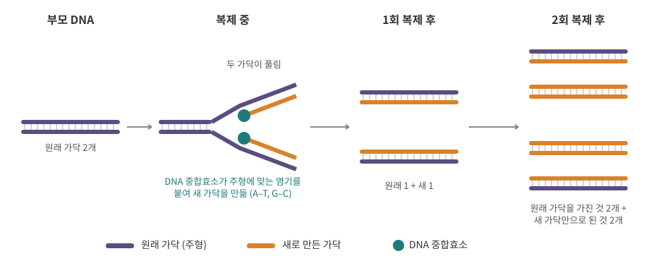
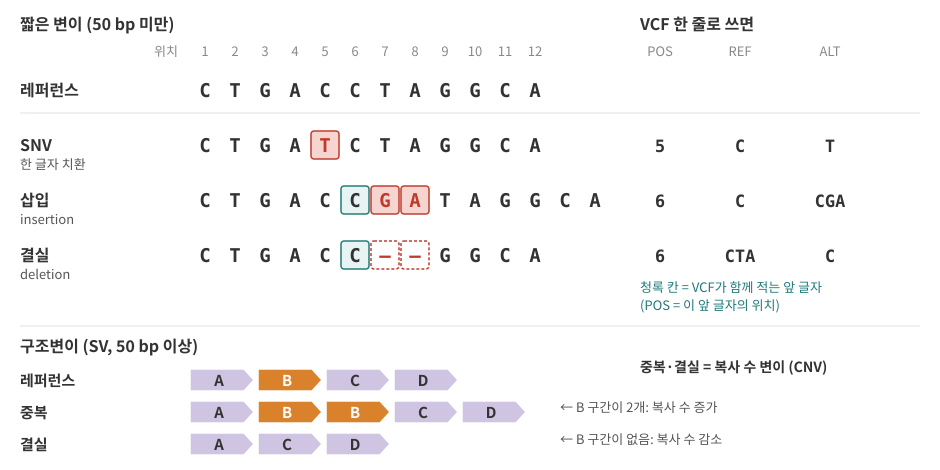
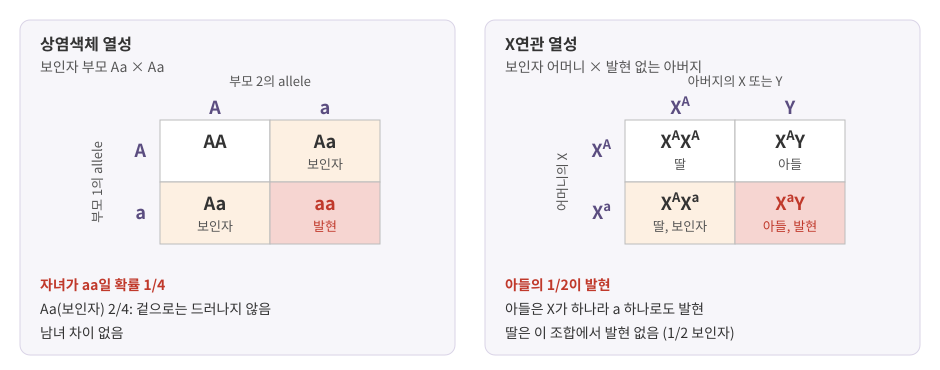
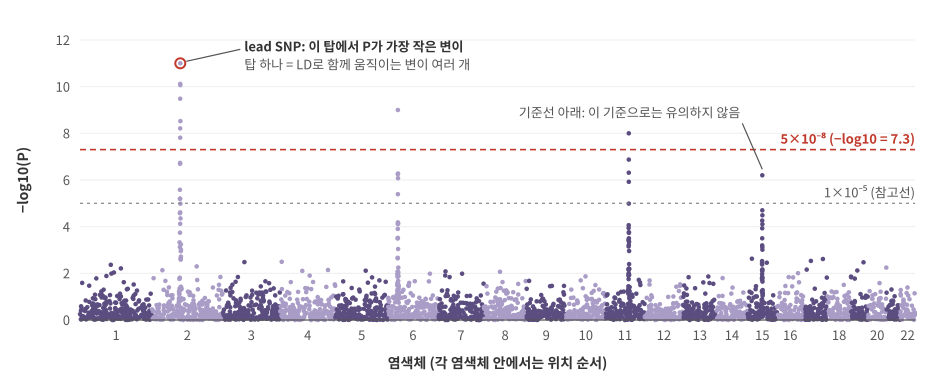

::: {.callout-note collapse="true"}
## 참고 자료
- Essential Cell Biology 6, 19장 — 구조 참고
- OpenStax Biology 2e 12장 Mendel's Experiments and Heredity, 14장 DNA Structure and Function — 구조 참고
- 본문의 숫자는 옆의 배지가 출처
- 그림은 직접 그린 모식도. Manhattan plot과 VCF 예시는 가상 데이터
:::

# 1. DNA 복제: 한 벌을 두 벌로

## 1) 반보존적 복제

{fig-alt="부모 DNA의 두 가닥이 풀리며 각각 주형이 되어, 1회 복제 후 원래 가닥 하나와 새 가닥 하나로 된 이중나선 2개, 2회 복제 후 원래 가닥을 가진 것 2개와 새 가닥만으로 된 것 2개가 생기는 과정"}

- 세포가 둘로 나뉘기 전에 유전체 전체를 한 번 복사함 ([9장](09_cell_cycle_death_cancer.qmd))
- 두 가닥이 풀리고, 각 가닥이 **주형 (template)**이 되어 짝이 맞는 새 가닥을 만듦 (A–T, G–C, [2장](02_biomolecules.qmd))
- 결과: 새 이중나선 하나 = 원래 가닥 하나 + 새 가닥 하나 → **반보존적 복제 (semiconservative replication)** [Meselson 1958](https://doi.org/10.1073/pnas.44.7.671){.src}
- 새 가닥을 만드는 효소 = DNA 중합효소 (DNA polymerase). 새 가닥은 5'→3' 방향으로만 자람

## 2) 얼마나 정확한가

| 단계 | 하는 일 | 빠져나가는 오류 (대장균 추정) |
|---|---|---|
| 염기 선택 | 중합효소가 주형에 맞는 염기를 고름 | 염기 약 10⁵개에 1개 꼴로 틀림 |
| 교정 (proofreading) | 방금 붙인 염기가 틀리면 중합효소가 뒤로 돌아가 떼어 냄 | 틀린 것 약 100개 중 1개만 남음 |
| 불일치 수선 (mismatch repair) | 복제가 끝난 뒤 짝이 안 맞는 자리를 찾아 고침 | 남은 것 약 1,000개 중 1개만 남음 |
| 최종 | | 염기쌍당 10⁻⁹–10⁻¹¹ [Fijalkowska 2012](https://pmc.ncbi.nlm.nih.gov/articles/PMC3391330){.src} |

- 독립적인 검사 세 단계를 곱하는 구조: 10⁻⁵ × 10⁻² × 10⁻³ = 10⁻¹⁰
- 숫자는 대장균 연구에서 나온 것. 사람 세포도 같은 세 단계를 거치지만 정확한 값은 세포와 위치마다 다름

## 3) DNA 수선

- 복제 오류 말고도 DNA는 계속 손상됨: 자외선, 화학물질, 저절로 일어나는 화학 변화
- 세포에는 손상 종류별 수선 경로가 있음 (개념만)
  - 염기 하나가 망가짐 → 그 염기를 잘라 내고 다시 채움
  - 가닥이 크게 뒤틀림(예: 자외선 손상) → 그 부분을 넓게 잘라 내고 다시 합성
  - 두 가닥이 다 끊김 → 끝을 그냥 잇거나(이 과정에서 글자가 빠지거나 더해질 수 있음), 복제해 둔 같은 서열을 주형 삼아 복구
- 수선이 고장 나면 변이가 쌓임 → 암 ([9장](09_cell_cycle_death_cancer.qmd))
- CRISPR 유전자 편집은 일부러 두 가닥을 끊고 이 수선 과정을 이용 ([12장](12_data_generation.qmd))

# 2. 변이의 종류

## 1) 크기로 나누기

{fig-alt="12글자 레퍼런스 서열과 비교한 SNV, 삽입, 결실과 각각의 VCF POS, REF, ALT, 그리고 구간 A, B, C, D 중 B가 두 번 있는 중복과 B가 없는 결실"}

| 종류 | 크기 | 무엇 |
|---|---|---|
| SNV (single nucleotide variant) | 1 bp | 한 글자가 다른 글자로 바뀜 |
| indel (insertion/deletion) | 50 bp 미만 | 짧은 삽입이나 결실 |
| SV (structural variant) | 50 bp 이상 | 큰 결실·삽입·중복·역위(방향 뒤집힘)·전좌(다른 곳으로 이동) |
| CNV (copy number variant) | SV의 일부 | 한 구간의 복사 수가 늘거나 줄어듦 (중복, 결실) |

- indel과 SV를 나누는 50 bp는 관례적인 기준 [Chaisson 2019](https://doi.org/10.1038/s41467-018-08148-z){.src}
- SNP (single nucleotide polymorphism): 집단에서 어느 정도 흔한 SNV를 부르는 말. 빈도 기준은 문헌마다 다름
  - dbSNP에 등록된 변이에는 `rs` 번호가 붙음 (rsID) → VCF의 ID 컬럼
- CDS 안에서 3의 배수가 아닌 indel은 그 뒤의 codon 읽기틀을 전부 바꿈 (frameshift, [7장](07_translation_protein.qmd))

## 2) 두 사람은 얼마나 다른가

- 1000 Genomes Project (26개 집단, 2,504명) 기준 [1000 Genomes 2015](https://doi.org/10.1038/nature15393){.src}

| 한 사람의 유전체에서 | 규모 |
|---|---|
| 레퍼런스와 다른 자리 | 410만–500만 개 |
| 그중 SNV와 짧은 indel | 99.9% 이상 |
| 구조변이 (SV) | 2,100–2,500개, 영향을 받는 염기는 약 2,000만 개 |
| 단백질 서열을 바꾸는 변이 자리 | 1만–1.2만 개 |
| 알려진 조절 구간(UTR, promoter, enhancer 등)과 겹치는 변이 자리 | 45.9만–56.5만 개 |

- 31억 bp 중 400만–500만 자리 → 약 0.1–0.2%
- 개수로는 SNV가 압도적, 바뀐 염기 양으로는 SV가 더 많음
- 대부분의 변이는 단백질 밖, 조절 구간이나 기능을 모르는 곳에 있음 ([3장](03_genome_chromatin.qmd))
- 레퍼런스와 다르다 ≠ 이상하다. 레퍼런스는 좌표를 정하는 기준 서열일 뿐

## 3) 생식세포 변이와 체세포 변이

| | 생식세포 변이 (germline) | 체세포 변이 (somatic) |
|---|---|---|
| 생기는 때 | 수정란에 이미 있음 (부모에게 받았거나 부모의 정자·난자에서 새로 생김) | 발생 중이나 태어난 뒤 몸의 한 세포가 분열하며 |
| 분포 | 몸의 거의 모든 세포 | 그 세포의 자손 세포에만 |
| 자녀에게 | 전달될 수 있음 | 전달 안 됨 |
| 대표 데이터 | 혈액 DNA의 WGS·WES, GWAS용 genotype | 종양 vs 정상 조직 비교 |
| read 중 ALT 비율 | 이형접합 약 50%, 동형접합 약 100% | 그 변이를 가진 세포 비율에 따라 낮을 수 있음 |
| 자세히 | 이 장 | [9장](09_cell_cycle_death_cancer.qmd) |

- 새로 생긴 생식세포 변이 (de novo mutation): 부모에게는 없고 자녀에게 처음 나타남
  - 변이율: 염기당 세대당 약 1.2 × 10⁻⁸ (아버지 평균 나이 29.7세) [Kong 2012](https://doi.org/10.1038/nature11396){.src}
  - 아이슬란드 1,548 가족에서 새 변이 108,778개 → 자녀 한 명당 **약 70개** [Jónsson 2017](https://doi.org/10.1038/nature24018){.src}
  - 부모 나이 1년마다 아버지 쪽 약 1.5개, 어머니 쪽 약 0.4개씩 늚 [Jónsson 2017](https://doi.org/10.1038/nature24018){.src}
- 어림 확인: 1.2 × 10⁻⁸ × (31억 × 2) ≈ 74 → 자녀 한 명당 수십 개라는 자릿수가 맞음

# 3. 멘델 유전

## 1) 용어

| 용어 | 뜻 | VCF에서 |
|---|---|---|
| allele (대립유전자) | 한 자리에 올 수 있는 서로 다른 서열 | REF, ALT |
| genotype (유전자형) | 한 사람이 그 자리에 가진 allele 두 개의 조합 | GT 칸 (`0/1` 등) |
| phenotype (표현형) | 관찰되는 형질 (키, 질병 여부, 발현량) | VCF 밖, 따로 된 표 |
| 동형접합 (homozygous) | 두 allele이 같음 | `0/0`, `1/1` |
| 이형접합 (heterozygous) | 두 allele이 다름 | `0/1` |
| 우성 (dominant) | allele 하나만 있어도 형질이 나타남 | |
| 열성 (recessive) | 두 allele 모두 있어야 형질이 나타남 | |
| 보인자 (carrier) | 열성 allele을 하나 가졌지만 형질은 없음 | 이형접합 |

::: {.callout-important}
## genotype은 숫자 0, 1, 2로 바뀐다
- 분석에서는 genotype을 **ALT allele의 개수**로 셈: `0/0` → 0, `0/1` → 1, `1/1` → 2
- GWAS는 대개 이 0/1/2를 설명변수로 형질을 회귀함 → allele 하나당 효과 = BETA ([1. Basic Statistics 9장](https://kkonoo.github.io/1_Basic_Statistics/chapters/09_correlation_regression.html))
- 같은 숫자라도 기준 allele을 바꾸면 0과 2가 뒤바뀜 → 장 끝 GWAS 데이터 상자
:::

## 2) 유전 양식

{fig-alt="왼쪽은 보인자 부모 Aa와 Aa 사이 자녀가 AA, Aa, Aa, aa이고 aa만 발현. 오른쪽은 보인자 어머니와 발현 없는 아버지 사이에서 딸 둘은 발현 없음, 아들 하나는 발현"}

| 유전 양식 | 특징 | 예 |
|---|---|---|
| 상염색체 우성 | 이형접합이면 발현. 부모 한쪽이 이형접합이면 자녀의 1/2 | 헌팅턴병 (*HTT*) |
| 상염색체 열성 | 두 allele 모두 있어야 발현. 보인자 부모 사이 자녀의 1/4 | 낭포성 섬유증 (*CFTR*) [GeneReviews](https://pubmed.ncbi.nlm.nih.gov/20301428/){.src} |
| X연관 열성 | 남성은 X가 하나라 allele 하나로 발현 → 남성 환자가 훨씬 많음 | 혈우병 A (*F8*) [GeneReviews](https://pubmed.ncbi.nlm.nih.gov/20301578/){.src} |

- 멘델 양식을 따르는 것은 유전자 하나가 크게 좌우하는 형질
- 키, 2형 당뇨 같은 흔한 형질은 효과가 작은 많은 변이 + 환경이 함께 작용 (복합 형질, complex trait) → GWAS가 찾는 대상 (장 끝 데이터 상자)

# 4. 연관과 연관불평형

## 1) 재조합과 연관

- 정자·난자를 만들 때 (감수분열, meiosis) 부모 쪽 짝 염색체 두 개가 조각을 맞바꿈 = 재조합 (recombination)
- 가까운 두 자리 사이에서는 재조합이 잘 일어나지 않음 → 두 자리의 allele이 함께 전달됨 = 연관 (linkage)
- haplotype: 염색체 하나 위에 함께 놓인 allele들의 조합 → VCF의 `|`(phased)가 이 정보 (장 끝 데이터 상자)

## 2) 연관불평형 (LD)

- 연관불평형 (linkage disequilibrium, LD): 집단에서 가까운 변이끼리 함께 다니는 정도
  - 여러 세대가 지나도 가까운 변이 사이는 재조합이 드물어 짝이 유지됨
  - 흔한 측도 r²: 두 변이의 allele을 0/1로 놓았을 때 상관계수의 제곱 (0 = 무관, 1 = 항상 함께)
- 집단마다 LD 구조가 다름 [1000 Genomes 2015](https://doi.org/10.1038/nature15393){.src}
  - 거리에 따라 LD가 줄어드는 속도는 아프리카 집단에서 가장 빠름
  - 흔한 변이 하나에 r² > 0.8로 묶인 변이: 비아프리카 집단 15–20개, 아프리카 집단 약 8개
- GWAS에서의 뜻
  - 원인 변이 하나가 형질에 영향 → LD로 묶인 이웃 변이 수십 개도 함께 유의하게 나옴
  - 가장 작은 P를 가진 변이(lead SNP)가 원인이라는 보장은 없음 → 후보를 좁히는 작업 = fine-mapping
  - 여러 집단의 데이터를 함께 보면 묶인 변이가 줄어 후보를 좁히기 쉬움

::: {.callout-tip collapse="true"}
## 비유: 늘 같이 다니는 친구 무리
- 가까운 변이들 = 늘 함께 다니는 친구 무리
- GWAS = 사건 현장 근처 CCTV에 찍힌 사람 목록. 무리 전체가 찍힘
- 가장 선명하게 찍힌 한 명(lead SNP)이 범인이라고 단정할 수 없음 → 다른 증거(기능 실험, 다른 집단)가 필요
:::

::: {.callout-caution .data-box icon=false collapse="true"}
## 데이터에서는 이렇게 보여요: VCF 한 줄 = 변이 하나, 샘플 칸 = 그 사람의 genotype

**파일 구조** [hts-specs](https://github.com/samtools/hts-specs){.src}

- `##`로 시작하는 메타정보 줄: 형식 버전, INFO·FORMAT 키의 뜻, 레퍼런스 정보
- `#CHROM`으로 시작하는 헤더 한 줄: 컬럼 이름, 10번째부터는 샘플 이름
- 그 아래: 변이 하나 = 한 줄

```text
##fileformat=VCFv4.3
##INFO=<ID=DP,Number=1,Type=Integer,Description="Total Depth">
##FORMAT=<ID=GT,Number=1,Type=String,Description="Genotype">
##FORMAT=<ID=AD,Number=R,Type=Integer,Description="Read depth for each allele">
#CHROM POS  ID REF ALT QUAL FILTER INFO  FORMAT   S1          S2
chr1   1051 .  C   T   812  PASS   DP=60 GT:AD:DP 0/0:30,0:30 0/1:14,16:30
```

| 컬럼 | 뜻 | 위 예에서 |
|---|---|---|
| CHROM | 염색체 이름 | `chr1` |
| POS | 위치, 1-based ([3장](03_genome_chromatin.qmd)). indel은 바로 앞 글자의 위치 | `1051` |
| ID | dbSNP의 rs 번호, 없으면 `.` | `.` |
| REF | 레퍼런스 염기 | `C` |
| ALT | 다른 allele, 둘 이상이면 쉼표로 | `T` |
| QUAL | ALT가 틀렸을 확률의 phred 점수 (−10 log₁₀ 확률) | `812` |
| FILTER | 모든 필터 통과면 `PASS`, 아니면 걸린 필터 이름 | `PASS` |
| INFO | 그 자리 전체의 정보, `키=값;` | `DP=60` (두 샘플 read 합) |
| FORMAT | 샘플 칸의 키 순서 | `GT:AD:DP` |
| 샘플 열 | 사람마다 한 열, FORMAT 순서대로 값 | `0/1:14,16:30` |

: {tbl-colwidths="[14,56,30]"}

**GT (genotype)**: 숫자 = allele 번호 (0 = REF, 1 = 첫째 ALT, 2 = 둘째 ALT …)

| GT | 뜻 |
|---|---|
| `0/0` | REF 둘: 레퍼런스와 같은 동형접합 |
| `0/1` | REF 하나 + ALT 하나: 이형접합 |
| `1/1` | ALT 둘: ALT 동형접합 |
| `./.` | 판정 못 함 (no call) |
| `0|1`과 `1|0` | `|` = phased: 어느 allele이 어느 염색체(haplotype)에 있는지 앎. 둘은 다른 정보 |
| `0/1` | `/` = unphased: 두 allele이 있다는 것만 앎 |
| `1/2` | multi-allelic: ALT가 `G,T`처럼 둘 이상, 첫째 ALT 하나 + 둘째 ALT 하나 |

**FORMAT의 다른 키** [hts-specs](https://github.com/samtools/hts-specs){.src}

- `AD`: allele마다 read 수, REF가 먼저 (`14,16` = REF 14개, ALT 16개). multi-allelic이면 값이 allele 수만큼
- `DP`: 이 샘플의 그 자리 read 깊이
- `GQ`: 그 자리가 변이라는 조건에서 이 genotype이 틀렸을 확률의 phred 점수 (20 → 1%, 30 → 0.1%)

**R로 GT 읽기**

```{r}
#| label: vcf-line
line <- paste("chr1", "1051", ".", "C", "T", "812", "PASS", "DP=60", "GT:AD:DP",
  "0/0:30,0:30", "0/1:14,16:30", sep = "\t")
v <- strsplit(line, "\t")[[1]]
alleles <- c(v[4], strsplit(v[5], ",")[[1]])   # 번호 0 = REF, 1 = 첫 ALT
fmt <- strsplit(v[9], ":")[[1]]                 # FORMAT: 샘플 칸의 키 순서
smp <- lapply(strsplit(v[10:11], ":"), setNames, fmt)
sapply(smp, `[[`, "AD")                         # 샘플별 allele read 수
```

- GT 번호를 실제 염기로 바꾸기: 파일의 두 샘플 + 다른 예 둘

```{r}
#| label: vcf-gt
decode <- function(g) {
  a <- strsplit(g, "[/|]")[[1]]                 # / 또는 |로 나누기
  if (any(a == ".")) return("no call")
  sep <- if (grepl("|", g, fixed = TRUE)) "|" else "/"
  paste(alleles[as.integer(a) + 1], collapse = sep)
}
gts <- c(sapply(smp, `[[`, "GT"), "1|1", "./.")
setNames(sapply(gts, decode), gts)
```

- S1은 `C/C`(레퍼런스와 같음), S2는 `C/T`(이형접합). `1|1`은 phased `T|T`, `./.`은 판정 못 함
- S2의 ALT read 비율 16 / 30 ≈ 0.53 → 이형접합 생식세포 변이의 기대값 0.5 근처. 체세포 변이라면 이 비율이 훨씬 낮을 수 있음
- `0/0`과 `./.`은 다름: 앞은 "REF임을 확인", 뒤는 "모름" (read가 없거나 근거 부족)
- 이 위치는 [3장](03_genome_chromatin.qmd) 가상 유전자 DEMO1의 첫 CDS(1,041–1,100) 안
:::

::: {.callout-caution .data-box icon=false collapse="true"}
## 데이터에서는 이렇게 보여요: GWAS 결과표 한 줄 = 변이 하나의 연관 검정, 기준 allele부터 확인

**컬럼** — GWAS Catalog의 요약통계 형식 GWAS-SSF 이름 기준 [GWAS-SSF](https://github.com/EBISPOT/gwas-summary-statistics-standard){.src}

| 내용 | GWAS-SSF 이름 (다른 이름 예) | 뜻 |
|---|---|---|
| 변이 ID | `rsid`, `variant_id` (SNP) | rs 번호 또는 `염색체_위치_REF_ALT` |
| 염색체 | `chromosome` (CHR) | GWAS-SSF는 X = 23, Y = 24, MT = 25 |
| 위치 | `base_pair_location` (BP, POS) | assembly와 좌표계는 메타데이터 파일에 따로 적음 |
| effect allele | `effect_allele` (A1, EA) | 효과를 잰 기준 allele |
| other allele | `other_allele` (A2, NEA) | 나머지 allele |
| EAF | `effect_allele_frequency` (EAF, AF) | effect allele의 빈도 |
| 효과 크기 | `beta` 또는 `odds_ratio` (BETA, OR) | effect allele 하나당 효과. 이분형 형질이면 BETA = log(OR) |
| SE | `standard_error` (SE) | 효과 추정의 표준오차 |
| P | `p_value` (P) | "효과 = 0" 가설의 p-value |

: {tbl-colwidths="[16,40,44]"}

**유전체 전체 유의수준 5×10⁻⁸**

- GWAS의 전통적인 기준 [1000 Genomes 2015](https://doi.org/10.1038/nature15393){.src}
- 유래: 유럽 집단에서 유전체 전체의 독립 검정 수가 약 100만 번 [Pe'er 2008](https://doi.org/10.1002/gepi.20303){.src} → 0.05 ÷ 10⁶ (Bonferroni)
  - 아프리카 집단은 LD가 짧아 독립 검정 수가 약 2배 [Pe'er 2008](https://doi.org/10.1002/gepi.20303){.src}
  - 다중검정 → [1. Basic Statistics 10장](https://kkonoo.github.io/1_Basic_Statistics/chapters/10_multiple_testing.html)

```{r}
#| label: gwas-threshold
0.05 / 1e6      # 독립 검정 약 100만 번에 Bonferroni
-log10(5e-8)    # Manhattan plot 기준선의 높이
exp(0.18)       # BETA(로그 오즈) 0.18 → OR
```

**Manhattan plot 읽기**

{fig-alt="가로축은 염색체 1번부터 22번까지, 세로축은 마이너스 log10 P. 2번, 6번, 11번 염색체에 빨간 점선 5 곱하기 10의 마이너스 8승을 넘는 탑이 있고 15번 염색체의 탑은 선 아래"}

- 점 하나 = 변이 하나. 가로 = 염색체와 위치, 세로 = −log₁₀(P) → 위로 갈수록 P가 작음
- 빨간 점선 = 5×10⁻⁸ (높이 7.3). 넘는 탑만 "유전체 전체 수준에서 유의"
- 탑 하나 = 신호 하나. LD로 묶인 이웃 변이들이 함께 올라가서 탑 모양 (4절)
- 탑에 가장 가까운 유전자 이름을 붙여 부르는 경우가 많지만, 조절 대상 유전자는 멀리 있을 수 있음 ([3장](03_genome_chromatin.qmd)의 enhancer)
:::

::: {.callout-warning collapse="true"}
## 처음엔 여기서 헷갈려요: GWAS 결과 합치기
| 헷갈리는 짝 | 차이 |
|---|---|
| effect allele vs ALT | 결과표마다 기준이 다름. effect allele이 REF인 파일도 있음 → GWAS-SSF는 `ref_allele` 칸에 EA/OA로 표시 [GWAS-SSF](https://github.com/EBISPOT/gwas-summary-statistics-standard){.src} |
| 같은 결과, 반대 부호 | 기준 allele을 바꾸면 BETA 부호가 바뀌고 EAF → 1 − EAF, OR → 1/OR |
| A/T, C/G 변이 | 반대 가닥으로 읽어도 같은 글자 쌍 → 글자만으로 방향을 맞출 수 없음. EAF로 확인 |
| lead SNP vs 원인 변이 | lead SNP은 신호를 대표하는 표지. 원인은 LD로 묶인 이웃일 수 있음 |
| 연관 vs 인과 | 연관 신호 = "이 근처에 형질과 관련된 무언가가 있음". 어느 유전자를 어떻게 바꾸는지는 따로 증거가 필요 |
| VCF의 POS vs 결과표의 위치 | 둘 다 assembly에 따라 다름. 합치기 전에 assembly부터 확인 ([3장](03_genome_chromatin.qmd)) |
:::

# 5. 정리

- DNA 복제는 반보존적. 염기 선택·교정·불일치 수선을 거쳐 오류는 염기쌍당 10⁻⁹–10⁻¹¹ (대장균)
- 변이는 크기로 SNV, indel(50 bp 미만), SV(50 bp 이상)로 나누고, CNV는 복사 수가 바뀌는 SV
- 한 사람은 레퍼런스와 400만–500만 자리에서 다르고, 자녀는 부모에게 없던 새 변이를 약 70개 가짐
- 생식세포 변이는 모든 세포에 있고 유전됨, 체세포 변이는 일부 세포에만 있고 유전 안 됨
- 멘델 유전은 allele·genotype·우열로, 흔한 형질은 많은 변이의 작은 효과로 설명. LD 때문에 GWAS 신호는 탑 모양
- VCF의 GT는 allele 번호(0 = REF). GWAS 결과는 effect allele과 assembly부터 확인하고 5×10⁻⁸ 기준으로 읽음

**심화 학습**: [Human Genetics (chaek)](https://chaek.org/books/human-genetics)

# 연습문제

1. 복제 오류율이 염기쌍당 10⁻¹⁰이라고 가정하자. 세포 하나가 유전체 두 벌(약 62억 bp)을 복제할 때 기대되는 오류 수는? 오류 수가 포아송 분포를 따른다면 오류가 하나도 없을 확률은? ([1. Basic Statistics 3장](https://kkonoo.github.io/1_Basic_Statistics/chapters/03_distributions.html))
2. VCF 한 줄이 `REF A`, `ALT G,T`이고 한 샘플의 칸이 `GT:AD:DP` = `1/2:0,12,9:21`이다. (a) 이 사람이 가진 두 allele은? (b) AD의 세 숫자는 각각 무엇인가? (c) GT가 `1|2`였다면 무엇을 더 알 수 있나?
3. 연구 A는 effect allele `G`, other allele `A`, BETA +0.05, EAF 0.30을 보고했고, 연구 B는 같은 변이에 effect allele `A`, other allele `G`, BETA −0.05, EAF 0.70을 보고했다. 두 결과는 같은 말인가? 두 연구를 합치기 전에 무엇을 확인해야 하나?
4. 동료가 "GWAS lead SNP이 유전자 X의 intron에 있으니 X가 이 형질의 원인 유전자"라고 했다. 4절의 LD와 [3장](03_genome_chromatin.qmd)의 enhancer를 근거로 반박하고, 판단에 필요한 추가 증거를 두 가지 쓰라.
