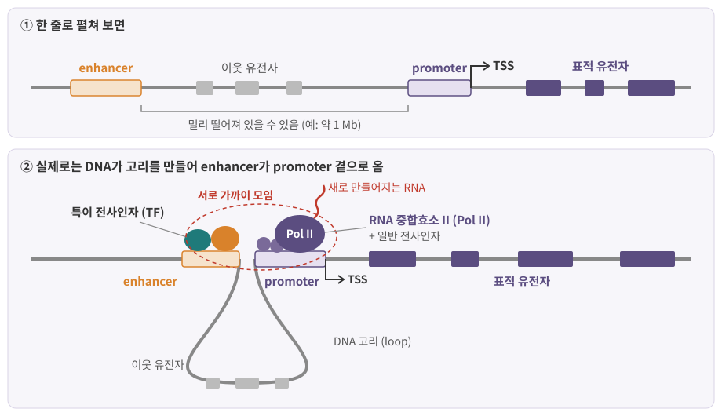
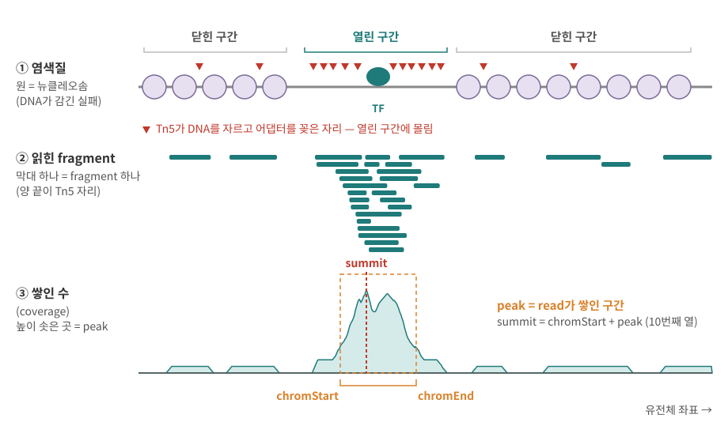
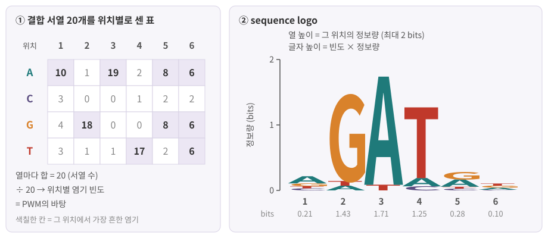

::: {.callout-note collapse="true"}
## 참고 자료
- Essential Cell Biology 7, 8장 — 구조 참고
- OpenStax Biology 2e 16장 Gene Expression — 구조 참고
- 본문의 숫자는 옆의 배지가 출처. 세포 종류·측정법마다 다르므로 **자릿수**로 읽기
- 그림은 직접 그린 모식도
:::

# 1. 전사: DNA를 RNA로 베끼기

## 1) 무엇을 베끼나

- 전사 (transcription): DNA 한 가닥을 주형 (template)으로 삼아, 그와 짝이 맞는 RNA를 만드는 일
- 만드는 효소: RNA 중합효소 (RNA polymerase)
- RNA는 5'→3' 방향으로 자람 → `+` 가닥 유전자인지 `−` 가닥 유전자인지가 GTF의 strand 칸 ([2장](02_biomolecules.qmd), [3장](03_genome_chromatin.qmd))
- 시퀀싱이 세는 RNA는 모두 이 단계에서 태어남 → **발현량 차이의 출발점**

::: {.callout-important}
## 전사 조절 (transcriptional regulation)
- 우리 몸의 세포는 거의 같은 유전체를 가짐
- 그런데 T세포와 간세포가 켜는 유전자는 다름 → 차이는 **어느 유전자를, 언제, 얼마나 전사하느냐**
- 이것을 정하는 장치: promoter·enhancer(DNA 위의 자리), 전사인자(그 자리에 붙는 단백질), 후성유전 상태(그 자리에 닿을 수 있는지)
:::

## 2) RNA 중합효소는 세 종류

| 효소 | 만드는 RNA | 데이터에서 |
|---|---|---|
| RNA 중합효소 I (Pol I) | 큰 rRNA 세 가지 (28S, 18S, 5.8S) | 세포 RNA의 대부분(약 80%)이 rRNA [BioNumbers](https://bionumbers.hms.harvard.edu/bionumber.aspx?id=107234){.src} → 제거하거나 피해서 잡음 ([6장](06_rna_processing.qmd)) |
| RNA 중합효소 II (Pol II) | **mRNA**, 일부 snRNA | RNA-seq이 주로 세는 대상 |
| RNA 중합효소 III (Pol III) | tRNA, 5S rRNA, U6 snRNA, 7SL RNA 등 작은 RNA | 짧은 RNA들 → 종류는 [6장](06_rna_processing.qmd) |

- 효소별 산물: [Pol I·III 리뷰 2000](https://pubmed.ncbi.nlm.nih.gov/10684922/){.src} [Pol I–III 리뷰](https://www.ncbi.nlm.nih.gov/pmc/articles/PMC10907179/){.src}
- RNA 종류 정리는 [6장](06_rna_processing.qmd)
- 이 장의 나머지는 **Pol II가 mRNA를 만드는 과정의 조절** 이야기

# 2. promoter와 전사인자

## 1) promoter와 TSS

- TSS (transcription start site): RNA의 첫 글자가 만들어지는 위치 (좌표 +1)
- promoter: TSS 바로 주변(주로 앞쪽)의 구간 — Pol II와 일반 전사인자가 자리를 잡는 곳
- 교과서의 대표 서열 TATA box는 **일부** promoter에만 있음
  - 사람 promoter 데이터베이스 분석에서 약 12% [TATA 분석 2006](https://www.ncbi.nlm.nih.gov/pmc/articles/PMC1780112/){.src}. 서열을 얼마나 느슨하게 정의하느냐에 따라 달라짐
- 사람 promoter의 상당수는 대신 CpG island 위에 있음 → 4절

## 2) 일반 전사인자와 특이 전사인자

| | 일반 전사인자 (general transcription factor) | 특이 전사인자 (sequence-specific TF) |
|---|---|---|
| 이름 예 | TFIID, TFIIB 등 (TF**II** = Pol II용) | *SPI1*(PU.1), *GATA1*, *FOXP3* 등 |
| 붙는 곳 | 거의 모든 Pol II promoter의 중심부 | 자기가 좋아하는 **짧은 서열**이 있는 promoter·enhancer |
| 하는 일 | Pol II를 TSS에 앉히는 공통 장치 | 어느 유전자를 켤지(또는 끌지) **고름** |
| 세포마다 | 거의 같음 | 세포 종류마다 다름 → [10장](10_cell_identity.qmd) |

- 앞으로 "TF"라고만 쓰면 특이 전사인자
- 사람 TF: **1,600개가 넘음**, 그중 약 3분의 2는 결합 서열이 알려짐 [Lambert 2018](https://doi.org/10.1016/j.cell.2018.01.029){.src}

## 3) TF는 짧은 서열을 읽는다: 모티프

- 모티프 (motif): TF가 잘 붙는 DNA 서열의 **패턴**
- 길이는 짧음 — 대개 6–12 bp [DREAM5](https://dreamchallenges.org/dream-5-transcription-factor-dna-motif-recognition-challenge/){.src}
- 정확히 한 서열이 아니라 **위치마다 허용하는 정도가 다른 선호도**
  - 어떤 위치는 거의 한 염기로 고정, 어떤 위치는 아무 염기나 괜찮음
  - 이 선호도를 표로 적은 것 = PWM, 그림으로 그린 것 = sequence logo (장 끝 데이터 상자 2)
- 짧은 패턴이라 유전체에서 **우연히도 매우 자주** 나타남 → "서열이 맞는다"만으로는 결합을 설명하지 못함

# 3. enhancer와 세포 종류

## 1) enhancer와 DNA 고리

{fig-alt="위 패널은 enhancer, 이웃 유전자, promoter, TSS, 표적 유전자가 한 줄로 놓인 DNA. 아래 패널은 사이의 DNA가 고리로 빠지면서 enhancer 위의 두 TF와 promoter 위의 일반 전사인자, RNA 중합효소 II가 가까이 모이고 새 RNA가 나오는 모습"}

- enhancer: TF 여러 개가 모여 붙어 **전사를 높이는** 조절 구간
- 표적 유전자에서 멀리 있을 수 있음, 중간에 다른 유전자가 끼어 있기도 함
  - 예: *Shh*의 enhancer ZRS는 약 1 Mb 떨어진 다른 유전자의 intron 안에 있음 → [3장](03_genome_chromatin.qmd)
- 멀리 있는 enhancer가 일하려면 DNA가 접혀 **고리 (loop)**를 만들어 promoter 곁으로 와야 함 (3차원 구조는 [3장](03_genome_chromatin.qmd))
- 분석에서의 뜻: peak나 변이를 **가장 가까운 유전자**에 붙이는 것은 편하지만 틀릴 수 있음

## 2) 세포 종류마다 다른 TF 조합

- TF 하나가 혼자 유전자를 켜는 경우는 드묾 → 여러 TF의 **조합**이 enhancer를 고름
- 예: 대식세포와 B 세포
  - 두 세포 모두 PU.1(유전자 *SPI1*)을 가짐
  - 그런데 PU.1이 붙는 자리는 세포마다 다름 — 각 세포의 계통 TF(대식세포용, B 세포용)와 **함께** 붙는 곳에서 enhancer가 열림 [Heinz 2010](https://pmc.ncbi.nlm.nih.gov/articles/PMC2898526){.src}
- 그래서 같은 유전체에서 세포 종류마다 다른 enhancer 지도가 생김 → 세포 정체성 ([10장](10_cell_identity.qmd))
- 데이터에서: 세포 종류별로 열린 구간(ATAC peak)이 다르고, 그 구간에 많은 모티프로 "이 세포를 움직이는 TF"를 추정함 (장 끝 데이터 상자)

::: {.callout-tip collapse="true"}
## 비유: 같은 악보, 다른 연주
- 유전체 = 모든 단원이 같은 총보를 가짐
- TF 조합 = 지휘자가 고른 "이번에 연주할 파트"
- enhancer = 악보 곳곳의 "여기서 크게" 표시. 멀리 떨어진 페이지에 적혀 있어도 접어서 맞대면 해당 마디에 적용됨
:::

# 4. 후성유전: 서열은 같아도 상태가 다르다

- 후성유전 (epigenetics): DNA 서열을 바꾸지 않고 유전자 발현 상태를 정하고, 세포가 분열해도 이어지는 표지
- 이 책에서 다루는 세 가지: 열린 염색질, DNA 메틸화, 히스톤 변형

## 1) 열린 염색질과 닫힌 염색질

- DNA는 뉴클레오솜에 감겨 있음 ([3장](03_genome_chromatin.qmd))
- TF와 Pol II가 DNA에 붙으려면 그 자리가 **드러나 있어야** 함
- 열린 염색질 (open chromatin, accessible chromatin): 뉴클레오솜이 비켜서 DNA가 드러난 짧은 구간
  - 활성 promoter, 일하는 enhancer가 대표적
- 열린 구간을 재는 방법이 ATAC-seq → 장 끝 데이터 상자 1

## 2) DNA 메틸화

- DNA 메틸화 (DNA methylation): C(사이토신)에 작은 메틸기가 붙는 것. 포유류에서는 주로 **CpG** (C 바로 다음이 G인 자리)의 C
- 사람 유전체의 CpG 약 2,800만 개, 한 연구에서 그중 약 60%가 메틸화 [Edwards 2010](https://genome.cshlp.org/content/20/7/972){.src} — 조직·측정법마다 다름
- CpG island: CpG가 드물지 않고 몰려 있는 구간
  - 고전적 정의(Gardiner-Garden & Frommer 1987): 200 bp 이상, GC 비율 50% 초과, 관측/기대 CpG 비 0.6 이상
  - 이 기준은 반복 서열까지 잡는 일이 많아 더 엄격한 기준(500 bp 이상, GC 55% 이상, 0.65 이상)도 제안됨 [Takai & Jones 2002](https://pmc.ncbi.nlm.nih.gov/articles/PMC122594/){.src} → 어느 정의로 만든 CpG island 목록인지 확인
  - 대부분 **메틸화되지 않은** 상태이고, 대개 전사가 시작되는 자리(promoter)에 있음 [Deaton & Bird 2011](https://doi.org/10.1101/gad.2037511){.src}
- promoter의 CpG island가 메틸화되면 그 유전자는 **꺼진 채로 오래 유지**되는 경향 [Deaton & Bird 2011](https://doi.org/10.1101/gad.2037511){.src}
- 메틸화는 RNA-seq이나 ATAC-seq이 아니라 별도 실험(bisulfite 시퀀싱, 메틸화 array 등)으로 잼

## 3) 히스톤 변형

- 히스톤 꼬리의 특정 아미노산에 화학 표지가 붙음 → 그 자리 염색질의 상태와 연관
- 이름 읽는 법: **H3K27ac** = 히스톤 **H3**의 **27**번째 아미노산 lysine(**K**)에 acetyl(**ac**) 기가 붙음. me1·me3 = 메틸기 1개·3개

| 표지 | 주로 있는 곳 | 뜻 |
|---|---|---|
| H3K4me3 | 활성 promoter (TSS 주변) | 켜진 또는 켤 준비가 된 promoter |
| H3K4me1 | enhancer | enhancer 표시 (활성 여부와 별개) |
| H3K27ac | 활성 enhancer와 promoter | **일하는** enhancer — H3K4me1만 있고 H3K27ac가 없으면 대기 상태 [Creyghton 2010](https://dspace.mit.edu/handle/1721.1/84587){.src} |
| H3K36me3 | 전사되고 있는 유전자 몸통 | 전사가 지나간 흔적 |
| H3K27me3 | 넓은 억제 구간 | Polycomb 단백질에 의한 억제 |
| H3K9me3 | 이질염색질, 반복 서열 | 오래 닫혀 있는 구간 |

- 사람 참조 후성유전체 프로젝트 (Roadmap Epigenomics)는 H3K4me3, H3K4me1, H3K36me3, H3K27me3, H3K9me3 다섯 표지를 핵심으로 재고, H3K27ac는 일부 시료에서 더 잼. 표지의 조합으로 염색질 상태 (chromatin state)를 나눔 [Roadmap 2015](https://pubmed.ncbi.nlm.nih.gov/25693563/){.src}
- 히스톤 표지는 항체로 잡아 ChIP-seq으로 잼 → 장 끝 데이터 상자 1

::: {.callout-warning collapse="true"}
## 처음엔 여기서 헷갈려요: 전사 조절
| 헷갈리는 짝 | 차이 |
|---|---|
| promoter vs enhancer | promoter는 TSS 바로 옆, Pol II가 앉는 곳. enhancer는 멀리 있을 수 있고 TF 조합으로 전사를 높임 |
| 일반 전사인자 vs 특이 전사인자 | 일반 = 모든 promoter의 공통 장치, 특이(TF) = 어느 유전자를 켤지 고름 |
| 모티프가 있다 vs TF가 붙어 있다 | 모티프는 서열 위의 가능성. 실제 결합은 열린 염색질·다른 TF·세포 종류에 달림 (데이터 상자 2) |
| 열려 있다 vs 전사 중이다 | 열린 염색질은 "닿을 수 있음". 대기 중인 enhancer처럼 열려 있어도 아직 전사가 없을 수 있음 |
| DNA 메틸화 vs 히스톤 메틸화 | 이름은 비슷하지만 대상이 다름. DNA 메틸화는 C에, H3K4me3 등은 히스톤 단백질에 |
| 가장 가까운 유전자 vs 표적 유전자 | enhancer는 고리로 멀리 있는 유전자를 조절할 수 있음 |
:::

::: {.callout-caution .data-box icon=false collapse="true"}
## 데이터에서는 이렇게 보여요: peak = read가 쌓인 구간, narrowPeak 한 줄 = peak 하나

**두 실험이 재는 것**

| | ATAC-seq | ChIP-seq |
|---|---|---|
| 재는 것 | 열린 염색질 | 특정 단백질(TF) 또는 히스톤 표지가 붙은 자리 |
| 원리 | Tn5 전이효소 (transposase)가 열린 DNA를 자르면서 시퀀싱 어댑터를 바로 꽂음 [Buenrostro 2013](https://pubmed.ncbi.nlm.nih.gov/24097267/){.src} | 항체로 단백질을 잡아, 거기 붙어 있던 DNA 조각을 함께 끌어내 시퀀싱 |
| 필요한 것 | 세포 수백–수만 개 [Buenrostro 2013](https://pubmed.ncbi.nlm.nih.gov/24097267/){.src}, single-cell도 가능 | 단백질마다 좋은 항체, 비교용 대조군(input, IgG) |
| 비슷한 방법 | DNase-seq | CUT&RUN, CUT&Tag (항체는 [12장](12_data_generation.qmd)) |

: {tbl-colwidths="[14,43,43]"}

{fig-alt="세 줄짜리 트랙 모식도. 첫 줄은 뉴클레오솜 사이 열린 구간에 TF가 붙어 있고 빨간 삼각형(Tn5 자리)이 열린 구간에 몰림. 둘째 줄은 fragment 막대가 열린 구간에 많이 쌓임. 셋째 줄은 coverage가 솟은 peak와 chromStart, chromEnd, summit 표시"}

**peak 파일: narrowPeak**

- peak caller (예: MACS2/MACS3)가 read가 배경보다 많이 쌓인 구간을 찾아 적음
- 형식: BED 6열 + 4열 = 10열, 탭 구분, 좌표는 BED처럼 **0-based** ([3장](03_genome_chromatin.qmd)) [UCSC](https://genome.ucsc.edu/goldenPath/help/bigNarrowPeak.html){.src} [MACS3 문서](https://macs3-project.github.io/MACS/docs/narrowPeak.html){.src}

```
chr1   1000   1400   sampleA_peak_17   312   .   8.21   34.6   31.2   210
```

| 열 | 이름 | 뜻 (MACS3 출력 기준) |
|---|---|---|
| 1–3 | chrom, chromStart, chromEnd | peak 구간 |
| 4 | name | peak 이름 |
| 5 | score | 브라우저 표시용 0–1000. MACS3는 −log10 q × 10을 넣어 1000을 넘기도 함 → **통계량으로 쓰지 말 것** |
| 6 | strand | 방향을 알 수 없으므로 `.` |
| 7 | signalValue | 배경 대비 몇 배 많은지 (fold enrichment, summit 기준) |
| 8 | pValue | −log10 p |
| 9 | qValue | −log10 q (FDR) |
| 10 | peak | summit 위치 = chromStart로부터의 거리 (없으면 −1) |

: {tbl-colwidths="[8,30,62]"}

- 위 예시 줄(가상)의 summit: 1000 + 210 = 1210 (0-based)
- motif 분석은 흔히 peak 전체보다 **summit 주변 일정 폭**을 씀 — 예: HOMER `-size 200`은 peak 중심 200 bp [HOMER](http://homer.ucsd.edu/homer/ngs/peakMotifs.html){.src}

**single-cell ATAC**

- Cell Ranger ATAC/ARC 출력의 출발점
  - `fragments.tsv.gz`: fragment 하나에 한 줄 — `chrom`, `start`, `end`(BED처럼 0-based) [10x Genomics](https://www.10xgenomics.com/support/software/cell-ranger-atac/latest/analysis/outputs/fragments-file){.src}, 이어서 `barcode`, `readCount` [Signac](https://stuartlab.org/signac/articles/pbmc_vignette.html){.src}
  - peak × cell 행렬: 행 = peak, 열 = 세포, 칸 = 그 peak 안에 떨어진 Tn5 삽입 자리 수 [Signac](https://stuartlab.org/signac/articles/pbmc_vignette.html){.src} → [0장](00_why_biology.qmd) 표의 scATAC 행 (도구에 따라 fragment 수로 세기도 함)
- 세포 하나에는 한 자리의 DNA가 두 벌뿐 → 칸은 대부분 0이고 값도 작음 (0, 1, 2 …)
- QC 지표 (Signac)
  - `nucleosome_signal`: 147–294 bp fragment(뉴클레오솜 하나를 감싼 길이) 대 147 bp 미만(뉴클레오솜 없는 구간) 비율 [Signac](https://stuartlab.org/signac/reference/NucleosomeSignal.html){.src}
  - `TSS.enrichment`: TSS 주변에 fragment가 몰린 정도. 낮으면 실험이 잘 안 된 것
  - FRiP (fraction of reads in peaks): 15–20% 미만이면 저품질 세포를 의심 [Signac](https://stuartlab.org/signac/articles/pbmc_vignette.html){.src}
- fragment 길이 분포: 약 200 bp 간격의 물결 = 뉴클레오솜 0개, 1개, 2개를 사이에 둔 fragment [Buenrostro 2013](https://pubmed.ncbi.nlm.nih.gov/24097267/){.src} → 이 무늬가 안 보이면 의심
:::

::: {.callout-caution .data-box icon=false collapse="true"}
## 데이터에서는 이렇게 보여요: TF 모티프는 위치별 염기 빈도 표(PWM)이고, 모티프가 있다고 결합하는 것은 아니다

**PFM → PWM → logo**

- 한 TF가 붙는 서열을 여러 개 모아 줄 맞춤 → 위치마다 A·C·G·T를 셈 = PFM (position frequency matrix)
- 열마다 빈도로 바꾸고, 배경 빈도(예: 각 25%)와 비교해 log 비를 취함 = PWM (position weight matrix)
- sequence logo: 위치마다 글자를 쌓은 그림 [WebLogo](https://pmc.ncbi.nlm.nih.gov/articles/PMC419797/){.src}
  - 열 전체 높이 = 그 위치가 얼마나 고정되어 있는지 (정보량, bits). DNA는 네 글자라 최대 log₂4 = **2 bits**
  - 글자 높이 = 그 염기의 빈도 × 정보량

{fig-alt="왼쪽은 6개 위치에서 A, C, G, T의 개수를 센 표. 오른쪽은 같은 표로 그린 sequence logo로, 2번 G, 3번 A, 4번 T가 크게 서 있고 각 위치 아래에 정보량 0.21, 1.43, 1.71, 1.25, 0.28, 0.10 bits가 적혀 있음"}

**서열 하나에 점수 매기기 — 작은 PWM**

```{r}
#| label: pwm-score
# 그림 왼쪽의 표: 행 = 염기, 열 = 위치
cnt <- matrix(c(10, 3, 4, 3,   1, 0, 18, 1,   19, 0, 0, 1,
                 2, 1, 0, 17,  8, 2, 8, 2,    6, 2, 6, 6),
              nrow = 4, dimnames = list(c("A", "C", "G", "T"), 1:6))
p   <- prop.table(cnt + 0.5, margin = 2)  # 열마다 빈도 (0 피하려 +0.5)
pwm <- log2(p / 0.25)                     # 배경 25% 대비 log2 비
score <- function(s) {
  b <- strsplit(s, "")[[1]]
  sum(pwm[cbind(b, 1:6)])                 # 위치마다 그 염기 칸을 더함
}
sapply(c("AGATAA", "TGATGC", "CCCGGG"), score)
```

- `AGATAA` 7.05 = 이 PWM의 최고점, `TGATGC` 4.08 = 두 군데가 어긋났지만 양수, `CCCGGG` −10.16
- 실제 도구도 같은 계산을 유전체 전체에 미끄러뜨리며 하고, **기준 점수**를 넘는 자리를 "모티프 있음"으로 표시

**우연히 몇 번 나올까**

```{r}
#| label: motif-chance
genome <- 3.1e9      # 사람 유전체 한 벌 (bp)
k <- 8               # 정확히 맞아야 하는 길이
genome * 2 / 4^k     # 두 가닥, 네 염기가 같은 비율이라고 가정
```

- 정확히 맞는 8 bp 서열도 약 9만 5천 번 — 느슨한 PWM 기준이면 훨씬 많음
- TF 하나가 실제로 붙는 자리는 이보다 훨씬 적음 → 서열만으로 예측한 결합 자리는 대부분 실제로 쓰이지 않음 [Wasserman 2004](https://www.nature.com/articles/nrg1315.pdf){.src}

**분석 도구**

| 도구 | 입력 → 출력 | 묻는 질문 |
|---|---|---|
| JASPAR | TF별 PFM 모음 (오픈 DB, 2024년 10번째 판) [JASPAR 2024](https://pmc.ncbi.nlm.nih.gov/articles/PMC10767809){.src} | 이 TF의 모티프는? |
| HOMER `findMotifsGenome.pl` | peak 파일 → `knownResults.txt` 등 [HOMER](http://homer.ucsd.edu/homer/ngs/peakMotifs.html){.src} [Heinz 2010](https://pmc.ncbi.nlm.nih.gov/articles/PMC2898526){.src} | 이 peak 집합에 배경보다 많은 모티프는? |
| chromVAR `computeDeviations()` | peak × cell 행렬 + 모티프 → 세포 × 모티프 deviation z-score [chromVAR](https://bioconductor.org/packages/release/bioc/vignettes/chromVAR/inst/doc/Introduction.html){.src} [Schep 2017](https://pmc.ncbi.nlm.nih.gov/articles/PMC5623146/){.src} | 어느 세포에서 이 모티프를 가진 peak들이 기대보다 더 열려 있나? |
| Signac `AddMotifs()`, `FindMotifs()` | Seurat 객체 안의 peak + JASPAR 모티프 [Signac](https://stuartlab.org/signac/articles/pbmc_vignette.html){.src} | 두 세포 종류 사이에 차이 나는 peak에 많은 모티프는? |

**분석에서의 판단**

- 모티프 enrichment 결과 = "이 TF **계열**이 관여할 **가능성**". 같은 계열 TF는 모티프가 거의 같아서 하나로 특정하기 어려움
- 그 TF의 mRNA가 그 세포에서 발현되는지 함께 확인 (multiome이면 같은 세포의 RNA로)
- 배경(background) peak 선택이 결과를 바꿈 → GC 비율이 비슷한 배경을 쓰는 이유
:::

# 5. 정리

- 전사 = DNA를 주형으로 RNA를 만드는 일. mRNA는 Pol II가, rRNA와 tRNA는 Pol I·III가 만듦
- 일반 전사인자는 모든 promoter의 공통 장치, 특이 전사인자(TF)는 짧은 모티프를 읽어 어느 유전자를 켤지 고름
- enhancer는 멀리 있어도 DNA 고리로 promoter 곁에 옴 → 가장 가까운 유전자가 표적이라는 보장 없음. 세포 종류마다 다른 TF 조합이 다른 enhancer를 엶
- 후성유전 상태(열린 염색질, CpG 메틸화, 히스톤 표지)가 TF가 그 자리에 닿을 수 있는지를 정함
- ATAC·ChIP peak = read가 쌓인 구간. narrowPeak 10열, summit = chromStart + 10번째 열, scATAC은 peak × cell 행렬
- 모티프는 PWM과 logo로 표현. 모티프가 있다 ≠ 결합한다 → 열린 염색질과 발현을 함께 봄

# 연습문제

1. narrowPeak 한 줄이 `chr2  50000  50600  p_1  540  .  12.3  60.1  55.7  250`이다. (a) summit의 0-based 좌표는? (b) summit 주변 ±100 bp 구간을 BED 형식(0-based, end 미포함)으로 쓰면? (c) 5번째 열 540을 p값처럼 해석하면 안 되는 이유는?
2. 6 bp 모티프가 정확히 일치하는 자리는 사람 유전체(두 가닥, 31억 bp)에서 우연히 몇 번쯤 나올까? 실제 ChIP-seq에서 그 TF의 peak가 2만 개였다면, 이 두 숫자의 차이를 어떻게 설명하겠나?
3. scATAC 데이터에서 어떤 peak가 T세포 클러스터에서만 열려 있고, 가장 가까운 유전자는 *GENE_X*이다. 동료가 "이 peak가 *GENE_X*를 켠다"고 결론 내렸다. 이 결론을 뒷받침하거나 반박하려면 무엇을 더 보면 좋을지 두 가지를 들어라.
4. 어떤 enhancer 후보 구간에 H3K4me1은 높지만 H3K27ac는 없다. 이 구간의 상태를 어떻게 해석하겠나? 같은 구간이 ATAC에서 peak로 잡혔다면 해석이 어떻게 달라지나?
