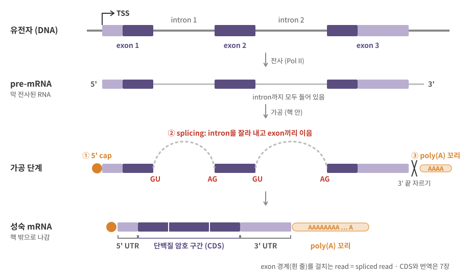
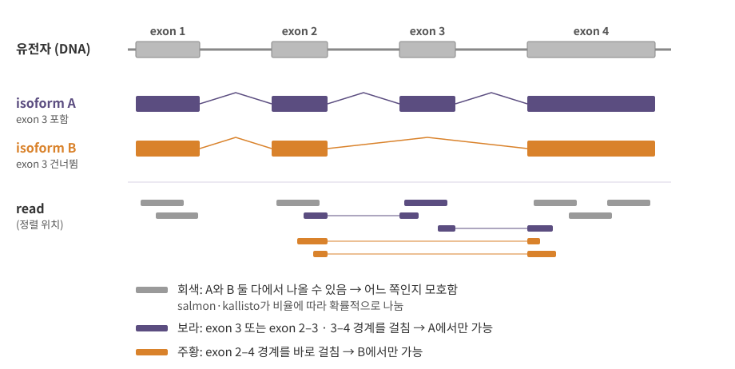
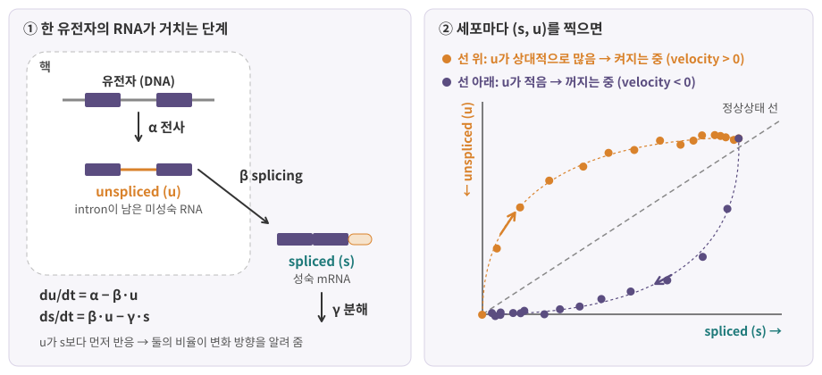
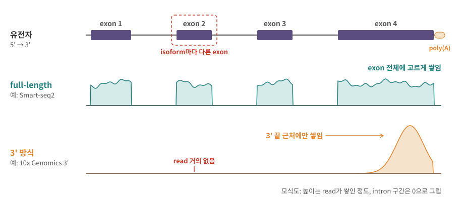

::: {.callout-note collapse="true"}
## 참고 자료
- Essential Cell Biology 7장 — 구조 참고
- OpenStax Biology 2e 15장 Genes and Proteins — 구조 참고
- 본문의 숫자는 옆의 배지가 출처. 도구 이름·열 이름은 각 도구의 문서 기준
- 그림은 직접 그린 모식도
:::

# 1. 막 만든 RNA는 아직 완성품이 아니다

## 1) pre-mRNA에서 성숙 mRNA로

- Pol II가 막 만든 RNA = pre-mRNA (전구 mRNA): exon과 intron이 모두 들어 있음 ([3장](03_genome_chromatin.qmd)의 유전자 구조)
- 핵 안에서 세 가지 가공을 거쳐 성숙 mRNA (mature mRNA)가 된 뒤 세포질로 나감

{fig-alt="네 줄 모식도. 유전자 DNA의 exon 3개와 intron 2개, intron까지 들어 있는 pre-mRNA, 5' cap이 붙고 GU와 AG 경계에서 intron이 고리로 빠지며 3' 끝이 잘려 AAAA 꼬리가 붙는 가공 단계, cap과 exon 셋과 poly(A) 꼬리로 된 성숙 mRNA"}

| 단계 | 하는 일 | 데이터에서 보이는 흔적 |
|---|---|---|
| ① 5' cap | 5' 끝에 변형된 G 하나를 붙인 모자 → 끝을 보호, 번역 시작에 쓰임 ([7장](07_translation_protein.qmd)) | 5' 끝 = TSS 쪽. 5' 방식(10x 5')은 이쪽 끝 근처를 읽음 [10x Cell Ranger](https://github.com/10XGenomics/cellranger/blob/main/lib/python/cellranger/chemistry_defs.json){.src} |
| ② splicing | intron을 잘라 내고 exon끼리 이음 | exon–exon 경계를 걸치는 read (spliced read) |
| ③ 3' 끝 + poly(A) 꼬리 | polyA 신호(대표 서열 AAUAAA)에서 10–30 nt 뒤를 자르고 A를 길게 붙임 [Beaudoing 2000](https://genome.cshlp.org/content/10/7/1001){.src} | poly(A)를 잡는 방법에서 read가 3' 끝에 몰림 (장 끝 데이터 상자) |

- 가공 중인 RNA는 핵에 있음 → 핵을 읽으면 intron read가 많음 ([1장](01_cell_system.qmd)의 snRNA-seq)

## 2) splicing과 GU–AG 경계

- splicing: 스플라이세오좀 (spliceosome) — 작은 RNA(snRNA)와 단백질의 복합체 — 이 intron 양 끝을 알아보고 잘라 냄
- intron 경계의 규칙: 대부분 **GU로 시작해 AG로 끝남** (DNA 서열로는 GT…AG)
  - 포유류 splice site 쌍의 98.71%가 GT–AG, 0.56%가 GC–AG, 나머지는 AT–AC 등 드문 쌍 [Burset 2000](https://pmc.ncbi.nlm.nih.gov/articles/PMC29840){.src}
- 정렬 프로그램도 이 규칙을 씀 — 예: STAR [STAR 매뉴얼](https://github.com/alexdobin/STAR/blob/master/doc/STARmanual.pdf){.src}
  - `SJ.out.tab` 5번째 열 = intron 모티프: `1` GT/AG, `2` CT/AC, `3` GC/AG, `4` CT/GC, `5` AT/AC, `6` GT/AT, `0` 그 밖 (비정형)
  - 짝수 번호는 `−` 가닥 유전자의 같은 모티프를 `+` 가닥 쪽에서 읽은 것 (GT/AG의 역상보 = CT/AC, [2장](02_biomolecules.qmd))
  - 기본 설정에서 annotation에 없는 비정형(`0`) 경계는 더 많은 read가 있어야 보고됨 (`--outSJfilterCountUniqueMin 3 1 1 1`: 비정형 3개, 나머지 1개)

::: {.callout-tip collapse="true"}
## 비유: 영화 편집
- pre-mRNA = 촬영 원본, intron = 잘라 낼 장면, exon = 남길 장면
- 편집자(spliceosome)는 장면 앞뒤의 표식(GU…AG)을 보고 자름
- 같은 원본에서 어떤 장면을 남기느냐에 따라 **다른 버전**이 나옴 → 2절 isoform
:::

# 2. 한 유전자, 여러 isoform

## 1) 대체 splicing

- 대체 splicing (alternative splicing): 같은 pre-mRNA에서 exon 조합을 다르게 이어 서로 다른 mRNA를 만듦
- 사람의 exon이 여러 개인 유전자 중 약 95%가 대체 splicing을 거친다는 추정 [Pan 2008](https://doi.org/10.1038/ng.259){.src}
- 그래서 annotation에는 한 유전자에 transcript가 여러 개 달린 경우가 흔함 → 정량할 때 "어느 isoform의 read인가"가 문제 (장 끝 데이터 상자 1)

::: {.callout-important}
## isoform (= transcript)
- 같은 유전자에서 나온, exon 조합이나 시작·끝 위치가 다른 RNA 하나하나
- GTF에서 `transcript_id` 하나 = isoform 하나. 여러 transcript가 같은 `gene_id`를 공유 ([3장](03_genome_chromatin.qmd))
- gene 수준의 양 = 그 유전자 isoform들의 합
:::

| 종류 | 무엇 |
|---|---|
| exon 건너뛰기 (exon skipping) | 가운데 exon 하나를 넣거나 뺌 |
| 대체 5'·3' splice site | exon 경계를 조금 앞이나 뒤에서 자름 |
| intron 남기기 (intron retention) | intron 하나를 자르지 않고 남김 |
| 대체 첫 exon·마지막 exon | 다른 TSS나 다른 3' 끝을 씀 |

- isoform이 다르면 단백질의 일부 구간이 빠지거나([7장](07_translation_protein.qmd)), 3' UTR이 달라 mRNA의 조절이 달라질 수 있음

## 2) 대체 poly(A)

- 한 유전자 안에 poly(A)를 붙일 수 있는 자리가 여러 개 → 3' 끝이 다른 isoform (대체 polyadenylation)
- 흔히 3' UTR 길이가 달라짐 — 단백질은 같아도 mRNA 조절이 달라질 수 있음
- poly(A) 쪽 3' 끝만 읽는 데이터에서도 이 차이는 보일 수 있음: read 무더기의 위치가 달라지기 때문 [Patrick 2020](https://genomebiology.biomedcentral.com/articles/10.1186/s13059-020-02071-7){.src}

# 3. RNA의 종류

| 종류 | 하는 일 | 데이터에서 |
|---|---|---|
| mRNA | 단백질의 설계도 | 전체 RNA의 1–5% [Qiagen](https://www.qiagen.com/cm/knowledge-and-support/knowledge-hub/bench-guide/rna/introduction/rna-numbers-size-molecular-weight-distribution-yield-and-conversions){.src}. 대부분의 RNA-seq이 세려는 대상 |
| rRNA | 리보솜의 재료 (28S, 18S, 5.8S, 5S, [7장](07_translation_protein.qmd)) | 전체 RNA의 약 80% [BioNumbers](https://bionumbers.hms.harvard.edu/bionumber.aspx?id=107234){.src} → 제거하거나 피해서 라이브러리를 만듦 |
| tRNA | 아미노산을 리보솜으로 나름 ([7장](07_translation_protein.qmd)) | 짧은 RNA |
| snRNA | splicing (스플라이세오좀의 RNA) | 짧은 RNA |
| miRNA | 약 22 nt의 작은 RNA. 표적 mRNA에 짝지어 그 양이나 번역을 줄임 [Bartel 2004](https://pubmed.ncbi.nlm.nih.gov/14744438/){.src} | 아주 짧음 → 따로 small RNA-seq. 예: miRge3는 새 miRNA를 찾을 때 16–25 nt read만 씀 [miRge3](https://mirge3.readthedocs.io/en/master/quick_start.html){.src} |
| lncRNA | 단백질을 만들지 않는 긴 RNA, 조절 역할이 알려진 것도 있음 | GTF의 `gene_type "lncRNA"` [GENCODE](https://www.gencodegenes.org/pages/data_format.html){.src} |

: {tbl-colwidths="[12,38,50]"}

- 어느 RNA 중합효소가 만드나: mRNA는 Pol II, 큰 rRNA는 Pol I, tRNA·5S rRNA·U6 snRNA는 Pol III → [5장](05_transcription.qmd) 표
- "비암호화 RNA (non-coding RNA, ncRNA)" = mRNA가 아닌 RNA 전부를 묶어 부르는 말
- 무엇을 잡느냐(poly(A), 크기, rRNA 제거)에 따라 같은 시료에서도 보이는 RNA 종류가 달라짐 → [12장](12_data_generation.qmd)

# 4. 핵 밖으로, 그리고 분해

- 가공이 끝난 mRNA는 핵공을 지나 세포질로 나감 ([1장](01_cell_system.qmd))
- 세포질에서 번역되다가 결국 분해됨
  - mRNA 반감기: 쥐 섬유모세포(NIH3T3)에서 중앙값 약 9시간 [BioNumbers](https://bionumbers.hms.harvard.edu/bionumber.aspx?id=106378){.src}, 유전자마다 다름 → [7장](07_translation_protein.qmd)
- 그래서 한 순간의 mRNA 양 = **만들어지는 속도와 분해되는 속도의 균형**
  - 전사가 막 켜진 유전자: 새 pre-mRNA(unspliced)가 먼저 늘고 성숙 mRNA(spliced)가 뒤따라 늘어남
  - 이 시간차를 이용하는 것이 RNA velocity (장 끝 데이터 상자 2)

::: {.callout-warning collapse="true"}
## 처음엔 여기서 헷갈려요: RNA 가공과 데이터
| 헷갈리는 짝 | 차이 |
|---|---|
| polyA 신호 vs poly(A) 꼬리 | 신호는 DNA·pre-mRNA 위의 짧은 서열([3장](03_genome_chromatin.qmd)), 꼬리는 가공 때 새로 붙이는 A의 줄 — 유전체에는 없음 |
| pre-mRNA vs 성숙 mRNA | pre-mRNA는 intron 포함·핵 안, 성숙 mRNA는 intron 제거·주로 세포질 |
| gene count vs transcript count | gene count = 그 유전자 isoform들의 합. transcript count는 모호한 read를 나눈 **추정값** |
| count vs TPM | count는 read 수(추정), TPM은 길이로 나누고 합을 100만으로 맞춘 비율 → 시료 간 DE에는 count를 씀 |
| intron read = 잡음? | 아님. 핵 속 pre-mRNA의 신호이고, snRNA-seq과 RNA velocity는 이것을 일부러 씀 |
| 3' 데이터의 isoform 결과 | 5' 쪽에서 갈리는 isoform은 3' 끝 read로는 구분이 거의 안 됨 (데이터 상자 3) |
:::

::: {.callout-caution .data-box icon=false collapse="true"}
## 데이터에서는 이렇게 보여요: read 하나가 여러 isoform에 맞으면, 정량 도구가 확률적으로 나눠 준다

{fig-alt="exon 4개짜리 유전자, exon 1-2-3-4로 이어진 isoform A와 exon 1-2-4로 이어진 isoform B. 아래 read 중 회색은 exon 1, 2, 4 안에 있어 둘 다 가능, 보라는 exon 3이나 exon 2-3, 3-4 경계를 걸쳐 A에서만 가능, 주황은 exon 2-4 경계를 걸쳐 B에서만 가능"}

**모호한 read를 나누는 법 — EM의 아이디어**

- salmon·kallisto는 read를 "맞을 수 있는 transcript 집합"별로 묶고, EM 알고리즘으로 각 transcript의 비율을 추정 [Patro 2017](https://doi.org/10.1038/nmeth.4197){.src} [Bray 2016](https://doi.org/10.1038/nbt.3519){.src}
- 핵심 반복: (1) 현재 비율대로 모호한 read를 나눔 → (2) 나눈 결과로 비율을 다시 계산 → 안 바뀔 때까지

```{r}
#| label: em-isoform
only_A <- 30; only_B <- 10; both <- 60      # read 수 (가상)
theta <- c(A = 0.5, B = 0.5)                # 처음엔 반반이라고 가정
for (i in 1:30) {
  n <- c(A = only_A + both * theta[["A"]],  # 공유 read를 현재 비율대로 나눔
         B = only_B + both * theta[["B"]])
  theta <- n / sum(n)                       # 비율 갱신
}
round(n, 1)
```

- 공유 read 60개가 반반(30:30)이 아니라 **45:15**로 나뉨 → A만의 증거가 B만의 증거보다 많기 때문
- 실제 도구는 transcript 길이, fragment 길이 분포, 서열 편향까지 함께 고려 (여기서는 두 isoform의 길이가 같다고 가정)

**출력 파일**

| 도구 | 파일 | 열 |
|---|---|---|
| salmon | `quant.sf` | `Name`, `Length`, `EffectiveLength`, `TPM`, `NumReads` [salmon](https://github.com/COMBINE-lab/salmon){.src} |
| kallisto | `abundance.tsv` (`abundance.h5`) | `target_id`, `length`, `eff_length`, `est_counts`, `tpm` [kallisto](https://github.com/pachterlab/kallisto){.src} |

- `NumReads`, `est_counts` = 추정 count → 공유 read가 비율대로 쪼개져 들어가므로 **소수**일 수 있음
- TPM (transcripts per million): count를 유효 길이로 나눈 뒤, 시료 안 합이 100만이 되도록 맞춘 값
  - 예: T1(1,000 nt, count 100), T2(4,000 nt, count 100)뿐이라면 길이당 read 0.1 대 0.025 → TPM 800,000 대 200,000
  - count가 같아도 짧은 transcript가 분자 수로는 더 많다는 뜻

**gene 수준으로 합치기: tximport**

- `tximport(files, type = "salmon", tx2gene = tx2gene)` → `abundance`(TPM), `counts`, `length` 세 행렬을 gene 수준으로 돌려줌 [tximport](https://bioconductor.org/packages/release/bioc/vignettes/tximport/inst/doc/tximport.html){.src}
  - `tx2gene` = transcript ID → gene ID 표 (GTF에서 만듦, [3장](03_genome_chromatin.qmd))
  - `txOut = TRUE`면 transcript 수준 그대로
- DE 분석으로 넘기는 두 방법 [tximport](https://bioconductor.org/packages/release/bioc/vignettes/tximport/inst/doc/tximport.html){.src} [Soneson 2015](https://doi.org/10.12688/f1000research.7563.1){.src}
  1. 원래 count + 길이 offset: `DESeq2::DESeqDataSetFromTximport()`가 알아서 처리
  2. `countsFromAbundance = "lengthScaledTPM"` 또는 `"scaledTPM"`으로 만든 count를 보통 count 행렬처럼 사용
- 피할 것: gene 수준 count를 offset **없이** 그대로 넘기기 — 시료마다 isoform 구성이 달라 평균 길이가 바뀌는 효과를 놓침
:::

::: {.callout-caution .data-box icon=false collapse="true"}
## 데이터에서는 이렇게 보여요: unspliced와 spliced를 따로 세면 세포가 어디로 가는지 추정할 수 있다 (RNA velocity)

{fig-alt="왼쪽은 핵 안에서 유전자 DNA가 전사되어 intron이 남은 unspliced RNA가 되고 splicing으로 spliced mRNA가 되어 핵 밖에서 분해되는 단계와 두 미분방정식. 오른쪽은 가로축 spliced, 세로축 unspliced 평면에 점선 정상상태 선과, 선 위로 올라가는 주황 점들(켜지는 중)과 선 아래로 내려오는 보라 점들(꺼지는 중)"}

**아이디어**

- 흔한 scRNA-seq에서도 intron이 남은 새 RNA(unspliced)와 성숙 mRNA(spliced)를 구별할 수 있음 [La Manno 2018](https://doi.org/10.1038/s41586-018-0414-6){.src} [scVelo 문서](https://scvelo.org){.src}
- 유전자마다 du/dt = α − β·u, ds/dt = β·u − γ·s
- 정상상태보다 u가 많으면 → 그 유전자 발현이 **늘어나는 중**, 적으면 **줄어드는 중**
- 여러 유전자의 방향을 모으면 세포의 "다음 상태"를 화살표로 그림 (UMAP 위 streamline)

**행렬 만들기**

| 도구 | 하는 일 | 결과 |
|---|---|---|
| velocyto `run10x` | Cell Ranger 출력(BAM + GTF)에서 read를 spliced/unspliced/ambiguous로 나눔 | `.loom` 파일 — 층(layer) `spliced`, `unspliced`, `ambiguous` [velocyto](http://velocyto.org/velocyto.py/index.html){.src} |
| STARsolo | `--soloFeatures Gene Velocyto` | 같은 세 가지 행렬 (velocyto 방식을 따름) [STARsolo](https://github.com/alexdobin/STAR/blob/master/docs/STARsolo.md){.src} |

- velocyto.py 저장소는 더 이상 관리되지 않고 STARsolo를 권함 [velocyto.py](https://github.com/velocyto-team/velocyto.py){.src} → 새로 시작한다면 STARsolo

**scVelo에서** [scVelo 문서](https://scvelo.org){.src} [Bergen 2020](https://doi.org/10.1038/s41587-020-0591-3){.src}

- `adata.layers["spliced"]`, `adata.layers["unspliced"]`에 두 행렬
- `scv.pp.moments()` → `scv.tl.velocity(mode = "stochastic")` (또는 `scv.tl.recover_dynamics()` 후 `mode = "dynamical"`) → `scv.tl.velocity_graph()` → `scv.pl.velocity_embedding_stream()`

**분석에서의 판단**

- 모델 가정(유전자 공통의 splicing 속도, 정상상태가 데이터에 보임)이 깨지면 화살표가 틀림 [scVelo 문서](https://scvelo.org){.src}
- 이미 다 자란 세포(예: 성숙한 PBMC)처럼 실제 변화가 거의 없는 데이터에서도 화살표는 그려짐 → 오해 주의 [Bergen 2021](https://doi.org/10.15252/msb.202110282){.src}
- unspliced 비율은 방법마다 다름: snRNA-seq은 intron read가 많음 ([1장](01_cell_system.qmd)) → 핵 데이터는 intron까지 세는 `--soloFeatures GeneFull`이 쓰임 [STARsolo](https://github.com/alexdobin/STAR/blob/master/docs/STARsolo.md){.src}
:::

::: {.callout-caution .data-box icon=false collapse="true"}
## 데이터에서는 이렇게 보여요: 3' 방식은 유전자의 3' 끝만 읽는다

{fig-alt="exon 4개짜리 유전자 아래 두 coverage 트랙. full-length 트랙은 네 exon 모두에 고른 높이, 3' 방식 트랙은 exon 4의 끝부분에만 봉우리가 있고 exon 2(isoform마다 다른 exon) 아래는 read가 거의 없음"}

- [0장](00_why_biology.qmd)의 질문 "read가 왜 유전자의 3' 끝에 몰려 있나?"의 답: poly(A) 꼬리를 손잡이로 mRNA를 잡고, 그 근처를 읽기 때문 (10x 3' 화학의 이름도 "polyA" [10x Cell Ranger](https://github.com/10XGenomics/cellranger/blob/main/lib/python/cellranger/chemistry_defs.json){.src})

| | full-length (예: Smart-seq2) | 3' 방식 (예: 10x Genomics 3') |
|---|---|---|
| read가 덮는 곳 | transcript 전체 [OSCA](https://bioconductor.org/books/release/OSCA.intro/getting-scrna-seq-datasets.html){.src} | 3' 끝 근처 |
| 세포 구분 | 세포마다 FASTQ 따로 (plate) [STARsolo](https://github.com/alexdobin/STAR/blob/master/docs/STARsolo.md){.src} | read 1의 세포 바코드 16 bp [10x Cell Ranger](https://github.com/10XGenomics/cellranger/blob/main/lib/python/cellranger/chemistry_defs.json){.src} |
| UMI | 없음 [STARsolo](https://github.com/alexdobin/STAR/blob/master/docs/STARsolo.md){.src} → read count | 12 bp (v3) [10x Cell Ranger](https://github.com/10XGenomics/cellranger/blob/main/lib/python/cellranger/chemistry_defs.json){.src} → UMI count |
| isoform·splicing | 볼 수 있음 [OSCA](https://bioconductor.org/books/release/OSCA.intro/getting-scrna-seq-datasets.html){.src} | 5' 쪽에서 갈리는 isoform은 거의 구분 못 함 |
| 길이 보정 | 필요 (긴 transcript에서 read가 더 나옴) | 하지 않음 — count에 길이 편향이 없어서, 보정하면 오히려 편향이 생김 [tximport](https://bioconductor.org/packages/release/bioc/vignettes/tximport/inst/doc/tximport.html){.src} |
| 세포 수 | 적음 | 많음 — droplet 방식은 처리량과 세포당 비용 때문에 사실상 표준 [OSCA](https://bioconductor.org/books/release/OSCA.intro/getting-scrna-seq-datasets.html){.src} |

: {tbl-colwidths="[18,41,41]"}

- 확인하는 법: gene body coverage — transcript를 5'→3'으로 같은 칸으로 나눠 평균 coverage를 그림
  - Picard `CollectRnaSeqMetrics`의 `MEDIAN_5PRIME_TO_3PRIME_BIAS` = 5' 끝 대 3' 끝 coverage 비 [Picard](https://github.com/broadinstitute/picard/blob/master/src/main/java/picard/analysis/RnaSeqMetrics.java){.src} → 3' 방식이면 0에 가까움
  - full-length 데이터인데 3' 쪽으로 크게 치우쳤다면 RNA 분해 같은 시료 문제를 의심
- 3' 데이터로 isoform을 말하고 싶다면: 대체 poly(A)처럼 **3' 끝에서 갈리는 차이**만 가능 [Patrick 2020](https://genomebiology.biomedcentral.com/articles/10.1186/s13059-020-02071-7){.src}
:::

# 5. 정리

- pre-mRNA는 핵에서 5' cap, splicing, 3' 끝 자르기와 poly(A) 꼬리를 거쳐 성숙 mRNA가 됨
- intron은 대부분 GU…AG 경계로 잘림. 정렬 도구(STAR)도 이 모티프로 splice junction을 판단
- 대체 splicing과 대체 poly(A)로 한 유전자에서 여러 isoform이 나옴 → 모호한 read는 salmon·kallisto가 EM으로 나누고, tximport가 gene 수준으로 합침
- RNA의 대부분은 rRNA이고 mRNA는 1–5% → 무엇을 잡느냐에 따라 보이는 RNA가 달라짐
- unspliced와 spliced를 따로 세면 RNA velocity로 변화 방향을 추정. 단, 가정이 깨지면 화살표도 틀림
- 3' 방식은 3' 끝만 읽음 → UMI가 있고 길이 보정이 필요 없지만, 5' 쪽 isoform 차이는 보이지 않음

# 연습문제

1. 데이터 상자 1의 EM에서 A에만 맞는 read 45, B에만 맞는 read 5, 둘 다 맞는 read 50이라면 수렴값은? 손으로 고정점(θ_A = (45 + 50·θ_A) / 100)을 풀어 보고, 코드의 숫자만 바꿔 확인하라.
2. 한 시료에 transcript가 셋뿐이다: T1(500 nt, count 50), T2(2,000 nt, count 200), T3(1,000 nt, count 50). 각 TPM을 구하라. count가 가장 큰 T2가 TPM으로도 가장 큰가? 이유는?
3. 10x 3' 데이터로 분석한 동료가 "질병군에서 유전자 X의 exon 2를 건너뛰는 isoform이 늘었다"고 말한다. exon 2는 유전자의 5' 쪽에 있다. 이 주장을 어떻게 검토하겠나? 어떤 데이터가 있으면 확인할 수 있나?
4. 같은 조직의 scRNA-seq과 snRNA-seq에서 velocity를 각각 그렸더니 화살표 방향이 다르게 나왔다. 두 데이터의 unspliced 비율이 다를 수 있는 생물학적 이유를 쓰고, 어느 쪽 결과를 더 믿을지 판단하는 데 필요한 정보를 두 가지 들어라.
