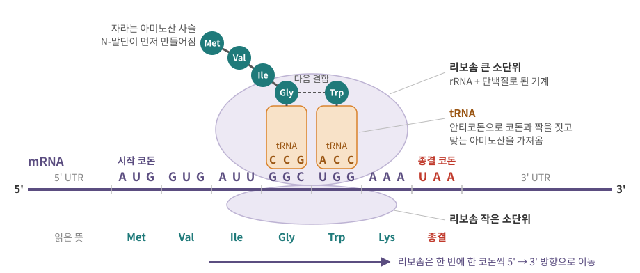
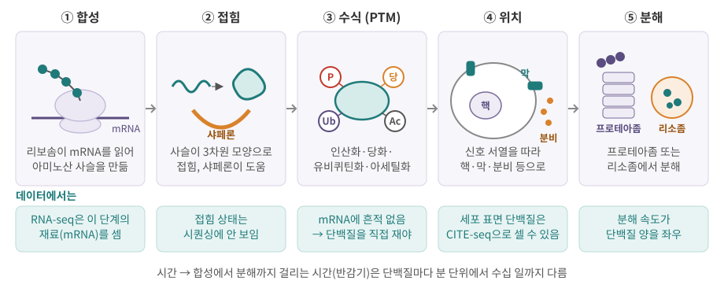
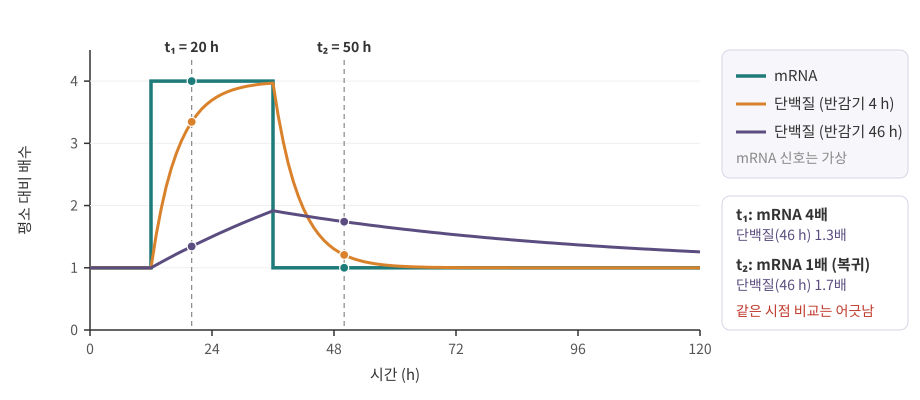

::: {.callout-note collapse="true"}
## 참고 자료
- Essential Cell Biology 4장, 7장 — 구조 참고
- OpenStax Biology 2e 15장 Genes and Proteins — 구조 참고
- 본문의 숫자는 옆의 배지가 출처. 세포 종류와 측정 방법마다 다르므로 **자릿수**로 읽기
- 그림은 직접 그린 모식도
:::

# 1. mRNA를 읽어 단백질을 만든다

## 1) 유전암호: 세 글자가 한 단어

- 번역 (translation): mRNA의 염기 서열을 아미노산 서열로 바꾸는 과정 → 전사 ([5장](05_transcription.qmd)), 가공 ([6장](06_rna_processing.qmd)) 다음 단계
- mRNA 염기 3개 = **코돈 (codon)** 하나 → 아미노산 하나, 또는 "여기서 멈춤"
- 염기 4종을 3개씩 묶으면 4³ = **64개 코돈**
  - 61개: 아미노산 20종을 지정
  - 3개 (UAA, UAG, UGA): **종결 코돈 (stop codon)** [NHGRI](https://www.genome.gov/genetics-glossary/Codon){.src}
- **시작 코돈 (start codon)** = AUG (메티오닌, Met) → 단백질의 첫 아미노산은 대개 Met [NCBI](https://www.ncbi.nlm.nih.gov/Taxonomy/Utils/wprintgc.cgi){.src}
- **중복성 (degeneracy)**: 코돈 61개가 아미노산 20종을 나눠 가짐 → 아미노산 하나에 코돈 여러 개

| 아미노산 | 코돈 | 개수 |
|---|---|---|
| 메티오닌 (Met), 시작 | AUG | 1 |
| 트립토판 (Trp) | UGG | 1 |
| 페닐알라닌 (Phe) | UUU, UUC | 2 |
| 알라닌 (Ala) | GCU, GCC, GCA, GCG | 4 |
| 류신 (Leu) | UUA, UUG, CUU, CUC, CUA, CUG | 6 |
| 세린 (Ser) | UCU, UCC, UCA, UCG, AGU, AGC | 6 |
| 종결 | UAA, UAG, UGA | 3 |

- 위 표는 64개 중 23개. 전체는 NCBI 유전암호 표의 표 1(표준 유전암호)
- 알라닌처럼 **세 번째 글자**만 다른 코돈이 같은 아미노산인 경우가 많음
  - → 세 번째 자리의 변이는 아미노산을 바꾸지 않을 때가 많음 (동의 변이, synonymous) → [4장](04_replication_mutation_inheritance.qmd)
- 표준 유전암호가 기본이고 일부는 다른 표를 씀 [NCBI](https://www.ncbi.nlm.nih.gov/Taxonomy/Utils/wprintgc.cgi){.src}
  - 예: 척추동물 미토콘드리아에서는 UGA가 종결이 아니라 트립토판 → 미토콘드리아 유전자는 [1장](01_cell_system.qmd)

## 2) 리보솜과 tRNA

{fig-alt="mRNA 위의 코돈 AUG GUG AUU GGC UGG AAA UAA, 그 위에 리보솜 두 소단위와 tRNA 두 개, tRNA 위로 Met-Val-Ile-Gly 사슬이 자라고 Trp가 다음 차례로 들어옴"}

| 등장인물 | 무엇인가 | 하는 일 |
|---|---|---|
| mRNA | 가공을 마친 RNA ([6장](06_rna_processing.qmd)) | 읽을 서열 제공: 5' UTR – CDS – 3' UTR |
| 리보솜 (ribosome) | rRNA + 단백질, 지름 20–30 nm ([0장](00_why_biology.qmd)) | mRNA를 따라 움직이며 아미노산을 이어 붙임 |
| tRNA (transfer RNA) | 한쪽 끝에 **안티코돈 (anticodon)**, 다른 끝에 아미노산 | 코돈을 아미노산으로 바꿔 주는 어댑터 |
| 아미노산 사슬 | 펩타이드 결합으로 이어진 아미노산 | 다 만들어지면 접혀서 단백질 ([2장](02_biomolecules.qmd)) |

- 시작 코돈부터 종결 코돈까지 = **CDS (coding sequence)**. 그 앞뒤의 5' UTR, 3' UTR (untranslated region)은 번역되지 않음
- 사슬은 **N-말단 → C-말단** 방향으로 자람 → 단백질 서열도 N→C로 적음 ([2장](02_biomolecules.qmd))
- mRNA 하나를 리보솜 여러 개가 동시에 읽음 (폴리솜, polysome) → mRNA 하나에서 단백질이 계속 나옴
  - 쥐 섬유모세포(NIH3T3)의 번역 속도 중앙값: mRNA 하나당 시간당 약 140개 [Schwanhäusser 2013 정정](https://doi.org/10.1038/nature11848){.src}

## 3) 읽기틀과 frameshift

- **읽기틀 (reading frame)**: 어디서부터 3개씩 끊어 읽느냐
  - 한 가닥에 3가지 (첫째·둘째·셋째 글자에서 시작), 양 가닥이면 6가지
- 시작 코돈에서 종결 코돈까지 끊기지 않는 구간 = **ORF (open reading frame)** → 유전자 예측의 기본 단위
- 가상의 mRNA로 보면

| 서열 | 3개씩 끊으면 | 번역 |
|---|---|---|
| 원래 | AUG GUG AUU GGC UGG AAA UAA | Met-Val-Ile-Gly-Trp-Lys-종결 |
| 4번째 염기(G) 1개 삭제 | AUG **UGA** UUG GCU GGA AAU AA | Met-종결 → 바로 끝남 |
| 4–6번째 염기(GUG) 3개 삭제 | AUG AUU GGC UGG AAA UAA | Met-Ile-Gly-Trp-Lys-종결 → Val 하나만 빠짐 |

- 길이가 3의 배수가 아닌 indel → **frameshift (읽기틀 이동)**: 그 뒤 아미노산이 모두 바뀌고, 엉뚱한 종결 코돈이 일찍 나오기 쉬움
- 3의 배수인 indel → 읽기틀 유지 (in-frame): 아미노산 몇 개만 빠지거나 더해짐
- 그래서 변이 해석에서 frameshift는 대개 단백질을 크게 망가뜨리는 변이로 봄 → indel과 변이 주석은 [4장](04_replication_mutation_inheritance.qmd)

::: {.callout-warning collapse="true"}
## 처음엔 여기서 헷갈려요: 코돈과 읽기틀
| 헷갈리는 짝 | 차이 |
|---|---|
| 코돈 vs 안티코돈 | 코돈은 mRNA 위의 세 글자, 안티코돈은 tRNA 위에서 그것과 짝을 짓는 세 글자 |
| 유전자 vs CDS | 유전자(전사되는 구간)에는 UTR과 intron도 들어 있음. CDS는 실제로 번역되는 부분만 ([3장](03_genome_chromatin.qmd), [6장](06_rna_processing.qmd)) |
| 전사 시작점 vs 시작 코돈 | 전사 시작점(TSS)은 RNA가 시작되는 곳 ([5장](05_transcription.qmd)), 시작 코돈은 그 RNA 안에서 번역이 시작되는 곳. 그 사이가 5' UTR |
| 종결 코돈 vs 전사 끝 | 종결 코돈 뒤에도 mRNA는 이어짐 (3' UTR, poly(A) 꼬리, [6장](06_rna_processing.qmd)) |
:::

# 2. 접히고, 다듬어진다

{fig-alt="합성, 접힘, 수식, 위치, 분해의 다섯 칸과 그 아래 데이터에서 보이는지를 적은 청록색 칸"}

## 1) 접힘과 샤페론

- 아미노산 사슬은 만들어지면서 **3차원 모양으로 접힘 (folding)** → 단백질의 기능은 모양에서 나옴 ([2장](02_biomolecules.qmd))
- 세포 안은 분자로 빽빽함 (단백질 µm³당 200만–400만 개, [0장](00_why_biology.qmd)) → 덜 접힌 사슬끼리 엉겨 붙기 (aggregation) 쉬움
- **샤페론 (chaperone)**: 접힘을 돕고 엉김을 막는 단백질. 대표: HSP70, HSP90, 샤페로닌 (chaperonin) [Hartl 2011](https://doi.org/10.1038/nature10317){.src}
  - HSP = 열충격 단백질 (heat shock protein): 열 같은 스트레스에서 많이 만들어져 붙은 이름
- 접힘에 실패한 단백질은 분해로 처리 (4절). 이 품질 관리 능력이 나이 들며 떨어지는 것이 알츠하이머·파킨슨 같은 단백질 응집 질환과 이어짐 [Hartl 2011](https://doi.org/10.1038/nature10317){.src}
- 데이터에서: 열충격 단백질 유전자(*HSPA1A* 등) 발현이 유난히 높은 세포 무리가 보이면, 생물학적 상태인지 시료 처리 과정의 스트레스 흔적인지 따져 봐야 함 → [12장](12_data_generation.qmd)

## 2) 번역 후 변형 (PTM)

- 번역 후 변형 (post-translational modification, PTM): 다 만든 단백질에 화학 그룹이나 작은 단백질을 붙이거나 떼어 성질을 바꿈

| PTM | 무엇을 붙이나 | 주로 하는 일 | 자세히 |
|---|---|---|---|
| 인산화 (phosphorylation) | 인산기 → 세린·트레오닌·타이로신 | 활성 스위치. kinase가 붙이고 phosphatase가 뗌 | [8장](08_cell_signaling.qmd) |
| 당화 (glycosylation) | 당 사슬 | 분비·막 단백질에 붙음. ER에서 시작해 골지에서 다듬음 | 3절 |
| 유비퀴틴화 (ubiquitination) | 작은 단백질 유비퀴틴 (사슬로도) | 분해 표지, 신호전달 | 4절 |
| 아세틸화 (acetylation) | 아세틸기 → 라이신 | 예: 히스톤 꼬리 → 염색질이 풀려 전사가 쉬워짐 | [5장](05_transcription.qmd) |

- 인산화
  - 사람의 단백질 kinase 유전자: 약 518개 [Manning 2002](https://pubmed.ncbi.nlm.nih.gov/12471243/){.src}
  - 인산화 자리의 비율: 세린 : 트레오닌 : 타이로신 ≈ 86 : 12 : 2 (HeLa 세포) [BioNumbers](https://bionumbers.hms.harvard.edu/bionumber.aspx?id=111946){.src}
- 당화: N-연결 당화는 Asn-X-Ser/Thr(X는 프롤린이 아님) 서열의 아스파라진에 붙고, ER에서 시작 [Breitling 2013](https://pmc.ncbi.nlm.nih.gov/articles/PMC3721281){.src}
- 유비퀴틴화: 사슬이 어떤 라이신으로 이어졌는지에 따라 뜻이 다름 [CMLS 2016](https://pmc.ncbi.nlm.nih.gov/articles/PMC4980412){.src}
  - K48 사슬 → 프로테아좀 분해 신호
  - K63 사슬 → 신호전달, DNA 수리 등 분해와 무관한 일

::: {.callout-important}
## 단백질이 하는 일 = 양 × 상태
- 같은 양의 단백질이라도 **인산화됐는지, 어디에 있는지, 무엇과 붙어 있는지**에 따라 일하는 정도가 다름
- RNA-seq이 세는 것은 그 단백질을 만들 **mRNA 수**뿐 → PTM·위치·분해는 mRNA에 흔적이 없음
- "mRNA 변화 없음 ≠ 단백질 기능 변화 없음" → 신호전달은 대부분 이 층위에서 일어남 ([8장](08_cell_signaling.qmd))
:::

# 3. 제자리로 간다: 위치 신호

## 1) 주소는 서열 안에

- 단백질은 대부분 세포질의 리보솜에서 만들어지기 시작하지만, 갈 곳은 다양함: 세포질, 핵, 미토콘드리아, 세포막, 세포 밖
- 주소 = 아미노산 서열 안의 짧은 **신호 (signal)** → 1999년 노벨 생리의학상의 주제 [Nobel 1999](https://www.nobelprize.org/prizes/medicine/1999/press-release/){.src}

| 신호 | 서열 어디에 | 가는 곳 |
|---|---|---|
| 신호 서열 (signal sequence, signal peptide) | N-말단의 짧은 구간 | 번역 도중 리보솜째 ER로 → 골지 → 세포막·세포 밖·리소좀 (소기관은 [1장](01_cell_system.qmd)) |
| 막관통 구간 (transmembrane domain) | 서열 중간의 기름에 녹는(소수성) 구간 | 막에 박힘: 수용체, 수송체 |
| 핵 위치 신호 (NLS, nuclear localization signal) | 서열 안의 짧은 구간 | 핵: 전사인자 등 |
| 미토콘드리아 표적 서열 | N-말단 | 미토콘드리아 |

- 사람 단백질 암호화 유전자 약 1.96만 개 중 약 39%가 신호 서열이나 막관통 구간을 가진 것으로 예측 [HPA v17](https://v17.proteinatlas.org/humanproteome/secretome){.src}
  - 분비 단백질이 있는 유전자 15%, 막 단백질이 있는 유전자 28% (둘 다 있는 유전자도 있음). 예측 방법과 버전에 따라 숫자가 달라짐

## 2) 데이터와 연결하면

| 단백질이 있는 곳 | 예 | 데이터에서 |
|---|---|---|
| 세포 표면 (막) | 수용체, CD 표지 | 항체로 직접 셀 수 있음 → flow cytometry, CITE-seq (장 끝 데이터 상자) |
| 세포 밖 (분비) | 사이토카인, 항체 | 세포를 떠나 버림 → 세포 하나에서는 그 **mRNA**로 만드는 세포를 추정 ([8장](08_cell_signaling.qmd), [11장](11_tissue_interaction.qmd)) |
| 핵 | 전사인자 | 활성은 핵으로 들어갔는지에 달림 → mRNA 양만으로는 알기 어려움 ([5장](05_transcription.qmd)) |

# 4. 끝난다: 분해

## 1) 두 개의 분해 경로

| | 유비퀴틴–프로테아좀 | 리소좀·자가포식 |
|---|---|---|
| 표지 | 유비퀴틴 사슬 (주로 K48) | 막으로 감싸거나(자가포식), 세포막에서 안으로 들여옴 |
| 분해 장소 | 프로테아좀 (proteasome): 통 모양의 단백질 분해 복합체 | 리소좀 (lysosome): 분해 효소가 든 소기관 ([1장](01_cell_system.qmd)) |
| 주로 분해하는 것 | 수명이 짧은 조절 단백질, 잘못 접힌 단백질 | 막 단백질, 오래된 소기관, 큰 덩어리 |
| 노벨상 | 2004년 화학상 [Nobel 2004](https://www.nobelprize.org/prizes/chemistry/2004/press-release/){.src} | 2016년 생리의학상 (자가포식) [Nobel 2016](https://www.nobelprize.org/prizes/medicine/2016/press-release/){.src} |

- 분해는 "고장 난 것 버리기"만이 아님 → 조절 단백질을 제때 없애는 **스위치** (세포주기 단백질 등, [9장](09_cell_cycle_death_cancer.qmd))
- 자가포식 (autophagy): 세포가 자기 일부를 막으로 싸서 리소좀으로 보내 분해하고 재활용 [Nobel 2016](https://www.nobelprize.org/prizes/medicine/2016/press-release/){.src}

## 2) 반감기: 단백질은 대체로 mRNA보다 오래 산다

- 반감기 (half-life): 분자의 절반이 분해되는 데 걸리는 시간

| 대상 | 반감기 | 출처 |
|---|---|---|
| 단백질 (쥐 섬유모세포 NIH3T3, 중앙값) | 약 46시간 | [BioNumbers](https://bionumbers.hms.harvard.edu/bionumber.aspx?id=106377){.src} |
| mRNA (같은 세포, 중앙값) | 약 9시간 | [BioNumbers](https://bionumbers.hms.harvard.edu/bionumber.aspx?id=106378){.src} |
| 단백질 (분열하지 않는 사람·쥐 일차 세포) | 약 10시간부터 1,000시간 이상까지 | [Mathieson 2018](https://pmc.ncbi.nlm.nih.gov/articles/PMC5814408){.src} |
| MYC 단백질 (전사인자) | 약 20–30분 | [Gregory 2000](https://pmc.ncbi.nlm.nih.gov/articles/PMC85426){.src} |

- 같은 유전자의 mRNA 반감기와 단백질 반감기는 서로 상관이 거의 없음 [Schwanhäusser 2011](https://doi.org/10.1038/nature10098){.src}
- 빨리 켜고 꺼야 하는 조절 단백질은 반감기가 짧음 → 분해가 막히면 쌓임
  - 예: 버킷 림프종 세포주 다수에서 MYC 단백질이 2–6배 안정해져 있음 [Gregory 2000](https://pmc.ncbi.nlm.nih.gov/articles/PMC85426){.src}
- 대체로 단백질이 mRNA보다 오래 감 → 단백질 양은 mRNA 변화를 **늦게, 완만하게** 따라감 (장 끝 데이터 상자)

::: {.callout-warning collapse="true"}
## 처음엔 여기서 헷갈려요: 수식과 분해
| 헷갈리는 짝 | 차이 |
|---|---|
| 유비퀴틴화 = 분해? | K48 사슬은 분해 표지지만, K63 사슬은 분해와 무관한 신호전달에도 씀 |
| 프로테아좀 vs 리소좀 | 프로테아좀은 표지된 단백질을 하나씩 분해하는 복합체, 리소좀은 막으로 싼 덩어리를 통째로 분해하는 소기관 |
| mRNA 반감기 vs 단백질 반감기 | 서로 거의 무관. mRNA가 오래 산다고 그 단백질도 오래 사는 것은 아님 |
| PTM vs 돌연변이 | PTM은 서열이 같은 단백질에 나중에 붙는 것, 돌연변이는 DNA 서열 자체가 바뀐 것 ([4장](04_replication_mutation_inheritance.qmd)) |
:::

::: {.callout-caution .data-box icon=false}
## 데이터에서는 이렇게 보여요: mRNA 양 ≠ 단백질 양

**단백질 양을 정하는 것**

- 오래 일정한 상태(정상 상태)라면: 단백질 수 ≈ mRNA 수 × 번역 속도 ÷ 분해 속도
  1. **mRNA 수**: RNA-seq이 재는 유일한 항목
  2. **번역 속도**: mRNA 하나에서 시간당 몇 개를 만드나 (중앙값 약 140개 [Schwanhäusser 2013 정정](https://doi.org/10.1038/nature11848){.src})
  3. **분해 속도**: 단백질 반감기 (4절)
  4. **시간 지연**: 상태가 막 바뀐 동안에는 위 식이 맞지 않음 (아래 시뮬레이션)
- 평균적으로 mRNA 하나당 단백질 약 2,800개 [Schwanhäusser 2011, 2013 정정](https://doi.org/10.1038/nature10098){.src} ([0장](00_why_biology.qmd)과 같은 숫자)
- 이 비가 유전자마다 크게 다름: mRNA 하나당 수백 개에서 수십만 개 [Edfors 2016](https://www.ncbi.nlm.nih.gov/pmc/articles/PMC5081484/){.src}

**무엇끼리 비교하느냐에 따라 답이 다르다**

| 비교 | 질문 | 알려진 것 |
|---|---|---|
| 유전자끼리 (한 시료 안의 유전자 수천 개) | mRNA가 많은 유전자가 단백질도 많은가? | 대체로 그렇지만 일부만 설명: mRNA 차이가 단백질 차이의 약 40%를 설명 [Schwanhäusser 2011](https://doi.org/10.1038/nature10098){.src}, 측정 오차를 보정한 재분석은 56% 이상 [Li 2014](https://pmc.ncbi.nlm.nih.gov/articles/PMC3940484){.src} |
| 같은 유전자를 조직·세포끼리 | mRNA가 높은 조직에서 그 단백질도 높은가? | 유전자별 비율을 곱하면 잘 맞는다는 보고 [Edfors 2016](https://www.ncbi.nlm.nih.gov/pmc/articles/PMC5081484/){.src}와, 유전자 하나 단위의 예측은 그만큼 정확하지 않다는 반론 [Fortelny 2017](https://doi.org/10.1038/nature22293){.src} |
| 같은 유전자를 시간에 따라 | 자극 뒤 mRNA가 오르면 단백질도 바로 오르나? | 상태가 바뀌는 상황을 포함해 여러 경우에 mRNA만으로는 단백질을 예측하기에 부족 [Liu 2016](https://doi.org/10.1016/j.cell.2016.03.014){.src}. 바뀌는 동안에는 시간 지연이 큼 (아래) |

- 유전자끼리 상관이 높다고 해서 **유전자 하나의 단백질 양을 mRNA로 정확히 맞힐 수 있다는 뜻은 아님** (상관의 단위가 다름)

**시간 지연: 작은 시뮬레이션**

{fig-alt="mRNA 계단 곡선과, 빨리 따라가는 주황 곡선, 늦게 오르고 늦게 내려오는 보라 곡선. 20시간과 50시간에 점선"}

- 가정: 번역 속도는 일정, 평소 단백질 양 = 1. 반감기 4시간인 단백질과 46시간(NIH3T3 중앙값)인 단백질

```{r}
#| label: lag-sim
t <- 0:120                            # 시간 (h)
m <- ifelse(t >= 12 & t < 36, 4, 1)   # mRNA: 12-36 h만 4배 (가상)
protein <- function(half_life) {      # 단백질 양 (평소 = 1)
  kd <- log(2) / half_life            # 시간당 분해 비율
  p <- rep(1, length(t))
  for (i in 2:length(t)) p[i] <- p[i - 1] + kd * (m[i - 1] - p[i - 1])
  p
}
res <- rbind(mRNA = m, half_4h = protein(4), half_46h = protein(46))
colnames(res) <- paste0(t, "h")
round(res[, c("0h", "20h", "36h", "50h", "120h")], 2)
```

- 20시간: mRNA는 4배인데 반감기 46시간 단백질은 1.34배
- 50시간: mRNA는 이미 평소(1배)로 돌아왔는데 그 단백질은 1.74배 → 이 시점의 RNA-seq은 "변화 없음", 단백질은 "높음"
- 반감기 4시간 단백질은 mRNA를 거의 바로 따라감 (20시간 3.35배, 50시간 1.21배)
- 120시간(5일)에도 반감기 46시간 단백질은 1.26배

**분석할 때**

- DE 유전자 = "mRNA가 바뀐 유전자". 단백질이 바뀌었다는 뜻은 아님
- 시간 경과 실험에서 mRNA 변화와 단백질 변화의 시점이 어긋나는 것은 정상
- marker 유전자의 mRNA가 낮게 잡혀도 단백질은 충분히 많을 수 있음 → 표면 단백질은 직접 재기 (다음 상자)
- 신호의 활성(인산화)은 mRNA에 보이지 않음 → [8장](08_cell_signaling.qmd)의 데이터 상자
:::

::: {.callout-caution .data-box icon=false}
## 데이터에서는 이렇게 보여요: CITE-seq은 RNA 행렬 옆에 단백질 행렬을 하나 더 만든다

**원리** [Stoeckius 2017](https://doi.org/10.1038/nmeth.4380){.src}

- CITE-seq (cellular indexing of transcriptomes and epitopes by sequencing): 세포 표면 단백질에 붙는 **항체에 짧은 DNA 바코드**를 달아 둠
- 이 바코드 = **ADT (antibody-derived tag)**. poly(A) 꼬리가 있어 mRNA처럼 포획되고, 같은 **세포 바코드**를 받음
- RNA와 ADT는 라이브러리를 따로 만들어 읽음 → 세포 하나에서 mRNA와 표면 단백질을 함께 셈

**파일로는**

| | RNA 행렬 | ADT 행렬 |
|---|---|---|
| 행 | 유전자 (수만 개) | 항체 (패널에 넣은 만큼. Seurat 튜토리얼 예: 11개) |
| 열 | 세포 바코드 | **같은** 세포 바코드 |
| 칸 | UMI 수, 대부분 0 | 항체 바코드의 UMI 수, 0이 훨씬 적음 |
| Cell Ranger의 feature type | `Gene Expression` | `Antibody Capture` |
| Seurat에서 | `RNA` assay | `ADT` assay |

- feature type = [0장](00_why_biology.qmd)에서 본 `features.tsv.gz`의 세 번째 열
- 0이 적은 이유: 세포 안 단백질 복사 수가 mRNA보다 훨씬 많아 ADT에서는 drop-out이 크게 줄어듦 [Seurat](https://satijalab.org/seurat/articles/multimodal_vignette.html){.src}
- 그래서 표면 단백질은 뚜렷한데 그 유전자의 mRNA는 0인 세포가 흔함 → Seurat 튜토리얼의 CD19 단백질과 *CD19* RNA 비교가 그 예

**배경과 isotype control**

- ADT에는 배경이 있음: 항체가 표적이 없는 세포에도 조금 붙고, 용액에 떠다니는 항체도 잡힘 → 음성 세포의 count도 0이 아님
- 세포가 없는 빈 droplet의 ADT는 염색하지 않은 세포의 수준과 비슷 → 배경 추정에 씀 [Mulè 2022](https://www.nature.com/articles/s41467-022-29356-8){.src}
- **isotype control**: 종류(isotype)는 같지만 사람 세포에 표적이 없는 항체 → 그 count = 비특이 결합의 크기 → 진짜 양성인지 가르는 기준선 [Mulè 2022](https://www.nature.com/articles/s41467-022-29356-8){.src}

**정규화**

- RNA처럼 세포별 총 count로 나누는 방식이 잘 안 맞음: 항체 수가 적고, 많이 발현되는 단백질 몇 개가 총합을 좌우 [ADTnorm](https://pmc.ncbi.nlm.nih.gov/articles/PMC11261982){.src}
- Seurat 튜토리얼: CLR (centered log-ratio) 변환 [Seurat](https://satijalab.org/seurat/articles/multimodal_vignette.html){.src}
  - `NormalizeData()`에 `assay = "ADT"`, `normalization.method = "CLR"`, `margin = 2`
  - 세포 하나 안에서 각 항체 값을 그 세포 항체 값들의 기하평균과 비교해 log를 취함
  - `margin = 2` = 세포마다, 기본값 `margin = 1` = 항체마다(세포들에 걸쳐) → 어느 쪽을 썼는지 적어 두기
- 대안: dsb — 빈 droplet과 isotype control로 배경을 빼는 정규화 [Mulè 2022](https://www.nature.com/articles/s41467-022-29356-8){.src}

**분석할 때**

- cell type 판정: 표면 단백질(ADT)이 RNA marker보다 뚜렷할 때가 많음 → 두 행렬을 같이 봄
- 양성·음성의 경계는 isotype control과 음성 세포 무리에 비춰 정함
- ADT가 재는 것은 **세포 표면**에 나온 단백질뿐 → 세포 안 단백질, 분비된 단백질은 일반 CITE-seq으로 못 잼
- 항체마다 품질이 달라 신호 크기가 다름 → 한 항체의 값이 낮다고 그 단백질이 없다고 단정하지 않기
:::

# 5. 정리

- 코돈 64개: 61개는 아미노산 20종, 3개는 종결. AUG에서 시작해 3개씩 읽으므로, 3의 배수가 아닌 indel은 읽기틀을 바꿈
- 리보솜이 mRNA를 5'→3'으로 읽고 tRNA가 아미노산을 날라, 사슬은 N-말단에서 C-말단으로 자람
- 단백질은 접히고(샤페론), 수식되고(PTM), 신호 서열을 따라 제자리로 가고, 프로테아좀·리소좀에서 분해됨 → 이 과정은 mRNA에 흔적이 없음
- 단백질 반감기는 대체로 mRNA보다 길어서(NIH3T3 중앙값 46시간 vs 9시간) 단백질은 mRNA를 늦게 따라감
- mRNA ≠ 단백질: 유전자끼리는 상관이 있지만 일부만 설명하고, 시간에 따라서는 어긋남
- CITE-seq은 ADT 행렬(항체 × 세포)을 더해 표면 단백질을 직접 셈. 배경(isotype control, 빈 droplet)과 정규화(CLR, dsb)에 주의

# 연습문제

1. mRNA `AUGGUGAUUGGCUGGAAAUAA`에서 (a) 6번째 염기 뒤에 C 하나가 끼어들면 번역 결과는 어떻게 되나? (b) CCC 세 개가 끼어들면? 각각을 [4장](04_replication_mutation_inheritance.qmd)의 변이 종류로 부르면?
2. 데이터 상자의 시뮬레이션처럼 번역 속도는 일정하다고 하자. 어떤 유전자의 mRNA가 갑자기 2배가 되어 그대로 유지될 때, 단백질이 새 정상 상태까지 가는 거리의 절반(1.5배)에 이르는 시간은 반감기 4시간 단백질과 46시간 단백질에서 각각 대략 얼마인가? 자극 6시간 뒤에 RNA-seq과 단백질을 함께 쟀다면 결과를 어떻게 읽어야 하나?
3. 동료가 "이 유전자는 DE 분석에서 변화가 없으니 이 처리는 이 단백질의 기능을 바꾸지 않았다"고 말했다. PTM, 위치, 분해, 시간 지연 중 두 가지 이상을 근거로 반박하라.
4. CITE-seq 데이터에서 어떤 세포가 CD4 ADT는 높은데 *CD4* mRNA UMI는 0이다. 이를 설명할 수 있는 이유를 두 가지 들고, 이 신호가 진짜 양성인지 확인할 때 isotype control을 어떻게 쓸지 쓰라.
