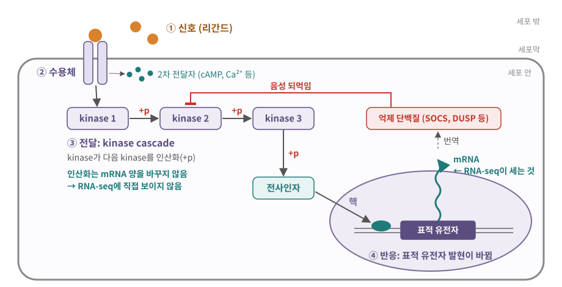
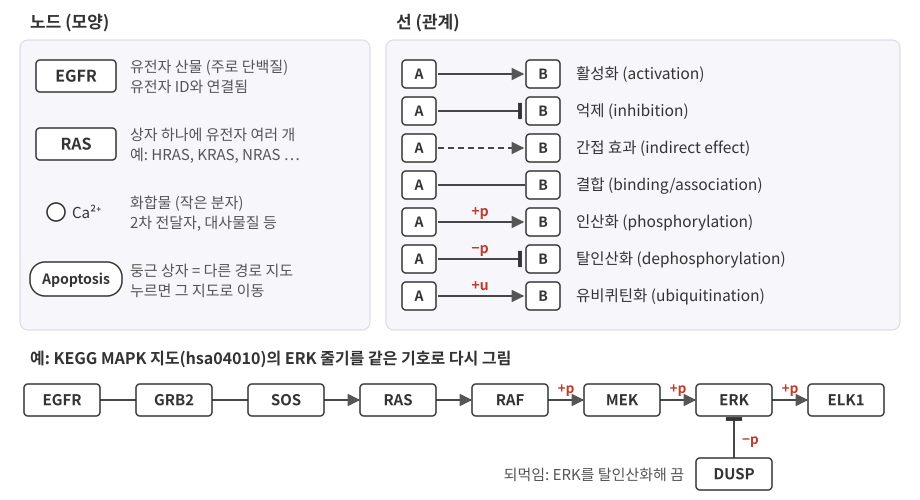
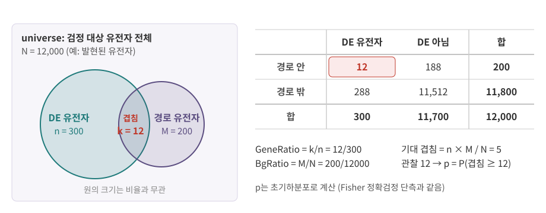

::: {.callout-note collapse="true"}
## 참고 자료
- Essential Cell Biology 16장 — 구조 참고
- OpenStax Biology 2e 9장 Cell Communication — 구조 참고
- 본문의 숫자는 옆의 배지가 출처
- 그림은 직접 그린 모식도. KEGG 기호 그림도 KEGG 그림을 옮긴 것이 아니라 범례를 보고 새로 그린 것
:::

# 1. 신호전달의 기본 구조

## 1) 신호 → 수용체 → 전달 → 반응

{fig-alt="세포 밖 리간드가 막의 수용체에 붙고, kinase 세 개가 차례로 인산화되어 전사인자가 핵 안 표적 유전자를 켜고, 그 mRNA에서 만들어진 억제 단백질이 kinase 2를 억제하는 그림"}

| 단계 | 무엇 | 예: 성장 신호 |
|---|---|---|
| ① 신호 | 세포 밖의 신호 분자 = 리간드 (ligand) | 상피 성장인자 EGF |
| ② 수용체 | 리간드를 알아보고 모양이 바뀌는 단백질 | EGFR (세포막) |
| ③ 전달 | 세포 안에서 신호를 전하고 키움: kinase cascade, 2차 전달자 | RAS → RAF → MEK → ERK |
| ④ 반응 | 효소 활성·모양·이동의 변화, 그리고 대개 **유전자 발현 변화** | ERK → 전사인자 → 표적 유전자 |

::: {.callout-important}
## 신호전달 (signal transduction)
- 세포 밖 신호를 세포 안의 **다른 형태의 신호**로 바꿔 전하는 과정
- 대부분의 리간드는 세포 안으로 들어가지 않음 → 수용체의 **모양 변화**가 막 너머로 신호를 넘김
- 세포 안에서 신호를 나르는 수단은 주로 **인산화**와 **작은 분자(2차 전달자)** → 둘 다 mRNA 양으로는 보이지 않음
:::

## 2) 신호가 가는 거리

| 종류 | 거리 | 예 | 데이터에서 |
|---|---|---|---|
| 내분비 (endocrine) | 혈액을 타고 먼 기관까지 | 인슐린, 스테로이드 호르몬 | 보내는 세포와 받는 세포가 다른 조직 → 한 시료 안에서 짝을 찾기 어려움 |
| 측분비 (paracrine) | 가까운 이웃 세포 | 사이토카인, 성장인자 | 리간드–수용체 분석이 주로 겨냥하는 신호 ([11장](11_tissue_interaction.qmd)) |
| 자가분비 (autocrine) | 자기 자신 | 활성화된 T 세포의 IL-2 | 같은 세포가 리간드와 수용체를 함께 발현 |
| 접촉 신호 (juxtacrine) | 맞붙은 세포끼리, 막 단백질 대 막 단백질 | Notch–Delta | 누가 누구 옆에 있는지가 필요 → spatial 데이터 ([11장](11_tissue_interaction.qmd)) |

- scRNA-seq의 세포 간 상호작용 분석은 "보내는 세포의 리간드 mRNA × 받는 세포의 수용체 mRNA"로 신호를 **추정**
  - 실제로 단백질이 만들어져 분비되고 결합했는지는 별개 ([7장](07_translation_protein.qmd): mRNA ≠ 단백질)

# 2. 수용체의 종류

| 수용체 | 리간드가 붙으면 | 사람에서 | 예 |
|---|---|---|---|
| **GPCR** (G 단백질 연결 수용체): 막을 7번 관통 | 안쪽의 G 단백질을 켬 → 2차 전달자 | 약 800개, 절반가량은 후각 수용체 [Hauser 2017](https://doi.org/10.1038/nrd.2017.178){.src} | 아드레날린 수용체 |
| **RTK** (수용체 티로신 키나아제): 막 1번 관통, 안쪽에 kinase | 둘이 짝을 지어 서로의 타이로신을 인산화 → cascade 시작 | 58개, 20개 하위군 [Lemmon 2010](https://pmc.ncbi.nlm.nih.gov/articles/PMC2914105/){.src} | EGFR, 인슐린 수용체 |
| **이온 통로형** (ligand-gated ion channel): 막의 구멍 | 통로가 열려 이온이 흐름 | | 신경전달물질 수용체 |
| **핵 수용체** (nuclear receptor): 세포질·핵 안 | 막을 통과한 리간드가 붙으면 **수용체 자체가 전사인자**로 일함 | 48개 [IUPHAR 2023](https://experts.umn.edu/en/publications/international-union-of-basic-and-clinical-pharmacology-cxiii-nucl/){.src} | 스테로이드 호르몬 수용체 |

: {tbl-colwidths="[30,30,22,18]"}

- GPCR은 사람 막 단백질 중 가장 큰 집단이고, FDA 승인 약의 약 34%가 GPCR에 작용 [Hauser 2017](https://doi.org/10.1038/nrd.2017.178){.src}
- 핵 수용체 경로는 짧음: 리간드 → 수용체(= 전사인자) → 표적 유전자. 중간의 cascade가 없음
- 수용체 유전자의 mRNA가 있다 = 그 신호를 **받을 수 있는** 세포 후보. 지금 신호를 받고 있다는 뜻은 아님

::: {.callout-warning}
## 처음엔 여기서 헷갈려요: 수용체와 신호
| 헷갈리는 짝 | 차이 |
|---|---|
| 리간드 vs 수용체 | 리간드는 신호 분자(열쇠), 수용체는 그것을 알아보는 단백질(자물쇠) |
| 수용체 mRNA 있음 vs 신호 켜짐 | 수용체를 만들 수 있다는 것과 지금 리간드가 붙어 신호가 흐르고 있다는 것은 다름 |
| kinase vs phosphatase | kinase(인산화효소)는 인산기를 붙이고 phosphatase(탈인산화효소)는 뗌. 둘 다 있어야 신호가 켜졌다 꺼짐 |
| RTK vs 사이토카인 수용체 | RTK는 kinase가 수용체 안에 있고, 사이토카인 수용체는 따로 붙은 kinase(JAK)를 씀 (4절) |
:::

# 3. 신호를 전하고 키우기

## 1) kinase cascade: MAPK 경로

- kinase가 다음 kinase를 인산화해 켜고, 그것이 또 다음을 켬 → **연쇄 (cascade)**
  - 단계마다 한 분자가 여러 분자를 켤 수 있어 신호가 커짐
  - 단계마다 다른 신호가 끼어들 조절 지점이 생김
- 대표: MAPK (mitogen-activated protein kinase) 경로의 ERK 줄기 [KEGG](https://www.kegg.jp/entry/hsa04010){.src}

| 층 | 분자 | 하는 일 | KEGG 그림에서 |
|---|---|---|---|
| 수용체 (RTK) | EGFR | EGF가 붙으면 둘이 짝을 지어 서로를 인산화 | 직사각형 |
| 연결 | GRB2, SOS | 인산화된 수용체에 붙어 RAS를 켬 | 화살촉 없는 선 (결합) |
| 스위치 | RAS | 켜지면 RAF를 켬 | → (활성화) |
| MAPKKK | RAF | MEK를 인산화 | +p |
| MAPKK | MEK | ERK를 인산화 | +p |
| MAPK | ERK | 전사인자 ELK1 등을 인산화 | +p |
| 반응 | ELK1·SRF | *FOS* 등 표적 유전자 발현 | expression |

- MAPKKK → MAPKK → MAPK = "kinase의 kinase의 kinase" [KEGG](https://www.kegg.jp/entry/hsa04010){.src}
- 표의 연결은 KEGG MAPK 지도의 KGML 파일에 적힌 관계와 같음 [KEGGgraph](https://github.com/Accio/KEGGgraph){.src} → 5절의 그림 아래 줄이 같은 줄기
- KEGG MAPK 지도에는 ERK 말고도 JNK, p38, ERK5 줄기가 있음 [KEGG](https://www.kegg.jp/entry/hsa04010){.src} → "MAPK가 켜졌다"는 말은 어느 줄기인지 따져야 함
- 이 줄기의 유전자(*KRAS*, *BRAF* 등)는 암에서 자주 돌연변이 → 수용체 신호 없이도 늘 켜진 상태가 됨 → [9장](09_cell_cycle_death_cancer.qmd)

## 2) 2차 전달자

- 2차 전달자 (second messenger): 수용체가 켜지면 세포 안에서 빠르게 만들어지거나 풀려나 퍼지는 **작은 분자** → 신호를 넓게, 크게 전함

| 2차 전달자 | 어떻게 생기나 | 무엇을 켜나 |
|---|---|---|
| cAMP | GPCR → G 단백질 → adenylyl cyclase가 ATP로 만듦 | PKA (kinase) |
| IP3 | phospholipase C (PLC)가 막 지질 PIP2를 잘라 만듦 | ER의 통로를 열어 Ca²⁺를 내보냄 |
| DAG | PLC가 PIP2를 자를 때 IP3와 함께 생김 (막에 남음) | PKC (kinase) |
| Ca²⁺ | ER이나 세포 밖에서 세포질로 들어옴 | PKC, calcineurin 등 여러 단백질 |

- PLC → DAG → PKC, PLC → IP3·Ca²⁺로 이어지는 연결은 KEGG의 ErbB·VEGF 지도에도 화합물(원)로 그려져 있음 [KEGGgraph](https://github.com/Accio/KEGGgraph){.src}
- 작은 분자라 시퀀싱에 직접 보이지 않음 → 그 결과로 바뀐 **전사**로만 간접적으로 봄

# 4. 신호의 끝: 전사, 그리고 되먹임

## 1) 끝은 대개 전사인자

- 많은 경로의 마지막 단계 = **전사인자 (transcription factor)**의 활성 변화 → 표적 유전자 발현 변화 ([5장](05_transcription.qmd))

| 전사인자가 켜지는 방식 | 예 |
|---|---|
| 인산화 | ERK가 ELK1을 인산화 |
| 핵으로 이동 | 인산화된 STAT이 짝을 지어 핵으로 (이 절의 3) |
| 리간드가 직접 붙음 | 핵 수용체 |

- 순서: 인산화 (빠름) → 전사 변화 (그 뒤) → 단백질 변화 (더 뒤, [7장](07_translation_protein.qmd))
- 그래서 RNA-seq에 보이는 것은 신호 자체가 아니라 **신호의 결과** = 표적 유전자의 mRNA

## 2) 음성 되먹임

- 켜진 신호는 스스로를 끄는 장치도 켬 = **음성 되먹임 (negative feedback)** → 신호가 너무 오래, 너무 세게 가지 않게 함

| 경로 | 억제자 | 끄는 방법 | 출처 |
|---|---|---|---|
| JAK–STAT | SOCS | STAT이 *SOCS* 유전자를 켜고, SOCS 단백질이 JAK을 억제 | [Biomarker Res 2013](https://doi.org/10.1186/2050-7771-1-5){.src} |
| MAPK (ERK) | DUSP (탈인산화효소) | ERK에서 인산기를 떼어 끔 | [KEGGgraph](https://github.com/Accio/KEGGgraph){.src} |

- 데이터에서: 되먹임 유전자(*SOCS3* 등)의 mRNA가 올라가 있으면 그 경로가 최근에 켜졌다는 **간접 단서**가 될 수 있음 → 표적 유전자로 경로 활성을 추정하는 방법의 아이디어 (5절)
- 되먹임 때문에 같은 경로의 유전자도 시점에 따라 오르기도 내리기도 함 → 한 시점의 결과만으로 방향을 단정하지 않기

## 3) 면역 신호의 예: JAK–STAT

- 사이토카인 (cytokine): 면역세포끼리 주고받는 작은 단백질 신호 → [HaLab Wiki 사이토카인](https://halab-wiki.knu.ac.kr/disease/immunology/01-basics/cytokine.html)
- 순서 [Biomarker Res 2013](https://doi.org/10.1186/2050-7771-1-5){.src}
  1. 사이토카인이 수용체에 붙음 → 수용체에 붙어 있던 **JAK**(JAK1, JAK2, JAK3, TYK2)이 켜짐
  2. JAK이 **STAT**을 인산화 (사람 STAT 7종: STAT1, 2, 3, 4, 5A, 5B, 6)
  3. 인산화된 STAT이 짝(이량체)을 지어 핵으로 → 전사인자로 표적 유전자를 켬
  4. 표적 중 *SOCS* → JAK 억제 (되먹임)
- MAPK보다 단계가 짧음: 수용체 → JAK → STAT → 핵

# 5. 데이터에서는 이렇게 보여요

::: {.callout-caution .data-box icon=false}
## 데이터에서는 이렇게 보여요: KEGG 그림의 상자 하나는 유전자 하나가 아닐 수 있다

{fig-alt="왼쪽은 노드 모양 네 가지, 오른쪽은 활성화, 억제, 간접 효과, 결합, 인산화, 탈인산화, 유비퀴틴화 선, 아래는 EGFR에서 ELK1까지의 줄과 ERK를 억제하는 DUSP"}

**기호** [KEGG 도움말](https://www.kegg.jp/kegg/document/help_pathway.html){.src} [KEGGgraph](https://github.com/Accio/KEGGgraph){.src}

| 기호 | 뜻 | KGML 파일에서 |
|---|---|---|
| 직사각형 | 유전자 산물 (주로 단백질) | `gene` |
| 작은 원 | 화합물 (2차 전달자, 대사물질 등) | `compound` |
| 둥근 직사각형 | 다른 경로 지도로 연결 | `map` |
| → | 활성화 | `activation` |
| ⊣ (T자 끝) | 억제 | `inhibition` |
| 점선 화살표 | 간접 효과 (중간 단계 생략) | `indirect effect` |
| 화살촉 없는 선 | 결합 | `binding/association` |
| +p / −p | 인산화 / 탈인산화 | `phosphorylation` / `dephosphorylation` |
| +u | 유비퀴틴화 | `ubiquitination` |

- KGML = KEGG 지도를 기계가 읽는 XML 파일. 분석 도구가 그림을 그리거나 그래프로 바꿀 때 씀
- 지도는 여러 세포·조직·실험의 지식을 모은 것 → 내 세포에서 모든 화살표가 작동한다는 뜻은 아님
- 화살표 대부분은 **단백질 사이**의 관계(결합·인산화) → mRNA 데이터로 직접 확인되지 않음

**상자 하나 = 유전자 여러 개**

- MAPK 지도(hsa04010)의 RAS 상자에는 HRAS, KRAS, NRAS 등 여러 유전자가 함께 들어 있음 [KEGGgraph](https://github.com/Accio/KEGGgraph){.src}
- JAK–STAT 지도(hsa04630)의 JAK 상자 = 유전자 4개, STAT 상자 = 7개 [KEGGgraph](https://github.com/Accio/KEGGgraph){.src}
- 지도 하나에 유전자 수백 개 (MAPK 지도는 200개 이상) → 다음 상자의 "큰 집합이 잘 걸림" 문제
- `hsa` = 사람(*Homo sapiens*) 지도, 같은 번호의 `mmu` = 쥐 지도 → 유전자 ID 체계는 [부록 B](A2_nomenclature.qmd)

**색칠된 그림 읽기**

- KEGG 원래 지도에도 색이 있음: 생물종 지도의 유전자 상자 기본색은 연두 (KGML에 `bgcolor="#BFFFBF"`) → 실험 결과와 무관
- 분석 도구가 결과로 칠한 그림 (예: pathview) [pathview](https://github.com/datapplab/pathview){.src}
  - 기본 색: 낮음 = 초록, 중간 = 회색, 높음 = 빨강 → 원래 지도의 연두와 헷갈리기 쉬움
  - 상자에 유전자가 여러 개면 값을 하나로 합침 (기본 `node.sum = "sum"`) → +2와 −2인 두 유전자는 합이 0이라 회색
  - **색 범례(color key)**가 무엇의 값인지(log2 fold change? 점수?)부터 확인
- RNA-seq 결과로 칠한 상자 = 그 유전자의 **mRNA 변화**. 화살표를 따라 신호가 흘렀다는 증거는 아님 (3절)
:::

::: {.callout-caution .data-box icon=false}
## 데이터에서는 이렇게 보여요: pathway 분석 = 유전자 목록과 유전자 집합의 겹침에 대한 검정

**ORA (over-representation analysis)**

- 질문: DE 유전자 목록에 이 경로의 유전자가 **우연보다 많이** 들어 있나?
- 2×2 표 → 초기하분포 검정 (= Fisher 정확검정 단측) [enrichit](https://github.com/YuLab-SMU/enrichit){.src}

{fig-alt="universe 1만 2천 개 안에서 DE 유전자 300개와 경로 유전자 200개가 12개 겹치는 벤 그림과, 같은 숫자의 2×2 표"}

```{r}
#| label: ora-phyper
N <- 12000; n <- 300; M <- 200; k <- 12   # universe, DE, 경로, 겹침
c(expected = n * M / N, FoldEnrichment = (k / n) / (M / N))
phyper(k - 1, M, N - M, n, lower.tail = FALSE)   # P(겹침 >= 12)
tab <- matrix(c(k, n - k, M - k, N - M - n + k), nrow = 2)
fisher.test(tab, alternative = "greater")$p.value  # 같은 값
```

- 기대 겹침 5개, 관찰 12개 → FoldEnrichment 2.4, p ≈ 0.0045
- `phyper`와 단측 `fisher.test`가 같은 값

**universe가 p값을 바꾼다**

```{r}
#| label: ora-universe
N2 <- 20000                               # 전체 유전자를 universe로
c(expected = n * M / N2)
phyper(k - 1, M, N2 - M, n, lower.tail = FALSE)
```

- universe를 2만 개로 잡으면 기대 겹침이 3개로 줄어 p ≈ 5.2 × 10⁻⁵ → 같은 겹침이 약 86배 더 유의해 보임
- universe = "**DE가 될 수 있었던 유전자**" = 보통 그 데이터에서 검정한(발현된) 유전자
  - `enrichGO`·`enrichKEGG`에서 `universe`를 안 넣으면 주석이 있는 유전자 전체가 기본 → 직접 넣기 [clusterProfiler](https://github.com/YuLab-SMU/clusterProfiler){.src}

**결과표의 열 (clusterProfiler `enrichGO`, `enrichKEGG`)** [enrichit](https://github.com/YuLab-SMU/enrichit){.src}

| 열 | 뜻 | 위 예에서 |
|---|---|---|
| `ID`, `Description` | 경로 ID와 이름 | 예: hsa04010, MAPK signaling pathway |
| `GeneRatio` | k/n: DE 유전자 중 이 경로 유전자 | 12/300 |
| `BgRatio` | M/N: universe 중 이 경로 유전자 | 200/12000 |
| `RichFactor` | k/M: 경로 유전자 중 DE 비율 | 0.06 |
| `FoldEnrichment` | GeneRatio ÷ BgRatio | 2.4 |
| `zScore` | 기대값에서 몇 표준편차 떨어졌나 | |
| `pvalue` | 초기하분포 p값 | 0.0045 |
| `p.adjust` | 다중검정 보정 p값 (기본 BH) | 검정한 경로 수에 따라 다름 |
| `qvalue` | Storey q값 | |
| `geneID` | 겹친 유전자 (`/`로 구분) | 12개 |
| `Count` | k | 12 |

- 버전에 따라 열 구성이 조금 다름 → 받은 표의 열 이름부터 확인

**GSEA (gene set enrichment analysis)**

- DE 문턱(예: p < 0.05)을 쓰지 않음 → **모든 유전자를 한 줄로 세움** (log2 fold change나 검정 통계량 순)
- 순위 목록의 위쪽(또는 아래쪽)에 경로 유전자가 몰려 있는지 → enrichment score (ES)
- NES (normalized enrichment score): 집합 크기가 달라도 비교할 수 있게 맞춘 ES. 양수 = 위쪽(증가 쪽)에 몰림, 음수 = 아래쪽
- leading edge: ES가 최고가 되는 지점까지 기여한 핵심 유전자
- clusterProfiler `gseGO`·`gseKEGG` 결과 열: `setSize`, `enrichmentScore`, `NES`, `pvalue`, `p.adjust`, `qvalue`, `rank`, `leading_edge`, `core_enrichment`(leading edge 유전자) [enrichit](https://github.com/YuLab-SMU/enrichit){.src}

**FDR**

- 경로·GO term 수백에서 수천 개를 한꺼번에 검정 → `pvalue`가 아니라 `p.adjust`로 판단 → [1. Basic Statistics 10장](https://kkonoo.github.io/1_Basic_Statistics/chapters/10_multiple_testing.html)

**해석할 때**

| 주의 | 왜 | 어떻게 |
|---|---|---|
| 경로 "활성" ≠ 경로 유전자 mRNA 증가 | 신호는 인산화로 흐름 → 부품 유전자의 mRNA는 그대로일 수 있음 (3절) | 경로가 켜졌을 때 **바뀌는 표적 유전자**로 활성을 추정: PROGENy (섭동 실험에서 반응한 유전자, 14개 경로) [Schubert 2018](https://doi.org/10.1038/s41467-017-02391-6){.src}, 점수 계산은 decoupleR [decoupleR](https://doi.org/10.1093/bioadv/vbac016){.src} |
| 유전자 집합끼리 겹침 | 같은 유전자가 여러 경로·GO term에 들어 있음 | 상위 결과들이 같은 유전자 몇 개 때문인지 `geneID`·`core_enrichment`를 나란히 비교 |
| 큰 집합이 잘 걸림 | 유전자가 많으면 작은 쏠림도 유의해짐 (검정력) | `setSize`·`BgRatio`를 함께 보고, 크기 범위를 `minGSSize`(기본 10)·`maxGSSize`(기본 500)로 정함 [clusterProfiler](https://github.com/YuLab-SMU/clusterProfiler){.src} |
| universe | 위 예처럼 p값이 수십 배 달라짐 | 검정한 유전자를 universe로 명시 |
| 경로 이름 | 질병 이름이 붙은 지도도 유전자 묶음일 뿐 | 이름보다 `geneID`의 실제 유전자를 읽기 |
:::

# 6. 정리

- 신호전달 = 신호(리간드) → 수용체 → 전달 → 반응. 반응의 끝은 대개 전사인자 → 표적 유전자 발현
- 수용체 네 종류: GPCR(약 800개), RTK(58개), 리간드 개폐 이온 통로, 핵 수용체(48개)
- 신호는 kinase 연쇄(EGFR → RAS → RAF → MEK → ERK)와 2차 전달자(cAMP, IP3·DAG, Ca²⁺)로 전해지고 커짐 → 둘 다 mRNA에 직접 보이지 않음
- 켜진 신호는 SOCS, DUSP 같은 음성 되먹임으로 꺼짐 → RNA-seq에 보이는 것은 신호의 결과(표적 유전자)
- KEGG 그림: 상자 하나에 유전자 여러 개, 화살표는 대부분 단백질 사이의 관계, 색은 범례부터 확인
- ORA는 2×2 표의 초기하 검정(universe가 중요), GSEA는 순위 목록 위의 쏠림(NES, leading edge). 경로 활성은 표적 유전자 기반 방법으로 따로 봄

# 연습문제

1. universe 10,000개, DE 유전자 200개, 어떤 경로의 유전자 100개 중 DE와 겹치는 것이 8개다. (a) 기대 겹침은? (b) `GeneRatio`, `BgRatio`, `FoldEnrichment`는? (c) `phyper`로 p값을 구하는 식을 쓰라.
2. EGF로 자극하고 10분 뒤 bulk RNA-seq을 했더니 *EGFR*, *KRAS*, *BRAF*, *MAP2K1*, *MAPK1*의 mRNA는 변화가 없었다. 동료가 "MAPK 경로는 켜지지 않았다"고 결론 내렸다. 이 장의 내용으로 반박하고, 경로 활성을 보려면 무엇을 보면 좋을지 쓰라.
3. pathview로 칠한 MAPK 그림에서 RAS 상자가 회색이었다. 그런데 상자 안 유전자 중 *KRAS*는 크게 올랐다고 한다. 어떻게 이런 일이 생길 수 있나?
4. GSEA 결과 상위 GO term 다섯 개의 `core_enrichment`가 거의 같은 유전자 열 개로 이루어져 있다. 이 결과를 "다섯 가지 생물학적 과정이 함께 바뀌었다"고 보고하면 무엇이 문제인가?
