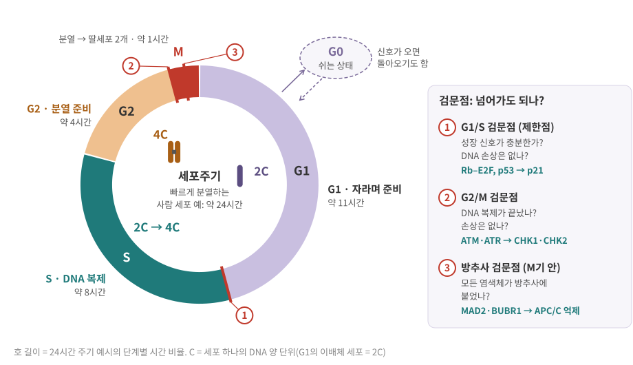
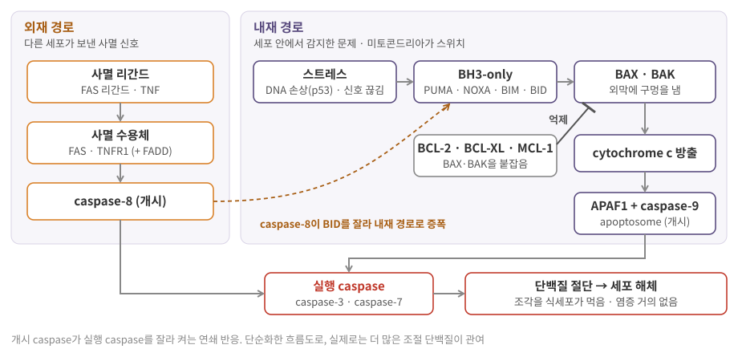
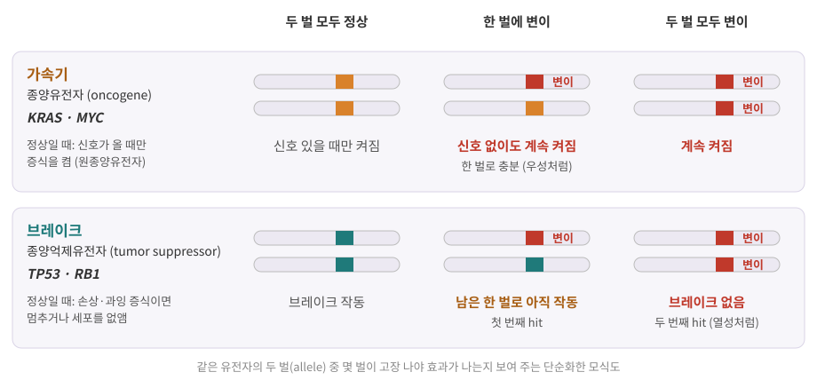
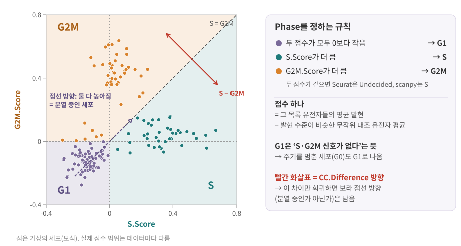

::: {.callout-note collapse="true"}
## 참고 자료
- Essential Cell Biology 18, 20장 — 구조 참고
- OpenStax Biology 2e 10장 Cell Reproduction — 구조 참고
- 본문의 숫자는 옆의 배지가 출처. 세포 종류·암 종류·코호트마다 값이 다르므로 **자릿수와 경향**으로 읽기
- 그림은 직접 그린 모식도
:::

# 1. 세포는 언제 나뉘나: 세포주기

## 1) 네 단계와 G0

- 세포주기 (cell cycle) = 세포 하나가 자라고, DNA를 복사하고, 둘로 나뉘기까지의 정해진 순서 — 한 방향으로만 돎

| 단계 | 하는 일 | DNA 양 | 24시간 주기 예시 |
|---|---|---|---|
| G1 (gap 1) | 세포가 자라며 분열할지 결정 | 2C | 약 11시간 |
| S (synthesis) | DNA 복제 → [4장](04_replication_mutation_inheritance.qmd) | 2C → 4C | 약 8시간 |
| G2 (gap 2) | 분열 준비, 복제 확인 | 4C | 약 4시간 |
| M (mitosis) | 염색체를 나눠 딸세포 2개로 | 4C → 2C씩 | 약 1시간 |
| G0 | 주기에서 빠져 분열을 멈춘 상태 (quiescence) | 2C | 기간 정해지지 않음 |

- 시간은 빠르게 분열하는 사람 세포의 교과서적 예 [BioNumbers](https://bionumbers.hms.harvard.edu/bionumber.aspx?id=112260){.src} — 세포 종류마다 다르고, 특히 G1 길이 차이가 큼
- 다 자란 몸의 많은 세포는 분열하지 않고 G0에 머묾
  - 신호가 오면 돌아오는 세포: 예) 항원을 만난 림프구가 증식 ([HaLab Wiki: 면역계의 큰 그림](https://halab-wiki.knu.ac.kr/disease/immunology/01-basics/overview.html))
  - 거의 돌아오지 않는 세포: 예) 대부분의 신경세포

{fig-alt="G1, S, G2, M이 시계 방향으로 이어진 원. G1이 가장 길고 M이 가장 짧음. G1에서 G0로 빠졌다 돌아오는 화살표, G1/S·G2/M·M기 안의 검문점 세 개, 안쪽에 2C, 2C→4C, 4C 표시"}

- S기에 DNA 전체가 한 번 복제 → 염색체 하나가 똑같은 **자매염색분체 (sister chromatid)** 2개로 붙어 있음
- M기에 자매염색분체를 갈라 딸세포에 하나씩 → 딸세포는 다시 2C
- 그래서 분열 중인 세포 집단의 DNA 양을 염색해 세면 G1(2C)과 G2·M(4C) 두 봉우리, 그 사이에 S기 세포가 깔림

::: {.callout-warning collapse="true"}
## 처음엔 여기서 헷갈려요: n과 C
| 헷갈리는 짝 | 차이 |
|---|---|
| n vs C | n = 염색체 **벌 수** (배수성, ploidy). 사람 체세포는 2n = 46. C = 세포 하나의 **DNA 양** 단위 |
| "2n → 4n" | S기 뒤에도 염색체 수는 46개 그대로(각각 자매염색분체 2개) → 늘어난 것은 DNA 양이므로 **2C → 4C**가 정확함. 교재에 따라 2n → 4n으로 쓰기도 하니 문맥으로 읽기 |
| G1 vs G0 | 둘 다 DNA 양 2C. G1은 다음 분열로 가는 중, G0는 주기에서 빠져 쉼 → 데이터에서 잘 구분되지 않음 (장 끝 데이터 상자) |
:::

## 2) cyclin–CDK: 단계를 넘기는 스위치

- **CDK** (cyclin-dependent kinase) = 다른 단백질에 인산을 붙이는 효소(kinase, → [8장](08_cell_signaling.qmd)). 혼자서는 꺼져 있음
- **cyclin** = 주기에 따라 양이 오르내리는 단백질. CDK에 붙어야 CDK가 켜짐
- 단계마다 다른 cyclin이 나타나 다른 CDK와 짝을 이룸 (아래는 대표 짝, 실제로는 겹침이 있음)

| 시기 | 대표 짝 | 하는 일 |
|---|---|---|
| G1 | cyclin D – CDK4/6 | 성장 신호에 반응해 Rb 인산화 시작 (2절) |
| G1 → S | cyclin E – CDK2 | S기 진입, Rb 인산화 마무리 |
| S | cyclin A – CDK2 | DNA 복제 진행 |
| G2 → M | cyclin B – CDK1 | 분열 시작 |

- cyclin은 할 일을 마치면 **분해**됨 (유비퀴틴 표지 → [7장](07_translation_protein.qmd))
  - 예: M기 중기 → 후기에서 APC/C라는 효소 복합체가 cyclin B에 분해 표지를 붙임 → 분열을 마무리
  - 분해된 cyclin은 다음 주기에 새로 만들어질 때까지 없음 → 주기가 **한 방향**으로만 진행되는 이유

::: {.callout-tip collapse="true"}
## 비유: 엔진과 단계별 열쇠
- CDK = 엔진, cyclin = 단계마다 다른 열쇠
- 열쇠를 꽂으면 그 단계의 일만 켜지고, 쓰고 나면 열쇠를 부숨 → 이전 단계로 돌아갈 수 없음
:::

# 2. 검문점: 넘어가도 되는지 확인

::: {.callout-important}
## 검문점 (checkpoint)
- 다음 단계로 넘어가기 전에 **조건이 맞는지 확인**하고, 안 맞으면 주기를 멈추는 감시 장치
- 멈춘 동안 고칠 수 있으면 고치고, 못 고치면 세포사멸(3절)로 보냄
- 검문점이 고장 나면 손상된 DNA나 잘못 나뉜 염색체를 가진 채 분열 → 암의 출발점(4절)
:::

## 1) 세 검문점

| 검문점 | 확인하는 것 | 멈추게 하는 주요 분자 | 고장 나면 |
|---|---|---|---|
| G1/S (제한점, restriction point) | 성장 신호가 충분한가, DNA 손상은 없나 | Rb–E2F, p53 → p21 | 신호 없이도 S기로 진입 |
| G2/M | DNA 복제가 끝났나, 손상은 없나 | ATM·ATR → CHK1·CHK2 → CDC25 억제 → cyclin B–CDK1 꺼둠 | 손상된 DNA로 분열 |
| 방추사 검문점 (spindle assembly checkpoint) | 모든 염색체가 방추사에 붙었나 (M기 중기 → 후기) | MAD2·BUBR1이 APC/C–CDC20을 막음 | 염색체 수 이상 (aneuploidy) |

- 염색체 수 이상은 시퀀싱에서 **copy number 변화**로 보임 → [4장](04_replication_mutation_inheritance.qmd)

## 2) Rb: G1/S의 문지기

- Rb 단백질(유전자 *RB1*)은 인산이 적은 상태에서 전사인자 **E2F**를 붙잡음 → S기 유전자 전사가 꺼짐 (전사인자 → [5장](05_transcription.qmd))
- 성장 신호(→ [8장](08_cell_signaling.qmd)) → cyclin D–CDK4/6 → Rb 인산화 → E2F가 풀려남
- 풀린 E2F가 cyclin E 등 S기 유전자를 켬 → cyclin E–CDK2가 Rb를 더 인산화 → **되먹임**으로 스위치가 확실히 넘어감
- 이 지점(제한점)을 넘으면 성장 신호가 끊겨도 주기가 계속 진행 [Seville 2005](https://www.benthamdirect.com/content/journals/ccdt/10.2174/1568009053765816){.src}

## 3) p53: 손상을 감지하고 결정

- p53 단백질(유전자 *TP53*)은 평소 빠르게 분해되어 적음 → DNA 손상 같은 스트레스가 오면 분해가 멈춰 쌓임
- p53은 **전사인자** → 표적 유전자를 켜서 결정을 실행

| p53이 켜는 유전자 | 단백질 | 결과 |
|---|---|---|
| *CDKN1A* | p21 | CDK를 억제 → 주기 멈춤, 고칠 시간 확보 |
| *BAX*, *BBC3*, *PMAIP1* | BAX, PUMA, NOXA | 세포사멸 쪽으로 (3절) [Front Biosci 2002](https://www.imrpress.com/journal/FBL/7/4/10.2741/A772){.src} |

- 멈출지 죽일지는 세포 종류·손상 정도·맥락에 따라 다름
- PUMA = *BBC3*, NOXA = *PMAIP1*처럼 단백질 이름과 유전자 기호가 다른 경우가 많음 → 데이터에서는 **유전자 기호**로 찾기

# 3. 세포사멸: 스스로 정리하는 죽음

## 1) apoptosis와 necrosis

- 세포사멸 (apoptosis) = 세포가 **프로그램에 따라** 스스로 해체되는 죽음
  - 발생 중 필요 없는 세포 제거, 손상된 세포 제거, 면역세포가 감염세포를 없앨 때
- 괴사 (necrosis) = 외부 손상(혈류 차단, 독소, 물리적 손상 등)으로 세포가 **터지는** 죽음

| 비교 | apoptosis | necrosis |
|---|---|---|
| 시작 | 세포 안팎의 신호 → 정해진 경로 | 감당 못 할 손상 |
| 모양 | 세포가 쪼그라듦, 염색질 응축, 핵이 조각남, 막에 싸인 조각(apoptotic body)으로 나뉨 | 세포·소기관이 부풀고 세포막이 터짐 |
| 내용물 | 막 안에 갇힌 채 식세포가 먹어 치움 | 밖으로 쏟아짐 (DAMP: 손상 신호 분자) |
| 염증 | 거의 없음 | 염증을 일으킴 |

- 출처 [Elmore 2007](https://pmc.ncbi.nlm.nih.gov/articles/PMC2117903){.src} [Kim 2018](https://pmc.ncbi.nlm.nih.gov/articles/PMC6294794){.src} — 단, necrosis에도 **프로그램된** 형태(necroptosis, pyroptosis 등)가 있고, apoptosis 세포를 제때 치우지 못하면 결국 터져 염증을 일으킴

## 2) 두 경로

- **caspase** = 단백질을 자르는 효소 무리. 평소엔 꺼진 전구체로 있다가 잘리면서 켜짐 → 연쇄 반응
  - 개시 caspase (caspase-8, -9) → 실행 caspase (caspase-3, -7) → 세포 단백질을 잘라 해체 [Elmore 2007](https://pmc.ncbi.nlm.nih.gov/articles/PMC2117903){.src}

{fig-alt="외재 경로: 사멸 리간드, 사멸 수용체, caspase-8. 내재 경로: 스트레스, BH3-only, BAX·BAK, cytochrome c 방출, APAF1과 caspase-9. BCL-2 계열이 BAX·BAK을 억제하고, caspase-8이 BID를 통해 내재 경로를 증폭. 두 경로가 실행 caspase-3·7로 모여 세포 해체"}

**내재 경로 (intrinsic, 미토콘드리아 경로)**: 세포 안의 문제가 출발점

- 결정권은 **BCL-2 계열** 단백질의 힘겨루기 [Cell Death Differ 2013](https://www.nature.com/articles/cdd2013139){.src}

| BCL-2 계열 | 예 | 역할 |
|---|---|---|
| 지키는 쪽 (anti-apoptotic) | BCL-2, BCL-XL, MCL-1 | BAX·BAK을 붙잡아 막음 |
| 구멍 내는 쪽 (effector) | BAX, BAK | 미토콘드리아 외막에 구멍 |
| 감지하는 쪽 (BH3-only) | BID, BIM, PUMA, NOXA | 스트레스를 감지해 저울을 사멸 쪽으로 |

- 외막에 구멍 → 미토콘드리아([1장](01_cell_system.qmd)) 안의 **cytochrome c**가 세포질로 나옴 → APAF1과 함께 caspase-9를 켬 → 실행 caspase [Elmore 2007](https://pmc.ncbi.nlm.nih.gov/articles/PMC2117903){.src}

**외재 경로 (extrinsic, 사멸 수용체 경로)**: 다른 세포가 보낸 **사멸 리간드**가 세포 표면의 **사멸 수용체**에 붙는 것이 출발점

- FAS 리간드 → FAS, TNF → TNFR1 → 어댑터 단백질(FADD) → caspase-8. 세포독성 T세포가 감염세포를 없애는 방법 중 하나 [Elmore 2007](https://pmc.ncbi.nlm.nih.gov/articles/PMC2117903){.src}
- caspase-8은 BID를 잘라 내재 경로까지 끌어들여 신호를 키우기도 함. 리간드–수용체 신호의 일반 원리 → [8장](08_cell_signaling.qmd), [11장](11_tissue_interaction.qmd)

## 3) 분석에서 만나는 곳

- scRNA-seq QC: 죽어 가거나 손상된 세포는 미토콘드리아 유전자 비율이 높게 나오는 경향 → 걸러냄 [Seurat PBMC3k](https://satijalab.org/seurat/articles/pbmc3k_tutorial){.src} → [1장](01_cell_system.qmd)
- pathway 분석에서 "apoptosis" 항목이 뜨면 → 내재·외재 중 어느 쪽 유전자가 움직였는지 나눠 보기 ([8장](08_cell_signaling.qmd))
- 유전자 기호로 찾기: caspase-3 = *CASP3*, cytochrome c = *CYCS*, FAS 리간드 = *FASLG* ([부록 B](A2_nomenclature.qmd))

# 4. 암: 어디가 고장 나는가

## 1) 가속기와 브레이크

- 암 = 세포가 주기·검문점·사멸의 통제를 벗어나 **계속 늘어나는** 상태
- 고장 나는 유전자는 크게 두 종류

{fig-alt="위 줄 가속기: 정상, 한 벌 변이, 두 벌 변이에서 한 벌 변이부터 계속 켜짐. 아래 줄 브레이크: 한 벌 변이에서는 아직 작동, 두 벌 모두 변이일 때 브레이크 없음"}

| 구분 | 종양유전자 (oncogene) | 종양억제유전자 (tumor suppressor gene) |
|---|---|---|
| 정상일 때 | 증식을 켜는 유전자 (원종양유전자, proto-oncogene) | 증식을 막거나 손상 세포를 없애는 유전자 |
| 암에서 | 너무 많이·계속 켜짐 (기능 획득) | 기능을 잃음 (기능 상실) |
| 몇 벌이 고장 나야 | 한 벌로 충분 | 대개 두 벌 모두 |
| 변이 모양 | 특정 자리의 점 돌연변이, 유전자 증폭 | 기능을 끊는 변이, 결실 |

| 유전자 | 종류 | 정상 역할 | 암에서 | 얼마나 흔한가 |
|---|---|---|---|---|
| *KRAS* | 종양유전자 | 성장 신호를 전달하는 스위치 ([8장](08_cell_signaling.qmd)) | 점 돌연변이로 켜진 채 고정 | 췌장암 약 80–90%, 대장암 약 40% [J Clin Med 2023](https://pmc.ncbi.nlm.nih.gov/articles/PMC9861148/table/jcm-12-00709-t001){.src} [J Hematol Oncol 2022](https://jhoonline.biomedcentral.com/articles/10.1186/s13045-022-01375-4/tables/1){.src}, 폐선암 약 1/3 [NCI](https://www.cancer.gov/research/key-initiatives/ras/news-events/dialogue-blog/2021/update-kras-cancer-comutations){.src} |
| *MYC* | 종양유전자 | 증식 유전자를 켜는 전사인자 ([5장](05_transcription.qmd)) | 증폭·과발현 | 여러 암종을 합친 분석에서 증폭 약 14% [Genes 2017](https://www.ncbi.nlm.nih.gov/pmc/articles/PMC5485515/){.src} |
| *TP53* | 종양억제 | 손상 시 멈춤·사멸 (2절) | 기능 상실 변이 | 사람 종양의 절반 이상 [Hum Mutat 2014](https://pubmed.ncbi.nlm.nih.gov/24665023/){.src} |
| *RB1* | 종양억제 | E2F를 붙잡아 G1/S 억제 (2절) | 두 벌 모두 상실 | 망막모세포종의 원인 유전자 [Knudson 1971](https://pmc.ncbi.nlm.nih.gov/articles/PMC389051){.src} |

## 2) two-hit 가설

- Knudson (1971): 망막모세포종(retinoblastoma, 어린이 눈의 암) 48례를 통계적으로 분석해 **변이 두 번**이 필요하다고 제안 [Knudson 1971](https://pmc.ncbi.nlm.nih.gov/articles/PMC389051){.src}

| | 유전형 (hereditary) | 산발형 (sporadic) |
|---|---|---|
| 첫 번째 hit | 부모에게서 물려받음 (생식세포 변이) → 몸의 모든 세포에 이미 있음 | 체세포에서 우연히 |
| 두 번째 hit | 체세포에서 | 체세포에서 |
| 결과 | 한 번만 더 맞으면 되므로 일찍, 여러 개 생김 (첫 변이를 물려받은 사람당 평균 약 3개로 예측) | 두 번 다 우연히 → 드물고 하나 |

- 뒤에 이 "두 벌"이 *RB1*의 두 allele로 밝혀짐 → 종양억제유전자 개념의 출발점
- 두 번째 hit은 흔히 남은 정상 allele이 통째로 사라지는 형태 → **이형접합성 소실 (loss of heterozygosity, LOH)**
  - 첫 hit을 물려받은 경우 VCF에서: 정상 조직은 `0/1`, 종양은 `1/1`처럼 보임 → [4장](04_replication_mutation_inheritance.qmd)

## 3) 체세포 변이가 쌓인다

- 암의 변이는 대부분 **체세포 변이 (somatic mutation)** = 태어난 뒤 한 세포에서 생겨 그 후손에게만 있음 → [4장](04_replication_mutation_inheritance.qmd)
- 12개 암종 3,281개 종양을 분석한 연구: 의미 있게 자주 변이된 유전자 127개, 종양 하나는 그중 **2–6개** 정도를 가짐 [Kandoth 2013](https://pmc.ncbi.nlm.nih.gov/articles/PMC3927368){.src}
  - → 암을 만드는 핵심 변이(driver)는 몇 개뿐이고, 나머지 많은 변이는 따라온 것(passenger)
- 검문점이 고장 난 세포는 변이를 더 빨리 쌓음 → 다음 hit이 쉬워짐

## 4) 암의 특징 (hallmarks of cancer)

- Hanahan과 Weinberg가 암세포가 얻는 능력을 목록으로 정리 → 판이 바뀌며 늘어남
  - 2000년 6개 → 2011년 8개 + 이를 가능하게 하는 특성(enabling characteristics) 2개 [Hanahan & Weinberg 2011](https://doi.org/10.1016/j.cell.2011.02.013){.src} → 2022년 추가 **제안** [Hanahan 2022](https://pubmed.ncbi.nlm.nih.gov/35022204/){.src}

| 특징 (2011년 판 이름) | 처음 들어간 판 | 이 책에서 연결되는 곳 |
|---|---|---|
| 증식 신호 유지 / 성장 억제 회피 | 2000 | *KRAS*, 성장 신호 → [8장](08_cell_signaling.qmd) / *RB1*, 검문점 (2절) |
| 세포사멸 저항 | 2000 | *TP53*, BCL-2 계열 (3절) |
| 무한 복제 능력 | 2000 | 염색체 끝(텔로미어) 유지 → [4장](04_replication_mutation_inheritance.qmd) |
| 혈관 신생 유도 / 침윤과 전이 | 2000 | 조직, 세포 접합·기질 → [11장](11_tissue_interaction.qmd) |
| 에너지 대사 재편 / 면역 파괴 회피 | 2011 (새로 떠오르는 특징) | 미토콘드리아 → [1장](01_cell_system.qmd) / [HaLab Wiki: 면역세포](https://halab-wiki.knu.ac.kr/disease/immunology/01-basics/cells.html) |
| enabling: 유전체 불안정성과 변이, 종양 촉진 염증 | 2011 | 검문점(2절), 괴사와 염증(3절), [4장](04_replication_mutation_inheritance.qmd) |
| 표현형 가소성(분화 교란), enabling: 비변이성 후성유전 재프로그래밍·다형성 미생물군, 노화 세포 | 2022 제안 | 분화 → [10장](10_cell_identity.qmd), 후성유전 → [5장](05_transcription.qmd) |

::: {.callout-warning collapse="true"}
## 처음엔 여기서 헷갈려요: 암 유전자
| 헷갈리는 짝 | 차이 |
|---|---|
| 원종양유전자 vs 종양유전자 | 원종양유전자는 정상 세포에 꼭 필요한 유전자(*KRAS*, *MYC*). 변이로 지나치게 켜진 형태를 종양유전자라 부름 → "암 유전자 = 원래 나쁜 유전자"가 아님 |
| 생식세포 변이 vs 체세포 변이 | 생식세포 변이는 몸 전체에, 체세포 변이는 종양에만. 종양 시퀀싱에서는 정상 조직과 비교해 체세포 변이를 골라냄 → [4장](04_replication_mutation_inheritance.qmd) |
| *TP53* vs p53 | 이탤릭 *TP53* = 유전자, 정체 p53 = 단백질 ([부록 B](A2_nomenclature.qmd)) |
:::

::: {.callout-caution .data-box icon=false}
## 데이터에서는 이렇게 보여요: 세포주기 점수 = S기·G2M기 유전자 묶음의 발현 점수

**무엇으로 점수를 매기나**

- Seurat에 내장된 유전자 목록 `cc.genes` (Tirosh 2016 기반) [Tirosh 2016](https://doi.org/10.1126/science.aad0501){.src}
  - `cc.genes$s.genes` 43개 (예: *PCNA*, *MCM5*, *CCNE2*), `cc.genes$g2m.genes` 54개 (예: *MKI67*, *TOP2A*, *CDK1*, *CCNB2*)
  - `cc.genes.updated.2019` = 개수는 같고 일부 유전자 기호를 2019년 기준으로 갱신한 판 [Seurat](https://satijalab.org/seurat/reference/cc.genes.updated.2019){.src}
  - **사람** 유전자 기호 → 마우스 데이터에 쓰려면 상동 유전자로 바꿔야 함
- 점수 하나 = 그 목록 유전자들의 평균 발현 − 발현 수준이 비슷한 무작위 대조 유전자들의 평균 (Tirosh 2016의 방식) [scanpy 소스](https://github.com/scverse/scanpy/blob/main/src/scanpy/tools/_score_genes.py){.src}

| 도구 | 함수 | 결과가 저장되는 곳 |
|---|---|---|
| Seurat | `CellCycleScoring(obj, s.features = s.genes, g2m.features = g2m.genes)` | 메타데이터 `S.Score`, `G2M.Score`, `Phase` |
| scanpy | `sc.tl.score_genes_cell_cycle(adata, s_genes=..., g2m_genes=...)` | `adata.obs['S_score']`, `['G2M_score']`, `['phase']` |

- Seurat에서 `set.ident = TRUE`를 주면 세포 정체(identity)가 Phase로 바뀌고 원래 값은 `old.ident`에 보관 [Seurat 비네트](https://satijalab.org/seurat/articles/cell_cycle_vignette){.src} [scanpy](https://scanpy.readthedocs.io/en/stable/api/scanpy.tl.score_genes_cell_cycle.html){.src}

**Phase는 이렇게 정해짐**

{fig-alt="가로축 S.Score, 세로축 G2M.Score. 두 점수가 모두 음수인 왼쪽 아래가 G1, 대각선 아래가 S, 위가 G2M. 대각선에 수직인 빨간 화살표가 CC.Difference 방향, 대각선을 따라가는 보라 점선이 분열 여부 방향"}

```{r}
#| label: phase-rule
S.Score   <- c(-0.20, 0.45, 0.05, -0.10, 0.30)   # 가상의 세포 5개
G2M.Score <- c(-0.15, 0.10, 0.60,  0.25, 0.30)
Phase <- ifelse(S.Score < 0 & G2M.Score < 0, "G1",
         ifelse(S.Score > G2M.Score, "S",
         ifelse(G2M.Score > S.Score, "G2M", "Undecided")))
data.frame(S.Score, G2M.Score, Phase,
           CC.Difference = S.Score - G2M.Score)
```

- 규칙은 그림 오른쪽과 같음 [Seurat 소스](https://github.com/satijalab/seurat/blob/main/R/utilities.R){.src} [scanpy 소스](https://github.com/scverse/scanpy/blob/main/src/scanpy/tools/_score_genes.py){.src}
- 4번 세포: S.Score가 음수여도 G2M.Score가 양수라 G2M
- 5번 세포: 두 점수가 같음 → Seurat은 `Undecided` (scanpy는 이 경우 S)
- **G1 = "S·G2M 신호가 없다"**는 뜻 → 주기를 멈춘 G0 세포, 분화를 마친 세포도 G1로 나옴

**UMAP에서 증식 세포가 따로 모이는 이유**

- 분열 중인 세포는 S/G2M 유전자 수십 개를 한꺼번에 많이 발현 → 주성분 몇 개가 세포주기 유전자로 갈림
  - Seurat 비네트(마우스 조혈 전구세포)에서도 PC8, PC10이 *TOP2A*, *MKI67* 등으로 갈렸고, 주기 유전자만으로 PCA하면 세포가 phase대로 완전히 나뉨 [Seurat 비네트](https://satijalab.org/seurat/articles/cell_cycle_vignette){.src}
- 그 결과 UMAP에 "상위 marker가 *MKI67*, *TOP2A*뿐인" 작은 클러스터가 생김
  - → 새로운 cell type이 아니라 여러 type의 **증식 상태**일 가능성 ([10장](10_cell_identity.qmd))
  - 확인: 그 클러스터 안에 T세포·B세포 등 다른 type의 marker가 섞여 있는지 보기
:::

::: {.callout-caution .data-box icon=false}
## 데이터에서는 이렇게 보여요: 주기 효과는 "무엇이 궁금한가"에 따라 빼거나 남김

**빼는 방법 두 가지 (Seurat 비네트)** [Seurat 비네트](https://satijalab.org/seurat/articles/cell_cycle_vignette){.src}

| 방법 | 코드 | 남는 것 |
|---|---|---|
| 두 점수 모두 회귀 | `ScaleData(obj, vars.to.regress = c("S.Score", "G2M.Score"))` | 주기 신호가 **전부** 빠짐 |
| 차이만 회귀 | `obj$CC.Difference <- obj$S.Score - obj$G2M.Score` 후 `ScaleData(obj, vars.to.regress = "CC.Difference")` | 분열 중 vs 쉬는 세포의 차이는 **남고**, 분열 중인 세포 안의 S vs G2M 차이만 빠짐 |

- 회귀 = 유전자마다 점수로 발현을 설명하는 회귀식을 맞추고 **잔차**를 다음 단계에 씀 ([1. Basic Statistics 9장](https://kkonoo.github.io/1_Basic_Statistics/chapters/09_correlation_regression.html))
- 차이만 회귀를 쓰는 경우: 비네트는 분화 과정(마우스 조혈처럼 줄기세포는 쉬고 분화 중인 세포는 증식하는 경우)에서 전부 빼면 줄기세포와 전구세포의 구분까지 흐려질 수 있다고 설명
- 위 코드 출력의 1번(G1)과 5번(분열 중) 세포는 CC.Difference가 둘 다 0 근처 → 차이를 회귀해도 두 세포의 **"분열 중인가"** 차이는 그대로 남음 (그림의 보라 점선 방향)
- scanpy: `sc.pp.regress_out(adata, ['S_score', 'G2M_score'])` [scanpy 튜토리얼](https://scanpy.scverse.org/en/latest/how-to/cell-cycle.html){.src} — `adata.X`를 덮어쓰므로 원래 값은 따로 보관. 함수 설명에도 경우에 따라 과보정될 수 있다고 적혀 있음 [scanpy 소스](https://github.com/scverse/scanpy/blob/main/src/scanpy/preprocessing/_simple.py){.src}
- Seurat의 회귀 결과는 `scale.data`(PCA·클러스터링 입력)에 저장됨 → marker·DE 검정의 기본 입력(`data`)은 그대로 [Seurat FindMarkers](https://satijalab.org/seurat/reference/findmarkers){.src}

**판단 표**

| 상황 | 권장 | 이유 |
|---|---|---|
| 같은 cell type이 phase에 따라 여러 클러스터로 갈림, 궁금한 것은 type 구분 | 두 점수 회귀 고려 | 주기 차이가 type 차이를 가림 |
| 분화 과정: 쉬는 줄기세포와 증식하는 전구세포가 함께 있음 (예: 조혈) | 차이만 회귀 | 분열 여부 자체가 계통 정보 |
| 종양: 악성 세포의 증식 정도를 비교 | 빼지 않음 | 증식이 암의 핵심 특징 (4절) |
| 활성화된 T세포의 확장 (자극 전후 비교) | 빼지 않음 | 항원을 만난 T세포는 증식 → 그것이 보고 싶은 반응 ([HaLab Wiki](https://halab-wiki.knu.ac.kr/disease/immunology/01-basics/overview.html)) |
| 증식 세포가 소수이고 클러스터 하나로 모임 | 빼지 않고 "증식 상태"로 해석 | 다른 클러스터는 영향이 작음 |
| 확신이 없음 | 회귀 전과 후를 모두 돌려 결론 비교 | 결론이 바뀌면 그 이유를 보고 |

- 주기 점수는 빼는 대상이기 전에 **결과 변수**이기도 함: 시료·조건별로 Phase가 S·G2M인 세포 비율 = 증식 정도의 대리 지표
:::

# 5. 정리

- 세포주기 G1 → S → G2 → M, 주기를 멈추면 G0. DNA 양은 S기에 2C → 4C, n(염색체 벌 수)과 구분
- cyclin–CDK가 단계를 넘기고, 검문점(G1/S의 Rb·p53, G2/M의 DNA 손상 신호, 방추사 검문점)이 조건이 안 맞으면 멈춤
- apoptosis는 caspase로 조용히 해체되는 죽음 — 내재 경로(BCL-2 계열 → cytochrome c → caspase-9)와 외재 경로(FAS·TNFR1 → caspase-8). necrosis는 터지며 염증
- 암은 가속기(종양유전자: *KRAS*, *MYC*, 한 벌로 충분)가 붙고 브레이크(종양억제유전자: *TP53*, *RB1*, 두 벌 모두)가 고장 난 상태. 체세포 변이가 쌓여 생김
- 세포주기 점수(`S.Score`, `G2M.Score`, `Phase`)로 증식 세포를 찾고, 궁금한 것에 따라 전부 회귀·차이만 회귀·그대로 둠을 고름

# 연습문제

1. 24시간 주기(G1 11, S 8, G2 4, M 1시간)로 돌고 있는 세포 집단에서 무작위로 세포를 고른다고 하자. 각 단계에 있을 확률을 그 단계의 시간 비율로 근사하면 (a) S기 세포 비율은? (b) DNA 양이 4C인 세포(G2+M) 비율은? (c) 실제 조직에서 `CellCycleScoring`이 G1으로 부른 세포가 (a), (b)로 짐작한 것보다 훨씬 많았다. 가능한 이유를 두 가지 들어라.
2. 어떤 세포의 점수가 S.Score = −0.02, G2M.Score = −0.01이다. (a) `CellCycleScoring`의 Phase는? (b) 이 세포가 "G1기에 있다"고 말할 수 있나? (c) 분열하지 않는 혈액 속 휴지기 T세포만 모은 데이터라면 Phase 분포가 어떻게 나올지 예상하고, 그 분포를 "모두 G1기에 있다"로 읽으면 안 되는 이유를 써라.
3. 한 환자의 종양에서 *RB1*의 한 allele에 기능을 끊는 변이가 발견되었다. 동료가 "이 종양은 RB1 기능을 잃었다"고 결론 내렸다. two-hit 가설로 이 결론의 빈틈을 지적하고, 정상 조직과 종양의 VCF·copy number에서 무엇을 더 확인해야 하는지 써라.
4. T세포를 항원으로 자극하기 전과 후의 scRNA-seq를 비교하려 한다. 자극 후 시료에서 증식 세포 클러스터가 크게 늘었다. 세포주기 효과를 회귀로 빼야 할까? 빼면 무엇을 잃는지, 빼지 않으면 무엇을 조심해야 하는지 판단 표를 근거로 답하라.
