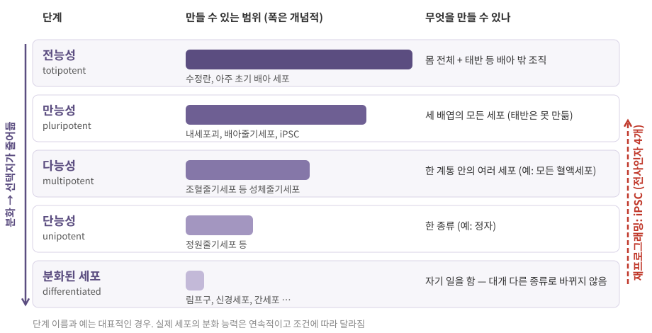
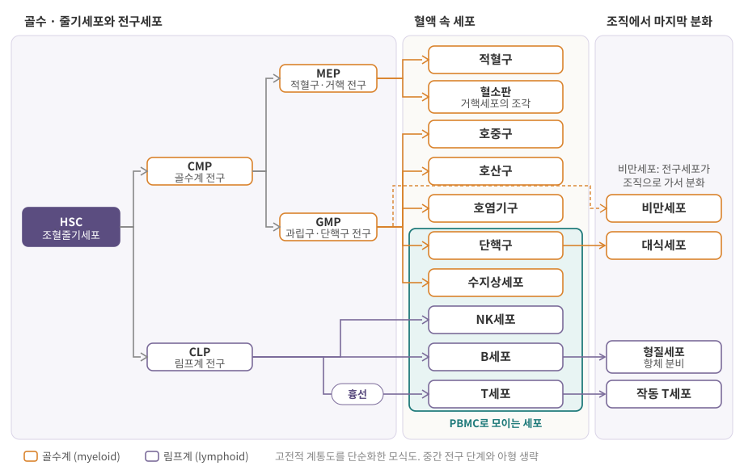
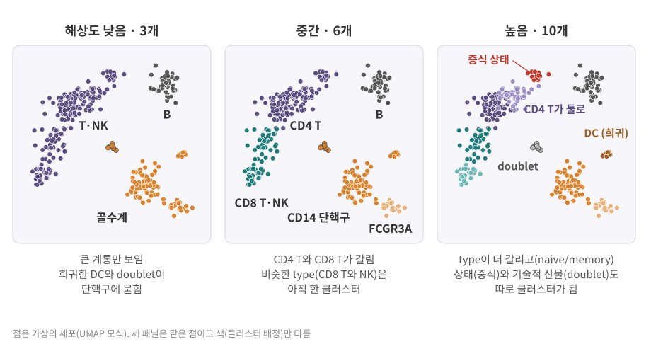
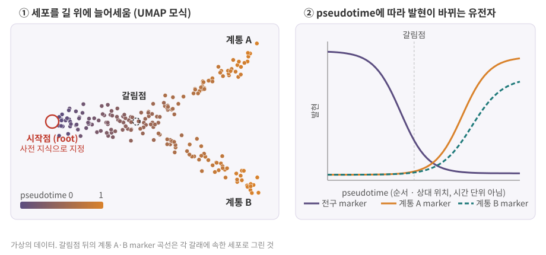

::: {.callout-note collapse="true"}
## 참고 자료
- Essential Cell Biology 20장 — 구조 참고
- 면역세포는 HaLab Wiki에서 자세히:
  - [면역계는 전체적으로 어떻게 짜여 있나?](https://halab-wiki.knu.ac.kr/disease/immunology/01-basics/overview.html)
  - [면역세포의 종류와 상태는 어떻게 구분하나?](https://halab-wiki.knu.ac.kr/disease/immunology/01-basics/cells.html)
  - [면역계는 언제 만들어지고 출생 전후에 어떻게 달라지나?](https://halab-wiki.knu.ac.kr/disease/immunology/01-basics/ontogeny.html)
- 본문의 숫자와 도구 설명은 옆의 배지가 출처. 도구의 기본값은 버전마다 바뀔 수 있으니 쓰는 버전의 설명서로 확인
- 그림은 직접 그린 모식도
:::

# 1. cell type이란 무엇인가

## 1) 같은 유전체, 다른 프로그램

- 몸의 세포는 수정란 하나에서 나왔고, 거의 모두 **같은 유전체**를 가짐
- 그런데 T세포와 간세포는 모양도, 하는 일도, 발현하는 유전자도 전혀 다름
- 차이는 **어떤 유전자를 켜고 끄는가** = 발현 프로그램
  - 프로그램을 정하는 것: 전사인자 (transcription factor)의 조합, 열린 염색질 구간 → [3장](03_genome_chromatin.qmd), [5장](05_transcription.qmd)
- 증거: 다 분화된 섬유모세포에 전사인자 4개를 넣었더니 배아줄기세포와 비슷한 상태로 되돌아감 (3절) [Takahashi 2006](https://doi.org/10.1016/j.cell.2006.07.024){.src} → 분화하면서 유전체를 잃은 것이 아니라 프로그램이 바뀐 것

| "같은 유전체"의 예외 | 무엇이 다른가 | 자세히 |
|---|---|---|
| T·B 림프구 | 항원 수용체 유전자 조각을 잘라 붙임(재조합) → 세포(클론)마다 서열이 다름 | [HaLab Wiki: 면역계의 큰 그림](https://halab-wiki.knu.ac.kr/disease/immunology/01-basics/overview.html) |
| 포유류 적혈구 | 성숙하면서 핵을 버림 | 4절 |
| 암세포 | 체세포 변이가 쌓임 | [9장](09_cell_cycle_death_cancer.qmd) |

::: {.callout-important}
## cell type (세포 유형)
- 같은 계통에서 나와 비슷한 **발현 프로그램과 기능을 안정적으로** 유지하는 세포 집단
- 정답 목록이 정해져 있지 않음 → 얼마나 잘게 나누느냐(해상도)에 따라 "T세포" 하나일 수도, CD4·CD8·naive·memory로 여럿일 수도 있음
:::

## 2) 정체성(type)과 상태(state)

| 구분 | type (정체성) | state (상태) |
|---|---|---|
| 뜻 | 계통에 묶인 안정적인 정체 | 맥락(자극, 시기, 환경)에 따라 바뀌는 프로그램 |
| 지속 | 오래 유지, 대개 되돌아가지 않음 | 자극이 사라지면 돌아오기도 함 |
| 예 | B세포 vs T세포, CD14 단핵구 vs FCGR3A 단핵구 | 세포주기·증식([9장](09_cell_cycle_death_cancer.qmd)), 활성화, 스트레스, 질환 관련 상태 (예: 알츠하이머 모델 생쥐의 질환 관련 미세아교세포 DAM [Keren-Shaul 2017](https://doi.org/10.1016/j.cell.2017.05.018){.src}) |

- 전사체로 나눈 집단이 곧 기능적으로 독립된 cell type이라고 바로 동일시하지 않기 [Papalexi & Satija 2018](https://doi.org/10.1038/nri.2017.76){.src}
- 경계가 흐린 경우도 많음: naive T와 memory T를 type으로 볼지 state로 볼지는 연구 질문에 따라 다르게 다룸 → 자세히 [HaLab Wiki: 면역세포의 종류와 상태](https://halab-wiki.knu.ac.kr/disease/immunology/01-basics/cells.html)

::: {.callout-tip collapse="true"}
## 비유: 같은 악보집, 다른 악기와 다른 연주
- 유전체 = 모든 연주자가 똑같이 받은 두꺼운 악보집
- type = 맡은 악기 (바이올린 연주자가 내일 첼로를 잡지 않음)
- state = 지금 연주하는 곡의 빠르기와 세기 (지휘에 따라 바뀜)
:::

# 2. 발생: 수정란에서 여러 세포로

## 1) 세 배엽

- 수정란 (zygote) → 분열 → **포배** (blastocyst): 바깥 세포층(영양외배엽, 태반 쪽) + 안쪽 세포 덩어리(**내세포괴**, inner cell mass → 몸 전체)
- 낭배 형성 (gastrulation): 내세포괴에서 세 **배엽** (germ layer)이 생김 → 각 배엽이 정해진 조직들을 만듦

| 배엽 | 만드는 조직 예 |
|---|---|
| 외배엽 (ectoderm) | 피부 표피, 신경계(뇌·척수) |
| 중배엽 (mesoderm) | 근육, 뼈·연골, 심장·혈관, **혈액세포**, 신장 |
| 내배엽 (endoderm) | 소화관 안쪽 상피, 간, 췌장, 기도 상피 |

- 혈액·면역세포는 중배엽 계통. 피를 만드는 장소는 발생 중에 난황낭 → 태아 간 → 골수 등으로 옮겨 감 → [HaLab Wiki: 면역계의 발생](https://halab-wiki.knu.ac.kr/disease/immunology/01-basics/ontogeny.html)

## 2) 분화 능력의 단계

{fig-alt="전능성, 만능성, 다능성, 단능성, 분화된 세포 다섯 줄. 막대가 아래로 갈수록 짧아지고, 각 줄에 예와 만들 수 있는 범위. 오른쪽에 분화된 세포에서 만능성으로 올라가는 빨간 점선 화살표"}

- 분화가 진행될수록 선택지가 줄어들고, 보통 한 방향으로만 감
- 다능성·단능성 세포는 주로 다 자란 몸의 조직 안에서 그 조직을 유지

::: {.callout-tip collapse="true"}
## 비유: 언덕을 굴러 내려가는 공 (Waddington 지형)
- 꼭대기의 공(만능 세포)은 어느 골짜기로든 갈 수 있음
- 굴러 내려가며 갈림길마다 한쪽을 고르면, 골짜기 바닥(분화된 세포)에서는 다른 골짜기로 넘어가기 어려움
- 장 끝 데이터 상자의 궤적(trajectory) 분석은 이 내리막길을 데이터에서 다시 그려 보려는 시도
:::

# 3. 줄기세포

::: {.callout-important}
## 줄기세포 (stem cell)
- **자기 재생** (self-renewal): 분열해도 줄기세포가 남음
- **분화** (differentiation): 다른 종류의 세포를 만들어 냄
- 둘 다 할 수 있어야 줄기세포. 분화는 하지만 자기 재생 능력이 제한된 세포는 **전구세포** (progenitor)
:::

| 종류 | 어디서 | 분화 능력 | 쓰임 |
|---|---|---|---|
| 배아줄기세포 (embryonic stem cell, ESC) | 포배의 내세포괴를 꺼내 배양 | 만능성 | 발생 연구, 원하는 세포로 분화 유도 |
| 성체줄기세포 (adult stem cell) | 골수(조혈줄기세포), 장 상피, 피부 등 | 대개 다능성 | 평생 조직 유지·재생 |
| 유도만능줄기세포 (induced pluripotent stem cell, iPSC) | 분화된 세포에 전사인자를 넣어 되돌림 | 만능성 | 환자 세포로 만든 질환 모델, 분화 세포·오가노이드 → [12장](12_data_generation.qmd) |

**iPSC: 전사인자 4개로 되돌리기** [Takahashi 2006](https://doi.org/10.1016/j.cell.2006.07.024){.src}

- Takahashi와 Yamanaka (2006): 마우스 배아·성체 섬유모세포에 **Oct3/4, Sox2, c-Myc, Klf4** 네 전사인자를 넣어 만능 상태로 유도 (Nanog는 필요 없었음)
- 만능성 확인: 면역결핍 생쥐 피부 밑에 넣자 **세 배엽 조직이 모두 섞인 종양** (기형종)이 생김, 포배에 넣자 배아 발생에 참여
- c-Myc = [9장](09_cell_cycle_death_cancer.qmd)의 종양유전자 *MYC* → 만능성·증식과 암은 가까운 관계, 기형종은 만능성의 증거이자 위험

# 4. 조혈: 줄기세포 하나에서 모든 혈액세포로

- 조혈 (hematopoiesis): 골수의 **조혈줄기세포** (hematopoietic stem cell, HSC)가 평생 모든 혈액세포를 만듦 → 자기 재생 + 다능성
- 고전적 계통도: HSC가 **골수계** (myeloid)와 **림프계** (lymphoid) 두 갈래로 나뉨 ([HaLab Wiki: 면역계의 큰 그림](https://halab-wiki.knu.ac.kr/disease/immunology/01-basics/overview.html)의 용어를 따름)

{fig-alt="왼쪽 HSC에서 CMP와 CLP로, CMP에서 MEP와 GMP로 갈라짐. MEP는 적혈구와 혈소판, GMP는 호중구·호산구·호염기구·단핵구·수지상세포와 비만세포, CLP는 NK·B·T세포(흉선 경유). 단핵구는 대식세포, B세포는 형질세포로. 단핵구부터 T세포까지가 PBMC로 표시됨"}

| 계통 | 전구세포 | 주요 세포 | 주로 하는 일 |
|---|---|---|---|
| 골수계 | CMP → MEP | 적혈구, 혈소판 (거핵세포의 조각) | 산소 운반, 지혈 |
| 골수계 | CMP → GMP | 과립구 (호중구·호산구·호염기구), 단핵구 (→ 조직에서 대식세포), 수지상세포, 비만세포 | 선천면역, 항원 제시 |
| 림프계 | CLP | B세포 (→ 형질세포), T세포 (흉선에서 성숙), NK세포 | 적응면역(B·T), 선천면역(NK) |

: {tbl-colwidths="[11,15,50,24]"}

- CMP = 공통 골수계 전구세포, CLP = 공통 림프계 전구세포, MEP = 거핵세포·적혈구 전구세포, GMP = 과립구·대식세포 전구세포
- **계통 ≠ 역할**: NK세포는 림프계 출신이지만 항원 특이 수용체가 없어 선천면역에 속함
- 단순화 주의: 사람 전구세포 지도에서는 고전 모델과 다른 경로도 보고됨 → 위키의 계통도 설명 참고
- **PBMC** (말초혈액 단핵세포)는 밀도구배로 모은 단핵세포 = 림프구 + 단핵구 + 수지상세포 → 과립구와 적혈구는 대부분 빠짐 ([HaLab Wiki: 면역세포의 종류와 상태](https://halab-wiki.knu.ac.kr/disease/immunology/01-basics/cells.html))
  - PBMC scRNA-seq에 호중구가 거의 없는 이유 = 생물학이 아니라 **시료 준비** 단계
- 면역세포 아형·상태·혈액 속 비율·발생 시기는 위키 세 페이지와 [부록 D](A4_immune_cells.qmd)에서

::: {.callout-caution .data-box icon=false}
## 데이터에서는 이렇게 보여요: 클러스터는 계산 결과, cell type은 해석

**해상도에 따라 클러스터 수가 바뀜**

- Seurat `FindClusters()`: 세포 이웃 그래프를 Louvain(기본)이나 Leiden 알고리즘으로 나눔 [Seurat PBMC3k](https://satijalab.org/seurat/articles/pbmc3k_tutorial){.src}
  - `resolution`이 클수록 클러스터가 많아짐
  - 튜토리얼: 세포 3천 개 안팎이면 0.4–1.2가 대개 무난, 데이터가 클수록 알맞은 값이 커지는 경향. PBMC3k 예제는 `resolution = 0.5`에서 9개
  - scanpy도 같은 생각: `sc.tl.leiden(adata, resolution=...)`

{fig-alt="세 패널에 같은 점 배치. 해상도 낮음 3개(T·NK, B, 골수계), 중간 6개, 높음 10개. 높음 패널에서 작은 증식 상태 클러스터, doublet, 희귀한 DC가 따로 표시됨"}

| 클러스터가 cell type과 어긋나는 경우 | 어떻게 보이나 | 확인 방법 |
|---|---|---|
| 한 type이 **상태**로 갈라짐 | 상위 marker가 *MKI67*, *TOP2A* (증식, [9장](09_cell_cycle_death_cancer.qmd)) 또는 활성화·스트레스 유전자 | 그 클러스터 안 세포들의 type marker 확인 |
| 비슷한 type이 **합쳐짐** | 해상도가 낮으면 CD8 T와 NK가 한 덩어리, 희귀한 type(DC)이 큰 클러스터에 묻힘 | 해상도를 올려 보기, 알려진 marker로 하위 분리 |
| **doublet** | 두 세포가 한 방울에 → 두 계통의 marker를 함께 (예: T세포 + 단핵구), UMI·유전자 수가 많음 | scDblFinder, DoubletFinder, Scrublet 점수 |
| **배치 효과** | 같은 type이 시료·실험 날짜별로 다른 클러스터 | 클러스터별 시료 구성 보기, 통합(integration) 후 비교 |
| **저품질 세포** | 미토콘드리아 비율이 높고 UMI가 적은 클러스터 | QC 지표 → [1장](01_cell_system.qmd) |

- doublet은 세포를 많이 넣을수록 늘어남: 10x Chromium 문서 기준 포획 세포 1,000개당 약 0.8% → 1만 개면 약 8% [scDblFinder](https://github.com/plger/scDblFinder){.src}
- UMAP 위의 거리와 면적은 실제 유사도·비율을 왜곡할 수 있음 → "가까우니 비슷한 type" 판단은 marker로 확인 [Chari & Pachter 2023](https://doi.org/10.1371/journal.pcbi.1011288){.src}

**판단 기준**

| 질문 | "예"라면 |
|---|---|
| 알려진 marker 조합으로 설명되나? | cell type 후보 |
| 해상도를 조금 바꿔도 유지되나? | 안정적인 집단 |
| 여러 시료(사람)에서 고르게 나오나? | 한 시료에서만 나오면 배치·개인차 의심 |
| 상위 marker가 주기·스트레스·미토콘드리아 유전자뿐인가? | type보다 state나 품질 문제 |
| 서로 다른 계통의 marker가 한 세포에 같이 있나? | doublet 의심 |
:::

::: {.callout-caution .data-box icon=false}
## 데이터에서는 이렇게 보여요: marker = 그 클러스터에서는 켜져 있고 나머지에서는 꺼진 유전자

**`FindAllMarkers()` 결과 읽기**

- `FindAllMarkers(pbmc, only.pos = TRUE)` = 클러스터마다 "이 클러스터 vs 나머지 전체 세포" 비교, 높은 쪽만 남김 [Seurat PBMC3k](https://satijalab.org/seurat/articles/pbmc3k_tutorial){.src}
- Seurat v5 기본값: Wilcoxon 순위합 검정, `logfc.threshold = 0.1`, `min.pct = 0.01`, `only.pos = FALSE` [Seurat FindMarkers](https://satijalab.org/seurat/reference/findmarkers){.src}

| 컬럼 | 뜻 |
|---|---|
| `p_val` | 검정 p값 |
| `avg_log2FC` | 두 집단 평균 발현의 log2 배수. 양수 = 이 클러스터에서 높음 |
| `pct.1` | 이 클러스터에서 그 유전자가 검출된(0보다 큰) 세포 비율 |
| `pct.2` | 나머지 세포에서 검출된 세포 비율 |
| `p_val_adj` | 데이터셋 전체 유전자 수로 Bonferroni 보정한 p값 |
| `cluster`, `gene` | 어느 클러스터의 어느 유전자인지 |

```{r}
#| label: marker-columns
x1 <- c(2.1, 1.8, 0, 2.5, 1.9, 2.2, 1.6, 2.0)    # 클러스터 안 8개
x2 <- c(0, 0, 0.9, 0, 0, 0, 0, 0, 1.1, 0, 0, 0)  # 나머지 12개
pct.1 <- round(mean(x1 > 0), 3)                  # 0보다 큰 세포 비율
pct.2 <- round(mean(x2 > 0), 3)
avg <- function(x) log2((sum(expm1(x)) + 1) / length(x))
c(pct.1 = pct.1, pct.2 = pct.2,
  avg_log2FC = round(avg(x1) - avg(x2), 2))
```

- 값은 한 유전자의 log 정규화 발현(가상). 8개 중 7개에서 검출 → `pct.1` 0.875, 12개 중 2개 → `pct.2` 0.167, `avg_log2FC` 약 4.03
- 계산식: log 정규화 값을 원래 단위로 되돌려(`expm1`) 합에 1을 더하고 세포 수로 나눈 뒤 log2, 두 집단의 차 [Seurat 소스](https://github.com/satijalab/seurat/blob/main/R/differential_expression.R){.src} — 버전마다 식이 조금 다를 수 있음

**좋은 marker의 조건**

- `pct.1`은 높고 `pct.2`는 낮음 → 켜짐/꺼짐이 뚜렷 (가장 중요)
- `avg_log2FC`가 큼
- 알려진 생물학과 맞음, 하나보다 **여러 개의 조합**
- `p_val_adj`로 줄 세우지 않기: 같은 데이터로 클러스터를 만들고 다시 검정하므로 p값이 과장됨 → Seurat 설명서도 주의를 당부 [Seurat FindMarkers](https://satijalab.org/seurat/reference/findmarkers){.src} ([1. Basic Statistics 10장](https://kkonoo.github.io/1_Basic_Statistics/chapters/10_multiple_testing.html))

**PBMC3k 튜토리얼의 marker** [Seurat PBMC3k](https://satijalab.org/seurat/articles/pbmc3k_tutorial){.src}

| 클러스터 | marker | cell type |
|---|---|---|
| 0 | *IL7R*, *CCR7* | Naive CD4+ T |
| 1 | *CD14*, *LYZ* | CD14+ 단핵구 |
| 2 | *IL7R*, *S100A4* | Memory CD4+ T |
| 3 | *MS4A1* | B |
| 4 | *CD8A* | CD8+ T |
| 5 | *FCGR3A*, *MS4A7* | FCGR3A+ 단핵구 |
| 6 | *GNLY*, *NKG7* | NK |
| 7 | *FCER1A*, *CST3* | DC (수지상세포) |
| 8 | *PPBP* | Platelet (혈소판) |

- 같은 *PPBP* 클러스터를 scanpy 튜토리얼은 "Megakaryocytes"라 부름 → 이름은 분석자의 해석이므로 marker와 함께 보고 ([HaLab Wiki](https://halab-wiki.knu.ac.kr/disease/immunology/01-basics/cells.html))

**참조 데이터로 자동 annotation**

| 도구 | 방식 | 출처 |
|---|---|---|
| Azimuth | 라벨이 붙은 참조 데이터에 내 세포를 매핑 (Seurat 팀) | [Hao 2021](https://doi.org/10.1016/j.cell.2021.04.048){.src} |
| SingleR | 순수한 cell type 참조 전사체와 비교해 세포마다 독립적으로 추정 | [Aran 2019](https://www.nature.com/articles/s41590-018-0276-y){.src} |
| CellTypist | 로지스틱 회귀 분류기, 면역세포 중심의 내장 모델 | [Domínguez Conde 2022](https://doi.org/10.1126/science.abl5197){.src} |

- 참조에 없는 type도 가장 비슷한 이름을 받음 → 자동 라벨은 출발점, marker로 확인해 확정
:::

::: {.callout-caution .data-box icon=false}
## 데이터에서는 이렇게 보여요: 궤적과 pseudotime = 한 번 찍은 사진 속 세포를 길 위에 늘어세운 것

{fig-alt="왼쪽: 시작점에서 갈림점을 지나 계통 A와 B로 갈라지는 점들이 보라에서 주황으로 색이 변함. 오른쪽: 전구 marker는 pseudotime에 따라 내려가고 계통 A·B marker는 갈림점 뒤에 올라감"}

- 분화는 연속 과정 → 한 시료 안에 중간 단계 세포가 섞여 있으면 UMAP에서 **길**처럼 늘어섬
- **pseudotime** = 시작점에서 길을 따라 잰 상대 위치 (보통 0 → 1)
  - 실제 시간(시간·일)이 **아님**: 같은 시점에 채취한 서로 다른 세포를 순서대로 늘어놓은 것
  - 0.8인 세포가 0.4인 세포보다 "두 배 늦게" 분화했다는 뜻이 아님
- 방향은 데이터만으로 정해지지 않음
  - 시작점(root)을 사전 지식으로 지정: 예) scanpy의 diffusion pseudotime은 `adata.uns['iroot']`에 시작 세포를 줘야 계산 [scanpy 소스](https://github.com/scverse/scanpy/blob/main/src/scanpy/tools/_dpt.py){.src}
  - 또는 RNA velocity로 방향 추정 → [6장](06_rna_processing.qmd) [La Manno 2018](https://doi.org/10.1038/s41586-018-0414-6){.src}

| 도구 | 특징 | 출처 |
|---|---|---|
| Monocle | pseudotime 순서 매기기를 널리 알린 도구, 지금은 Monocle 3 | [Monocle 3](https://cole-trapnell-lab.github.io/monocle3/){.src} |
| Slingshot | 클러스터 위에 계통(가지)을 잡고 매끈한 곡선으로 pseudotime 계산 | [Street 2018](https://doi.org/10.1186/s12864-018-4772-0){.src} |
| PAGA | 클러스터끼리 얼마나 연결됐는지 그래프로 요약, scanpy `sc.tl.paga` | [Wolf 2019](https://genomebiology.biomedcentral.com/articles/10.1186/s13059-019-1663-x){.src} |

- 방법마다 결과가 다를 수 있어 여러 방법을 비교한 벤치마크도 있음 [Saelens 2019](https://doi.org/10.1038/s41587-019-0071-9){.src}
- 궤적은 **추론**: 실제로 그 세포가 그 세포에서 나왔는지는 계통추적(lineage tracing) 실험으로 따로 확인해야 함 ([HaLab Wiki: 면역계의 발생](https://halab-wiki.knu.ac.kr/disease/immunology/01-basics/ontogeny.html))
:::

# 5. 정리

- 세포는 거의 같은 유전체를 갖고 **발현 프로그램**이 다름. type은 안정적 정체성, state는 맥락에 따라 바뀌는 프로그램
- 수정란 → 포배 → 세 배엽 → 조직. 분화 능력은 전능성 → 만능성 → 다능성 → 단능성으로 좁아지고, iPSC는 전사인자 4개로 이를 거꾸로 돌림
- 조혈: HSC → 골수계(CMP)·림프계(CLP) → 혈액세포. PBMC에는 과립구·적혈구가 대부분 빠져 있음. 자세한 면역세포는 HaLab Wiki
- 클러스터는 계산 결과, cell type은 해석: 해상도, 상태, doublet, 배치 효과를 확인한 뒤 이름을 붙임
- marker는 `pct.1`·`pct.2`·`avg_log2FC`를 함께 보고, `p_val_adj`로 줄 세우지 않음. 자동 annotation은 출발점
- pseudotime은 순서이지 시간이 아니고, 방향은 시작점 지정이나 RNA velocity로 정함

# 연습문제

1. 10x Chromium으로 세포 8,000개를 포획했다. 포획 1,000개당 약 0.8%라는 기준으로 doublet은 대략 몇 %, 몇 개일까? 이 중 같은 type 세포끼리 생긴 doublet은 왜 클러스터나 marker로 찾기 어려울까?
2. 한 클러스터의 marker 후보가 둘이다. 유전자 X는 `avg_log2FC` 2.1, `pct.1` 0.95, `pct.2` 0.60이고, 유전자 Y는 `avg_log2FC` 1.2, `pct.1` 0.40, `pct.2` 0.02다. 각각 어떤 점이 좋고 어떤 점이 아쉬운가? 다른 데이터셋에서 이 클러스터를 다시 찾는 데 하나만 쓴다면 어느 쪽을 고르겠고, 둘을 함께 쓰면 무엇이 나아지는가?
3. 동료가 `resolution`을 0.5에서 1.2로 올렸더니 CD4 T 클러스터가 셋으로 갈렸고, "CD4 T의 새 아형 3개를 찾았다"고 말한다. 이 주장을 받아들이기 전에 확인할 것 세 가지를 판단 기준 표를 근거로 써라.
4. 조혈 전구세포 데이터에서 Slingshot으로 pseudotime을 구했더니 적혈구 쪽 끝이 0, HSC 쪽 끝이 1로 나왔다. 무엇이 잘못되었을 가능성이 큰가? 이 결과로 "적혈구가 HSC가 된다"고 말할 수 없는 이유와, 방향을 정할 두 가지 방법을 써라.
