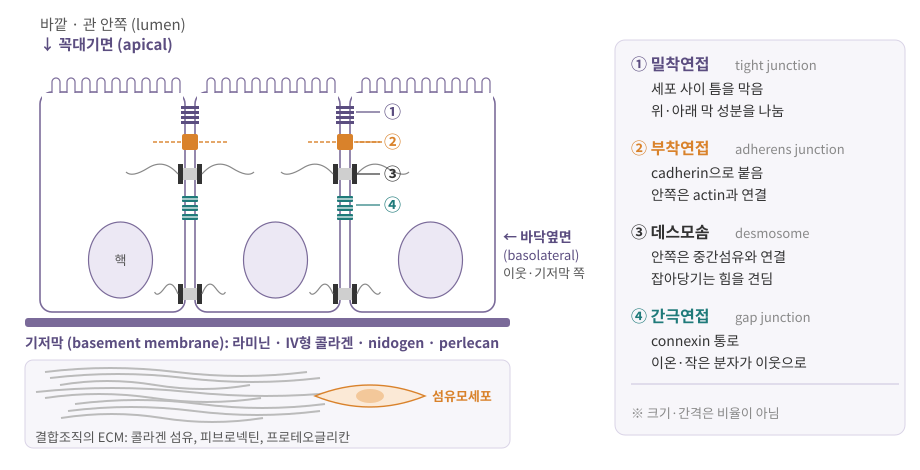
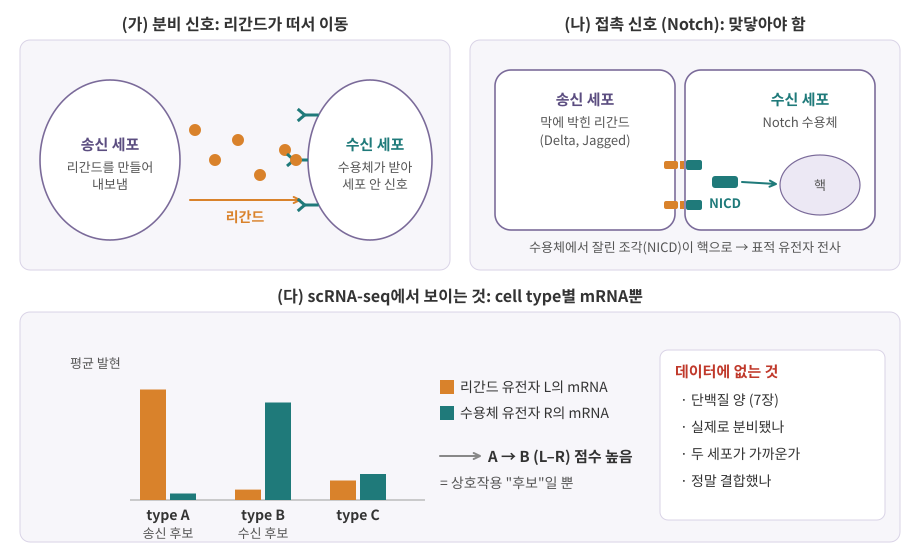
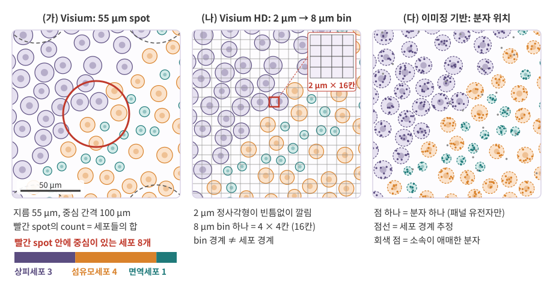

::: {.callout-note collapse="true"}
## 참고 자료
- Essential Cell Biology 16, 20장 — 구조 참고
- 본문의 숫자는 옆의 배지가 출처. 플랫폼 사양은 버전마다 바뀌므로 **쓰기 전에 최신 문서로 다시 확인**
- 그림은 직접 그린 모식도
:::

# 1. 조직은 세포와 그 사이의 것으로 이루어진다

## 1) 세포가 모여 조직이 된다

- 조직 (tissue) = 구조가 비슷한 세포들이 모여 **함께 일하는 단위** [SEER](https://www.training.seer.cancer.gov/anatomy/cells_tissues_membranes/tissues/){.src}
- 기관 (organ) = 여러 조직의 조합 (예: 장 = 상피 + 결합조직 + 근육 + 신경)
- 사람 몸의 조직은 크게 네 가지 [SEER](https://www.training.seer.cancer.gov/anatomy/cells_tissues_membranes/tissues/){.src}

| 조직 | 하는 일 | 예 | scRNA-seq에서 만나는 세포 |
|---|---|---|---|
| 상피 (epithelial) | 몸 표면과 관의 안쪽을 덮음, 분비샘을 이룸 | 피부 표면, 장·기도 안쪽 | 상피세포 (여러 아형) |
| 결합 (connective) | 다른 조직을 받치고 잇는 틀 | 힘줄, 뼈, 지방, 진피 | 섬유모세포 (fibroblast) 등 |
| 근육 (muscle) | 수축해서 힘을 냄 | 골격근, 심장근, 평활근 | 근육세포, 평활근세포 |
| 신경 (nervous) | 신호를 전달·처리 | 뇌, 척수, 말초신경 | 신경세포, 신경교세포 |

- 이 네 칸은 아주 큰 분류. 데이터에서 보는 "cell type"은 이 아래 수십–수백 가지 → [10장](10_cell_identity.qmd)
- 실제 조직 시료에는 혈관과 면역세포도 섞임 → 3절의 조직 미세환경

## 2) 세포 사이를 채우는 세포외기질

- 세포외기질 (extracellular matrix, ECM) = 세포가 분비해 세포 **밖**에 쌓은 단백질과 당의 그물 [Frantz 2010](https://doi.org/10.1242/jcs.023820){.src}
- 단순한 충전재가 아님: 조직의 모양을 잡고, 세포가 붙을 자리를 주고, 신호 분자를 붙잡아 둠

| 성분 | 무엇인가 | 하는 일 |
|---|---|---|
| 콜라겐 (collagen) | 섬유를 이루는 단백질 계열, 종류가 여럿 | 잡아당기는 힘을 버팀 (힘줄, 진피, 뼈) |
| 피브로넥틴 (fibronectin) | 접착 단백질 | 세포와 콜라겐 섬유를 이어 줌 |
| 라미닌 (laminin) | 기저막의 핵심 단백질 | 세포가 기저막에 붙는 자리 |
| 프로테오글리칸 (proteoglycan) | 핵심 단백질 + 긴 당 사슬 | 물을 머금은 젤을 만들고 성장인자 등을 붙잡음 |

- 기저막 (basement membrane): 상피 바로 아래의 **얇은 판 모양 ECM**
  - 라미닌 + IV형 콜라겐 + nidogen + 프로테오글리칸(perlecan, agrin)이 스스로 엮여 만듦 [Yurchenco 2011](https://pmc.ncbi.nlm.nih.gov/articles/PMC3039528){.src}
  - 상피와 그 아래 결합조직을 가르는 경계
- 결합조직의 ECM은 주로 섬유모세포 같은 기질세포가 만듦 → scRNA-seq에서 콜라겐 유전자(*COL1A1* 등)가 높은 cluster를 볼 때 떠올릴 것

::: {.callout-tip}
## 숫자도 출처를 확인하자: "콜라겐은 몸 단백질의 1/3"
- 교과서와 논문에 흔히 나오는 문장: 콜라겐이 몸 전체 단백질의 1/4–1/3
- 생쥐 전신을 실제로 재 보니 **암컷 약 12%, 수컷 약 17%** — 흔한 말의 절반 정도 [Tarnutzer 2023](https://www.ncbi.nlm.nih.gov/pmc/articles/PMC10024738/){.src}
- 힘줄·뼈처럼 콜라겐이 많은 조직만 보면 높게 나옴 → **무엇을 분모로 했는지**가 숫자를 바꿈
:::

# 2. 세포 접합과 상피의 극성

## 1) 네 가지 접합

{fig-alt="원기둥 모양 상피세포 세 개 사이에 밀착연접, 부착연접, 데스모솜, 간극연접이 위에서부터 표시되고, 세포 아래에 기저막 띠와 콜라겐 섬유, 섬유모세포가 있는 그림"}

| 접합 | 붙잡는 분자 | 세포 안쪽 연결 | 하는 일 |
|---|---|---|---|
| 밀착연접 (tight junction) | claudin, occludin | ZO 단백질 → actin | 세포 사이 틈을 막아 이온·용질이 새는 길을 조절 [Hartsock 2008](https://pmc.ncbi.nlm.nih.gov/articles/PMC2682436){.src} |
| 부착연접 (adherens junction) | E-cadherin | catenin → actin | 세포끼리 접촉을 시작하고 유지 [Hartsock 2008](https://pmc.ncbi.nlm.nih.gov/articles/PMC2682436){.src} |
| 데스모솜 (desmosome) | desmoglein, desmocollin (cadherin 계열) | desmoplakin → 중간섬유 | 중간섬유를 막에 고정해 잡아당기는 힘을 견딤 [Delva 2009](https://pmc.ncbi.nlm.nih.gov/articles/pmid/20066089){.src} |
| 간극연접 (gap junction) | connexin (6개가 모여 connexon) | — | 두 세포의 connexon이 맞물린 통로로 이온과 작은 분자가 이동 [Goodenough 2009](https://pmc.ncbi.nlm.nih.gov/articles/PMC2742079/){.src} |

- 앞의 셋은 **붙이는** 접합, 간극연접은 **통하는** 접합
- 간극연접은 상피뿐 아니라 고형 조직의 거의 모든 세포에 있음 [Goodenough 2009](https://pmc.ncbi.nlm.nih.gov/articles/PMC2742079/){.src}
- 단백질 이름과 유전자 기호가 다른 경우가 많음: E-cadherin ↔ *CDH1*, connexin 43 ↔ *GJA1* → [부록 B](A2_nomenclature.qmd)

## 2) 상피의 극성

- 상피세포의 막은 두 영역으로 나뉨 [극성 리뷰 2022](https://www.ncbi.nlm.nih.gov/pmc/articles/PMC9253303/){.src}
  - 꼭대기면 (apical): 바깥이나 관의 안쪽을 향함
  - 바닥옆면 (basolateral): 이웃 세포와 기저막 쪽을 향함
- 밀착연접이 꼭대기면 바로 아래를 두르며 경계 역할 → 두 영역의 막 성분이 섞이지 않게 함 [PMC5713485](https://pmc.ncbi.nlm.nih.gov/articles/PMC5713485){.src}
- 그래서 같은 세포 안에서도 **어느 면에 어떤 단백질이 있는지**가 다름 (예: 한쪽 면으로 흡수, 반대쪽 면으로 내보냄)

::: {.callout-warning}
## 처음엔 여기서 헷갈려요: 조직을 낱개 세포로 만들면 생기는 일
- scRNA-seq은 조직을 **낱개 세포로 떼어 내야**(해리, dissociation) 시작할 수 있음 → 접합과 ECM을 효소·물리적 힘으로 끊음
- 세포 종류마다 떨어지는 정도, 살아남는 정도가 다를 수 있음
- → scRNA-seq의 cell type **비율**을 조직 속 비율로 바로 읽으면 안 됨
- spatial 방법은 조직 절편을 그대로 쓰므로 이 단계를 피함 (대신 다른 한계가 있음 → 4절)
:::

# 3. 세포는 서로 신호를 주고받는다

## 1) 분비 신호와 접촉 신호

- 신호가 가는 거리(내분비, 측분비, 자가분비, 접촉)와 수용체 이후 세포 안의 신호전달 → [8장](08_cell_signaling.qmd)
- 이 장은 **누가 누구에게** 보내는가, 즉 세포 사이의 관계에 집중. 데이터 분석에서 중요한 구분은 셋

| 방식 | 무엇이 전달되나 | 데이터에서 필요한 것 |
|---|---|---|
| 분비 신호 (측분비 등) | 분비된 리간드 → 근처 세포의 수용체 | 송신 cell type과 수신 cell type이 같은 조직에 있음 |
| 접촉 신호 (juxtacrine) | **막에 박힌** 리간드 → 맞닿은 세포의 수용체 | 두 세포가 실제로 맞닿아 있음 → 위치 정보 |
| 간극연접 | 세포질의 작은 분자가 통로로 직접 이동 | 리간드–수용체 분석으로는 잡히지 않음 (connexin 발현만 보임, 2절) |

{fig-alt="왼쪽 위는 송신 세포가 리간드를 내보내 수신 세포 수용체에 붙는 그림, 오른쪽 위는 맞닿은 두 세포의 막 리간드와 Notch 수용체, 아래는 cell type A, B, C의 리간드와 수용체 발현 막대와 데이터에 없는 것 목록"}

## 2) 접촉 신호의 예: Notch

- Notch는 맞닿은 이웃 세포끼리 쓰는 대표적 접촉 신호 경로
- 순서 [PMC4321269](https://pmc.ncbi.nlm.nih.gov/articles/PMC4321269/figure/fig01){.src}
  1. 수신 세포 막의 Notch 수용체가 이웃 세포 막의 리간드(Delta 또는 Jagged)와 결합
  2. 수용체가 잘리며 세포 안쪽 조각(NICD)이 떨어져 나옴
  3. NICD가 핵으로 들어가 표적 유전자의 전사를 바꿈 → [5장](05_transcription.qmd)
- 리간드도 막에 붙어 있으므로 **두 세포가 맞닿아야** 신호가 감
- 발생 과정에서 이웃 세포끼리 직접 소통하는 주된 경로 [Notch 리뷰](https://pmc.ncbi.nlm.nih.gov/articles/PMC8105286){.src} → 세포 운명 결정은 [10장](10_cell_identity.qmd)

## 3) 조직 미세환경

- 실제 조직 시료 한 조각에 들어 있는 세포
  - 실질세포 (parenchymal cell): 그 기관의 주된 일을 하는 세포 (예: 간세포, 장 상피세포)
  - 기질세포 (stromal cell): 틀을 만드는 섬유모세포, 혈관을 이루는 내피세포 등
  - 면역세포: 원래 있던 것 + 염증이나 종양으로 들어온 것 (침윤, infiltration) → [부록 D](A4_immune_cells.qmd)
- 종양 미세환경 (tumor microenvironment): 암세포 + 기질세포 + 침윤 면역세포 → [9장](09_cell_cycle_death_cancer.qmd)
- bulk RNA-seq은 이 모든 세포의 발현이 **섞인 합**
  - 예: ESTIMATE는 발현 signature로 시료의 기질·면역세포 정도를 점수로 매김 [Yoshihara 2013](https://pmc.ncbi.nlm.nih.gov/articles/PMC3826632){.src}
  - 이 점수는 같은 연구 안에서 **상대적으로만** 비교 가능 [Yoshihara 2013](https://pmc.ncbi.nlm.nih.gov/articles/PMC3826632){.src}
- 두 시료의 발현 차이가 "세포가 달라져서"인지 "세포 구성비가 달라서"인지 구분해야 함 → single-cell, spatial 데이터를 쓰는 이유 중 하나

::: {.callout-warning}
## 처음엔 여기서 헷갈려요
| 헷갈리는 짝 | 차이 |
|---|---|
| ECM vs 기저막 | 기저막은 상피 아래 얇은 판 모양으로 특수하게 짜인 ECM |
| 부착연접 vs 데스모솜 | 둘 다 cadherin 계열로 붙음. 부착연접은 actin, 데스모솜은 중간섬유에 연결 |
| 간극연접 vs 접촉 신호 | 간극연접은 작은 분자가 통로로 이동, 접촉 신호는 막 단백질끼리 결합해 수용체가 신호를 냄 |
| 리간드 mRNA vs 신호 전달 | mRNA가 있어도 단백질로 만들어져 분비되고 수용체에 닿아야 신호가 감 |
| 발현 차이 vs 구성 차이 | bulk 발현이 달라진 것이 세포 구성비 변화 때문일 수 있음 |
:::

# 4. 데이터에서는 이렇게 보여요

::: {.callout-caution .data-box icon=false}
## 데이터에서는 이렇게 보여요: spatial의 한 열은 세포가 아닐 수 있다

{fig-alt="세 패널에 같은 세포 배치가 그려짐. 첫 패널은 지름 55 µm 원 하나가 세포 8개를 덮고, 둘째 패널은 8 µm 격자와 2 µm 칸 16개 확대, 셋째 패널은 세포 안의 작은 점과 점선 세포 경계"}

**방식 비교**

- 크게 두 갈래: 시퀀싱 기반 (위치 바코드를 붙여 시퀀싱) vs 이미징 기반 (현미경으로 분자를 직접 찾음) [OSTA](https://bioconductor.org/books/release/OSTA/pages/seq-introduction.html){.src}

| 방식 | 한 단위 | 유전자 수 | 출처 |
|---|---|---|---|
| Visium | 지름 55 µm spot, 중심 간격 100 µm | 미리 고르지 않음 (전사체 규모) | [OSTA](https://bioconductor.org/books/release/OSTA/pages/seq-introduction.html){.src} |
| Visium HD | 2 µm 정사각형이 빈틈없이 → 보통 8 µm·16 µm bin으로 합쳐 분석 | 미리 고르지 않음 | [10x Genomics](https://www.10xgenomics.com/support/software/loupe-browser/latest/analysis/assay-analysis/lb-hd-spatial-gene-expression){.src} |
| Xenium | 분자 하나의 위치 (세포보다 작은 해상도) | 미리 고른 패널, 최대 5,000 유전자 (+100 추가) | [10x Genomics](https://10xgenomics.com/platforms/xenium){.src} |
| MERFISH (MERSCOPE) | 분자 하나의 위치 | 패널 최대 약 1,000 유전자 | [OSTA](https://bioconductor.org/books/release/OSTA/pages/img-introduction.html){.src}, [Chen 2015](https://pmc.ncbi.nlm.nih.gov/articles/PMC4662681/){.src} |
| CosMx | 분자 하나의 위치 | 1,000 → 6,000 → 전사체 규모 패널(18,000개 이상)까지 | [OSTA](https://bioconductor.org/books/release/OSTA/pages/img-introduction.html){.src}, [Bruker](https://brukerspatialbiology.com/blog/revealing-spatial-biology-at-whole-transcriptome-scale-introducing-the-cosmx-human-whole-transcriptome-panel/){.src} |

- 시퀀싱 기반: 유전자를 미리 고르지 않아도 됨. 대신 한 단위가 세포와 맞지 않음
- 이미징 기반: 세포 하나, 그 안의 위치까지 봄. 대신 **패널에 넣은 유전자만** 보이고, 세포 경계를 그리는 단계(segmentation)의 오류가 count에 섞임

**spot ≠ 세포**

- Visium spot 하나에 평균 1–10개 세포 [10x Genomics](https://www.10xgenomics.com/jp/blog/answering-your-questions-about-the-visium-spatial-gene-expression-solution){.src} — 조직마다 크게 다름 (사람 뇌 약 0–10개, 생쥐 뇌 약 50개) [OSTA](https://bioconductor.org/books/release/OSTA/pages/seq-introduction.html){.src}
- spot의 count = 덮인 세포들의 mRNA가 **섞인 합** → [0장 연습문제 3](00_why_biology.qmd#연습문제)의 계산이 바로 이 문제
- 그래서 spot마다 cell type 비율을 추정하는 deconvolution을 함: scRNA-seq으로 만든 cell type별 발현 profile을 참고(reference)로 씀
  - 예: RCTD [Cable 2022](https://doi.org/10.1038/s41587-021-00830-w){.src}, cell2location [Kleshchevnikov 2022](https://doi.org/10.1038/s41587-021-01139-4){.src}
  - reference에 없는 cell type은 추정할 수 없음 → reference를 어떤 데이터로 만들었는지 확인
- Visium HD의 8 µm bin도 세포 경계와 무관하게 자른 격자 → bin 하나에 세포 조각 여럿이 걸칠 수 있음 [OSTA](https://bioconductor.org/books/release/OSTA/pages/seq-workflow-visium-hd-bin.html){.src}

**파일로는**

- 행렬 모양은 scRNA-seq과 같음 (유전자 × spot/bin/세포) + 단위마다 **x, y 좌표**와 조직 사진
- Bioconductor에서는 `SingleCellExperiment`를 확장한 `SpatialExperiment` 객체에 좌표·이미지를 함께 담음 [SpatialExperiment](https://bioconductor.org/packages/SpatialExperiment){.src}
- 열 이름이 "barcode"여도 그것이 세포인지 spot인지 bin인지 먼저 확인 (Visium HD의 Loupe 화면에서는 "cell"이 실제로는 bin을 뜻함 [10x Genomics](https://www.10xgenomics.com/support/software/loupe-browser/latest/analysis/assay-analysis/lb-hd-spatial-gene-expression){.src})
:::

::: {.callout-caution .data-box icon=false}
## 데이터에서는 이렇게 보여요: cell–cell communication 결과는 "가능성 목록"이다

**무엇을 하나**

- 질문: cell type A가 cell type B에게 신호를 보내는가?
- 재료: (1) cell type이 붙은 scRNA-seq 데이터, (2) 알려진 리간드–수용체 쌍 데이터베이스
- 방법: 쌍마다 **A에서 리간드 발현 × B에서 수용체 발현**을 점수로 만들고, 우연히 그만큼 높을지 따짐 (위 그림 (다))

| 도구 | 점수를 매기는 방식 | 출처 |
|---|---|---|
| CellPhoneDB | 두 cell type의 리간드·수용체 평균 발현으로 점수. cell type 이름표를 무작위로 섞어(기본 1,000번) p-value. 한 cell type에서 10% 이상 세포가 발현할 때만 계산. 여러 단백질로 된 수용체 복합체를 고려 | [CellPhoneDB 문서](https://cellphonedb.readthedocs.io/en/latest/RESULTS-DOCUMENTATION.html){.src}, [Efremova 2020](https://doi.org/10.1038/s41596-020-0292-x){.src} |
| CellChat | 발현과 사전지식으로 cell type 쌍 사이 통신 확률을 모델링 | [Jin 2021](https://doi.org/10.1038/s41467-021-21246-9){.src} |
| NicheNet | 리간드가 수신 세포의 **표적 유전자 발현 변화**를 설명하는지까지 봄 | [Browaeys 2020](https://pubmed.ncbi.nlm.nih.gov/31819264/){.src} |
| LIANA | 여러 방법·데이터베이스를 한 틀에서 돌려 순위를 합침 | [Dimitrov 2022](https://www.ncbi.nlm.nih.gov/pmc/articles/PMC9184522/){.src} |

**결과 형식**

- 한 행 = (송신 cell type, 수신 cell type, 리간드, 수용체) 조합 하나 + 점수
- 도구마다 컬럼 이름이 다름
  - CellChat `subsetCommunication()`: `source`, `target`, `ligand`, `receptor`, `prob`, `pval`, `pathway_name` 등 [CellChat 코드](https://github.com/jinworks/CellChat){.src}
  - LIANA: `source`, `target`, `ligand_complex`, `receptor_complex`, `magnitude_rank`, `specificity_rank` (순위는 **작을수록** 강함) [LIANA+ 문서](https://liana-py.readthedocs.io/en/latest/notebooks/basic_usage.html){.src}
  - CellPhoneDB: 행 = `interacting_pair`(예: 리간드\|수용체), 열 = cell type 쌍(예: A\|B), 값 = 평균 또는 p-value [CellPhoneDB 문서](https://cellphonedb.readthedocs.io/en/latest/RESULTS-DOCUMENTATION.html){.src}
- 가상의 예 (값은 지어낸 것)

| source | target | ligand | receptor | 점수 | p |
|---|---|---|---|---|---|
| Fibroblast | T cell | CXCL12 | CXCR4 | 0.21 | 0.001 |
| Endothelial | Fibroblast | PDGFB | PDGFRB | 0.15 | 0.004 |
| Epithelial | Epithelial | JAG1 | NOTCH2 | 0.08 | 0.03 |

**한계 — 결과는 가설이다**

- mRNA ≠ 단백질: 리간드 mRNA가 있어도 단백질 양, 분비 여부는 모름 → [7장](07_translation_protein.qmd)
- 거리 정보 없음: 두 cell type이 같은 시료에 있어도 서로 닿지 않을 수 있음. 특히 Notch 같은 **접촉 신호**는 맞닿아야 함
- 결합·활성 정보 없음: 수용체가 실제로 리간드와 붙어 신호를 냈는지 모름
- 데이터베이스 의존: 데이터베이스마다 겹치는 정도가 들쭉날쭉하고, **방법과 데이터베이스 선택이 결과를 크게 바꿈** [Dimitrov 2022](https://www.ncbi.nlm.nih.gov/pmc/articles/PMC9184522/){.src}
- cell type을 어떻게 나눴는지에 따라 결과가 바뀜 → [10장](10_cell_identity.qmd)
- p-value는 수많은 (cell type 쌍 × 리간드–수용체 쌍)에서 나옴 → 다중검정을 의식할 것 ([1. Basic Statistics 10장](https://kkonoo.github.io/1_Basic_Statistics/chapters/10_multiple_testing.html))

**spatial과 합치면**

- 실제로 가까이 있는 cell type 쌍만 남기는 **거리 조건**을 더할 수 있음 → 접촉 신호의 거짓 양성이 줄어듦
- 거꾸로 spatial로 고른 후보도 실험(차단 항체, 유전자 교란 → [12장](12_data_generation.qmd))으로 확인해야 인과를 말할 수 있음
:::

# 5. 정리

- 조직 = 세포 + 세포외기질(ECM). 기저막은 상피 아래 얇은 판 모양의 ECM
- 세포 접합 넷: 밀착연접(막음), 부착연접(actin), 데스모솜(중간섬유), 간극연접(통로). 상피는 꼭대기면과 바닥옆면으로 극성이 있음
- 세포 간 신호는 분비 신호와 접촉 신호(Notch)로 나뉨 — 접촉 신호는 세포가 맞닿아야 감
- 실제 조직은 실질세포 + 기질세포 + 면역세포의 혼합 → bulk 발현 차이는 구성 차이일 수 있음
- spatial의 한 단위(spot, bin)는 세포가 아닐 수 있음 → deconvolution, segmentation을 거침
- cell–cell communication 결과는 mRNA로 고른 **가능성 목록**. 거리·단백질·결합은 다른 데이터로 확인

# 연습문제

1. Visium spot(지름 55 µm)과 Visium HD의 8 µm bin, 16 µm bin의 면적을 비교하라. spot 하나는 8 µm bin 몇 개의 면적과 같은가? 지름 10 µm인 세포가 16 µm bin과 8 µm bin에 각각 어떻게 걸칠 수 있는지 그림으로 생각해 보고, 어느 쪽이 "세포 하나"에 더 가까운지 말하라.
2. CellPhoneDB 결과에서 Fibroblast → T cell의 CXCL12–CXCR4가 p = 0.001로 나왔다. 동료가 "섬유모세포가 CXCL12로 T 세포를 끌어당긴다"고 결론 내렸다. 이 결론에 대한 반론을 세 가지 들고, 각각 어떤 데이터나 실험으로 확인할 수 있는지 적어라.
3. 같은 종양 조직에서 해리 기반 scRNA-seq은 상피세포 비율이 10%, 이미징 기반 spatial은 40%로 나왔다. 두 숫자가 다를 수 있는 이유를 2절과 4절을 근거로 두 가지 이상 들어라.
4. Notch 신호(접촉)와 분비 신호의 차이를 바탕으로, scRNA-seq만 있을 때와 spatial 데이터가 있을 때 *JAG1*–*NOTCH2* 상호작용 후보를 어떻게 다르게 평가할지 설명하라.
