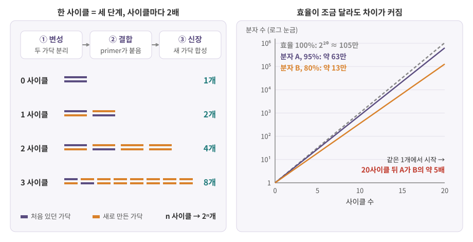
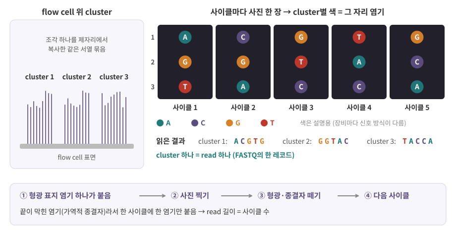
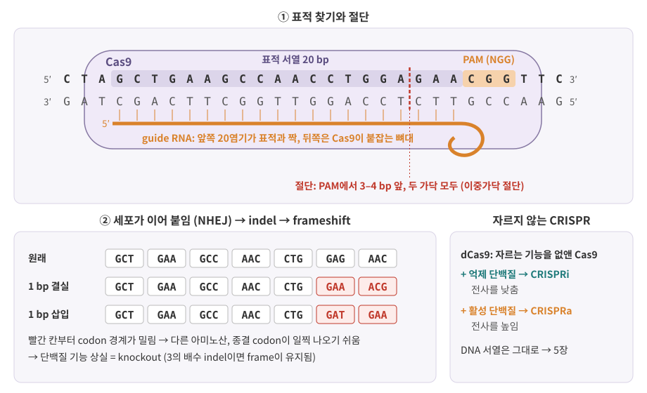
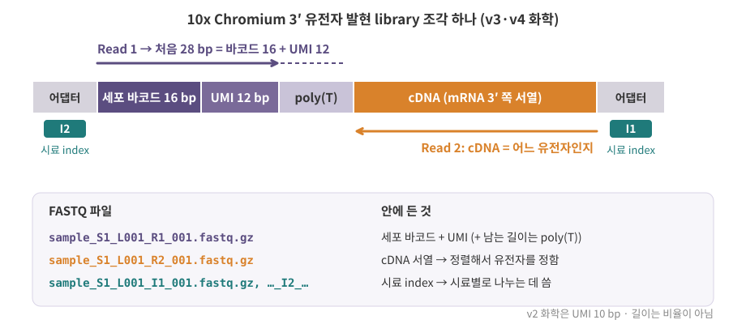

::: {.callout-note collapse="true"}
## 참고 자료
- Essential Cell Biology 10장 / OpenStax Biology 2e 17장 Biotechnology and Genomics — 구조 참고
- 본문의 숫자는 옆의 배지가 출처. 장비·키트 사양은 버전마다 바뀌므로 **쓰기 전에 그 버전의 문서로 다시 확인**
- 실험 조건(온도, 시간 등)은 키트·프로토콜마다 달라 이 장에서는 원리만 다룸
- 그림은 직접 그린 모식도
:::

# 1. 분자에서 파일까지

## 1) 이 장의 도구 지도

- 분석가가 받는 파일(FASTQ, count matrix)은 여러 실험 도구를 거쳐 만들어지고, 도구마다 데이터에 **흔적**을 남김

| 도구 | 하는 일 | 데이터에 남는 흔적 | 이 장 |
|---|---|---|---|
| 역전사 | RNA → DNA(cDNA)로 복사 | (oligo(dT)를 쓰면) 3' 쪽에 몰린 read, 일부만 잡힘 | 1절 |
| PCR | DNA를 2배씩 불림 | 중복 read, 증폭 편향 → UMI | 2절 |
| 시퀀싱 | DNA 염기를 읽음 | FASTQ, 품질 점수 | 3절 |
| 항체 | 특정 단백질에 붙음 | flow cytometry, ChIP-seq peak, CITE-seq 단백질 count | 4절 |
| CRISPR | 유전자를 자르거나 발현을 조절 | knockout, Perturb-seq | 5절 |
| 세포 배양 | 세포를 키움 | 세포주 데이터, 오인·오염 | 6절 |

## 2) 역전사: RNA를 DNA로

- 시퀀서는 DNA를 읽음 → RNA는 먼저 DNA로 복사해야 함
- 역전사효소 (reverse transcriptase): RNA를 주형 삼아 짝이 맞는 DNA 가닥을 만듦 → cDNA (complementary DNA)
- 복사는 primer가 붙은 곳에서 시작
  - oligo(dT) primer: mRNA 끝의 poly(A) 꼬리에 붙음 → mRNA만 골라 잡고, 3' 끝 쪽부터 복사 → [6장](06_rna_processing.qmd)
  - 세포 RNA의 대부분은 rRNA → poly(A)로 고르지 않으면 read 대부분이 rRNA로 감 ([0장](00_why_biology.qmd))
- 10x Chromium 3' 방식도 poly(A)를 잡음 (Cell Ranger의 화학 이름 `SC3Pv3-polyA`) [Cell Ranger 코드](https://github.com/10XGenomics/cellranger/blob/main/lib/python/cellranger/chemistry_defs.json){.src}
  - 이때 cDNA에 세포 바코드와 UMI가 함께 붙음 → 데이터 상자 1
- 포획·역전사가 모든 분자를 복사하지는 못함 → count에 0이 많은 이유 중 하나 ([0장](00_why_biology.qmd))
- RNA는 쉽게 분해됨 → 역전사 전에 RNA의 품질(분해 정도)을 확인 ([2장](02_biomolecules.qmd))

# 2. PCR: 분자를 불린다

## 1) 세 단계를 반복해 2배씩

- PCR (polymerase chain reaction) = 원하는 DNA 구간을 반복 복사해서 불리는 방법
- 재료: 주형 DNA, 구간의 양 끝을 정하는 primer 두 개, 열에 강한 DNA 중합효소, 뉴클레오타이드 → [2장](02_biomolecules.qmd)
- 한 사이클 = 온도를 바꿔 가며 세 단계

| 단계 | 온도 | 일어나는 일 |
|---|---|---|
| ① 변성 (denaturation) | 가장 높게 | 이중가닥이 두 가닥으로 떨어짐 |
| ② 결합 (annealing) | 낮춤 | primer가 표적 구간 양 끝에 붙음 |
| ③ 신장 (extension) | 중합효소가 일하기 좋은 온도 | primer에서부터 새 가닥을 이어 만듦 |

- 구체적인 온도·시간은 중합효소와 primer마다 다름 → 실험 프로토콜에 적힌 값을 따름

{fig-alt="왼쪽은 0에서 3 사이클까지 이중가닥 분자가 1, 2, 4, 8개로 늘어나는 그림, 오른쪽은 효율 100%, 95%, 80% 세 곡선이 20 사이클 동안 로그 눈금에서 직선으로 올라가는 그래프"}

- 이상적이면 사이클마다 2배 → n 사이클 뒤 **2ⁿ배**
  - 10 사이클 → 1,024배, 20 사이클 → 약 105만 배, 30 사이클 → 약 10억 배
- 작은 차이가 지수로 불어남: 20사이클 뒤 효율 95%면 약 63만 개(1.95를 20번 곱함), 80%면 약 13만 개(1.8을 20번 곱함) → 같은 1개에서 시작해도 약 **5배** 차이

## 2) 증폭 편향과 중복 read

- 실제 효율은 분자마다 조금씩 다름 → 증폭 편향 (amplification bias)
- 중복 read (duplicate): 같은 원본 분자의 복사본에서 나온 read
- 결과: read 수는 원래 분자 수의 비율을 그대로 반영하지 못함
- 해결: 증폭 **전에** 분자마다 붙인 UMI로 같은 분자의 read를 하나로 셈 → [0장](00_why_biology.qmd)
- UMI가 없는 bulk RNA-seq: 같은 위치에 정렬된 read를 중복으로 볼 수도 있지만, 많이 발현된 유전자는 서로 다른 분자가 우연히 같은 위치에서 나올 수 있어 판단이 어려움

::: {.callout-warning}
## 처음엔 여기서 헷갈려요
| 헷갈리는 짝 | 차이 |
|---|---|
| PCR 사이클 vs 시퀀싱 사이클 | PCR 사이클 = 불린 횟수, 시퀀싱 사이클 = 읽은 염기 수 (3절) |
| 중복 read vs 높은 발현 | 같은 분자의 복사본인지, 원래 분자가 많은지 — UMI가 있어야 구분 |
| Read 1·Read 2 vs DNA 두 가닥 | Read 1·2는 같은 조각을 양쪽 끝에서 읽은 것 (paired-end). 10x에서는 두 read의 역할이 아예 다름 |
| Q30 vs 정확도 30% | Q30 = 틀릴 확률 1/1,000 = 정확도 99.9% |
:::

# 3. 시퀀싱: 염기를 읽는다

## 1) library: 시퀀서가 읽을 수 있는 모양

- library = 읽을 DNA 조각의 양 끝에 **어댑터 (adapter)** 서열을 붙인 조각들의 모음
- 어댑터: 장비가 조각을 붙잡고 읽기를 시작하는 데 필요한 서열 + 시료를 구분하는 **index**
- 여러 시료를 서로 다른 index로 표시해 한 번에 시퀀싱 → 나중에 index로 시료를 나눔 (demultiplexing)

## 2) Illumina: 합성하며 읽기

{fig-alt="왼쪽에 flow cell 위 cluster 세 개, 가운데에 사이클 1부터 5까지 검은 사진 다섯 장과 cluster별 색 점, 아래에 cluster별 read 서열과 한 사이클의 네 단계"}

1. flow cell 표면에 library 조각이 붙고, 제자리에서 복사되어 **같은 서열의 묶음 (cluster)**이 됨 → 사진에 찍힐 만큼 신호가 커짐
2. 사이클마다 형광 표지된 염기가 **하나만** 붙음 — 끝이 막힌 염기(가역적 종결자, reversible terminator)라 다음 염기가 못 붙음
3. 사진을 찍어 cluster마다 어떤 염기가 붙었는지 읽음
4. 형광과 막힌 끝을 떼어 내고 다음 사이클 → read 길이 = 사이클 수, cluster 하나 = read 하나

## 3) paired-end

- 같은 조각을 한쪽 끝에서 한 번 (Read 1), 반대쪽 끝에서 한 번 (Read 2) 읽음
- bulk RNA-seq: 두 read 모두 cDNA → 조각의 양 끝 위치를 앎
- 10x 3': Read 1 = 바코드 + UMI, Read 2 = cDNA → 역할이 다름 [STARsolo 문서](https://github.com/alexdobin/STAR/blob/master/docs/STARsolo.md){.src} (데이터 상자 1)
- 가닥 특이적 (stranded) library: read가 원래 RNA의 어느 가닥에서 왔는지 남김. 어느 read가 어느 가닥인지는 키트마다 다르므로 정렬·정량 도구에 맞게 지정 ([2장](02_biomolecules.qmd))

## 4) 품질 점수

- 염기마다 "이 염기가 틀렸을 확률" P를 점수로 바꿔 저장: **Q = −10 log₁₀ P** (Phred 척도) [SAM 명세](https://samtools.github.io/hts-specs/SAMv1.pdf){.src}

| Q | 틀릴 확률 P | 정확도 |
|---|---|---|
| 10 | 1/10 | 90% |
| 20 | 1/100 | 99% |
| 30 | 1/1,000 | 99.9% |
| 40 | 1/10,000 | 99.99% |

- 10점 오를 때마다 틀릴 확률이 1/10
- 같은 척도를 정렬 품질 MAPQ에도 씀: "정렬 위치가 틀렸을 확률" [SAM 명세](https://samtools.github.io/hts-specs/SAMv1.pdf){.src} → [3장](03_genome_chromatin.qmd)

## 5) long-read 시퀀싱

- PacBio, Oxford Nanopore (ONT): 짧게 자르지 않고 **긴 분자 하나를 통째로** 읽는 방식
- 쓰임: 전사체 isoform의 전체 구조 ([6장](06_rna_processing.qmd)), 반복 서열이 많은 구간, 큰 구조 변이 ([4장](04_replication_mutation_inheritance.qmd))
- 길이·정확도는 장비와 화학 버전에 따라 계속 바뀜 → 숫자는 그 버전의 문서로 확인

# 4. 항체: 단백질을 붙잡는 도구

- 항체 (antibody): B 세포가 만드는 단백질. 특정 분자의 특정 부위(epitope)에 결합 → 면역세포는 [부록 D](A4_immune_cells.qmd)
- 특이성 (specificity): 원하는 표적에만 붙는 정도. 항체마다 다르고 실험마다 검증이 필요

| | 단클론 항체 (monoclonal) | 다클론 항체 (polyclonal) |
|---|---|---|
| 어디서 | B 세포 클론 하나에서 | 여러 B 세포가 만든 항체의 혼합 |
| 알아보는 부위 | epitope 하나 | 여러 epitope |
| 배치 간 일관성 | 높음 | 낮음 (배치마다 섞인 비율이 다름) |

| 방법 | 항체로 하는 일 | 데이터 | 자세히 |
|---|---|---|---|
| flow cytometry | 형광 항체를 붙인 세포를 하나씩 흘려 표면 단백질 양을 잼. 원하는 세포만 골라 담기도 함 (FACS) | 세포 × 단백질 (형광 색 수만큼) | [부록 D](A4_immune_cells.qmd) |
| ChIP-seq | DNA에 붙은 단백질(전사인자, 히스톤 변형)을 항체로 끌어내려 함께 딸려 온 DNA를 시퀀싱 | 유전체 위 peak | [5장](05_transcription.qmd) |
| CITE-seq | DNA 바코드를 붙인 항체로 표면 단백질을 표지하고, scRNA-seq과 같은 세포에서 바코드를 읽음 | 세포 × 단백질 count (ADT, antibody-derived tag) | [7장](07_translation_protein.qmd) |

- CITE-seq: 전사체와 표면 단백질을 같은 세포에서 잼 [Stoeckius 2017](https://doi.org/10.1038/nmeth.4380){.src}, [Seurat 문서](https://github.com/satijalab/seurat/blob/main/vignettes/multimodal_vignette.Rmd){.src}
  - Cell Ranger는 이 라이브러리를 `Antibody Capture` 종류로 처리 [Cell Ranger 코드](https://github.com/10XGenomics/cellranger/blob/main/lib/python/cellranger/rna/library.py){.src}
- 항체 기반 데이터는 **항체 품질**에 묶여 있음 → 어떤 항체(클론 이름, 제조사)를 썼는지 메타데이터 확인

# 5. CRISPR–Cas9: 유전자를 바꾼다

## 1) 표적 찾기와 절단

{fig-alt="위쪽에 두 가닥 DNA 서열과 20염기 표적 구간, 옆의 CGG PAM, 아래 가닥과 짝을 이룬 guide RNA, 빨간 점선 절단 위치. 아래 왼쪽은 원래, 1 bp 결실, 1 bp 삽입 세 줄의 codon 칸, 오른쪽은 dCas9을 쓰는 CRISPRi와 CRISPRa 설명"}

- Cas9: 세균(*S. pyogenes*)에서 온 DNA 절단 효소 [UCSC](https://github.com/ucscGenomeBrowser/kent/blob/master/src/hg/makeDb/trackDb/crisprAll.html){.src}
- 표적을 정하는 것은 guide RNA
  - guide의 **20염기**가 표적 DNA와 짝을 이룸 [UCSC](https://github.com/ucscGenomeBrowser/kent/blob/master/src/hg/makeDb/trackDb/crisprAll.html){.src}
  - 표적 바로 옆에 **PAM** 서열 `NGG`(N = 아무 염기)가 있어야 함 [UCSC](https://github.com/ucscGenomeBrowser/kent/blob/master/src/hg/makeDb/trackDb/crisprAll.html){.src}
- 자르는 곳: 보통 PAM에서 **3–4 bp 앞**, 두 가닥 모두 (이중가닥 절단) [UCSC](https://github.com/ucscGenomeBrowser/kent/blob/master/src/hg/makeDb/trackDb/crisprAll.html){.src}
- 비슷한 서열이 유전체 다른 곳에 있으면 거기도 자를 수 있음 (off-target) → guide 설계 도구가 특이성·효율 점수를 매김 [UCSC](https://github.com/ucscGenomeBrowser/kent/blob/master/src/hg/makeDb/trackDb/crisprAll.html){.src}

## 2) 끊긴 DNA를 세포가 이어 붙이면

- 세포는 이중가닥 절단을 고침. 끝을 그냥 이어 붙이는 방식 (NHEJ, non-homologous end joining)은 몇 염기를 넣거나 빼는 흔적을 남기기 쉬움 = **indel**
- 단백질을 만드는 구간에서 3의 배수가 아닌 indel → codon 읽는 틀이 밀림 (frameshift) → 기능을 잃은 단백질 → **knockout** → codon은 [7장](07_translation_protein.qmd)
- 같은 guide라도 세포마다 다른 indel이 생기고, 3의 배수 indel은 틀이 유지됨 → **세포마다 교란 정도가 다름** (데이터 상자 2)

## 3) 자르지 않는 CRISPR: CRISPRi, CRISPRa

- 자르는 기능을 없앤 Cas9 (dCas9)에 억제 또는 활성 단백질을 붙임
- guide가 안내한 자리에서 그 유전자의 전사를 낮추거나 (CRISPRi), 높임 (CRISPRa) → [5장](05_transcription.qmd)
- DNA 서열은 그대로 → 효과가 **mRNA 양**으로 나타남

::: {.callout-tip}
## 비유: 문서 편집
- knockout = 문장 중간에 글자 하나를 넣거나 빼서 뒤 문장을 전부 읽을 수 없게 만듦 (원본 파일이 바뀜)
- CRISPRi = 그 문단을 덜 인쇄하게 프린터 설정을 바꿈 (원본은 그대로)
- 그래서 knockout은 mRNA가 남아 있을 수 있고, CRISPRi는 mRNA 자체가 줄어듦 → scRNA-seq에서 보이는 모습이 다름
:::

# 6. 세포 배양

| | 세포주 (cell line) | 일차세포 (primary cell) |
|---|---|---|
| 무엇 | 계속 키울 수 있게 된 세포 집단 (암에서 유래, 인위적 불멸화 등) | 조직에서 바로 떼어 낸 세포 |
| 장점 | 많이 키워 같은 재료로 반복 실험 | 몸속 상태에 더 가까움 |
| 단점 | 배양 환경에 적응해 몸속 세포와 다를 수 있음 | 오래 키우기 어렵고 사람·시료마다 다름 |

- 세포주의 종류(암 세포주, 불멸화 세포주, 수명이 정해진 세포주 등)는 Cellosaurus에 정리되어 있음 [Cellosaurus](https://www.cellosaurus.org/){.src}
- 계대 (passage): 용기가 차면 일부를 덜어 새 용기로 옮겨 키우는 것
  - 계대가 쌓이면 성질이 바뀔 수 있음 → 실험 기록에 계대 수를 남기고, 데이터 메타데이터에서 확인
- 세포주 오인·교차 오염: 다른 세포주가 섞이거나 뒤바뀐 채 쓰이는 문제
  - Cellosaurus는 세포주마다 오염·오인 기록과 STR 프로필(세포주를 구별하는 유전 표지)을 제공하고, 국제 세포주 인증 위원회(ICLAC)의 작업에 기여 [Cellosaurus](https://www.cellosaurus.org/){.src}
  - 공개 데이터를 쓸 때: 세포주 이름을 Cellosaurus에서 찾아 문제 기록이 있는지 확인
- 세포주 하나는 한 개체에서 나온 세포 → 세포주 실험의 "반복"은 생물학적 반복(다른 사람)이 아님 ([1. Basic Statistics 0장](https://kkonoo.github.io/1_Basic_Statistics/chapters/00_why_statistics.html))
- 시료 준비도 흔적을 남김
  - 실험 전 살아 있는 세포의 비율을 확인 → 죽어 가는 세포는 품질 지표가 나쁨 ([1장](01_cell_system.qmd))
  - 조직 해리·처리 과정 자체가 세포에 스트레스를 줄 수 있음 → 스트레스 반응 유전자의 높은 발현이 실험 흔적일 수 있음 ([7장](07_translation_protein.qmd), [11장](11_tissue_interaction.qmd))

# 7. 데이터에서는 이렇게 보여요

::: {.callout-caution .data-box icon=false}
## 데이터에서는 이렇게 보여요: FASTQ 한 레코드 = 4줄, 품질 문자 하나 = 숫자 하나

**파일 이름 규칙**

- 예: `sample_S1_L001_R1_001.fastq.gz` [Cell Ranger 코드](https://github.com/10XGenomics/cellranger/blob/main/lib/python/tenkit/fasta.py){.src}

| 부분 | 뜻 |
|---|---|
| `sample` | 시료 이름 (sample sheet에 적은 이름) |
| `S1` | 시료 번호 |
| `L001` | flow cell의 lane 번호 (lane을 나누지 않고 만들면 이 부분이 없음) |
| `R1`, `R2` / `I1`, `I2` | read 종류: Read 1·2 / index read 1·2 |
| `001` | 파일 묶음 번호 |

**레코드 4줄**

```
@read_0001
GATCTTACGGCATCGA
+
FFF:FFFFF,FF#FFF
```

- 1줄 `@` + read 이름, 2줄 서열, 3줄 `+`, 4줄 품질 문자 (서열과 같은 길이) [Cell Ranger 코드](https://github.com/10XGenomics/cellranger/blob/main/lib/python/tenkit/fasta.py){.src}
- 참조 유전체의 FASTA([3장](03_genome_chromatin.qmd))와 달리, 서열마다 품질 줄이 붙음
- 품질 문자 = (Phred 점수 + 33)번 ASCII 문자 [SAM 명세](https://samtools.github.io/hts-specs/SAMv1.pdf){.src}

```{r}
#| label: phred
q <- "FFF:F,#"                      # 품질 문자열 일부
Q <- utf8ToInt(q) - 33              # 문자 → ASCII 번호 → Phred 점수
Q
signif(10^(-Q / 10), 2)             # 틀릴 확률 P = 10^(-Q/10)
```

- `F` = Q37 (틀릴 확률 약 0.02%), `:` = Q25 (약 0.3%), `,` = Q11 (약 8%), `#` = Q2 (63%, 사실상 모름)

**10x 3' library의 read 구조**

{fig-alt="왼쪽부터 어댑터, 보라색 세포 바코드 16 bp, UMI 12 bp, poly(T), 주황색 cDNA, 어댑터가 이어진 막대. 위에 Read 1 화살표, 아래에 반대 방향 Read 2 화살표, 양쪽 어댑터 아래 I2와 I1, 아래에 R1, R2, I1 FASTQ 파일 이름과 내용"}

| read | 내용 | 길이 | 출처 |
|---|---|---|---|
| Read 1 | 세포 바코드 + UMI (뒤로 더 읽으면 poly(T)) | 바코드 16 bp + UMI 12 bp (3' v3·v4), v2는 UMI 10 bp | [Cell Ranger 코드](https://github.com/10XGenomics/cellranger/blob/main/lib/python/cellranger/chemistry_defs.json){.src}, [STARsolo 문서](https://github.com/alexdobin/STAR/blob/master/docs/STARsolo.md){.src} |
| Read 2 | cDNA → 정렬해서 유전자를 정함 | 장비 설정에 따름 | [STARsolo 문서](https://github.com/alexdobin/STAR/blob/master/docs/STARsolo.md){.src} |
| I1, I2 | 시료 index | — | |

- 그래서 Read 1은 최소 16 + 12 = **28 사이클** 필요 (v3·v4)
- 세포 바코드는 아무 서열이나 오지 않음: 화학 버전마다 정해진 허용 목록 (whitelist, v3는 `3M-february-2018`)과 맞춰 봄 [STARsolo 문서](https://github.com/alexdobin/STAR/blob/master/docs/STARsolo.md){.src}
- 흔한 실수: R1을 유전체에 정렬함 → R1에는 유전자 서열이 거의 없음. STARsolo는 `--readFilesIn`에 cDNA read(R2)를 **먼저**, 바코드 read(R1)를 나중에 줌 [STARsolo 문서](https://github.com/alexdobin/STAR/blob/master/docs/STARsolo.md){.src}

**FASTQ → count matrix**

| 도구 | 특징 | 출처 |
|---|---|---|
| Cell Ranger | 10x의 공식 파이프라인. 결과 `filtered_feature_bc_matrix/` ([0장](00_why_biology.qmd)) | [10x Genomics](https://www.10xgenomics.com/support/software/cell-ranger/latest/analysis/outputs/cr-outputs-mex-matrices){.src} |
| STARsolo | STAR 정렬기에 들어 있는 기능. Cell Ranger 결과와 같은 모양을 내도록 설계 | [STARsolo 문서](https://github.com/alexdobin/STAR/blob/master/docs/STARsolo.md){.src} |
| alevin-fry | 빠르고 메모리를 적게 쓰는 정량 | [He 2022](https://www.nature.com/articles/s41592-022-01408-3){.src} |

- 공통 단계: 세포 바코드를 허용 목록과 맞춤 → cDNA read를 유전체·전사체에 정렬 → 같은 세포·유전자·UMI의 read를 분자 하나로 셈 → [3장](03_genome_chromatin.qmd), [0장](00_why_biology.qmd)
- 도구마다 세부 규칙이 달라 같은 FASTQ에서도 count가 조금씩 다를 수 있음 → 논문 methods에 도구와 버전을 적는 이유
:::

::: {.callout-caution .data-box icon=false}
## 데이터에서는 이렇게 보여요: Perturb-seq은 세포마다 "어떤 guide를 받았나"라는 열이 하나 더 있다

**무엇을 하나**

- 여러 유전자를 한 세포 집단 안에서 CRISPR로 하나씩 교란하고, 세포마다 **받은 guide**와 **전사체**를 같은 scRNA-seq에서 함께 읽음 [Dixit 2016](https://www.sciencedirect.com/science/article/pii/S0092867416316105){.src}

1. guide 라이브러리 (유전자마다 guide 몇 개 + 아무것도 겨냥하지 않는 대조 guide, non-targeting)를 바이러스로 세포 집단에 넣음
2. 세포마다 들어간 guide가 표적 유전자를 교란 (knockout 또는 CRISPRi)
3. scRNA-seq에서 전사체와 guide 서열을 **같은 세포 바코드**로 읽음
4. 세포마다 guide를 할당 → guide별로 세포를 묶어 대조군과 비교

**guide 할당 결과**

- Cell Ranger: guide 라이브러리를 `CRISPR Guide Capture` 종류로 처리 [Cell Ranger 코드](https://github.com/10XGenomics/cellranger/blob/main/lib/python/cellranger/rna/library.py){.src}
- `protospacer_calls_per_cell.csv`: `cell_barcode`, `num_features`(할당된 guide 수), `feature_call`(guide 이름), `num_umis` [Cell Ranger 코드](https://github.com/10XGenomics/cellranger/blob/main/lib/python/cellranger/feature/feature_assigner.py){.src}
- 요약표는 세포를 guide 분자 없음 / 확실한 할당 없음 / 1개 / 2개 이상으로 나눔 [Cell Ranger 코드](https://github.com/10XGenomics/cellranger/blob/main/lib/python/cellranger/feature/feature_assigner.py){.src}

**문제 1: 세포 하나에 guide가 몇 개 들어가나 (MOI)**

- 바이러스가 세포에 들어가는 것은 우연 → 세포당 guide 수는 대략 **포아송 분포** [MIMOSCA](https://github.com/asncd/MIMOSCA){.src} ([1. Basic Statistics 3장](https://kkonoo.github.io/1_Basic_Statistics/chapters/03_distributions.html))
- MOI (multiplicity of infection) = 세포당 평균 guide 수

```{r}
#| label: moi
moi <- c(0.1, 0.3, 1)                    # 세포당 평균 guide 수
p0 <- dpois(0, moi); p1 <- dpois(1, moi)
tab <- rbind(none = p0, one = p1, two_plus = 1 - p0 - p1,
             two_plus_if_infected = (1 - p0 - p1) / (1 - p0))
colnames(tab) <- paste0("MOI_", moi)
round(tab, 3)
```

- guide를 못 받은 세포는 보통 선별해서 버림 → 마지막 줄(받은 세포 중 2개 이상)이 실제로 보는 비율
  - MOI 0.3: 받은 세포의 약 14%가 guide 2개 이상, MOI 1: 약 42%
- MOI를 낮추면 "세포 하나 = 교란 하나"가 깔끔하지만 버리는 세포가 많음. 일부러 높여 두 유전자의 조합 효과를 보기도 함 [MIMOSCA](https://github.com/asncd/MIMOSCA){.src}
- 선별 후에도 guide 검출에 실패한 세포가 생겨 "0개"가 다시 나타남 [MIMOSCA](https://github.com/asncd/MIMOSCA){.src}

**문제 2: 잘못된 짝**

- guide read를 불리는 PCR에서 서로 다른 분자가 섞인 키메라가 생기면 guide가 엉뚱한 세포에 할당될 수 있음 [MIMOSCA](https://github.com/asncd/MIMOSCA){.src}

**문제 3: guide를 받았어도 교란이 안 된 세포**

- 5절에서 본 것처럼 세포마다 교란 정도가 다름 → guide를 받은 세포 안에 사실상 정상인 세포가 섞임
- Seurat Mixscape: 대조 guide 세포(NT)와 비교해 각 세포를 KO(교란됨) / NP(교란되지 않음)로 분류하고 NP를 걸러 냄 [Seurat Mixscape](https://github.com/satijalab/seurat/blob/main/vignettes/mixscape_vignette.Rmd){.src}

**세포는 몇 개나 필요한가**

- 개발자들의 어림: 교란마다 약 10개 세포면 전반적인 발현 signature, 개별 유전자 수준의 차이는 100개 이상 [MIMOSCA](https://github.com/asncd/MIMOSCA){.src}
- 교란 수 × 유전자 수만큼 검정이 생김 → 다중검정 ([1. Basic Statistics 10장](https://kkonoo.github.io/1_Basic_Statistics/chapters/10_multiple_testing.html))
:::

# 8. 정리

- RNA는 역전사로 cDNA가 된 뒤에야 시퀀싱됨. oligo(dT)로 poly(A)를 잡으면 mRNA의 3' 쪽이 읽힘
- PCR은 사이클마다 이상적으로 2배 → 작은 효율 차이가 큰 read 수 차이로 → UMI로 바로잡음
- Illumina는 cluster마다 사이클당 한 염기씩 형광으로 읽음. 품질 점수 Q = −10 log₁₀ P, Q30 = 틀릴 확률 1/1,000
- FASTQ 레코드 = 4줄, 품질 문자 = Phred + 33. 10x 3'에서 Read 1은 바코드·UMI, Read 2가 cDNA
- 항체는 flow cytometry, ChIP-seq, CITE-seq의 재료. CRISPR–Cas9은 20염기 guide + NGG PAM으로 자르고 indel로 knockout, dCas9은 전사만 조절
- Perturb-seq은 guide와 전사체를 같은 세포에서 읽음 → guide 할당, MOI, 교란 효율을 먼저 확인

# 연습문제

1. 분자 A와 B가 1개씩 있고 PCR 효율이 A는 90%, B는 70%라고 하자. 15사이클 뒤 각각 몇 개가 되나? 이 산물에서 read를 무작위로 1만 개 읽으면 A와 B의 read는 대략 몇 개씩일까? UMI로 세면 각각 몇이 되나?
2. FASTQ 품질 줄이 `FF,:#`이다. 각 염기의 Q와 틀릴 확률을 구하라. 길이 90 bp인 read의 모든 염기가 Q30이라면 read 하나에 틀린 염기는 평균 몇 개인가? read가 1억 개면?
3. 10x 3' v3의 UMI는 12 bp, v2는 10 bp다. 각각 만들 수 있는 서로 다른 UMI 서열의 수를 구하라. 한 세포에 mRNA가 10⁵–10⁶ 개라는 [0장](00_why_biology.qmd)의 숫자와 비교해, 같은 세포·같은 유전자의 서로 다른 분자가 우연히 같은 UMI를 받을 가능성이 왜 대개 작은지 설명하라.
4. 동료가 Perturb-seq 결과를 보고 "guide X를 받은 세포 200개에서 표적 유전자 mRNA가 대조군과 다르지 않으니, 이 유전자는 교란되지 않았다"고 말했다. knockout과 CRISPRi의 차이, guide 할당, 교란 효율을 근거로 반박하거나 보충하라.
