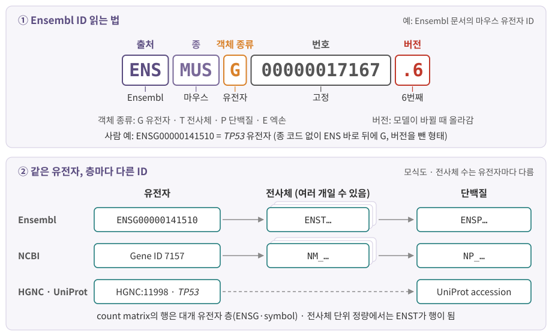

::: {.callout-note collapse="true"}
## 참고 자료
- 공식 규칙: HGNC 사람 유전자 명명 지침(Bruford 2020), MGI 마우스·쥐 명명 지침, HGVS 변이 표기 권고(varnomen.hgvs.org) — 본문 배지에서 연결
- 기호와 ID는 2026년 10월에 확인한 값. 기호는 바뀔 수 있으므로 쓸 때 다시 확인
- 본문의 사실은 옆의 배지가 출처
- 그림은 직접 그린 모식도
:::

# 1. 한눈에 보기

## 1) 사람과 마우스는 쓰는 법이 다르다

| 대상 | 사람 (HGNC) | 마우스 (MGI) |
|---|---|---|
| 유전자 기호 | 전부 대문자, 이탤릭: *TP53* | 첫 글자만 대문자, 이탤릭: *Trp53* |
| 단백질 | 같은 글자, 정체: TP53 | 전부 대문자, 정체: TRP53 |
| 미토콘드리아 유전자 | `MT-`로 시작: *MT-CO1*, *MT-ATP6* | `mt-`로 시작: *mt-Co1*, *mt-Atp6* |
| 공식 이름 예 | tumor protein p53 | transformation related protein 53 |

- 사람 규칙: [HGNC FAQ](https://www.genenames.org/help/faq/){.src} [Bruford 2020](https://pmc.ncbi.nlm.nih.gov/articles/PMC7494048){.src} [NCBI Gene](https://www.ncbi.nlm.nih.gov/gene/7157){.src} / 마우스 규칙: [MGI 지침](https://www.informatics.jax.org/mgihome/nomen/gene.shtml){.src} [MGI](https://www.informatics.jax.org/marker/MGI:98834){.src}
- 미토콘드리아 접두: [HGNC 2021](https://blog.genenames.org/hgnc/2021/06/25/Naming-genes-in-the-mitochondrial-genome){.src} [MGI mt-Co1](https://www.informatics.jax.org/accession/MGI:102504){.src}
- 이탤릭 = 유전자·대립유전자·RNA, 정체 = 단백질 → 같은 글자라도 무엇을 가리키는지 구분 [HGNC FAQ](https://www.genenames.org/help/faq/){.src}
  - 예: *BRAF* mRNA가 BRAF 단백질을 암호화 [HGNC FAQ](https://www.genenames.org/help/faq/){.src}
  - 저널 편집 방침 때문에 이 구분을 못 쓰는 경우도 있음 [HGNC FAQ](https://www.genenames.org/help/faq/){.src}
- 마우스 예외: 열성 돌연변이 대립유전자는 전부 소문자 [MGI 지침](https://www.informatics.jax.org/mgihome/nomen/gene.shtml){.src}
- 쥐(rat)는 마우스와 같은 지침을 따름 — 지침이 MGI와 RGD(쥐 유전체 DB)에 함께 게시됨 [MGI 지침](https://www.informatics.jax.org/mgihome/nomen/gene.shtml){.src}
- 그 밖의 생물(제브라피시, 초파리, 효모 등)은 각자의 명명 기관이 있음 → 필요할 때 그 기관 규칙을 확인

::: {.callout-important}
## 기호, 이름, ID는 서로 다른 것
| 구분 | 예 (사람) | 성질 |
|---|---|---|
| 기호 (symbol) | *TP53* | 짧은 약어. 사람이 읽기 좋음. **바뀔 수 있음** (3절) |
| 이름 (name) | tumor protein p53 | 풀어 쓴 이름 |
| ID (identifier) | HGNC:11998, 7157, ENSG00000141510 | 데이터베이스가 붙인 번호. 기호가 바뀌어도 같은 유전자를 가리키게 만든 것 |

- 행렬의 행을 **합치고 비교할 때는 ID**, 그림·표에 **보여 줄 때는 기호** (아래 데이터 상자)
:::

# 2. 유전자 ID

## 1) 한 유전자, 여러 번호

| ID 종류 | 사람 *TP53* | 마우스 *Trp53* | 생김새 |
|---|---|---|---|
| 명명 기관 ID (HGNC / MGI) | HGNC:11998 | MGI:98834 | 기관 이름 + 콜론 + 숫자 |
| NCBI Gene ID | 7157 | 22059 | 숫자만 |
| Ensembl gene ID | ENSG00000141510 | ENSMUSG00000059552 | `ENS`로 시작 (아래 그림) |

- 사람: [NCBI Gene](https://www.ncbi.nlm.nih.gov/gene/7157){.src} / 마우스: [NCBI Gene](https://www.ncbi.nlm.nih.gov/gene/22059){.src} [MGI](https://www.informatics.jax.org/marker/MGI:98834){.src}

- NCBI Gene ID의 옛 이름 = Entrez Gene ID → R 패키지에서는 `ENTREZID`라는 이름으로 남아 있음 ([부록 C](A3_databases.qmd))
- 세 번호는 서로 연결되어 있음: NCBI Gene 7157 기록에 HGNC:11998과 ENSG00000141510이 함께 적혀 있음 [NCBI Gene](https://www.ncbi.nlm.nih.gov/gene/7157){.src}

{fig-alt="ENSMUSG00000017167.6을 ENS, MUS, G, 번호, 버전으로 나눈 그림과, Ensembl·NCBI·HGNC/UniProt의 유전자·전사체·단백질 ID 층"}

## 2) Ensembl ID 읽기

- 구조: `ENS` + 종 코드 + 객체 종류 + 번호 + `.버전` [Ensembl](https://mart.ensembl.org/info/genome/stable_ids/){.src}
  - 종 코드: 사람은 **없음** (`ENSG…`), 마우스는 `MUS` (`ENSMUSG…`)
  - 객체 종류: `G` 유전자, `T` 전사체, `P` 단백질, `E` 엑손
  - 예: `ENSMUSG00000017167.6` = 마우스 유전자, 6번째 버전
- 버전: 그 유전자 모델이 바뀔 때 올라감. 유전자는 딸린 전사체 묶음이 바뀌면 올라감 [Ensembl](https://mart.ensembl.org/info/genome/stable_ids/){.src}
- 같은 유전자가 파일마다 버전이 붙기도, 안 붙기도 함
  - GENCODE GTF: `ENSG00000223972.5`처럼 버전이 붙음
  - 10x Cell Ranger 참조: 예전 참조 패키지와 맞추려고 버전을 떼어 냄 [10x 참조 제작](https://www.10xgenomics.com/support/software/cell-ranger/downloads/cr-ref-build-steps){.src}
  - → 두 파일을 합치기 전에 **버전 접미사를 맞춤** (아래 데이터 상자의 코드)

## 3) 전사체·단백질 ID

| 층 | Ensembl | NCBI RefSeq | 그 밖 |
|---|---|---|---|
| 유전자 | `ENSG…` | Gene ID (숫자) | HGNC ID |
| 전사체 (mRNA) | `ENST…` | `NM_…` (단백질 암호화), `NR_…` (비암호화) | |
| 단백질 | `ENSP…` | `NP_…` | UniProt accession ([부록 C](A3_databases.qmd)) |
| 유전체 서열 | | `NC_…` (염색체), `NG_…` (유전자 구간) | |

- RefSeq 접두: [GeneReviews](https://ncbi.nlm.nih.gov/books/NBK1528){.src}
- 한 유전자에 전사체가 여럿일 수 있음 → 이유는 [6장](06_rna_processing.qmd)(splicing)
- 유전자 단위 count matrix의 행 = `ENSG…`, 전사체 단위 정량의 행 = `ENST…`

# 3. 기호는 바뀐다

## 1) Excel이 유전자를 날짜로 바꾼다

| 입력 | Excel 기본 설정에서 | 지금 공식 기호 |
|---|---|---|
| SEPT2 | 2-Sep | *SEPTIN2* |
| MARCH1 | 1-Mar | *MARCHF1* |
| SEPT1 | 1-Sep | *SEPTIN1* |

- 날짜 변환 예: [Ziemann 2016](https://doi.org/10.1186/s13059-016-1044-7){.src} / 현재 기호: [HGNChelper](https://github.com/waldronlab/HGNChelper){.src}
- 문제는 2004년에 이미 보고됨 → 그래도 계속됨 [Ziemann 2016](https://doi.org/10.1186/s13059-016-1044-7){.src}
  - 2005–2015년 18개 저널의 보충 Excel 파일 35,175개 조사
  - 유전자 목록이 든 논문 3,597편 중 **704편(약 5분의 1)**에서 오류 확인
- HGNC의 대응: 2020년 지침에서 날짜로 자동 변환되는 기호를 **모두** 새 기호로 바꿈 [Bruford 2020](https://pmc.ncbi.nlm.nih.gov/articles/PMC7494048){.src}
  - *SEPT1* → *SEPTIN1*, *MARCH1* → *MARCHF1*
  - 마우스도 *Sept1* → *Septin1*, *March1* → *Marchf1* [HGNChelper](https://github.com/waldronlab/HGNChelper){.src}
- 결과: **2020년 전 논문·데이터와 이후 데이터의 기호가 다름** → 기호만으로 합치면 빠지는 유전자가 생김
- 실무
  - 유전자 목록 파일을 Excel로 열지 않음. 열어야 하면 열을 텍스트 형식으로 지정한 뒤 붙여 넣기
  - 이미 바뀐 목록은 R 패키지 HGNChelper로 날짜로 바뀐 기호·폐기된 기호·별칭을 찾아 고칠 수 있음 [HGNChelper](https://github.com/waldronlab/HGNChelper){.src}

## 2) 이전 기호와 별칭

- 승인 기호(approved symbol)는 하나지만, 이전 기호(previous symbol)와 별칭(alias)이 함께 기록됨
  - 예: 미토콘드리아 유전자의 `MT-` 없는 이름(ATP6 등)은 별칭으로 기록 [HGNC 2021](https://blog.genenames.org/hgnc/2021/06/25/Naming-genes-in-the-mitochondrial-genome){.src}
- 논문과 실험실에서는 단백질 별명이나 CD 번호를 더 많이 씀 → 승인 기호와 다름

| 흔히 보는 이름 | 승인 기호 | 메모 |
|---|---|---|
| p53 | *TP53* | 단백질 이름 |
| PD-L1 | *CD274* | 단백질 이름이 더 유명 |
| PD-1 | *PDCD1* | |
| CD20 | *MS4A1* | B세포 표지 → [부록 D](A4_immune_cells.qmd) |
| CD16 | *FCGR3A*, *FCGR3B* | **이름 하나가 유전자 둘**을 가리킴 |
| CD25 | *IL2RA*, *ISG20* | 별칭이 서로 다른 유전자에 겹침 |
| COX1 | *MT-CO1*, *PTGS1* | 미토콘드리아 유전자와 핵 유전자가 같은 별칭 |

- 출처: HGNC 기호표를 담은 R 패키지 [HGNChelper](https://github.com/waldronlab/HGNChelper){.src}
- 별칭 → 승인 기호 변환은 **일대일이 아닐 수 있음** → 결과가 둘 이상이면 사람이 판단. 변환 도구가 첫 번째 것만 조용히 고르는 경우도 있음 ([부록 C](A3_databases.qmd) 데이터 상자)

## 3) 사람 ↔ 마우스: 대소문자 바꾸기로 짝짓지 않는다

- ortholog: 서로 다른 종에서 같은 조상 유전자로부터 내려온 유전자 → 마우스 실험 결과를 사람 유전자와 비교할 때의 짝
- 많은 경우 대소문자만 다름 (*CD8A* ↔ *Cd8a*, *FOXP3* ↔ *Foxp3*) — 그러나 **항상은 아님**

| 사람 | 대소문자만 바꾸면 | ortholog 표의 마우스 유전자 | 무엇이 다른가 |
|---|---|---|---|
| *TP53* | Tp53 | *Trp53* | 기호 자체가 다름 |
| *MT-CO1* | Mt-co1 | *mt-Co1* | 접두 규칙이 다름 |
| *LYZ* | Lyz | *Lyz1*, *Lyz2* 등 | 하나 ↔ 여럿 |
| *FCGR3A* (CD16) | Fcgr3a | *Fcgr4* | 번호가 다른 유전자 |
| *HLA-A* | Hla-a | *H2-K1*, *H2-D1* 등 여러 개 | 유전자군 이름부터 다름 (HLA ↔ H2) |
| *CXCL8*, *GNLY* | Cxcl8, Gnly | 없음 | 표에 마우스 ortholog가 없음 |

- 출처: MGI·HCOP ortholog 표를 담은 [babelgene](https://cran.r-project.org/package=babelgene){.src}
- 규모 (babelgene 22.9의 MGI 표로 직접 셈)
  - 1:1 ortholog 16,985쌍 중 15,847쌍(**약 93%**)만 대소문자 변환과 일치 → 약 1,100쌍은 틀림
  - 사람 유전자 1,469개는 마우스 ortholog가 **둘 이상**
- 해결: ortholog 표로 매핑하고, 1:1이 아닌 유전자를 어떻게 처리했는지(버림, 합침) 기록

::: {.callout-warning collapse="true"}
## 처음엔 여기서 헷갈려요
| 헷갈리는 짝 | 차이 |
|---|---|
| *TP53* vs TP53 | 이탤릭 = 유전자·mRNA, 정체 = 단백질 |
| *CD274* vs PD-L1 | 같은 유전자의 공식 기호 vs 단백질 별명 |
| *TP53* vs *Trp53* | 사람 vs 마우스 ortholog. 대소문자 변환 관계가 아님 |
| `ENSG00000141510` vs `ENSG00000141510.N` | 같은 유전자, 버전 표기만 다름 → 합치기 전에 맞춤 |
| COX1 vs *MT-CO1* | 별칭은 여러 유전자에 겹칠 수 있음 (COX1 → *MT-CO1*, *PTGS1*) |
:::

## 4) 변이 표기: HGVS (아주 짧게)

- 형식: `참조 서열 accession:접두.변화` [GeneReviews](https://ncbi.nlm.nih.gov/books/NBK1528){.src}
  - 예: `NM_004006.2:c.4375C>T` → 단백질로는 `p.(Arg1459*)` (괄호 = 예측, `*` = 종결 코돈)

| 접두 | 무엇의 좌표 | 메모 |
|---|---|---|
| `g.` | 유전체 (genomic) | 참조: `NC_`, `NG_` |
| `c.` | 코딩 DNA (coding DNA) | 번역 시작 ATG의 A = 1 → 4375 ÷ 3 ≈ 1458.3 → 1459번째 아미노산 |
| `r.` | RNA | |
| `p.` | 단백질 (protein) | 아미노산 세 글자 표기 |
| `m.` | 미토콘드리아 (mitochondrial) | |

- 접두와 c. 번호 매기기: [GeneReviews](https://ncbi.nlm.nih.gov/books/NBK1528){.src}
- `A66G`처럼 쓰면 단백질 변화인지 염기 변화인지 모호 → `p.Ala66Gly`처럼 접두를 붙임 [GeneReviews](https://ncbi.nlm.nih.gov/books/NBK1528){.src}
- VCF 파일은 HGVS가 아니라 **염색체 좌표 + 참조/대체 염기**로 적음 → [4장](04_replication_mutation_inheritance.qmd)

::: {.callout-caution .data-box icon=false}
## 데이터에서는 이렇게 보여요: 행 이름은 symbol, 열쇠는 Ensembl ID

**파일로는** — Cell Ranger의 `features.tsv.gz` [10x Genomics](https://www.10xgenomics.com/support/software/cell-ranger/latest/analysis/outputs/cr-outputs-mex-matrices){.src}

| 열 | 내용 | 형식 예 |
|---|---|---|
| 1 | 유전자 ID (Ensembl, 버전 없음) | `ENSG00000141510` |
| 2 | 유전자 이름 (symbol) | `TP53` |
| 3 | feature 종류 | `Gene Expression` |

**읽어 들이면**

| 도구 | 행 이름 기본값 | 같은 symbol이 둘 이상이면 |
|---|---|---|
| Seurat `Read10X()` | 2열 symbol (`gene.column = 2`) | `unique.features = TRUE` → R의 `make.unique()`로 뒤에 `.1`, `.2` |
| scanpy `read_10x_mtx()` | `var_names='gene_symbols'` | `make_unique=True` → 뒤에 `-1`, `-2` |

- Seurat: [Read10X](https://satijalab.org/seurat/reference/read10x){.src} / scanpy: [read_10x_mtx](https://scanpy.readthedocs.io/en/stable/api/scanpy.read_10x_mtx.html){.src}
- scanpy에서 `var_names='gene_ids'`로 읽으면 행 이름이 Ensembl ID → 중복 문제가 없음
- 같은 symbol이 서로 다른 Ensembl ID에 붙는 경우가 있어서 생기는 일

```{r}
#| label: dup-and-version
sym <- c("GENE1", "GENE2", "GENE1")   # 가상의 symbol (GENE1 중복)
make.unique(sym)                      # Read10X의 행 이름 방식
sub("\\.[0-9]+$", "", "ENSG00000223972.5")   # 버전 떼기
```

- `GENE1.1`은 새 유전자가 아니라 **두 번째 GENE1** → Seurat 객체에서 끝에 `.1`이 붙은 유전자를 보면 `features.tsv.gz`에서 어느 ID인지 확인
- `sub()` 한 줄로 GENCODE 형식(`.5`)과 10x 형식(버전 없음)을 맞춤

**미토콘드리아 비율**

- Seurat 튜토리얼(사람 PBMC): `PercentageFeatureSet(pbmc, pattern = "^MT-")` [Seurat PBMC3k](https://satijalab.org/seurat/articles/pbmc3k_tutorial){.src}
- 마우스 데이터는 기호가 `mt-`로 시작 → 패턴도 `"^mt-"`. 사람 패턴을 그대로 쓰면 맞는 유전자가 없음 → 패턴에 걸린 유전자 목록부터 확인 ([1장](01_cell_system.qmd))

**분석에서의 판단**

- 데이터셋 합치기, DB와 매핑: **버전을 뗀 Ensembl ID**로 묶음
- 그림·표·논문: **symbol**로 표시
- 공개 single-cell 데이터 표준도 같은 방식: CELLxGENE 스키마는 유전자 행 이름(`var.index`)을 Ensembl ID로, symbol은 `feature_name` 열에 둠. 예전 판의 HGNC symbol 행 이름을 Ensembl ID로 바꿈 [CELLxGENE 스키마](https://github.com/chanzuckerberg/single-cell-curation/blob/main/schema/5.0.0/schema.md){.src}
- 사람–마우스 비교: ortholog 표로 매핑 (3절)
:::
