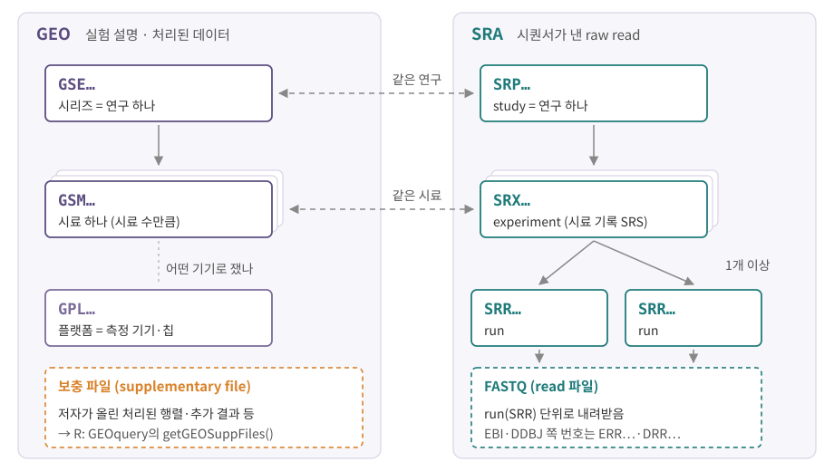

::: {.callout-note collapse="true"}
## 참고 자료
- 주소와 구성은 2026년 10월 기준. DB는 자주 개편되므로 주소가 바뀌면 이름으로 찾기
- 표의 주소는 각 DB의 공식 사이트. 설명 옆 배지가 출처
- 그림은 직접 그린 모식도
:::

# 1. 핵심 네 곳: NCBI, Ensembl, UniProt, GO

## 1) 한눈에

| DB | 무엇이 있나 | 언제 찾나 | 주소 |
|---|---|---|---|
| NCBI Gene | 유전자 요약, 위치, 다른 DB의 ID 연결 | 처음 보는 유전자가 무엇인지 | [ncbi.nlm.nih.gov/gene](https://www.ncbi.nlm.nih.gov/gene/) |
| Ensembl | 유전체 주석(유전자·전사체), stable ID, 표로 내려받기(BioMart), 변이 영향 예측(VEP) | ID 변환, 전사체 구조, 주석 판 확인 | [ensembl.org](https://www.ensembl.org) |
| UniProt | 단백질 서열, 기능, isoform, 번역 후 변형 | 단백질 수준 정보 | [uniprot.org](https://www.uniprot.org) |
| GO (Gene Ontology) | 기능 용어 사전 + 유전자별 주석 | 유전자 목록 해석, enrichment 분석 | [geneontology.org](https://geneontology.org) |

: {tbl-colwidths="[17,38,24,21]"}

- NCBI Gene: TP53 기록(Gene ID 7157)에 기능 요약과 HGNC·Ensembl·OMIM 번호가 함께 있음 [NCBI Gene](https://www.ncbi.nlm.nih.gov/gene/7157){.src}
- Ensembl 도구: [BioMart](https://www.ensembl.org/biomart/martview/){.src} [VEP](https://www.ensembl.org/info/docs/tools/vep/index.html){.src}
- UniProt 번역 후 변형: [UniProt](https://www.uniprot.org/help/post-translational_modification){.src}
- 유전자 기호·ID의 형식은 [부록 B](A2_nomenclature.qmd)

## 2) NCBI: 한 지붕 아래 여러 DB

| NCBI 안의 DB | 무엇 | 번호 예 |
|---|---|---|
| Gene | 유전자 기록 | 7157 (*TP53*) |
| RefSeq | 참조 서열: `NM_` mRNA, `NR_` 비암호화 RNA, `NP_` 단백질, `NC_` 염색체 | `NM_004006.2` |
| GEO | 기능 유전체 실험의 시료 정보와 처리된 데이터 | `GSE…` (아래 데이터 상자) |
| SRA | 시퀀서가 낸 raw read | `SRR…` (아래 데이터 상자) |
| ClinVar | 변이와 건강의 관계 | 2절 |

- RefSeq 접두와 예: [GeneReviews](https://ncbi.nlm.nih.gov/books/NBK1528){.src}
- 논문 검색(PubMed)도 같은 NCBI 안에 있음

## 3) Ensembl: 주석에는 판(release)이 있다

- 유전체 서열 위에 유전자·전사체 위치를 붙인 **주석(annotation)**을 판 번호로 냄
- 같은 GRCh38이라도 주석 판이 다르면 유전자 목록·ID가 조금씩 다름 → **어느 판을 썼는지 기록**
  - 예: 10x Cell Ranger 사람 참조 2024-A = Ensembl 109 FASTA + GENCODE v44 GTF [10x 참조 제작](https://www.10xgenomics.com/support/software/cell-ranger/downloads/cr-ref-build-steps){.src}
  - 예: CELLxGENE 제출 기준 = GENCODE v44 / Ensembl 110 [CELLxGENE 스키마](https://github.com/chanzuckerberg/single-cell-curation/blob/main/schema/5.0.0/schema.md){.src}
  - GENCODE 판과 Ensembl 판은 짝이 있음 (사람 v44 ↔ 110, 마우스 vM33 ↔ 110) [CELLxGENE 스키마](https://github.com/chanzuckerberg/single-cell-curation/blob/main/schema/5.0.0/schema.md){.src}
- ID 읽는 법(`ENSG…`, 버전 `.N`) → [부록 B](A2_nomenclature.qmd)

## 4) UniProt: reviewed와 unreviewed

| | Swiss-Prot | TrEMBL |
|---|---|---|
| 표시 | **reviewed** | **unreviewed** |
| 주석 | 큐레이터가 문헌을 읽고 정리 | 자동 주석 |
| 규모 | 상대적으로 적음 | 훨씬 많음 |
| 쓸 때 | 사람·마우스 단백질의 기능 확인은 먼저 여기 | Swiss-Prot에 없는 서열 (다른 종, 예측 단백질) |

- 둘을 합쳐 UniProtKB [UniProt](https://www.uniprot.org/){.src}
- entry 하나 = 단백질 하나, accession으로 구분 — 예: P04637 = 사람 TP53 단백질 ([부록 B](A2_nomenclature.qmd)의 *TP53*) [UniProt](https://www.uniprot.org/uniprotkb/P04637/entry){.src}
- 한 유전자에서 나오는 여러 isoform은 entry 안의 isoform 항목으로 확인 → splicing은 [6장](06_rna_processing.qmd)
- 검색 결과는 reviewed부터 보기 → 같은 유전자 이름으로 unreviewed entry가 여럿 나올 수 있음

## 5) GO: 세 분류와 증거 코드

| 분류 | 묻는 것 | 예 |
|---|---|---|
| MF (molecular function, 분자 기능) | 분자 하나가 하는 일. 이름 끝에 activity | catalytic activity, transporter activity |
| BP (biological process, 생물학적 과정) | 여러 활동이 모여 이루는 과정 | DNA repair, signal transduction |
| CC (cellular component, 세포 내 위치) | 그 일이 일어나는 장소, 복합체 | plasma membrane, mitochondrion |

- 세 분류와 예: [GO](https://geneontology.org/docs/ontology-documentation/){.src}
- GO ID = `GO:` + 7자리 숫자 (예: `GO:0005739` = mitochondrion) [GO](https://geneontology.org/docs/ontology-documentation/){.src}
- 용어는 나무가 아니라 **그래프**: 한 용어의 부모가 여럿일 수 있음 [GO](https://geneontology.org/docs/ontology-documentation/){.src}
  - 예: hexose biosynthetic process의 부모 = hexose metabolic process, monosaccharide biosynthetic process
  - → 부모 용어에도 같은 유전자가 들어가므로 enrichment 결과에 비슷한 용어가 줄줄이 나옴 ([8장](08_cell_signaling.qmd))

| 증거 코드 묶음 | 코드 | 뜻 |
|---|---|---|
| 실험 | EXP, IDA, IPI, IMP, IGI, IEP (+ 고처리량 HTP, HDA, HMP, HGI, HEP) | 실험 결과가 직접 뒷받침 |
| 계통 | IBA, IBD, IKR, IRD | 계통수의 조상·후손 기능에서 추론 |
| 계산 | ISS, ISO, ISA, ISM, IGC, RCA | 서열·구조 유사성 등 컴퓨터 분석 |
| 저자 진술 | TAS, NAS | 논문 저자의 서술 |
| 큐레이터 | IC, ND | 큐레이터 판단, 자료 없음 |
| 전자 주석 | IEA | **사람이 검토하지 않은** 자동 주석 |

- 증거 코드: [GO 증거 코드](https://geneontology.org/docs/guide-go-evidence-codes/){.src}

::: {.callout-warning collapse="true"}
## 처음엔 여기서 헷갈려요
| 헷갈리는 짝 | 차이 |
|---|---|
| GO 주석 없음 vs 기능 없음 | 주석은 연구·기록된 만큼만 있음. 없다고 기능이 없는 것은 아님 |
| 실험 증거 vs IEA | 같은 GO 주석이라도 근거가 다름 → 중요한 결론은 증거 코드까지 확인 |
| Swiss-Prot vs TrEMBL | 사람이 검토했나(reviewed) 아닌가(unreviewed) |
| GENCODE vs Ensembl | 판 번호가 짝지어진 같은 계열의 주석 (사람 v44 ↔ Ensembl 110) |
:::

# 2. 그 밖에 자주 쓰는 곳

| DB | 무엇이 있나 | 언제 찾나 | 주소 |
|---|---|---|---|
| UCSC Genome Browser | 유전체의 원하는 구간을 여러 주석 트랙과 함께 그려 줌. 내 트랙(custom track)을 올려 겹쳐 볼 수 있음 | peak·변이 주변에 무엇이 있나 | [genome.ucsc.edu](https://genome.ucsc.edu) |
| KEGG | pathway 지도 | pathway 분석 결과 해석 → [8장](08_cell_signaling.qmd) | [kegg.jp](https://www.kegg.jp) |
| Reactome | pathway 데이터베이스 | 위와 같음 → [8장](08_cell_signaling.qmd) | [reactome.org](https://reactome.org) |
| MSigDB | gene set 모음 (GSEA용) | gene set 분석 → [8장](08_cell_signaling.qmd) | [gsea-msigdb.org](https://www.gsea-msigdb.org/gsea/msigdb/) |
| GTEx | 사람 여러 조직의 RNA-seq과 유전 변이가 발현에 미치는 영향(eQTL) | 정상 조직에서의 발현, eQTL | [gtexportal.org](https://gtexportal.org/home/) |
| Human Protein Atlas | 조직·세포에서의 단백질·RNA 발현 | 이 단백질은 어디에 있나 | [proteinatlas.org](https://www.proteinatlas.org) |
| gnomAD | 여러 연구의 exome·genome을 모아 다시 처리한 변이 빈도 | 이 변이는 얼마나 흔한가 | [gnomad.broadinstitute.org](https://gnomad.broadinstitute.org) |
| ClinVar | 변이와 건강(질병)의 관계에 대한 제출 기록 | 이 변이가 질병과 관련 있나 | [ncbi.nlm.nih.gov/clinvar](https://www.ncbi.nlm.nih.gov/clinvar/) |
| GEO | 기능 유전체 실험의 시료 정보, 처리된 데이터 | 논문의 원자료 | [ncbi.nlm.nih.gov/geo](https://www.ncbi.nlm.nih.gov/geo/) |
| SRA | 시퀀서가 낸 raw read | FASTQ부터 다시 분석 | [ncbi.nlm.nih.gov/sra](https://www.ncbi.nlm.nih.gov/sra) |
| CELLxGENE Discover | 공개 single-cell 데이터 모음. Census로 Python·R에서 직접 조회 | 이 유전자는 어느 세포에서 발현되나, reference 데이터 | [cellxgene.cziscience.com](https://cellxgene.cziscience.com) |
| Human Cell Atlas | 인체 세포 지도 프로젝트의 데이터 포털 | 조직별 single-cell 데이터 | [data.humancellatlas.org](https://data.humancellatlas.org/) |

: {tbl-colwidths="[17,38,24,21]"}

- UCSC: [UCSC 도움말](https://genome.ucsc.edu/goldenPath/help/hgTracksHelp.html){.src} / MSigDB를 R 표로 받는 패키지(사람 외 여러 종, symbol·Entrez·Ensembl ID): [msigdbr](https://cran.r-project.org/package=msigdbr){.src}
- GTEx: [GTEx 2020](https://science.sciencemag.org/content/369/6509/1318){.src} / gnomAD: [gnomAD 소개](https://gnomad.broadinstitute.org/about){.src} / ClinVar: [ClinVar](https://github.com/ncbi/clinvar){.src}
- GEO: [GEOquery](https://bioconductor.org/packages/GEOquery/){.src} / SRA: [ffq 2022](https://doi.org/10.1101/2022.05.18.492548){.src} / CELLxGENE: [Census](https://github.com/chanzuckerberg/cellxgene-census){.src}
- gnomAD는 소아 질환으로 모집한 코호트를 뺐지만, 바이오뱅크 등에는 질환이 있는 사람도 섞일 수 있음 → "gnomAD에 있음 = 무해함"은 아님 [gnomAD 소개](https://gnomad.broadinstitute.org/about){.src}

# 3. 질문 → 어디서 찾나

| 질문 | 먼저 볼 곳 | 함께 볼 곳 |
|---|---|---|
| 이 유전자는 무슨 일을 하나? | NCBI Gene 요약 | UniProt 기능, GO 주석 |
| 이 유전자의 공식 기호는? 옛 이름은? | HGNC(사람) / MGI(마우스) | [부록 B](A2_nomenclature.qmd) |
| 이 Ensembl ID는 어느 유전자인가? ID를 바꾸려면? | Ensembl / BioMart | biomaRt, org.Hs.eg.db (아래 데이터 상자) |
| 이 유전자의 전사체는 몇 개, 구조는? | Ensembl | UCSC Genome Browser |
| 이 단백질의 서열·도메인·변형은? | UniProt (reviewed entry) | 단백질 family·signature 모음 InterPro |
| 이 변이는 얼마나 흔한가? | gnomAD | |
| 이 변이가 질병과 관련 있나? | ClinVar | 표기법은 [부록 B](A2_nomenclature.qmd)의 HGVS |
| 이 peak·변이 주변에 무엇이 있나? | UCSC Genome Browser | Ensembl |
| 이 유전자는 어느 조직에서 발현되나? | GTEx (RNA) | Human Protein Atlas (단백질) |
| 이 유전자는 어느 세포 종류에서 발현되나? | CELLxGENE Discover | Human Cell Atlas, [부록 D](A4_immune_cells.qmd) |
| 내 유전자 목록은 어떤 기능·pathway에 몰리나? | GO | KEGG, Reactome, MSigDB → [8장](08_cell_signaling.qmd) |
| 이 마우스 유전자의 사람 ortholog는? | MGI ortholog 표 | [부록 B](A2_nomenclature.qmd) |
| 이 논문의 원자료는? | 논문의 Data availability → GEO | SRA (아래 데이터 상자) |

- InterPro: 서로 닮은 단백질 무리의 서열 특징(signature)에 GO 용어를 연결해 자동 주석의 바탕이 됨 [GO 증거 코드](https://geneontology.org/docs/guide-go-evidence-codes/){.src}

::: {.callout-caution .data-box icon=false collapse="true"}
## 데이터에서는 이렇게 보여요: 논문의 원자료는 GSE에서 SRR까지 따라간다

{fig-alt="왼쪽 GEO의 GSE, GSM, GPL, 보충 파일과 오른쪽 SRA의 SRP, SRX, SRR, FASTQ가 연구와 시료 단위로 이어진 그림"}

| 번호 | 단위 | 어디 |
|---|---|---|
| GSE | 시리즈 = 관련 시료를 묶은 연구 하나 | GEO |
| GSM | 시료 하나의 측정 | GEO |
| GPL | 플랫폼 (기기·칩·탐침 설명) | GEO |
| GDS | GEO 직원이 정리한 비교 가능한 데이터셋 (요즘은 드묾) | GEO |
| SRP · SRS · SRX · SRR | study · sample · experiment · run | SRA |
| ERP · ERS · ERX · ERR / DRP · DRS · DRX · DRR | 같은 단위의 EBI·DDBJ 번호 | ENA, DDBJ |

- GEO 단위: [GEOquery](https://bioconductor.org/packages/GEOquery/){.src} / SRA 단위와 GEO 연결: [ffq 2022](https://doi.org/10.1101/2022.05.18.492548){.src}

**따라가는 순서**

1. 논문 Data availability에서 `GSE…` 번호 찾기
2. GSE 안의 `GSM…` 목록 = 시료 목록 (조건·반복 정보는 GSM 설명에)
3. 처리된 행렬이 필요하면 GEO **보충 파일** — 저자가 올린 행렬·추가 결과 등
4. raw read가 필요하면 GSM에 연결된 `SRX…` → `SRR…` → FASTQ

| 할 일 | 도구 | 함수·명령 |
|---|---|---|
| GSE 메타데이터·행렬 읽기 | GEOquery (R) | `getGEO("GSE…")` |
| 보충 파일 목록·내려받기 | GEOquery (R) | `getGEOSuppFiles("GSE…")` |
| GSE·GSM ↔ SRP·SRX·SRR 변환 | pysradb, ffq (명령줄) | `pysradb gsm-to-srr`, `ffq GSE…` |

- 함수 이름: [GEOquery](https://bioconductor.org/packages/GEOquery/){.src} [ffq 2022](https://doi.org/10.1101/2022.05.18.492548){.src} [pysradb](https://github.com/saketkc/pysradb){.src}
- 사람·마우스 RNA-seq 일부는 NCBI가 SRA read를 HISAT2·featureCounts로 같은 방식으로 다시 센 count도 제공 → GEOquery `getRNASeqData()` [GEOquery](https://bioconductor.org/packages/GEOquery/){.src}

**판단**

- 저자가 올린 행렬 = 저자의 참조·주석 판, 필터를 거친 결과 → 어떤 참조로 만들었는지(1절 3)) 확인
- 여러 데이터셋을 같은 기준으로 비교해야 하면 SRR부터 같은 파이프라인으로 다시 처리
- 한 시료에 run이 여럿이면(SRX 하나에 SRR 여러 개) 보통 합쳐서 한 시료로 다룸 → 시료 수를 SRR 수로 세지 않기
:::

::: {.callout-caution .data-box icon=false collapse="true"}
## 데이터에서는 이렇게 보여요: ID 변환은 일대일이 아니다

| 도구 | 방식 | 핵심 함수·이름 | 주의 |
|---|---|---|---|
| biomaRt | Ensembl BioMart에 질의 (인터넷 필요) | `useEnsembl(biomart = "genes", dataset = "hsapiens_gene_ensembl")` 다음 `getBM(attributes, filters, values)` | `version = 110`처럼 Ensembl 판을 고정할 수 있음 |
| org.Hs.eg.db + AnnotationDbi | 설치한 패키지 안의 표 (NCBI Gene ID 중심) | `mapIds(org.Hs.eg.db, keys, column = "SYMBOL", keytype = "ENSEMBL")` | `multiVals` 기본값 = `"first"` |

- biomaRt 속성 이름 예: `ensembl_gene_id`, `hgnc_symbol`, `entrezgene_id` [biomaRt 비네트](https://github.com/grimbough/biomaRt/blob/devel/vignettes/accessing_ensembl.Rmd){.src}
- org.Hs.eg.db의 keytype 예: `ENSEMBL`, `SYMBOL`, `ENTREZID` [AnnotationDbi](https://github.com/Bioconductor/AnnotationDbi/blob/devel/R/methods-geneCentricDbs.R){.src}
- `multiVals = "first"`: 하나의 key가 여러 값에 대응하면 **첫 번째만** 돌려줌. `"list"`, `"asNA"`, `"filter"`로 바꿀 수 있음 [AnnotationDbi](https://github.com/Bioconductor/AnnotationDbi/blob/devel/man/AnnotationDb-class.Rd){.src}
  - 예: 별칭 CD16은 *FCGR3A*와 *FCGR3B* 둘 → `"first"`면 하나가 조용히 사라짐 ([부록 B](A2_nomenclature.qmd))

**판단**

- 변환 전후 **개수를 셈**: 몇 개가 `NA`(대응 없음), 몇 개가 둘 이상에 걸리는지
- 두 도구의 결과가 다를 수 있음 (판과 출처가 다름) → 한 분석 안에서는 한 도구, 한 판으로 통일하고 판 번호를 기록
- 가능하면 처음부터 Ensembl ID로 분석하고 마지막에 symbol을 붙임 ([부록 B](A2_nomenclature.qmd) 데이터 상자)
:::
